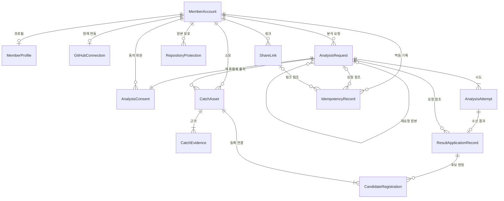
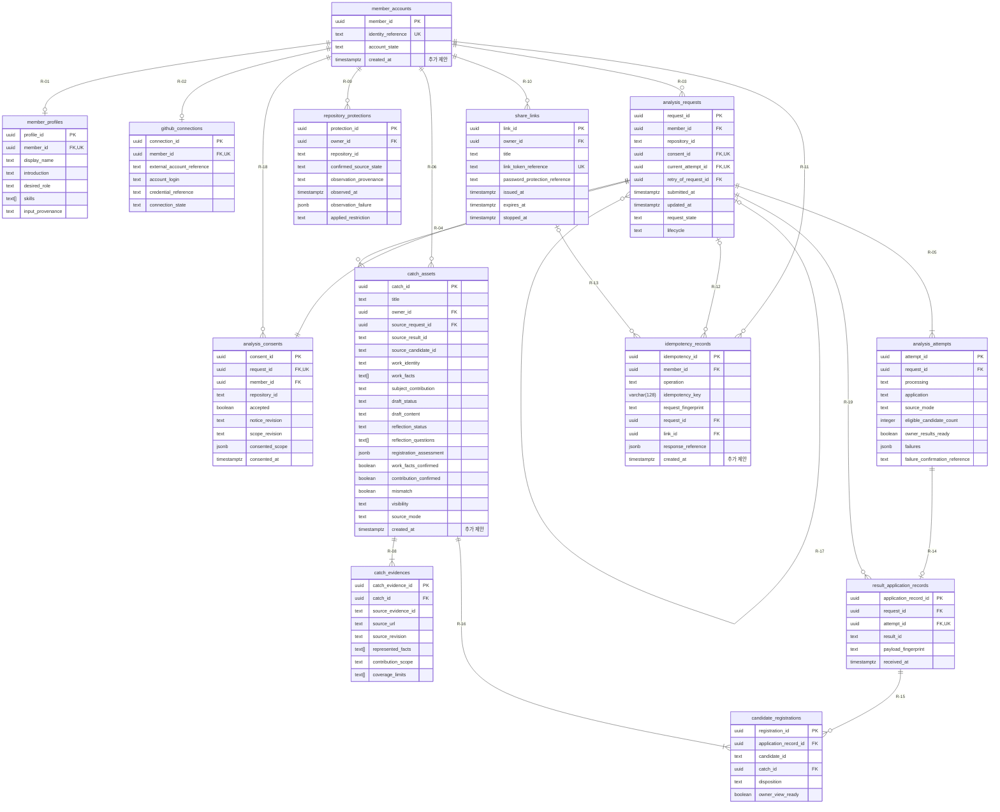
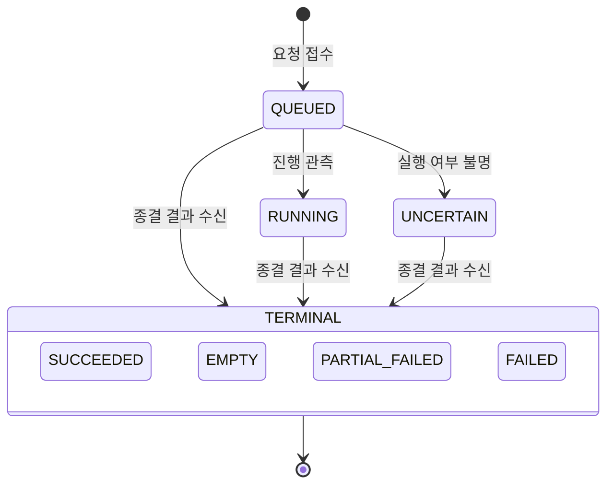
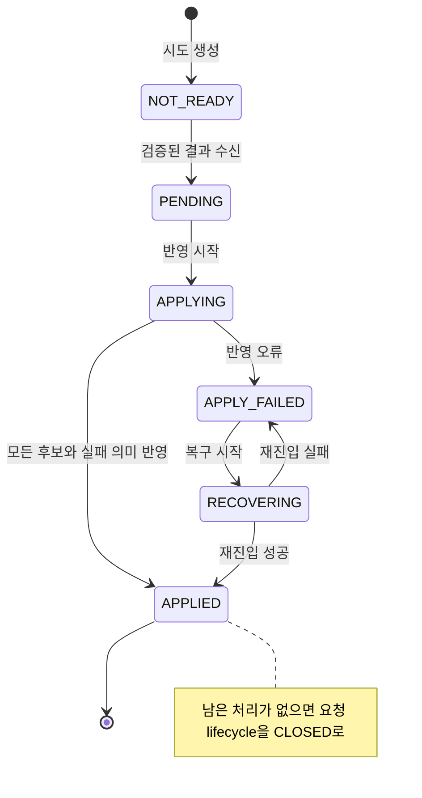
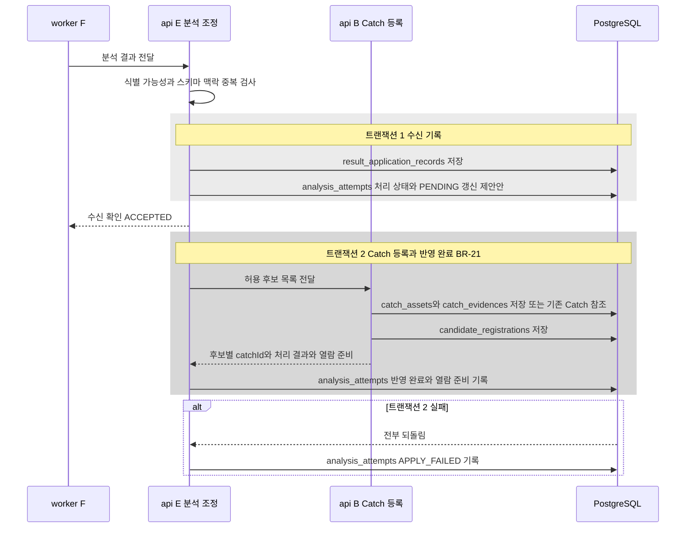
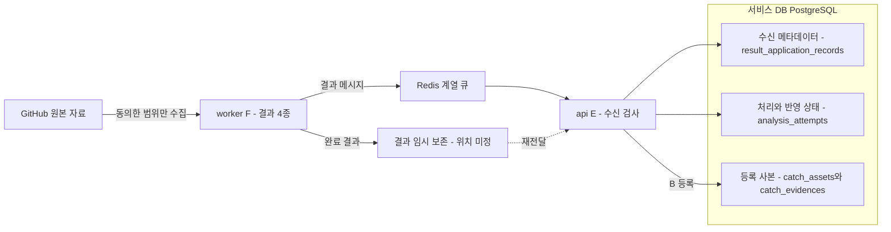

# 데이터베이스 요구사항 분석서 — 10월 MVP

| 항목 | 내용 |
|---|---|
| 팀명 | Jaemin_AI |
| 과제명 | 이력서-채용공고 텍스트 매칭 시스템 |
| 서비스명 | CatchU(캐치유) |
| 문서 버전 | v1.0 |
| 작성일 | 2026-09-28 |
| 기준 | origin/dev 9093d2e |
| 문서 지위 | 논리 모델(엔티티·속성·필수 여부·enum·관계·유일성)은 **승인**(api ERD v1, 2026-09-23 승인, 2026-09-24 팀장 결정 반영, PR #89 병합). 테이블명·컬럼명·PostgreSQL 데이터 타입·인덱스·삭제 시 동작·추가 CHECK는 **제안안**(물리 스키마는 #86·#104·#105에서 확정 전) |

## 변경 이력

| 버전 | 일자 | 내용 | 작성 |
|---|---|---|---|
| v1.0 | 2026-09-28 | 최초 작성. ERD v1 13개 엔티티의 데이터 요구사항·객체 정의·테이블 설계(제안안)·관계·정규화·무결성·보존·볼륨 가정·서비스 DB 경계 정리. 같은 날 문서 간 정합성 점검으로 요구사항–테이블–화면 대응의 화면 칸을 07 화면 설계서와 맞추고 작성 메모를 본문(2.1·5.1·11절)으로 옮김 | 팀장(AI 작성 보조) |

## 1. 개요

### 1.1 목적

10월 MVP의 서비스 데이터베이스가 담아야 할 데이터와 규칙을 요구사항에서부터 테이블 수준까지 한 문서로 정리한다. 승인된 논리 모델(api ERD v1)을 그대로 옮기고, 그 위에 PostgreSQL 물리 설계안(컬럼 타입·키·제약·인덱스)을 **제안안**으로 덧붙여 공통 DB 기반(#86)과 선행 테이블(#104·#105) 작업의 입력으로 쓴다.

한눈에 보기:

- 데이터 요구사항 23개(DR-01~DR-23)를 10월 기능 요구사항 19개 전부와 연결했다(2절).
- 서비스 DB는 테이블 13개(업무 10·기술 기록 3), 관계 19개(ERD v1 관계 16 + 관계 목록 밖 FK 3)다(3~5절).
- 회원당 진행 중 분석 1개, 회원별 같은 작업 Catch 1개, 유효 링크 5개·30일 만료, 생성 요청 멱등 처리, 결과 등록과 반영 완료의 한 트랜잭션을 DB 제약·트랜잭션으로 어떻게 지키는지 7절에 적었다.
- worker 분석 결과 원문, GitHub 원본, 토큰·비밀번호 원문은 서비스 DB에 두지 않는다(8·10절).

### 1.2 범위

- **대상:** api(NestJS)가 소유하는 서비스 DB 하나. ERD v1의 업무 엔티티 10개와 멱등·반영 연결용 기술 기록 3개, 모두 13개다.
- **사용자:** 10월 사용자는 구직자(로그인 회원)와 링크 수신자(비로그인)다. 링크 수신자는 계정이 없으므로 수신자 행을 저장하지 않는다. 링크 열람 기록도 두지 않는다(DEF-01, 12월 보류 항목).
- **범위 밖:** worker의 분석 결과 논리 모델 4개(서비스 DB 밖, 10절), Redis 계열 큐, 결과 임시 보존소, 12월 기능의 엔티티(06 문서, 미승인 계획).
- **용어:** Catch는 구직자의 GitHub 기록에서 확인한 작업 하나를 작업 사실·본인 기여·근거·설명 초안으로 정리한 자산이다. 엔티티명은 ERD v1 이름을 그대로 쓰고 테이블명은 공통 ID 대응표(`id-registry.md`)의 제안(snake_case 복수형)을 쓴다.

### 1.3 DBMS와 기술 기준

| 항목 | 기준 | 지위 |
|---|---|---|
| DBMS | PostgreSQL | 팀장 결정(작업관리 §7 코딩 운영) |
| ORM·스키마 변경 | TypeORM. 자동 동기화(`synchronize`)를 끄고 마이그레이션으로만 변경 | TypeORM은 팀장 결정(§7). `synchronize` 끄기·마이그레이션 전용은 #86의 범위(열림, 미구현) |
| Redis | 큐 용도. 영속 정본이 아니며 Redis만의 유실 가능한 락·키를 중복 방지 정본으로 삼지 않음 | 팀장 결정(§7), 승인(ERD v1 「물리 스키마 전환 제약」) |
| 큐 라이브러리 | BullMQ는 #77 검증 전 연결하지 않음 | 팀장 결정(§7) |
| DB 운영 | NCP 관리형 우선, MVP 단일 구성 | 검토초안(공통 아키텍처 §5) |
| PostgreSQL 주 버전 | NCP 관리형 DB 버전에 맞춤 | **미정**(#86 미결) |
| DB 접근 주체 | api만 접근. web·worker는 서비스 DB에 직접 접근하지 않음 | worker 직접 접근 금지는 승인(ADR-001), web 직접 접근 없음은 검토초안(공통 아키텍처 §4) |

### 1.4 문서 지위 구분

이 문서에서 '승인'은 팀이 쓰는 AI 개발 절차(AI-DLC)의 설계 단계 검토를 팀장이 통과시킨 산출물이라는 뜻이다. ERD v1은 api 기능 설계 단계에서 2026-09-23에 이 검토를 마쳤고, 9/24 팀장 결정을 반영한 판본이 PR #89로 dev에 병합됐다(2026-09-24). '팀장 결정'은 승인 뒤 입력 문서에 기록된 결정, '제안안'은 이 문서가 새로 제안하는 것, '미정'은 정할 곳이 남은 것이다.

| 내용 | 지위 | 근거 |
|---|---|---|
| 엔티티 13개, 속성·필수 여부·enum·기본값, 관계 16개, 복합 유일성, 물리 전환 제약 | 승인 | `construction/u2-api/functional-design/entities.md` |
| Catch `title` 추가, 공개 상태 두 가지(PRIVATE·PUBLIC), `repositoryId` 응답 필드·필터(칼럼 없음), 등록·반영 한 트랜잭션 | 팀장 결정(2026-09-24, PR #89·#97, #64) | 후속 입력 「B 계약 확인」. ERD v1에 이미 반영 |
| 테이블명·컬럼명·데이터 타입·인덱스·CHECK·삭제 시 동작·보조 컬럼 3개 | 제안안 | 이 문서. 확정은 #86(물리 규약)·#104·#105 |
| ID 형식, cascade·보관 기한, 선정 저장소 목록의 저장 위치 등 | 미정 | 11절 |

### 1.5 현재 구현 상태(2026-09-28)

- 기준 커밋의 api에는 DB 연결 코드가 없다. 구현된 것은 `GET /health`와 인증 기반(PR #110, 2026-09-27 병합: Access JWT 검증과 개발용 로그인)뿐이며, api README도 "DB·큐·worker 설정은 필요하지 않다"고 적는다.
- DB 관련 공통 이슈는 모두 열려 있다(2026-09-28 조회): #86 DB 연결·마이그레이션 기반(작성 이재민), #104 A·E 선행 테이블과 멱등 처리(작성 이영연), #105 E↔B 등록 연결(작성 이채아, 공동 확인 이영연).
- 따라서 4절의 테이블 설계는 구현 결과가 아니라 구현 기준 제안이다.

## 2. 데이터 요구사항 목록

### 2.1 데이터 요구사항

DR ID의 규칙은 공통 ID 대응표 1.1절(10월 DR-01부터)을 따르고, 목록은 이 절이 정본이다. FR·BR·NFR ID는 공통 ID 대응표 기준이다.

| DR ID | 데이터 요구 내용 | 관련 FR | 관련 BR·NFR | 대응 테이블 | 지위 |
|---|---|---|---|---|---|
| DR-01 | 서비스 회원을 인증 주체(현재 Google)와 1:1로 식별하고 모든 본인 소유 판정의 기준 키로 쓴다. 요청 본문의 회원 ID를 소유권으로 쓰지 않는다 | FR-MEM-01 | BR-01, NFR-SEC-01 | member_accounts | 승인 |
| DR-02 | 회원마다 기본 프로필 1개(표시 이름·한 줄 소개·직무·기술 스택)를 두고, 직무·기술 스택은 자가 입력 출처로 표시한다. 빈 값은 빈 문자열·빈 목록이다. 공개 프로필은 따로 저장하지 않고 열람 시점의 현재 값으로 투영한다 | FR-MEM-03, FR-LNK-02 | BR-01, BR-23 | member_profiles | 승인(투영 기준은 팀장 결정 9/20) |
| DR-03 | 회원마다 현재 GitHub 연동 1개(연결됨·해제됨·재인증 필요)와 GitHub 로그인 이름·외부 계정 참조를 두되, 토큰 원문은 저장하지 않고 자격정보 참조만 둔다. 행이 없으면 해제됨으로 본다 | FR-MEM-02 | BR-01, BR-24, NFR-PRV-02 | github_connections | 승인 |
| DR-04 | 분석 요청은 선정 저장소 하나를 대상으로 접수·갱신 시각과 진행 여부(ACTIVE·CLOSED)를 가진다. 회원당 진행 중 요청은 1개이며, 같은 저장소면 기존 요청을 돌려주고 다른 저장소면 거부한다 | FR-ANL-01, FR-ANL-02 | BR-03, NFR-REL-01 | analysis_requests | 승인 |
| DR-05 | 요청마다 새 분석 동의 1건을 요청과 같은 트랜잭션에 저장하고 고지 판본·범위 판본·허용 범위를 접수 시점 값으로 고정한다. 동의를 다른 요청에 재사용하거나 바꾸지 않는다 | FR-ANL-01 | BR-02, NFR-PRV-01 | analysis_consents | 승인 |
| DR-06 | 분석 시도는 처리 상태(processing)와 서비스 반영 상태(application)를 따로 저장하고 적합 후보 수, 실패 목록(원문·비밀값 제외), 확정 실패 근거, 합성·실제 구분(MOCK·LIVE)을 가진다 | FR-ANL-02, FR-GEN-01 | BR-05, BR-06, BR-15, BR-18 | analysis_attempts | 승인 |
| DR-07 | 유효 결과 없는 확정 실패만 새 동의로 재요청할 수 있고, 새 요청은 본인·같은 저장소의 원 요청을 가리킨다 | FR-ANL-02 | BR-04 | analysis_requests | 승인 |
| DR-08 | 검증한 종결 결과는 시도당 1건의 수신 메타데이터(결과 ID·본문 지문·수신 시각)로만 남기고 worker 결과 원문은 저장하지 않는다 | FR-ANL-02 | BR-05, BR-20 | result_application_records | 승인 |
| DR-09 | 후보마다 새 Catch를 만들었는지(CREATED) 기존 같은 작업의 Catch를 참조했는지(EXISTING)와 본인 열람 준비 여부를 남겨, 재전달·반영 복구 때 같은 catchId를 돌려준다. 등록 Catch 목록은 이 기록에서 유도한다 | FR-ANL-02, FR-CAT-01 | BR-07, BR-21 | candidate_registrations | 승인 |
| DR-10 | Catch는 제목, 작업 사실(1개 이상), 본인 기여, 설명 초안(상태·본문), 최소 생각해볼 질문(상태·목록), 등록 판정, 확인 두 값, 불일치 표시, 공개 상태, 출처(요청·결과·후보), MOCK·LIVE를 가진다. 최초 공개 상태는 미공개다 | FR-GEN-01, FR-GEN-02, FR-GEN-03, FR-CAT-01, FR-CAT-02 | BR-08, BR-09, BR-17, BR-22 | catch_assets | 승인(제목은 팀장 결정 9/24) |
| DR-11 | 초안은 '생성됨'일 때만 본문이 있고 실패·미생성이면 본문이 없다. 초안 실패는 등록을 막지 않는다. 최소 질문은 본인에게만 제공하며 답변을 저장하지 않는다 | FR-GEN-01, FR-GEN-02 | BR-08, BR-19 | catch_assets | 승인 |
| DR-12 | Catch마다 근거 1개 이상을 사본으로 저장한다(출처 URL·리비전·표현 사실·기여 범위·누락/잘림 한계). 등록 뒤에는 worker 임시 자료에 의존하지 않는다. 다른 Catch와 근거 일부가 겹쳐도 된다 | FR-GEN-01, FR-CAT-01, FR-LNK-02 | BR-07, BR-17 | catch_evidences | 승인 |
| DR-13 | 한 회원 안에서 같은 작업(workIdentity)은 Catch 1개만 둔다. 제목·표현만 바꾼 후보를 새 Catch로 만들지 않는다 | FR-ANL-02, FR-CAT-01 | BR-07, NFR-REL-01 | catch_assets | 승인(판별 함수는 OQ-F2 미정) |
| DR-14 | 본인 Catch 목록을 저장소로 거를 수 있어야 한다. 저장소는 원 분석 요청에서 유도하며 Catch에 칼럼을 추가하지 않는다 | FR-CAT-03 | — | catch_assets, analysis_requests | 팀장 결정(9/24) |
| DR-15 | 회원·저장소마다 확인된 원본 비공개 여부를 저장하고, 확인 증거 없이 조회 오류만으로 설정·해제하지 않는다. 비공개가 확인되면 관련 Catch를 수신자 열람에서 뺀다 | FR-ANL-03, FR-LNK-03 | BR-10 | repository_protections | 승인 |
| DR-16 | 공유 링크는 제목(앞뒤 공백 제거, 수신자 비노출), URL 조회 키, 선택 비밀번호 검증값, 발행·만료(발행 후 30×24시간 고정)·중단 시각을 가진다. 상태(유효·중단·만료)는 저장하지 않고 시각으로 계산한다 | FR-LNK-01, FR-LNK-04, FR-LNK-05, FR-LNK-06, FR-LNK-07 | BR-12, BR-13 | share_links | 승인 |
| DR-17 | 한 회원의 유효 링크는 최대 5개이고 유효 링크끼리 제목이 같을 수 없다. 판정과 생성은 회원 단위로 한 번에 처리하며 중단·만료 링크는 세지 않는다 | FR-LNK-04, FR-LNK-07 | BR-12 | share_links | 승인 |
| DR-18 | 링크는 특정 Catch와 연결하지 않는다. 매 요청 소유자의 현재 공개·보호 제한 없는 Catch 전체와 현재 프로필을 조합하며 링크별 사본을 두지 않는다 | FR-LNK-02, FR-LNK-03, FR-LNK-04 | BR-11, BR-23, NFR-SEC-01 | 저장 없음(share_links·catch_assets·repository_protections·member_profiles 조회) | 승인 |
| DR-19 | 생성 요청(분석 요청·링크 발행)은 회원·작업 종류·Idempotency-Key로 한 번만 처리한다. 같은 키·같은 본문은 기존 응답, 다른 본문은 거부한다. 키 예약·자원 생성·응답 연결은 원자적이다 | FR-ANL-01, FR-LNK-01, FR-LNK-04 | BR-14, NFR-REL-01 | idempotency_records | 승인 |
| DR-20 | 분석 결과의 Catch 등록(Catch·근거·등록 연결)과 반영 완료 기록을 한 트랜잭션으로 저장하고 수신 기록은 그 전에 따로 저장한다. 실패하면 등록 쪽 변경은 모두 되돌린다 | FR-ANL-02, FR-CAT-01 | BR-21, NFR-REL-01 | catch_assets, catch_evidences, candidate_registrations, analysis_attempts | 팀장 결정(9/24) |
| DR-21 | 모든 시각은 시간대가 있는 서버 시각으로 저장하고, 만료 판정은 저장된 파생 플래그가 아니라 현재 시각과 비교한다 | FR-LNK-07, FR-ANL-02 | BR-12, BR-13 | 전 테이블 | 승인 |
| DR-22 | 토큰·비밀번호 원문, worker 결과 원문, GitHub 원문(diff 등)을 서비스 DB에 저장하지 않는다. 실패·오류 기록에도 원문·비밀값을 넣지 않는다 | FR-MEM-02, FR-LNK-06, FR-ANL-02 | NFR-PRV-01, NFR-PRV-02, NFR-OBS-01 | github_connections, share_links, analysis_attempts, result_application_records | 승인 |
| DR-23 | 분석 실패·재전달·재시작·재배포에도 기존 Catch·공개 상태·링크가 사라지지 않아야 하며, 참조가 끊기는 삭제를 제공하지 않는다 | FR-ANL-02, FR-LNK-05, FR-CAT-02 | NFR-REL-01 | 전 테이블 | 승인(보관 기한·cascade는 미정) |

### 2.2 요구사항–테이블–화면 대응

10월 FR 19개가 어느 테이블을 만들고(C) 읽고(R) 바꾸는지(U) 정리했다. 10월 계약에는 행을 지우는 API가 없다(member-api·recipient-api에 DELETE 없음). 화면 ID는 공통 ID 대응표 8.1절 기준이며, 관련 화면 칸은 07 화면 설계서 2.3절의 기능 요구사항–화면 대응과 같다.

| FR ID | 요구사항명 | 생성(C) | 조회(R) | 변경(U) | 관련 화면 |
|---|---|---|---|---|---|
| FR-MEM-01 | 기본 로그인과 본인 홈 진입 | member_accounts, member_profiles(최초 로그인 때, 방식은 OQ-A1·#104) | member_accounts, github_connections, analysis_requests(홈은 연동 여부와 연결된 저장소 유무만, BR-24) | — | SCR_COMMON_01, SCR_AUTH_01, SCR_AUTH_02, SCR_PROF_02, SCR_HOME_01, SCR_HOME_02 |
| FR-MEM-02 | GitHub 연동 상태 확인 | github_connections | github_connections | github_connections.connection_state·credential_reference | SCR_PROF_04, SCR_HOME_02, SCR_ASSET_01, SCR_ASSET_03 |
| FR-MEM-03 | 기본 프로필 관리와 공개 프로필 투영 | — | member_profiles, github_connections.account_login(공개 노출 여부 OQ-A2) | member_profiles | SCR_AUTH_02, SCR_PROF_01, SCR_PROF_02, SCR_PROF_03, SCR_VIEW_02 |
| FR-ANL-01 | 저장소 선택·동의·요청 | analysis_requests, analysis_consents, analysis_attempts, idempotency_records | github_connections, 선정 저장소 목록(저장 위치 미정, OQ1) | — | SCR_ASSET_03 |
| FR-ANL-02 | 진행·실패·재요청·중복 방지·자료 보존 | result_application_records, candidate_registrations, analysis_requests(재요청) | analysis_requests, analysis_attempts, candidate_registrations | analysis_attempts.processing·application, analysis_requests.lifecycle·updated_at | SCR_ASSET_03 |
| FR-ANL-03 | 원본 비공개 확인 시 보호 | repository_protections | catch_assets, analysis_requests.repository_id | repository_protections.applied_restriction | SCR_ASSET_04, SCR_VIEW_03 |
| FR-GEN-01 | 경험 후보·근거·최소 질문 | catch_assets(work_facts·subject_contribution·reflection_*), catch_evidences | catch_assets, catch_evidences | — | SCR_ASSET_04, SCR_VIEW_03 |
| FR-GEN-02 | 근거 연결 설명 초안 | catch_assets.draft_status·draft_content | catch_assets | — | SCR_ASSET_04, SCR_VIEW_03 |
| FR-GEN-03 | Catch 제목 | catch_assets.title | catch_assets.title | —(구직자 수정 불가) | SCR_ASSET_01, SCR_ASSET_04, SCR_VIEW_02, SCR_VIEW_03 |
| FR-CAT-01 | 본인 Catch 목록·상세·확인·불일치 | — | catch_assets, catch_evidences | catch_assets.work_facts_confirmed·contribution_confirmed·mismatch | SCR_ASSET_01, SCR_ASSET_04 |
| FR-CAT-02 | 확인과 공개 분리, 공개·숨기기 | — | catch_assets, repository_protections | catch_assets.visibility | SCR_ASSET_04 |
| FR-CAT-03 | 저장소 필터 | — | catch_assets와 analysis_requests.repository_id 결합 | — | SCR_ASSET_01, SCR_ASSET_03 |
| FR-LNK-01 | 대표 없이 기본 링크 발행 | share_links, idempotency_records | share_links | — | SCR_LINK_01 |
| FR-LNK-02 | 기본 프로필·공개 자산 열람 | — | share_links, member_profiles, catch_assets, catch_evidences | — | SCR_VIEW_02, SCR_VIEW_03 |
| FR-LNK-03 | 기존 링크에 현재 공개·숨김 반영 | — | catch_assets.visibility, repository_protections | — | SCR_VIEW_02, SCR_VIEW_03, SCR_ASSET_04 |
| FR-LNK-04 | 비로그인 열람·제목·5개 제한 | share_links | share_links(토큰 조회, 유효 링크 개수·제목) | — | SCR_LINK_01, SCR_LINK_02, SCR_VIEW_01, SCR_VIEW_02, SCR_VIEW_03 |
| FR-LNK-05 | 링크 중단 | — | share_links | share_links.stopped_at | SCR_LINK_03, SCR_LINK_04, SCR_VIEW_01 |
| FR-LNK-06 | 선택 비밀번호 | share_links.password_protection_reference | share_links.password_protection_reference(grant 저장은 OQ-C1) | — | SCR_LINK_01, SCR_VIEW_01 |
| FR-LNK-07 | 30일 고정 만료 | share_links.expires_at | share_links.expires_at | — | SCR_LINK_01, SCR_LINK_02, SCR_LINK_03, SCR_VIEW_01 |

- 13개 테이블이 모두 하나 이상의 FR에 쓰이고, 19개 FR이 모두 하나 이상의 테이블을 쓴다.
- FR-MEM-03의 공개 프로필 항목: 9/20 팀장 결정은 GitHub 계정을 공개 항목에 넣지만, 계약 v1의 PublicProfile에는 그 필드가 없고 "미확인 GitHub 항목은 현재 응답에 넣지 않음"(OQ-A2)이다. DB는 github_connections.account_login을 이미 가지므로 어느 쪽으로 정해도 스키마 변경은 없다.

### 2.3 비기능 요구사항·업무규칙의 DB 반영

10월 NFR 8개가 서비스 DB에서 어떻게 다뤄지는지 정리했다. 화면·운영에서만 다루는 항목도 빠뜨리지 않고 적는다.

| NFR ID | 요구사항 | DB에서의 반영 | 이 문서 위치 |
|---|---|---|---|
| NFR-SEC-01 | 접근 통제(본인 소유·명시적 공개·매 요청 현재 권한) | 모든 본인 자료에 소유자 FK(member_id·owner_id). 공개 여부는 catch_assets.visibility와 repository_protections를 매 요청 조회하고 링크별 사본을 두지 않음 | DR-01, DR-18, 4.8, 4.10 |
| NFR-PRV-01 | 외부 AI 이용 조건(동의·최소 전송·보관/삭제) | 요청마다 동의 행(analysis_consents)과 고정된 허용 범위. 외부 AI 전송 자료 자체는 서비스 DB에 저장하지 않음 | DR-05, 4.6, 8절 |
| NFR-REL-01 | 실패 격리·중복 방지·재시작 시 자료 보존 | 진행 중 요청 부분 유일성, 멱등 기록, 등록·반영 한 트랜잭션, 참조가 끊기는 삭제 없음 | DR-19, DR-20, DR-23, 7절 |
| NFR-COS-01 | 요청별 호출·시간·출력·자원 상한 | DB 제약 대상 아님(worker·api 처리 한도). 상한 수치는 미정 | 9.1 |
| NFR-ACC-01 | 빈·로딩·실패·권한·중단·만료 안내 | DB는 안내를 가르는 상태 값만 제공(processing·application, visibility, stopped_at·expires_at, applied_restriction). 표시는 화면 설계서(07) 범위 | 7.2 |
| NFR-PRV-02 | 미공개 자료 본인 외 열람 금지·비밀값 보호 | 토큰·비밀번호 원문 미저장, 참조 값만 보관. 수신자 조회는 PUBLIC·보호 제한 없음만 | DR-22, 8절 |
| NFR-OBS-01 | 배포·영속·복구 증거, 민감 원문 진단 기록 금지 | 실패 목록·관측 실패 jsonb에 원문·비밀값 금지. 백업·복구 방식은 미정 | 4.7, 4.10, 8절 |
| NFR-PER-01 | 성능·수용량 목표(자리) | 규모 결정 없음. 가정치 계산만 | 9절(OQ14) |

업무규칙 BR-01~BR-24는 DR 표와 4·7절에 연결했다. worker 쪽 규칙 BR-16(허용 범위 안에서만 생성)은 서비스 DB에서 analysis_consents.consented_scope가 정본이며, 결과 반영 기록은 요청·동의·범위가 맞을 때만 만든다(ERD v1 ResultApplicationRecord 제약). BR-17~BR-20은 worker 결과가 등록될 때 catch_assets·analysis_attempts의 값으로 남는다.

## 3. 객체(엔티티) 정의서

### 3.1 엔티티 정의

| 엔티티명 | 한글명 | 설명 | 주요 속성 | 식별자(PK·후보키) | 관련 FR |
|---|---|---|---|---|---|
| MemberAccount | 회원 계정 | 인증된 서비스 회원과 소유권 기준 | identityReference, accountState | PK memberId 후보키 identityReference | FR-MEM-01 |
| MemberProfile | 회원 프로필 | 회원의 자가 입력 프로필 정본. 공개 프로필은 이 행을 투영 | displayName, introduction, desiredRole, skills, inputProvenance | PK profileId 후보키 memberId | FR-MEM-03, FR-LNK-02 |
| GitHubConnection | GitHub 연동 | 현재 연동 상태와 자격정보 참조. 토큰 원문 없음 | externalAccountReference, accountLogin, credentialReference, connectionState | PK connectionId 후보키 memberId | FR-MEM-02, FR-ANL-01 |
| AnalysisRequest | 분석 요청 | 새 동의로 접수된 요청. 현재 시도와 진행 잠금의 정본 | repositoryId, consentId, currentAttemptId, retryOfRequestId, submittedAt, updatedAt, requestState, lifecycle | PK requestId 후보키 consentId, currentAttemptId | FR-ANL-01, FR-ANL-02 |
| AnalysisConsent | 분석 동의 | 해당 요청에만 연결된 새 동의. 재사용하지 않음 | accepted, noticeRevision, scopeRevision, consentedScope, consentedAt | PK consentId 후보키 requestId | FR-ANL-01 |
| AnalysisAttempt | 분석 시도 | 처리 의미와 서비스 반영 상태를 분리한 기록. worker 결과 원문 저장소 아님 | processing, application, sourceMode, eligibleCandidateCount, ownerResultsReady, failures, failureConfirmationReference | PK attemptId | FR-ANL-02 |
| CatchAsset | Catch | 등록된 작업·기여·초안·최소 질문의 서비스 정본 | title, workIdentity, workFacts, subjectContribution, draftStatus, draftContent, reflectionStatus, reflectionQuestions, registrationAssessment, 확인 두 값, mismatch, visibility, sourceMode | PK catchId 후보키 (ownerId, workIdentity), (sourceRequestId, sourceResultId, sourceCandidateId) | FR-GEN-01, FR-GEN-02, FR-GEN-03, FR-CAT-01, FR-CAT-02, FR-CAT-03, FR-LNK-02 |
| CatchEvidence | Catch 근거 | 등록 Catch의 근거 사본 정본 | sourceEvidenceId, sourceUrl, sourceRevision, representedFacts, contributionScope, coverageLimits | PK catchEvidenceId 후보키 (catchId, sourceEvidenceId) | FR-GEN-01, FR-CAT-01, FR-LNK-02 |
| RepositoryProtection | 저장소 원본 보호 | 회원·저장소별 확인된 원본 보호 판단. 단순 조회 오류와 분리 | repositoryId, confirmedSourceState, observationProvenance, observedAt, observationFailure, appliedRestriction | PK protectionId 후보키 (ownerId, repositoryId) | FR-ANL-03, FR-CAT-02, FR-LNK-03 |
| ShareLink | 공유 링크 | 소유자의 현재 공개 Catch 전체를 여는 링크. Catch와 연결 없음 | title, linkTokenReference, passwordProtectionReference, issuedAt, expiresAt, stoppedAt | PK linkId 후보키 linkTokenReference | FR-LNK-01, FR-LNK-04, FR-LNK-05, FR-LNK-06, FR-LNK-07 |
| IdempotencyRecord | 멱등 기록 | 생성 POST의 영속 중복 방지. 업무 엔티티 아님 | operation, key, requestFingerprint, requestId, linkId, responseReference | PK idempotencyId 후보키 (memberId, operation, key) | FR-ANL-01, FR-LNK-01, FR-LNK-04 |
| ResultApplicationRecord | 결과 반영 기록 | 검증된 외부 결과의 수신·반영 메타데이터. 원문 없음 | resultId, payloadFingerprint, receivedAt | PK applicationRecordId 후보키 attemptId | FR-ANL-02 |
| CandidateRegistration | 후보 등록 연결 | 후보별 새 등록 또는 기존 같은 작업 참조. 재진입 키 | candidateId, catchId, disposition, ownerViewReady | PK registrationId 후보키 (applicationRecordId, candidateId) | FR-ANL-02, FR-CAT-01 |

### 3.2 소유 영역·담당·테이블 생성 작업

| 엔티티 | 구분 | 소유 영역 | 담당 | 테이블 생성 작업 |
|---|---|---|---|---|
| MemberAccount, MemberProfile, GitHubConnection | 업무 | A 회원·프로필·GitHub 연동 | 이영연 | #104 |
| AnalysisRequest, AnalysisConsent, AnalysisAttempt | 업무 | E 분석 요청·진행·반영 | 이영연 | #104 |
| IdempotencyRecord | 기술 기록 | A·E·C의 생성 작업 공용 | 이영연(`link_id` FK는 share_links 생성 때 최수영) | #104 |
| CatchAsset, CatchEvidence | 업무 | B Catch 등록·확인·공개 | 이채아 | #105 |
| ResultApplicationRecord | 기술 기록 | E | 이영연 | #105(작성자·순서는 #105에서 정함) |
| CandidateRegistration | 기술 기록 | B 판정 정본, E 결과 연결 | 이채아·이영연 | #105 |
| RepositoryProtection | 업무 | B | 이채아 | B 기능 PR(이슈 미지정) |
| ShareLink | 업무 | C 공유 링크·수신자 열람 | 최수영 | C 기능 PR(이슈 미지정) |

- DB 연결·마이그레이션 명령·물리 규약(ID·시각·enum·이름·복합/부분 유일성 표현)과 테스트 DB는 #86(이재민)이 먼저 준비한다. 기능 테이블은 각 담당이 ERD v1에 따라 기능 PR에서 마이그레이션과 함께 추가한다(#86 범위).
- 도메인 구성요소로는 A=IdentityProfile, E=AnalysisCoordinator, B=CatchRegistry, C=ShareAccess가 각 엔티티를 소유한다(승인 components.md).

## 4. 테이블 설계서

### 4.1 공통 물리 규약(제안안)

아래는 모두 **제안안**이다. #86에서 api README의 「DB 물리 규약」이 확정되면 이 표보다 그 규약을 따른다.

| 항목 | 제안 | 근거·이유 |
|---|---|---|
| 테이블명 | snake_case 복수형(예: `catch_assets`) | 공통 ID 대응표 9.1절 |
| 컬럼명 | ERD v1 속성명의 snake_case(예: `workFacts` → `work_facts`). ERD `key`만 `idempotency_key`로 바꿈 | 뜻이 드러나는 이름, 흔한 예약어 회피 |
| 내부 ID | `uuid`, 기본값 `gen_random_uuid()`. 요청·동의·첫 시도는 api가 미리 할당 | ERD v1 「요청 생성」은 세 ID를 미리 할당해 한 트랜잭션에서 연결하라고 한다. `gen_random_uuid()`는 PostgreSQL 13 이상 내장이므로 주 버전 확정 때 확인 |
| 외부 ID | `text` + `CHECK (col <> '')` | 저장소·결과·후보·근거 ID는 서비스 DB FK가 아니며 계약에 최대 길이가 없다 |
| 시각 | `timestamptz`. DB 세션과 Node 모두 UTC로 두고 화면에서 변환 | ERD v1 "시간대가 있는 서버 시각". 시간대 설정은 #86 범위 |
| enum | `text` + `CHECK (col IN (...))` | 계약 변경 때 값 추가·삭제가 마이그레이션 한 번으로 끝남 |
| 문자열 목록 | `text[]`, `NOT NULL DEFAULT '{}'`, 최소 개수는 `cardinality()` CHECK | ERD v1 "필수 목록의 빈 값은 []" |
| 구조 값 | `jsonb` + `jsonb_typeof()` CHECK. 원소 구조는 앱에서 계약 스키마로 검증 | 실패 목록·동의 범위 등은 통째로 저장·재응답 |
| FK 삭제 시 동작 | 모두 `ON DELETE NO ACTION`(참조 중인 행 삭제 거부) | ERD v1 "보류 정책 없이 참조가 끊어지는 삭제를 제공하지 않음". 지연 FK에서도 동작하도록 RESTRICT 대신 NO ACTION |
| 순환 FK | `DEFERRABLE INITIALLY DEFERRED` | ERD v1 "순환 FK는 커밋 시 참조 검사가 가능한 매핑" |
| 소유자·요청 일치 | 가능한 곳은 복합 FK로 DB가 보장 | ERD v1 "복합 참조 또는 같은 트랜잭션 검증"(둘 다 허용). TypeORM 표현이 번거로우면 마이그레이션 SQL로 추가 |
| 제약 이름 | `pk_`·`fk_`·`uq_`·`ck_`·`ix_` + 테이블 + 컬럼 | 마이그레이션 오류 메시지로 위반 규칙을 바로 찾기 위함 |

표 읽는 법: NULL 열의 '불가'는 `NOT NULL`이다. FK 열의 '복합'은 괄호 안 컬럼 묶음이 대상 테이블의 같은 묶음을 참조한다는 뜻이다. **[추가 제안]**은 ERD v1에 없는 보조 컬럼이다.

### 4.2 member_accounts — MemberAccount(회원 계정)

소유 A · 담당 이영연 · 생성 #104

| 컬럼명 | 설명(ERD 속성) | 데이터 타입 | PK | FK(참조) | NULL | 기본값 | 제약 |
|---|---|---|---|---|---|---|---|
| member_id | 회원 ID(`memberId`). 소유권 판정의 기준 | uuid | PK | — | 불가 | `gen_random_uuid()` | — |
| identity_reference | 인증 주체 식별자(`identityReference`). 인증 제공자 네임스페이스를 포함한 안정 키 | text | — | — | 불가 | — | UNIQUE, `CHECK (identity_reference <> '')` |
| account_state | 회원 사용 가능 상태(`accountState`). A의 내부 판정 값, 공개 enum 아님 | text | — | — | 불가 | — | 값 목록 미정(A 담당, OQ-A1) |
| created_at | **[추가 제안]** 계정 생성 시각 | timestamptz | — | — | 불가 | `now()` | — |

- 인덱스: `uq_member_accounts_identity_reference`가 로그인 조회 색인을 겸한다.
- 규칙: JWT 주체를 서버에서 member_id와 연결하고 요청 본문의 회원 ID를 쓰지 않는다(BR-01). 개발용 로그인(#87)의 회원 ID를 이 행과 맞추는 일은 #104 범위다.
- 개인정보: 이메일·실명·전화번호 속성은 ERD v1에 없다.

### 4.3 member_profiles — MemberProfile(회원 프로필)

소유 A · 담당 이영연 · 생성 #104

| 컬럼명 | 설명(ERD 속성) | 데이터 타입 | PK | FK(참조) | NULL | 기본값 | 제약 |
|---|---|---|---|---|---|---|---|
| profile_id | 프로필 ID(`profileId`) | uuid | PK | — | 불가 | `gen_random_uuid()` | — |
| member_id | 회원 ID(`memberId`) | uuid | — | member_accounts.member_id | 불가 | — | UNIQUE(회원당 1행) |
| display_name | 표시 이름(`displayName`) | text | — | — | 불가 | `''` | 길이 제한 미정(A 기능 설계) |
| introduction | 한 줄 소개(`introduction`) | text | — | — | 불가 | `''` | 길이 제한 미정 |
| desired_role | 직무(`desiredRole`, 옛 jobRole의 API 명칭). 자가 입력 | text | — | — | 불가 | `''` | 길이 제한 미정 |
| skills | 기술 스택(`skills`, 옛 technologyTags). 자가 입력 목록 | text[] | — | — | 불가 | `'{}'` | — |
| input_provenance | 입력 출처(`inputProvenance`) | text | — | — | 불가 | `'SELF_REPORTED'` | `CHECK (input_provenance IN ('SELF_REPORTED'))` |

- 인덱스: `uq_member_profiles_member_id`.
- 규칙: 회원 행을 만들 때 같은 트랜잭션에서 기본 프로필을 함께 만든다(#104). 공개 프로필은 저장하지 않고 이 행을 투영하며 fieldSource=SELF_REPORTED로 표시한다(BR-23). 직무·기술 스택을 GitHub 검증 사실로 표시하지 않는다.

### 4.4 github_connections — GitHubConnection(GitHub 연동)

소유 A · 담당 이영연 · 생성 #104

| 컬럼명 | 설명(ERD 속성) | 데이터 타입 | PK | FK(참조) | NULL | 기본값 | 제약 |
|---|---|---|---|---|---|---|---|
| connection_id | 연동 ID(`connectionId`) | uuid | PK | — | 불가 | `gen_random_uuid()` | — |
| member_id | 회원 ID(`memberId`) | uuid | — | member_accounts.member_id | 불가 | — | UNIQUE(회원당 현재 연동 1행) |
| external_account_reference | GitHub 계정 외부 식별자(`externalAccountReference`) | text | — | — | 허용 | — | 값이 있으면 `<> ''` |
| account_login | GitHub 로그인 이름(`accountLogin`) | text | — | — | 허용 | — | — |
| credential_reference | 자격정보 참조(`credentialReference`). 별도 보관한 자격정보를 가리키는 값이며 토큰 원문이 아님 | text | — | — | 허용 | — | 토큰 원문 저장 금지 |
| connection_state | 연동 상태(`connectionState`) | text | — | — | 불가 | — | `CHECK (connection_state IN ('CONNECTED','DISCONNECTED','REAUTH_REQUIRED'))` |

- 인덱스: `uq_github_connections_member_id`.
- 규칙: 행이 없으면 DISCONNECTED로 투영한다. CONNECTED의 실제 접근 가능 여부는 A가 확인한다. 자격정보 보관·갱신 상세는 OQ-A1·OQ-F1이다.
- 미정: 같은 GitHub 계정을 여러 회원이 연동할 수 있는지(external_account_reference 유일성)는 ERD v1에 없다(OQ-A1).

### 4.5 analysis_requests — AnalysisRequest(분석 요청)

소유 E · 담당 이영연 · 생성 #104

| 컬럼명 | 설명(ERD 속성) | 데이터 타입 | PK | FK(참조) | NULL | 기본값 | 제약 |
|---|---|---|---|---|---|---|---|
| request_id | 요청 ID(`requestId`). api가 동의·첫 시도 ID와 함께 미리 할당 | uuid | PK | — | 불가 | — | — |
| member_id | 요청 회원(`memberId`) | uuid | — | member_accounts.member_id | 불가 | — | — |
| repository_id | 대상 저장소 외부 ID(`repositoryId`). 선정 저장소 목록의 ID, 서비스 DB FK 아님 | text | — | — | 불가 | — | `CHECK (repository_id <> '')` |
| consent_id | 이 요청의 동의(`consentId`) | uuid | — | analysis_consents.consent_id 복합: (consent_id, request_id) → analysis_consents(consent_id, request_id), 지연 검사 | 불가 | — | UNIQUE |
| current_attempt_id | 현재 시도(`currentAttemptId`) | uuid | — | analysis_attempts.attempt_id 복합: (current_attempt_id, request_id) → analysis_attempts(attempt_id, request_id), 지연 검사 | 불가 | — | UNIQUE |
| retry_of_request_id | 재요청의 원 요청(`retryOfRequestId`) | uuid | — | analysis_requests.request_id 복합: (retry_of_request_id, member_id, repository_id) → analysis_requests(request_id, member_id, repository_id) | 허용 | — | `CHECK (retry_of_request_id <> request_id)` |
| submitted_at | 접수 시각(`submittedAt`) | timestamptz | — | — | 불가 | — | — |
| updated_at | 서버 관측 갱신 시각(`updatedAt`) | timestamptz | — | — | 불가 | — | `CHECK (updated_at >= submitted_at)` |
| request_state | 접수 상태(`requestState`) | text | — | — | 불가 | `'ACCEPTED'` | `CHECK (request_state IN ('ACCEPTED'))` |
| lifecycle | 진행 여부(`lifecycle`) | text | — | — | 불가 | `'ACTIVE'` | `CHECK (lifecycle IN ('ACTIVE','CLOSED'))` |

- 유일성: 부분 유일 색인 `UNIQUE (member_id) WHERE lifecycle = 'ACTIVE'`(회원당 진행 중 1개, BR-03). 복합 FK의 대상이 되도록 `UNIQUE (request_id, member_id)`와 `UNIQUE (request_id, member_id, repository_id)`를 둔다.
- 인덱스: `(member_id, repository_id, submitted_at)` — 같은 저장소의 이력·재요청 판정. `(member_id, submitted_at)` — 본인 요청 목록.
- 규칙: 재요청은 본인·같은 저장소의 확정 실패만 가리킨다. 복합 FK가 본인·같은 저장소를 DB에서 보장하고, '확정 실패·유효 결과 없음' 조건은 api가 판정한다(BR-04). 원 요청은 먼저 존재해야 하고 이 값은 생성 뒤 바꾸지 않으므로 순환이 생기지 않는다. 동의 범위를 이 테이블에 중복 저장하지 않는다(ERD v1).

### 4.6 analysis_consents — AnalysisConsent(분석 동의)

소유 E · 담당 이영연 · 생성 #104

| 컬럼명 | 설명(ERD 속성) | 데이터 타입 | PK | FK(참조) | NULL | 기본값 | 제약 |
|---|---|---|---|---|---|---|---|
| consent_id | 동의 ID(`consentId`). api가 미리 할당 | uuid | PK | — | 불가 | — | — |
| request_id | 동의한 요청(`requestId`) | uuid | — | analysis_requests.request_id 복합: (request_id, member_id, repository_id) → analysis_requests(request_id, member_id, repository_id), 지연 검사 | 불가 | — | UNIQUE(요청과 1:1) |
| member_id | 동의한 회원(`memberId`) | uuid | — | member_accounts.member_id | 불가 | — | 요청 회원과 같음(복합 FK) |
| repository_id | 동의 대상 저장소(`repositoryId`) | text | — | — | 불가 | — | 요청 저장소와 같음(복합 FK) |
| accepted | 동의 여부(`accepted`) | boolean | — | — | 불가 | — | `CHECK (accepted = true)` |
| notice_revision | 동의 당시 고지 판본(`noticeRevision`) | text | — | — | 불가 | — | `<> ''`. 판본 원천 테이블은 ERD v1 밖(미정, OQ11) |
| scope_revision | 동의 당시 범위 판본(`scopeRevision`) | text | — | — | 불가 | — | `<> ''` |
| consented_scope | 동의한 허용 범위(`consentedScope`). 해당 판본의 허용 자료 종류·범위를 고정한 값 | jsonb | — | — | 불가 | — | `CHECK (jsonb_typeof(consented_scope) = 'object')`. 구조는 worker 계약 Scope(revision·repositoryId·allowedResourceTypes·selectionReference)를 따르는 것을 제안 |
| consented_at | 동의 시각(`consentedAt`) | timestamptz | — | — | 불가 | — | — |

- 유일성·인덱스: `UNIQUE (request_id)`, 복합 FK 대상 `UNIQUE (consent_id, request_id)`, `ix_analysis_consents_member_id`.
- 규칙: 접수 때 현재 고지·범위 판본과 대조한다. 접수 뒤 동의 대상·범위를 바꾸거나 다른 요청에 연결하지 않으므로 api에 갱신 경로를 두지 않는다(BR-02).

### 4.7 analysis_attempts — AnalysisAttempt(분석 시도)

소유 E · 담당 이영연 · 생성 #104

| 컬럼명 | 설명(ERD 속성) | 데이터 타입 | PK | FK(참조) | NULL | 기본값 | 제약 |
|---|---|---|---|---|---|---|---|
| attempt_id | 시도 ID(`attemptId`). api가 미리 할당 | uuid | PK | — | 불가 | — | — |
| request_id | 소속 요청(`requestId`) | uuid | — | analysis_requests.request_id, 지연 검사 | 불가 | — | — |
| processing | 처리 상태(`processing`) | text | — | — | 불가 | `'QUEUED'` | `CHECK (processing IN ('QUEUED','RUNNING','UNCERTAIN','SUCCEEDED','EMPTY','PARTIAL_FAILED','FAILED'))` |
| application | 서비스 반영 상태(`application`) | text | — | — | 불가 | `'NOT_READY'` | `CHECK (application IN ('NOT_READY','PENDING','APPLYING','RECOVERING','APPLIED','APPLY_FAILED'))` |
| source_mode | 합성·실제 구분(`sourceMode`) | text | — | — | 불가 | — | `CHECK (source_mode IN ('MOCK','LIVE'))` |
| eligible_candidate_count | 적합 후보 수(`eligibleCandidateCount`) | integer | — | — | 불가 | `0` | `CHECK (eligible_candidate_count >= 0)` |
| owner_results_ready | 본인 결과 열람 준비(`ownerResultsReady`) | boolean | — | — | 불가 | `false` | — |
| failures | 실패 목록(`failures`). 계약 Failure의 stage·code·message·candidateId만 | jsonb | — | — | 불가 | `'[]'` | `CHECK (jsonb_typeof(failures) = 'array')`. 원문·비밀값 금지 |
| failure_confirmation_reference | 확정 실패 판단의 비원문 근거(`failureConfirmationReference`) | text | — | — | 허용 | — | timeout·조회 오류만으로 채우지 않음 |

- 유일성·인덱스: 복합 FK 대상 `UNIQUE (attempt_id, request_id)`, `ix_analysis_attempts_request_id`.
- 추가 CHECK(제안안): 종결 의미와 후보 수의 모순 방지 — `CHECK (processing NOT IN ('SUCCEEDED','PARTIAL_FAILED') OR eligible_candidate_count >= 1)`, `CHECK (processing NOT IN ('EMPTY','FAILED') OR eligible_candidate_count = 0)`. 실패 개수는 반영(APPLICATION)·전달(DISPATCH) 단계 실패가 섞일 수 있어 CHECK로 묶지 않는다.
- 규칙: 등록 Catch 목록은 candidate_registrations에서 유도하고 배열로 저장하지 않는다. 현재 MVP는 새 요청마다 새 시도 하나이며 자동 새 시도를 만들지 않는다.

### 4.8 catch_assets — CatchAsset(Catch)

소유 B · 담당 이채아 · 생성 #105

| 컬럼명 | 설명(ERD 속성) | 데이터 타입 | PK | FK(참조) | NULL | 기본값 | 제약 |
|---|---|---|---|---|---|---|---|
| catch_id | Catch ID(`catchId`) | uuid | PK | — | 불가 | `gen_random_uuid()` | — |
| title | Catch 제목(`title`). worker가 생성, 구직자 수정 불가 | text | — | — | 불가 | — | `CHECK (char_length(title) >= 1)` |
| owner_id | 소유 회원(`ownerId`) | uuid | — | member_accounts.member_id | 불가 | — | 원 요청 회원과 같음(아래 복합 FK) |
| source_request_id | 최초 등록 출처 요청(`sourceRequestId`) | uuid | — | analysis_requests.request_id 복합: (source_request_id, owner_id) → analysis_requests(request_id, member_id) | 불가 | — | — |
| source_result_id | 출처 결과 외부 ID(`sourceResultId`) | text | — | — | 불가 | — | `<> ''` |
| source_candidate_id | 출처 후보 외부 ID(`sourceCandidateId`) | text | — | — | 불가 | — | `<> ''` |
| work_identity | 작업 동일성 키(`workIdentity`). 의미·범위 버전 포함 | text | — | — | 불가 | — | `<> ''`. 형식은 OQ-F2 |
| work_facts | 작업 사실 목록(`workFacts`) | text[] | — | — | 불가 | — | `CHECK (cardinality(work_facts) >= 1)` |
| subject_contribution | 본인 기여(`subjectContribution`) | text | — | — | 불가 | — | `CHECK (char_length(subject_contribution) >= 1)` |
| draft_status | 초안 상태(`draftStatus`) | text | — | — | 불가 | — | `CHECK (draft_status IN ('GENERATED','FAILED','NOT_GENERATED'))` |
| draft_content | 초안 본문(`draftContent`) | text | — | — | 허용 | — | `CHECK ((draft_status = 'GENERATED') = (draft_content IS NOT NULL))` |
| reflection_status | 최소 질문 상태(`reflectionStatus`) | text | — | — | 불가 | — | `CHECK (reflection_status IN ('GENERATED','FAILED','NOT_GENERATED'))` |
| reflection_questions | 최소 생각해볼 질문(`reflectionQuestions`). 본인에게만 제공 | text[] | — | — | 불가 | `'{}'`(제안. ERD v1은 기본값 없이 필수 목록) | 수신자 응답에 넣지 않음, 답변 저장 없음 |
| registration_assessment | 등록 판정(`registrationAssessment`). 근거·기여·적합성과 실패 영향을 분리한 판단, 공개 DTO 아님 | jsonb | — | — | 불가 | — | `CHECK (jsonb_typeof(registration_assessment) = 'object')`. 내부 구조 미정(#105) |
| work_facts_confirmed | 작업 사실 확인(`workFactsConfirmed`) | boolean | — | — | 불가 | `false` | — |
| contribution_confirmed | 본인 기여 확인(`contributionConfirmed`) | boolean | — | — | 불가 | `false` | — |
| mismatch | 불일치 표시(`mismatch`) | boolean | — | — | 불가 | `false` | 공개를 막지 않음(BR-22) |
| visibility | 공개 상태(`visibility`) | text | — | — | 불가 | `'PRIVATE'` | `CHECK (visibility IN ('PRIVATE','PUBLIC'))` |
| source_mode | 합성·실제 구분(`sourceMode`) | text | — | — | 불가 | — | `CHECK (source_mode IN ('MOCK','LIVE'))` |
| created_at | **[추가 제안]** 등록 시각. 목록 정렬·커서의 안정 키 | timestamptz | — | — | 불가 | `now()` | — |

- 유일성: `UNIQUE (owner_id, work_identity)`(같은 작업 재등록 금지, BR-07), `UNIQUE (source_request_id, source_result_id, source_candidate_id)`(외부 ID 단독 전역 유일성은 추정하지 않음).
- 인덱스: `(owner_id, created_at, catch_id)` — 본인 목록과 커서(정렬 기준은 계약에 없어 미정). 부분 색인 `(owner_id) WHERE visibility = 'PUBLIC'` — 수신자 목록. sourceRequestId 필터는 위 복합 유일 색인이 겸한다. 저장소 필터는 analysis_requests와 결합해 `(member_id, repository_id, …)` 색인을 쓴다.
- 칼럼을 두지 않는 값(9/24 팀장 결정·ERD v1): `repository_id`는 원 요청에서 유도해 응답 필드와 목록 필터에만 쓴다. `restriction`은 repository_protections로 매번 계산한다.
- 추가 CHECK 검토(미정): `CHECK (visibility <> 'PUBLIC' OR (work_facts_confirmed AND contribution_confirmed))`는 확인 없는 공개를 DB에서 막는다. 다만 공개 중 확인을 해제하는 요청을 거부할지 자동 미공개로 돌릴지가 계약에 없어, B 담당(이채아)이 정한 뒤 적용한다.

### 4.9 catch_evidences — CatchEvidence(Catch 근거)

소유 B · 담당 이채아 · 생성 #105

| 컬럼명 | 설명(ERD 속성) | 데이터 타입 | PK | FK(참조) | NULL | 기본값 | 제약 |
|---|---|---|---|---|---|---|---|
| catch_evidence_id | 근거 ID(`catchEvidenceId`) | uuid | PK | — | 불가 | `gen_random_uuid()` | — |
| catch_id | 소속 Catch(`catchId`) | uuid | — | catch_assets.catch_id | 불가 | — | — |
| source_evidence_id | 출처 근거 외부 ID(`sourceEvidenceId`) | text | — | — | 불가 | — | `<> ''` |
| source_url | 출처 URL(`sourceUrl`) | text | — | — | 불가 | — | `<> ''`. URI 형식은 앱 검증 |
| source_revision | 출처 리비전(`sourceRevision`) | text | — | — | 불가 | — | `CHECK (char_length(source_revision) >= 1)` |
| represented_facts | 이 근거가 뒷받침하는 사실(`representedFacts`) | text[] | — | — | 불가 | — | `CHECK (cardinality(represented_facts) >= 1)` |
| contribution_scope | 기여 범위(`contributionScope`) | text | — | — | 불가 | — | — |
| coverage_limits | 누락·잘림 한계(`coverageLimits`) | text[] | — | — | 불가 | `'{}'`(제안. ERD v1은 기본값 없이 필수 목록) | — |

- 유일성·인덱스: `UNIQUE (catch_id, source_evidence_id)`가 Catch별 근거 조회 색인을 겸한다.
- 규칙: Catch당 근거 1개 이상은 정적 제약으로 표현할 수 없으므로 등록 트랜잭션 안에서 검증한다(선택: 커밋 시 검사하는 지연 제약 트리거). 근거 출처가 Catch의 원 요청·범위와 맞는지는 api가 검사한다.
- 미정: 근거 표시 순서 컬럼은 ERD v1에 없다. 순서를 보존해야 하면 #105에서 검토한다.

### 4.10 repository_protections — RepositoryProtection(저장소 원본 보호)

소유 B · 담당 이채아 · 생성 B 기능 PR

| 컬럼명 | 설명(ERD 속성) | 데이터 타입 | PK | FK(참조) | NULL | 기본값 | 제약 |
|---|---|---|---|---|---|---|---|
| protection_id | 보호 판단 ID(`protectionId`) | uuid | PK | — | 불가 | `gen_random_uuid()` | — |
| owner_id | 회원(`ownerId`) | uuid | — | member_accounts.member_id | 불가 | — | — |
| repository_id | 저장소 외부 ID(`repositoryId`) | text | — | — | 불가 | — | `<> ''` |
| confirmed_source_state | 확인된 원본 상태 관측값(`confirmedSourceState`) | text | — | — | 허용 | — | 값 목록 미정(OQ-B3) |
| observation_provenance | 관측 출처의 비원문 운영 참조(`observationProvenance`) | text | — | — | 허용 | — | — |
| observed_at | 관측 시각(`observedAt`) | timestamptz | — | — | 허용 | — | — |
| observation_failure | 관측 실패의 안전한 오류 값(`observationFailure`) | jsonb | — | — | 허용 | — | 원문·비밀값 금지 |
| applied_restriction | 적용 제한(`appliedRestriction`) | text | — | — | 불가 | — | `CHECK (applied_restriction IN ('NONE','SOURCE_PRIVATE'))` |

- 유일성·인덱스: `UNIQUE (owner_id, repository_id)`가 수신자 조회의 결합 색인을 겸한다.
- 추가 CHECK(제안안): `CHECK (applied_restriction <> 'SOURCE_PRIVATE' OR confirmed_source_state IS NOT NULL)` — SOURCE_PRIVATE는 확인 증거가 있어야 한다는 ERD 제약을 DB에서도 막는다.
- 규칙: 조회 오류만으로 SOURCE_PRIVATE를 설정하거나 해제하지 않는다(BR-10). 행이 없으면 제한 없음(NONE)으로 계산하는 것을 제안한다. 보호 해제·원본 재공개 정책은 보류, 관측 방법은 OQ-B3이다.

### 4.11 share_links — ShareLink(공유 링크)

소유 C · 담당 최수영 · 생성 C 기능 PR

| 컬럼명 | 설명(ERD 속성) | 데이터 타입 | PK | FK(참조) | NULL | 기본값 | 제약 |
|---|---|---|---|---|---|---|---|
| link_id | 링크 ID(`linkId`) | uuid | PK | — | 불가 | `gen_random_uuid()` | — |
| owner_id | 발행 회원(`ownerId`) | uuid | — | member_accounts.member_id | 불가 | — | — |
| title | 링크 제목(`title`). 앞뒤 공백을 뺀 값, 수신자 비노출 | text | — | — | 불가 | — | `CHECK (title = btrim(title) AND title <> '')`. `btrim`은 공백 문자만 지우므로 앱의 trim 기준과 맞춘다. 길이 제한 미정(링크 담당 화면 제안) |
| link_token_reference | 수신자 URL 토큰의 조회 키(`linkTokenReference`) | text | — | — | 불가 | — | UNIQUE. 저장 형식은 C 담당 설계 |
| password_protection_reference | 비밀번호 검증값 참조(`passwordProtectionReference`). NULL이면 비밀번호 없음 | text | — | — | 허용 | — | 원문 저장 금지 |
| issued_at | 발행 시각(`issuedAt`) | timestamptz | — | — | 불가 | — | — |
| expires_at | 만료 시각(`expiresAt`) | timestamptz | — | — | 불가 | — | `CHECK (expires_at = issued_at + interval '720 hours')` |
| stopped_at | 중단 시각(`stoppedAt`) | timestamptz | — | — | 허용 | — | `CHECK (stopped_at IS NULL OR stopped_at >= issued_at)` |

- 유일성: `UNIQUE (link_token_reference)`. 멱등 기록의 복합 FK 대상 `UNIQUE (link_id, owner_id)`.
- 인덱스: 부분 색인 `(owner_id, expires_at) WHERE stopped_at IS NULL` — 유효 링크 개수·제목 검사. `(owner_id, issued_at)` — 본인 링크 목록.
- 시간 의존 제약: 유효 조건은 `stopped_at IS NULL AND 현재시각 < expires_at`이다. 현재 시각은 색인 조건에 쓸 수 없으므로 '유효 링크 5개·제목 유일'은 정적 UNIQUE로 만들 수 없다. `(owner_id, title) WHERE stopped_at IS NULL` 같은 부분 유일 색인도 만료된 링크의 제목 재사용을 막아 규칙과 어긋난다. 그래서 같은 회원의 판정·생성을 직렬화(예: 회원 행 잠금)한 뒤 같은 판정 시각으로 검사한다(BR-12, 7.5절).
- 규칙: 상태(ACTIVE·STOPPED·EXPIRED)는 저장하지 않고 stopped_at과 현재 시각으로 계산한다. 중단은 `stopped_at`을 한 번만 기록하며 반복해도 같은 상태다. 재개·제목 변경·기간 연장은 없다. 링크–Catch 연결 테이블·사본을 두지 않는다(BR-11). 비밀번호 원문과 grant는 이 테이블에 저장하지 않는다(OQ-C1).
- 제약 메모: 발행자는 목록에서 URL을 다시 복사할 수 있어야 한다(9/15 팀장 결정). 따라서 link_token_reference를 되돌릴 수 없는 해시만으로 저장하면 이 요구를 채울 수 없다. 저장 형식을 정할 때 함께 본다.

### 4.12 idempotency_records — IdempotencyRecord(멱등 기록)

소유 A·E·C 생성 작업 공용 · 담당 이영연 · 생성 #104(`link_id` FK는 최수영)

| 컬럼명 | 설명(ERD 속성) | 데이터 타입 | PK | FK(참조) | NULL | 기본값 | 제약 |
|---|---|---|---|---|---|---|---|
| idempotency_id | 멱등 기록 ID(`idempotencyId`) | uuid | PK | — | 불가 | `gen_random_uuid()` | — |
| member_id | 요청 회원(`memberId`) | uuid | — | member_accounts.member_id | 불가 | — | — |
| operation | 생성 작업 종류(`operation`) | text | — | — | 불가 | — | `CHECK (operation IN ('createAnalysisRequest','createShareLink'))` |
| idempotency_key | 멱등 키(ERD `key`, 요청 헤더 Idempotency-Key) | varchar(128) | — | — | 불가 | — | `CHECK (char_length(idempotency_key) >= 1)` |
| request_fingerprint | 정규화한 요청 본문의 지문(`requestFingerprint`) | text | — | — | 불가 | — | 원문 저장 금지 |
| request_id | 생성된 분석 요청(`requestId`) | uuid | — | analysis_requests.request_id 복합: (request_id, member_id) → analysis_requests(request_id, member_id) | 허용 | — | 아래 배타 CHECK |
| link_id | 생성된 링크(`linkId`) | uuid | — | share_links.link_id 복합: (link_id, member_id) → share_links(link_id, owner_id) | 허용 | — | 아래 배타 CHECK |
| response_reference | 기존 응답을 안전하게 다시 돌려줄 참조(`responseReference`) | jsonb | — | — | 불가 | — | 원문 입력·토큰·비밀번호 금지. 구조는 #104 |
| created_at | **[추가 제안]** 키 예약 시각. 보관 기한이 정해지면 기준으로 씀 | timestamptz | — | — | 불가 | `now()` | — |

- 유일성: `UNIQUE (member_id, operation, idempotency_key)`(BR-14).
- 배타 CHECK(제안안): `CHECK ((operation = 'createAnalysisRequest' AND request_id IS NOT NULL AND link_id IS NULL) OR (operation = 'createShareLink' AND link_id IS NOT NULL AND request_id IS NULL))`. 키를 자원보다 먼저 예약하는 방식을 택하면 이 CHECK는 커밋 전 검증으로 바꾼다(#104에서 결정).
- 인덱스: `ix_idempotency_records_request_id`, `ix_idempotency_records_link_id`.
- 규칙: 키 예약·자원 생성·응답 연결은 한 트랜잭션이다. 기록이 있는 동안 연결을 유지하며, 기록 삭제 뒤 키 재사용 규칙은 보관 정책 없이 추정하지 않는다(계약 v1).

### 4.13 result_application_records — ResultApplicationRecord(결과 반영 기록)

소유 E · 담당 이영연 · 생성 #105

| 컬럼명 | 설명(ERD 속성) | 데이터 타입 | PK | FK(참조) | NULL | 기본값 | 제약 |
|---|---|---|---|---|---|---|---|
| application_record_id | 반영 기록 ID(`applicationRecordId`) | uuid | PK | — | 불가 | `gen_random_uuid()` | — |
| request_id | 요청(`requestId`) | uuid | — | analysis_requests.request_id | 불가 | — | 시도의 요청과 같음(아래 복합 FK) |
| attempt_id | 시도(`attemptId`) | uuid | — | analysis_attempts.attempt_id 복합: (attempt_id, request_id) → analysis_attempts(attempt_id, request_id) | 불가 | — | UNIQUE(시도당 1건) |
| result_id | 결과 외부 ID(`resultId`) | text | — | — | 불가 | — | `<> ''` |
| payload_fingerprint | 결과 본문의 안전한 정규화 지문(`payloadFingerprint`) | text | — | — | 불가 | — | 원문 결과 저장을 대신하지 않음 |
| received_at | 수신 시각(`receivedAt`) | timestamptz | — | — | 불가 | — | — |

- 유일성: `UNIQUE (attempt_id)`, `UNIQUE (request_id, attempt_id, result_id)`. 앞의 것만으로 뒤의 것이 성립하지만 ERD v1 제약을 그대로 옮긴다.
- 규칙: 시도·요청·본인·저장소·동의·범위·sourceMode가 모두 맞을 때만 만든다. 다른 본문이나 늦은 시도의 결과는 기존 기록을 덮어쓰지 않는다(BR-05).

### 4.14 candidate_registrations — CandidateRegistration(후보 등록 연결)

소유 B 판정·E 연결 · 담당 이채아·이영연 · 생성 #105

| 컬럼명 | 설명(ERD 속성) | 데이터 타입 | PK | FK(참조) | NULL | 기본값 | 제약 |
|---|---|---|---|---|---|---|---|
| registration_id | 등록 연결 ID(`registrationId`) | uuid | PK | — | 불가 | `gen_random_uuid()` | — |
| application_record_id | 반영 기록(`applicationRecordId`) | uuid | — | result_application_records.application_record_id | 불가 | — | — |
| candidate_id | 후보 외부 ID(`candidateId`) | text | — | — | 불가 | — | `<> ''` |
| catch_id | 등록되거나 참조된 Catch(`catchId`) | uuid | — | catch_assets.catch_id | 불가 | — | — |
| disposition | 처리 결과(`disposition`) | text | — | — | 불가 | — | `CHECK (disposition IN ('CREATED','EXISTING'))` |
| owner_view_ready | 본인 열람 준비(`ownerViewReady`) | boolean | — | — | 불가 | — | — |

- 유일성·인덱스: `UNIQUE (application_record_id, candidate_id)`(후보 하나 = Catch 하나), `ix_candidate_registrations_catch_id`.
- 규칙: EXISTING은 같은 소유자의 검증된 같은 작업일 때만이며 기존 Catch의 본문·출처·공개 상태를 바꾸지 않는다. 소유자 일치는 이 테이블에 소유자 컬럼이 없으므로 등록 트랜잭션 안에서 검사한다. Catch마다 등록 연결 1개 이상도 같은 트랜잭션에서 보장한다.

### 4.15 데이터 타입 선택 이유

내부 ID는 `uuid`를 제안한다. ERD v1은 ID를 "불투명한 비어 있지 않은 문자열"로 두고 형식을 물리 매핑에 넘겼는데, uuid는 응답에서 문자열로 나가므로 계약을 좁히지 않고, 요청·동의·첫 시도처럼 DB 왕복 없이 api가 ID를 미리 할당해야 하는 경우에 맞으며, 순번과 달리 다른 회원의 링크·Catch 개수를 짐작하게 하지 않는다. 대신 경로로 들어온 값이 uuid 형식이 아니면 DB 조회 전에 '없는 자원'(404 RESOURCE_UNAVAILABLE)으로 처리해야 계약의 존재 은닉 규칙을 지킨다. 저장소·결과·후보·근거 ID 같은 외부 ID는 형식을 서비스가 정하지 않고 계약에 최대 길이도 없으므로 `varchar(n)`으로 줄이지 않고 `text`에 '비어 있지 않음' CHECK만 둔다. 프로필 항목과 링크 제목도 길이 제한이 아직 정해지지 않아 `text`로 두고 제한이 정해지면 CHECK를 더하며, 반대로 Idempotency-Key는 계약이 최대 128자로 정했으므로 `varchar(128)`이다. 시각은 ERD의 "시간대가 있는 서버 시각"에 맞춰 `timestamptz`로 두고, 30일 만료는 일광절약 영향을 받지 않도록 `interval '720 hours'`로 검사한다. enum은 PostgreSQL 고유 enum 타입이 값을 빼기 어려워 계약 변경 때 부담이 크므로 `text` + CHECK를 제안한다. 작업 사실·최소 질문·근거 한계·기술 스택처럼 순서가 있고 통째로 읽고 쓰는 문자열 목록은 원소 타입이 보장되는 `text[]`로, 실패 목록·동의 범위·등록 판정·재응답 참조·관측 실패처럼 계약에 정해진 구조를 가진 값은 `jsonb`로 둔다. 확인 여부 같은 참·거짓은 `boolean`, 후보 수는 `integer`에 0 이상 CHECK를 둔다.

## 5. 관계와 카디널리티

### 5.1 관계 표

ERD v1의 속성 참조(FK)는 21개이고 관계 목록(`relationships`)은 16개다. 관계 16개가 FK 18개를 덮으며(R-04·R-05는 서로 참조하는 FK 두 개씩), 나머지 3개는 관계 목록에 없다. 그래서 R-01~R-16은 관계 목록을 그대로 옮기고, R-17~R-19에 남은 FK 3개를 더했다. 관계 번호 R-01~R-19는 이 문서 안에서만 쓰는 번호다. 삭제 시 동작은 모두 제안안이다.

| 관계 | 부모 | 자식 | 관계 설명 | 카디널리티(부모 : 자식) | FK | 삭제 시 동작(제안) |
|---|---|---|---|---|---|---|
| R-01 | member_accounts | member_profiles | 회원은 기본 프로필을 가진다 | 1 : 0..1 | member_profiles.member_id | 거부(NO ACTION) |
| R-02 | member_accounts | github_connections | 회원은 현재 연동을 최대 하나 가진다 | 1 : 0..1 | github_connections.member_id | 거부 |
| R-03 | member_accounts | analysis_requests | 회원은 분석 요청을 여러 번 한다 | 1 : 0..N | analysis_requests.member_id | 거부 |
| R-04 | analysis_requests | analysis_consents | 요청마다 새 동의 하나 | 1 : 1 | analysis_consents.request_id, analysis_requests.consent_id(서로 참조, 지연 검사) | 거부 |
| R-05 | analysis_requests | analysis_attempts | 요청은 시도를 가지며 그중 하나가 현재 시도 | 1 : 1..N | analysis_attempts.request_id, analysis_requests.current_attempt_id(지연 검사) | 거부 |
| R-06 | member_accounts | catch_assets | 회원은 Catch를 소유한다 | 1 : 0..N | catch_assets.owner_id | 거부 |
| R-07 | analysis_requests | catch_assets | Catch는 최초 등록 출처 요청을 가진다 | 1 : 0..N | catch_assets.source_request_id(복합으로 owner_id 일치) | 거부 |
| R-08 | catch_assets | catch_evidences | Catch는 근거를 1개 이상 가진다 | 1 : 1..N | catch_evidences.catch_id | 거부 |
| R-09 | member_accounts | repository_protections | 회원·저장소별 보호 판단 | 1 : 0..N | repository_protections.owner_id | 거부 |
| R-10 | member_accounts | share_links | 회원은 링크를 발행한다 | 1 : 0..N | share_links.owner_id | 거부 |
| R-11 | member_accounts | idempotency_records | 회원의 생성 요청 키 | 1 : 0..N | idempotency_records.member_id | 거부 |
| R-12 | analysis_requests | idempotency_records | 분석 요청 생성의 멱등 기록 | 0..1 : 0..N | idempotency_records.request_id | 거부 |
| R-13 | share_links | idempotency_records | 링크 발행의 멱등 기록 | 0..1 : 0..N | idempotency_records.link_id | 거부 |
| R-14 | analysis_attempts | result_application_records | 시도는 검증된 결과를 최대 하나 받는다 | 1 : 0..1 | result_application_records.attempt_id | 거부 |
| R-15 | result_application_records | candidate_registrations | 결과의 후보별 등록 판정 | 1 : 0..N | candidate_registrations.application_record_id | 거부 |
| R-16 | catch_assets | candidate_registrations | Catch는 등록 연결을 1개 이상 가진다 | 1 : 1..N | candidate_registrations.catch_id | 거부 |
| R-17 | analysis_requests | analysis_requests | 실패 재요청이 원 요청을 가리킨다 | 0..1 : 0..N | analysis_requests.retry_of_request_id(복합으로 본인·같은 저장소) | 거부 |
| R-18 | member_accounts | analysis_consents | 동의한 회원 | 1 : 0..N | analysis_consents.member_id | 거부 |
| R-19 | analysis_requests | result_application_records | 반영 기록의 요청(시도의 요청과 같음) | 1 : 0..N | result_application_records.request_id | 거부 |

FK가 아닌 논리 연결: repository_protections와 catch_assets는 (owner_id, repository_id) = (Catch 소유자, 원 요청의 저장소) 조회로 연결되며 링크–자산 연결이 아니다. share_links와 catch_assets 사이에는 연결이 없다(BR-11). 저장소·결과·후보·근거의 외부 ID는 서비스 DB FK가 아니다.

### 5.2 ERD

그림 1. 서비스 DB 논리 ERD — 엔티티 13개와 관계 19개(ERD v1 관계 16개 + 속성 참조 3개)

그림 2. 서비스 DB 물리 ERD 제안안 — 테이블 13개의 컬럼·타입·키(PK·FK·UK)와 관계 R-01~R-19. 복합 유일성은 7.1절에 적었다

### 5.3 핵심 기능을 ERD가 감당하는지 확인

10월 핵심 흐름마다 어느 테이블과 키를 거치는지 따라가 보았다. 흐름 이름은 api 기능 설계의 업무 흐름(F1~F8)이다.

| 흐름 | 쓰기 | 조회 경로와 키 | 막는 문제(DB 제약 또는 api의 같은 트랜잭션 검사) |
|---|---|---|---|
| F2 분석 요청 | analysis_requests·analysis_consents·analysis_attempts·idempotency_records를 한 트랜잭션에 | member_id로 진행 중 요청 확인(부분 유일 색인), (member_id, operation, idempotency_key)로 재전송 확인 | 회원당 진행 중 2개, 동의 재사용, 같은 키로 요청 2개 생성 |
| F3·F4 결과 수신·등록 | result_application_records(트랜잭션 1) → catch_assets·catch_evidences·candidate_registrations·analysis_attempts(트랜잭션 2) | attempt_id로 수신 기록 1건, (application_record_id, candidate_id)로 기존 등록 연결, (owner_id, work_identity)로 기존 같은 작업 Catch | 같은 결과 재전달로 Catch 중복, 두 후보가 같은 작업일 때 Catch 2개 |
| F5 본인 확인·공개 | catch_assets의 확인 두 값·visibility | owner_id로 본인 목록, 저장소 필터는 source_request_id → analysis_requests.repository_id, 공개 전 (owner_id, repository_id)로 원본 보호 확인 | 타인 Catch 변경(owner_id 비교), 보호 중 저장소의 Catch 공개 |
| F6 링크 발행·중단 | share_links, idempotency_records | owner_id의 유효 링크(stopped_at IS NULL, expires_at > 현재 시각) 개수·제목을 회원 단위 직렬화 뒤 검사 | 6번째 유효 링크, 유효 링크끼리 같은 제목 |
| F7 수신자 열람 | 없음(조회만) | link_token_reference → share_links.owner_id → member_profiles(현재 값) + catch_assets(visibility = PUBLIC) − repository_protections(SOURCE_PRIVATE) → catch_evidences | 링크별 사본이 없어 숨김·보호가 다음 조회에 바로 반영 |
| F8 실패 재요청 | 새 analysis_requests(retry_of_request_id)·새 동의·새 시도 | 복합 FK (retry_of_request_id, member_id, repository_id) | 타인 요청이나 다른 저장소를 원 요청으로 지정 |

## 6. 정규화 검토

### 6.1 테이블별 판정

모든 테이블은 단일 컬럼 대리키(uuid)를 PK로 쓰므로 PK에 대한 부분 종속은 생기지 않는다. 2NF는 복합 후보키(예: catch_evidences의 catch_id+source_evidence_id)에 대해서도 확인했다.

| 테이블 | 1NF | 2NF | 3NF | 판단과 의도적 중복 |
|---|---|---|---|---|
| member_accounts | 충족 | 충족 | 충족 | — |
| member_profiles | 충족(skills는 6.2의 목록 값) | 충족 | 충족 | 회원과 1:1로 분리. 공개 프로필을 따로 저장하지 않아 중복 없음 |
| github_connections | 충족 | 충족 | 충족 | 토큰 원문 대신 참조만 |
| analysis_requests | 충족 | 충족 | 충족 | 동의 범위를 중복 저장하지 않음(ERD v1). 재요청 허용 여부(retry)·등록 Catch 목록은 저장하지 않고 계산 |
| analysis_consents | 충족 | 충족 | **의도적 중복** | member_id·repository_id는 request_id로 정해지는 값이다. 동의는 동의한 대상을 스스로 고정하는 기록이고, 복합 FK로 요청 값과 항상 같으며 생성 뒤 바꾸지 않아 갱신 이상이 없다 |
| analysis_attempts | 충족(failures는 6.2) | 충족 | 충족 | 등록 Catch ID 배열을 두지 않고 candidate_registrations에서 유도 |
| catch_assets | 충족(목록 값은 6.2) | 충족(후보키 두 개에도 완전 종속) | **의도적 중복** | owner_id는 source_request_id로 정해지지만 매 요청 권한 판정 키라서 보유하고 복합 FK로 일치를 보장한다. source_mode도 시도 값과 같아야 한다. 반대로 repository_id는 중복을 피하려고 칼럼을 두지 않았다(9/24 결정) |
| catch_evidences | 충족 | 충족 | 충족 | **스냅샷**: 같은 출처 근거가 여러 Catch에 복사될 수 있다. worker 근거는 서비스 DB 밖에 있어 참조할 근거 원본 테이블이 없기 때문이다 |
| repository_protections | 충족 | 충족 | 충족 | Catch별 restriction은 저장하지 않고 계산 |
| share_links | 충족 | 충족 | **파생 값 보유** | expires_at = issued_at + 720시간으로 정해지는 값이다. API 필드이자 만료 조회 색인 열이라 저장하고 CHECK로 일관성을 보장한다. 상태(state)는 저장하지 않는다 |
| idempotency_records | 충족(response_reference는 6.2) | 충족 | 충족 | request_id·link_id 중 하나만 채우는 배타 FK. operation별 테이블로 나누는 대안보다 공통 멱등 처리 한 벌(#104)을 택했다 |
| result_application_records | 충족 | 충족 | **의도적 중복** | request_id는 attempt_id로 정해진다. ERD v1이 (request_id, attempt_id, result_id) 유일성을 요구하므로 보유하고 복합 FK로 일치를 보장한다 |
| candidate_registrations | 충족 | 충족(후보키 application_record_id+candidate_id에 완전 종속) | 충족 | — |

### 6.2 목록·구조 값과 1NF

- `text[]` 열(skills, work_facts, reflection_questions, represented_facts, coverage_limits)은 순서가 있는 한 덩어리 값으로 다룬다. worker가 함께 만들고 Catch와 함께 통째로 읽으며, 원소를 따로 갱신·검색·참조하는 기능이 10월에 없다. 작업 사실의 첫 항목이 제목 대체값(BR-17)이라 순서도 뜻을 가진다. 원소를 조건으로 검색하는 기능은 12월 계획판의 검색 기능(FR-SRC-102, 원본 FR7.2)이며, 06 문서(12월 계획판)는 그때 별도 테이블(CatchSearchAttribute, 가칭)을 두는 안을 적는다.
- `jsonb` 열(failures, consented_scope, registration_assessment, response_reference, observation_failure)은 계약이 정한 구조를 접수·판정 시점 그대로 보존하는 값이다. 필드로 조건 검색하지 않으며 원소 구조는 api가 계약 스키마로 검증한다.
- 엄격한 1NF를 적용하려면 목록마다 자식 테이블(예: Catch별 작업 사실 행)을 두면 된다. 쓰기·조회가 늘고 얻는 것이 없어 10월에는 택하지 않는다.

### 6.3 스냅샷과 비스냅샷

| 대상 | 저장 방식 | 근거 |
|---|---|---|
| Catch 본문(제목·작업 사실·기여·초안·질문) | 등록 때 생성 결과를 복사해 유지. 직접 수정·재생성 없음 | 9/20 팀장 결정(BR-23), FR-CAT-01 |
| Catch 근거 | Catch별 사본. worker 임시 자료에 의존하지 않음 | ERD v1 CatchEvidence |
| 분석 동의 범위 | 접수 시점 판본·범위를 고정 | ERD v1 AnalysisConsent |
| 기본 프로필 | 링크별 사본 없음. 열람 시점 현재 값 | 9/20 팀장 결정(BR-23) |
| 링크의 공개 Catch 집합 | 사본 없음. 매 요청 현재 공개·보호 상태로 계산 | BR-11, ADR-005 |
| 발행 시점 대표 구성 | 10월 없음 | 12월 FR-REP-103 |

## 7. 무결성·제약

### 7.1 유일성 제약

| 규칙 | 테이블 | DB 표현(제안) | 근거 |
|---|---|---|---|
| 인증 주체당 회원 1명 | member_accounts | `UNIQUE (identity_reference)` | ERD v1 |
| 회원당 프로필 1행 | member_profiles | `UNIQUE (member_id)` | ERD v1, #104 완료 기준 |
| 회원당 현재 연동 1행 | github_connections | `UNIQUE (member_id)` | ERD v1 |
| 회원당 진행 중 요청 1개 | analysis_requests | 부분 유일 색인 `UNIQUE (member_id) WHERE lifecycle = 'ACTIVE'` | BR-03, #104 완료 기준 |
| 요청당 동의 1개 | analysis_consents·analysis_requests | `UNIQUE (request_id)`, `UNIQUE (consent_id)` | ERD v1, #104 완료 기준 |
| 요청당 현재 시도 1개 | analysis_requests | `UNIQUE (current_attempt_id)` + 복합 FK | ERD v1 |
| 시도당 검증된 결과 1개 | result_application_records | `UNIQUE (attempt_id)`, `UNIQUE (request_id, attempt_id, result_id)` | BR-05 |
| 회원별 같은 작업 Catch 1개 | catch_assets | `UNIQUE (owner_id, work_identity)` | BR-07 |
| 같은 출처 후보의 Catch 1개 | catch_assets | `UNIQUE (source_request_id, source_result_id, source_candidate_id)` | ERD v1 |
| 후보 하나에 등록 연결 하나 | candidate_registrations | `UNIQUE (application_record_id, candidate_id)` | ERD v1 |
| Catch 안 같은 근거 중복 금지 | catch_evidences | `UNIQUE (catch_id, source_evidence_id)` | ERD v1 |
| 회원·저장소별 보호 판단 1개 | repository_protections | `UNIQUE (owner_id, repository_id)` | ERD v1 |
| 링크 토큰 유일 | share_links | `UNIQUE (link_token_reference)` | ERD v1 |
| 멱등 키 | idempotency_records | `UNIQUE (member_id, operation, idempotency_key)` | BR-14, #104 완료 기준 |
| 유효 링크끼리 제목 유일 | share_links | 시간 의존이라 정적 제약 불가. 회원 단위 직렬화 뒤 검사 | BR-12 |

### 7.2 상태 전이

enum CHECK는 허용 값만 보장한다. 허용 전이는 api가 조건부 갱신(현재 값이 허용된 이전 값일 때만 UPDATE하고, 갱신 행이 0이면 경쟁이나 허용되지 않은 전이로 처리)으로 지키는 것을 제안한다. 전이 정본은 api 기능 설계 「상태 전이 정본」이다.

| 대상 | 허용 전이 | 조건 | DB 적용(제안) |
|---|---|---|---|
| analysis_requests.request_state·lifecycle | 생성 → ACCEPTED·ACTIVE | 요청·동의·첫 시도를 원자 저장 | 한 트랜잭션 + 지연 FK |
| analysis_attempts.processing | QUEUED → RUNNING 또는 UNCERTAIN | 검증한 진행 이벤트 또는 실행 여부 불명(BR-15) | `WHERE processing = 'QUEUED'` |
| analysis_attempts.processing | QUEUED·RUNNING·UNCERTAIN → 종결 4종 | 맥락에 맞는 종결 결과. 진행 알림보다 먼저 와도 허용 | `WHERE processing IN ('QUEUED','RUNNING','UNCERTAIN')` |
| analysis_attempts.processing | 종결 → 같은 종결 유지 | 중복 수신은 같은 의미. 늦은 진행 이벤트로 되돌리지 않음 | 위 조건이 종결 행을 갱신하지 않음 |
| analysis_attempts.application | NOT_READY → PENDING → APPLYING → APPLIED | 결과 수신 → 반영 → 모든 후보·실패 의미 반영 확인 | 단계별 조건부 갱신 |
| analysis_attempts.application | APPLYING → APPLY_FAILED → RECOVERING → APPLIED 또는 APPLY_FAILED | 반영 오류·실제 복구 시작·재진입 결과. 이 동안 ACTIVE 유지 | 조건부 갱신 |
| analysis_requests.lifecycle | ACTIVE → CLOSED | APPLIED이고 남은 처리·반영·복구 없음. 실행 불명은 CLOSED 불가 | `WHERE lifecycle = 'ACTIVE'` + 시도 상태 확인 |
| catch_assets.visibility | PRIVATE ↔ PUBLIC | PUBLIC은 확인 두 값과 현재 보호 제한 없음을 같은 트랜잭션에서 다시 검사. 불일치 표시는 막지 않음. 확인(confirmation)은 공개 상태를 바꾸지 않음 | 해당 Catch 행 잠금 후 검사 |
| share_links | ACTIVE → STOPPED 또는 EXPIRED | 중단 시각 기록 또는 현재 시각 ≥ 만료. 재개 없음 | `SET stopped_at = now() WHERE stopped_at IS NULL`, 만료는 저장하지 않고 계산 |

processing 종결 의미: 후보 1개 이상·실패 0건은 SUCCEEDED, 후보 0·실패 0은 EMPTY, 후보 1개 이상·실패 1건 이상은 PARTIAL_FAILED, 후보 0·실패 1건 이상은 FAILED다(BR-18). 근거 부족·기준 미달은 시스템 오류가 아니라 미제공 사유로 구분한다.

그림 3. 분석 시도의 처리 상태(processing) 전이 — TERMINAL은 종결 상태 네 가지이며 종결 뒤에는 되돌아가지 않는다

그림 4. 분석 시도의 반영 상태(application) 전이 — APPLY_FAILED와 RECOVERING 동안 요청은 ACTIVE로 남는다

### 7.3 멱등 처리(Idempotency-Key)

1. 생성 POST(분석 요청 `createAnalysisRequest`, 링크 발행 `createShareLink`)는 헤더의 Idempotency-Key(1~128자)를 회원·작업 종류와 묶는다.
2. 같은 회원·작업·키로 기록이 있으면 요청 본문 지문을 비교한다. 같으면 새 자원 없이 response_reference로 기존 응답을 돌려주고, 다르면 409 IDEMPOTENCY_CONFLICT다.
3. 기록이 없으면 키 예약·자원 생성·응답 연결을 한 트랜잭션에서 한다. 같은 키의 동시 요청은 `UNIQUE (member_id, operation, idempotency_key)`에 걸려 하나만 커밋되고, 진 쪽은 기존 기록을 다시 읽어 2번으로 간다.
4. 응답 유실이 불명확하면 클라이언트는 새 키로 자동 재전송하지 않는다. Catch 확인·공개·불일치 표시와 링크 중단은 상태 지정 PUT이라 반복해도 행이 늘지 않으므로 멱등 기록을 쓰지 않는다.
5. Redis의 키·락만으로 이 보장을 대신하지 않는다(ERD v1). 공통 처리 방법과 README 안내는 #104 범위다.

### 7.4 한 트랜잭션 규칙(BR-21, 9/24 팀장 결정)

분석 결과를 받으면 E가 먼저 수신 기록을 저장하고(트랜잭션 1), 이어서 B의 Catch 등록과 E의 반영 완료 기록을 한 트랜잭션으로 저장한다(트랜잭션 2). 트랜잭션 2가 실패하면 그 변경을 모두 되돌리고 APPLY_FAILED를 기록하며, 수신 기록은 남는다. 같은 결과로 반영을 처음부터 다시 해도 유일성 키 때문에 Catch가 늘지 않고, worker를 다시 실행하지 않는다. 커밋 뒤 응답이 유실되면 재시도는 기존 등록 연결을 참조해 같은 catchId를 돌려준다. 일부 후보만 처리했으면 APPLIED·CLOSED로 만들지 않는다. 등록 함수의 입출력과 네 테이블의 생성 순서는 #105에서 정한다. 반영 중(APPLYING)을 어느 시점에 기록할지, 수신 때 처리 상태·PENDING 갱신을 트랜잭션 1에 함께 넣을지는 원천에 정해져 있지 않다(그림 5는 제안안, 확정은 E 담당·#105).

그림 5. 결과 반영의 트랜잭션 경계 — 수신 기록은 먼저 저장하고, Catch·근거·등록 연결과 반영 완료는 한 트랜잭션으로 묶는다(트랜잭션 1에서 시도 상태를 함께 갱신하는 것은 제안안)

### 7.5 구조 상한과 DB 보장 방식

| 상한 | 값 | DB 보장 방식(제안) | 출처 |
|---|---|---|---|
| 회원당 진행 중 분석 요청 | 1개 | 부분 유일 색인. 같은 저장소면 기존 요청 200, 다른 저장소면 409 판정은 회원 단위로 원자적 | BR-03 |
| 요청당 동의 | 1건 | UNIQUE + 요청 생성 트랜잭션 | BR-02 |
| 요청당 시도 | 현재 MVP는 1건(새 요청마다 새 시도, 자동 새 시도 없음). 모델은 1..N 이력 허용 | UNIQUE(current_attempt_id) | ERD v1 |
| 시도당 검증된 결과 | 1건 | UNIQUE(attempt_id) | BR-05 |
| Catch당 근거·등록 연결 | 1개 이상 | 등록 트랜잭션 검증(선택: 지연 제약 트리거) | ERD v1 |
| 회원당 유효 링크 | 5개(10월 시작값, 사용 기록을 보고 조정) | 같은 회원의 판정·생성을 직렬화(예: member_accounts 행 `SELECT … FOR UPDATE`)하고 같은 판정 시각으로 개수·제목 검사 | BR-12, 9/15 팀장 결정 |
| 링크 수명 | 발행 후 30×24시간 고정 | `CHECK (expires_at = issued_at + interval '720 hours')`, 판정은 현재 시각 비교 | FR-LNK-07 |
| 멱등 키 길이 | 1~128자 | `varchar(128)` + CHECK | 계약 v1 |
| 목록 페이지 크기 | 기본 20, 최대 100 | DB 제약이 아니라 api 입력 검증 | 계약 v1 |

직렬화 방식(행 잠금·권고 잠금 등)은 링크는 C 담당(최수영), 분석 요청은 E 담당(이영연)의 기능 PR에서 정한다. 어느 방식이든 동시 요청 충돌 시험을 #86의 테스트 DB로 한다.

### 7.6 순환 참조와 생성 순서

analysis_requests ↔ analysis_consents, analysis_requests ↔ analysis_attempts는 서로를 참조한다. api가 세 ID를 미리 할당하고 한 트랜잭션에서 세 행을 넣으며, 네 FK를 `DEFERRABLE INITIALLY DEFERRED`로 두어 커밋 때 검사한다. 트랜잭션이 실패하면 세 행 모두 남지 않는다(#104 완료 기준). 중간 미완료 행은 커밋되지 않으므로 다른 요청에 보이지 않는다. 마이그레이션은 B·C·E가 참조하는 #104(A·E 7개)가 먼저이고, #105(B·E 4개)와 B·C 기능 PR(repository_protections, share_links와 idempotency_records.link_id FK)은 그 뒤다.

## 8. 보존·삭제·보안

| 항목 | 현재 결정·제안 | 지위 | 근거·후속 |
|---|---|---|---|
| 삭제 API | 10월 계약에 행을 지우는 API가 없다 | 승인 | member-api·recipient-api |
| 참조가 끊기는 삭제 | 제공하지 않는다. 모든 FK는 NO ACTION(삭제 거부) 제안 | 승인(원칙), 제안안(FK 동작) | ERD v1 conventions |
| cascade·보관 기한(TTL) | 정하지 않았다 | 미정 | #86·#104·#105, OQ2 |
| 링크 중단·만료 | 링크 행을 지우지 않고 stopped_at·시각으로 판정. Catch를 숨기거나 지우지 않음 | 승인 | FR-LNK-05, BR-13 |
| Catch 숨기기 | 미공개로 바꾸는 행동이며 삭제가 아님 | 팀장 결정(9/24) | BR-22 |
| 탈퇴·회원 자료 삭제 | 10월 제공 안 함 | 미정(시점 미정) | DEF-04 |
| 원본 비공개·연결 해제·저장소 삭제 뒤 자료 | 확인된 비공개 보호만 확정. 확인 주기·재공개·연결 해제·삭제·본인 보관은 미결. 10월 화면에 연결 해제 버튼 없음 | 승인(보호), 미정(나머지) | OQ2, OQ-B3, 9/24 팀장 결정 |
| 멱등 기록 보관 | 기록이 있는 동안 중복 방지 연결 유지. 삭제 뒤 키 재사용은 추정하지 않음 | 승인(원칙), 미정(기한) | 계약 v1 |
| worker 임시 결과 | 서비스 DB에 저장하지 않음. 위치·수명 미정 | 승인(경계), 미정(위치) | OQ-F1 |
| 외부 AI 전송 자료 | 동의·최소 전송·비밀값 보호·보관/삭제·처리 위치 확인 필요. 서비스 LLM 미선정 | 승인(조건), 미정(세부) | NFR-PRV-01, OQ11, C06 |
| GitHub 자격정보 | DB 모델에는 원문이 아닌 credential_reference만 둔다. worker 메시지에 비밀값을 넣지 않는다 | 승인 | ERD v1, 계약 v1 |
| GitHub 토큰 보관 방식 | api가 관리하고 PostgreSQL에 암호화 저장, 암호화 키는 별도 보관, worker에는 작업에 필요한 토큰만 메모리로 전달하는 방향 | 검토초안 | 공통 아키텍처 §7. 확정은 OQ-A1·OQ-F1 |
| 링크 비밀번호 | 원문 저장 금지, 검증값 참조만. 알고리즘·grant 저장·시도 제한·응답 시간 은닉은 미결 | 승인(원칙), 미정(방식) | ERD v1, OQ-C1 |
| 링크 토큰 | 조회 키를 유일하게 저장. 목록 재복사 요구 때문에 되돌릴 수 없는 해시만 저장하는 방식은 그대로 쓸 수 없음 | 제안안(메모) | 9/15 팀장 결정, C 담당 설계 |
| 개인정보 최소화 | 계정·프로필 영역에 저장하는 개인 식별 정보는 인증 주체 식별자, GitHub 로그인 이름·외부 계정 참조, 자가 입력 프로필 4항목뿐이다. 이메일·실명·전화번호는 ERD v1에 없다. Catch·근거에는 동의한 공개 저장소 기록에서 나온 작업 사실과 출처 URL이 들어간다 | 승인 | ERD v1 |
| 미공개 자료 접근 | 본인 외 열람 금지, 관리자 지위 예외 없음 | 승인 | NFR-PRV-02 |
| 오류·진단 기록 | 오류 응답 details와 진단 기록에 원문 입력·비밀번호·토큰·SQL을 넣지 않음 | 승인 | 계약 v1, NFR-OBS-01 |
| 시험 데이터 | 과거 실험(9/16·9/17) 자료를 시험 fixture·기대 결과로 쓰지 않고 합성 자료를 쓴다(공용 합성 결과 세트는 #103, 열림). MOCK 결과는 source_mode로 구분 | 승인 | constraint-register 「과거 실험 자료·결과 사용」, 계약 v1 「mock 연결」 |
| 백업·복구 | NCP 재시작·재배포·합의한 복구 시나리오에서 자료 유지 검증 필요. 방식·주기·복구 목표는 미정 | 승인(요구), 미정(방식) | NFR-REL-01, M07, OQ14 |
| DB 접근 경로 | 인터넷에서 DB로 직접 접근하지 않는 구성이 기본 | 검토초안 | 공통 아키텍처 §8 |

## 9. 데이터 볼륨 가정

### 9.1 원천의 결정 상태

- 초기 이용량·분석량·동시 이용 규모와 저장량 목표는 정해지지 않았다(OQ14, NFR-PER-01 미정). 응답 시간·처리량·저장량 수치를 이 문서에 넣지 않는다.
- 선정 저장소 목록의 규모와 저장소 크기 한도, 재요청 횟수도 정해지지 않았다(OQ1). 요청별 호출·시간·출력 상한 수치도 미정이다(NFR-COS-01).
- 따라서 아래는 확정 규모가 아니라 구조 상한과 **가정치**로 계산한 것이다. 전체 회원 수는 정해진 값이 없으므로 쓰지 않고 회원 1명 기준으로만 적는다.

### 9.2 구조 상한(회원 1명 기준)

S = 회원이 분석한 선정 저장소 수(미정, 선정 목록 크기 이하), F = 실패 뒤 재요청 횟수(상한 미정), C = 요청당 등록 Catch 수(상한 없음), E = Catch당 근거 수(1 이상, 상한 없음).

| 테이블 | 회원 1명당 행 수 | 근거 |
|---|---|---|
| member_accounts | 1 | 인증 주체 유일 |
| member_profiles | 1 | 회원당 1행, 계정과 함께 생성 |
| github_connections | 0 또는 1 | 회원당 현재 연동 1행 |
| analysis_requests | S + F 이하. 동시에 ACTIVE는 1 | 정상 0건·부분 유효 결과는 재요청 대상이 아니고(api 기능 설계 F8) 완료 분석의 재분석은 보류(OQ-B2)이므로, 확정 실패만 새 요청으로 재요청한다고 보고 계산 |
| analysis_consents | analysis_requests와 같음 | 1:1 |
| analysis_attempts | analysis_requests와 같음(현재 MVP) | 새 요청마다 새 시도 하나 |
| result_application_records | analysis_attempts 이하 | 시도당 최대 1건 |
| catch_assets | 성공한 요청들의 C 합계 | 회원별 같은 작업 1개로 중복 제거 |
| catch_evidences | catch_assets × E | Catch당 1개 이상 |
| candidate_registrations | 후보 수 합계(catch_assets 이상) | 후보마다 1행, 같은 작업 후보는 같은 Catch 참조 |
| repository_protections | S 이하 | 회원·저장소별 1행 |
| share_links | 동시에 유효한 것은 5 이하, 누적은 상한 없음 | 중단·만료 행이 남고 삭제 정책 미정 |
| idempotency_records | 분석 요청·링크 발행 요청에 쓴 키 수 | 자원 하나에 여러 키가 연결될 수 있음 |

### 9.3 계산 예시(가정치, 결정 아님)

가정: 회원 1명이 저장소 3개를 분석하고 그중 1개가 한 번 실패해 재요청, 성공한 요청마다 Catch 5개, Catch당 근거 3개, 링크 누적 5개 발행. 숫자는 계산 방법을 보이기 위한 가정이다.

| 테이블 | 계산 | 행 수 |
|---|---|---|
| analysis_requests·analysis_consents·analysis_attempts | 저장소 3 + 재요청 1 | 각 4 |
| result_application_records | 시도당 최대 1 | 최대 4 |
| catch_assets | 성공 요청 3 × 5 | 15 |
| catch_evidences | 15 × 3 | 45 |
| candidate_registrations | 후보 수(같은 작업 후보가 없으면 Catch 수와 같음) | 15 이상 |
| repository_protections | 저장소별 최대 1 | 최대 3 |
| share_links | 가정 | 5 |
| idempotency_records | 요청 4 + 링크 5(키 재사용 없을 때) | 9 |

- 가장 빨리 커지는 테이블은 catch_evidences다. 증가를 좌우하는 것은 저장소당 후보·근거 수이며, 이는 worker의 묶기·근거 정규화(BDA-02·BDA-03)와 저장소 크기 한도(OQ1), 요청별 상한(NFR-COS-01)으로 정해진다.
- 프로필·근거의 문자열 길이 제한이 없어 행 크기를 추정할 수 없다. 저장량 추정은 OQ14에서 규모와 함께 정한다.

## 10. 서비스 DB 밖 자료와 경계

### 10.1 서비스 DB에 두지 않는 자료

| 자료 | 위치 | 서비스 DB와의 관계 | 지위 |
|---|---|---|---|
| AnalysisResult(분석 결과) | worker(F) 처리 영역 | 수신 메타데이터만 result_application_records, 처리 의미는 analysis_attempts로 | 승인(경계), 위치·수명 미정(OQ-F1) |
| WorkCandidate(작업 후보) | worker | 등록되면 catch_assets가 정본. 후보 판정은 candidate_registrations | 승인 |
| AnalysisEvidence(분석 근거) | worker | 등록되면 catch_evidences에 사본 | 승인 |
| DraftOutcome(초안 결과) | worker | catch_assets.draft_status·draft_content | 승인 |
| 후보의 묶음 이유·한계(groupingBasis·groupingLimitations), 미제공 사유(notProvided) | worker 결과 메시지 | ERD v1에 저장 칼럼이 없다. 등록 뒤 보존이 필요한지는 미정 | 미정(#105·OQ-F2) |
| GitHub 원본 자료(커밋·풀 리퀘스트·이슈, diff) | GitHub(외부). worker가 동의한 허용 범위에서 수집 | 서비스 DB에는 출처 URL·리비전·표현 사실만 남기고 원문을 두지 않음 | 승인 |
| 완료 결과 임시 보존 | 비공개 객체 저장소(검토초안 방향) | DB 반영 실패 때 재전달 기반. 공개 자산 저장소가 아님 | 검토초안, 미정(OQ-F1) |
| 큐 메시지(요청·진행·결과·수신 확인) | Redis 계열 큐 | 전달만 하며 최종 상태의 정본이 아님 | 팀장 결정(Redis), BullMQ 보류(#77) |
| 선정 저장소 목록(`/me/repositories`의 원천) | 미정 | analysis_requests.repository_id의 허용 목록. ERD v1 밖 | 미정(OQ1). #104는 개발용 합성 값으로 대신함 |
| 분석 고지 문구·판본(`/analysis-notice`) | 미정 | analysis_consents.notice_revision·scope_revision의 원천 | 미정(OQ11) |
| 링크 비밀번호 grant | 미정 | share_links에 저장하지 않음 | 미정(OQ-C1) |
| Google 인증 세션·갱신 토큰 | 미정 | member_accounts와 연결 | 미정(OQ-A1) |
| 식별 불가 메시지의 거부 기록 | 미정 | 원문·비밀값 없이 남김 | 미정(계약 v1) |
| 운영 기록(오류·호출량·비용) | 10월 없음 | — | 10월 제외, 12월 OperationLog(가칭) |

그림 6. 서비스 DB 안팎의 데이터 경계 — worker 결과 원문은 DB 밖에 두고, api가 검사한 메타데이터와 등록 사본만 서비스 DB에 저장한다

### 10.2 빅데이터 분석 정의서와의 연결

분석 기능(BDA)의 입력은 대부분 서비스 DB 밖(GitHub·worker)에 있고, 결과가 등록되면 아래 컬럼에 남는다. 분석 방법 자체는 09 빅데이터 분석 정의서(10월 MVP)에서 다룬다.

| BDA ID | 분석 기능 | 서비스 DB 입력 | 결과가 저장되는 테이블·컬럼 | 관련 화면 |
|---|---|---|---|---|
| BDA-01 | 허용 범위의 GitHub 자료 수집 | analysis_consents.consented_scope, analysis_requests.repository_id | 없음(수집 자료는 DB 밖) | SCR_ASSET_03 |
| BDA-02 | 근거 정규화 | — | catch_evidences.source_url·source_revision·represented_facts·contribution_scope·coverage_limits | SCR_ASSET_04, SCR_VIEW_03 |
| BDA-03 | 작업 묶기와 묶음 이유·한계 | — | catch_assets.work_facts(묶음 이유·한계는 저장 칼럼 없음) | SCR_ASSET_01, SCR_ASSET_04 |
| BDA-04 | 본인 기여 판별 | — | catch_assets.subject_contribution, catch_evidences.contribution_scope | SCR_ASSET_04, SCR_VIEW_03 |
| BDA-05 | 작업 동일성 판별 | catch_assets.work_identity(기존 Catch 대조) | catch_assets.work_identity, candidate_registrations.disposition | SCR_ASSET_01 |
| BDA-06 | 후보 적합성 판정과 결과 분류 | — | analysis_attempts.processing·eligible_candidate_count·failures, catch_assets.registration_assessment | SCR_ASSET_03, SCR_ASSET_01 |
| BDA-07 | Catch 제목 생성 | — | catch_assets.title | SCR_ASSET_01, SCR_ASSET_04, SCR_VIEW_02, SCR_VIEW_03 |
| BDA-08 | 근거 기반 설명 초안 생성 | — | catch_assets.draft_status·draft_content | SCR_ASSET_04, SCR_VIEW_03 |
| BDA-09 | 최소 생각해볼 질문 생성 | — | catch_assets.reflection_status·reflection_questions | SCR_ASSET_04 |
| BDA-10 | 원본 저장소 상태 확인 | repository_protections(기존 판단) | repository_protections 전 컬럼 | SCR_ASSET_04, SCR_VIEW_03 |
| BDA-11 | 실제 결과 검수 | catch_assets, catch_evidences(읽기만) | 없음(검수 기록은 DB 밖, C11·#122) | 없음 |

- 모든 분석 결과 행은 source_mode(MOCK·LIVE)를 가지므로 합성 결과를 실제 분석 성공으로 보이지 않게 구분할 수 있다.
- 분석 결과가 공개되는 경로는 catch_assets.visibility와 repository_protections를 거친 수신자 조회뿐이다. 최소 질문·확인·불일치 표시·출처 ID는 수신자에게 보내지 않는다(PublicCatch).

## 11. 미결·후속

| 번호 | 항목 | 이 문서의 처리 | 정할 곳 |
|---|---|---|---|
| 1 | 내부 ID 타입 | uuid 제안(대안 text) | #86 DB 물리 규약 |
| 2 | 외부 ID 타입 | text + 비어 있지 않음 CHECK 제안 | #86 |
| 3 | enum 저장 방식 | text + CHECK 제안 | #86 |
| 4 | 시각 타입·시간대 설정 | timestamptz, DB·Node UTC 제안 | #86 |
| 5 | 테이블·컬럼·제약 이름 규칙 | snake_case 복수형, 접두사 규칙 제안 | #86 |
| 6 | 복합·부분 유일성과 복합 FK의 표현(TypeORM 데코레이터 또는 마이그레이션 SQL) | 필요한 제약 목록만 제시 | #86 |
| 7 | PostgreSQL 주 버전 | 미정(`gen_random_uuid()`는 13 이상) | #86(NCP 관리형 DB 버전) |
| 8 | 삭제 시 동작·cascade·보관 기한 | NO ACTION 제안, 기한 미정 | #86·#104·#105, OQ2 |
| 9 | 요청·동의·첫 시도 순환 참조 매핑 | 지연 FK 제안 | #104 |
| 10 | 멱등 처리 공통 방법, response_reference 구조, 키 예약 순서 | 배타 CHECK 제안 | #104 |
| 11 | 등록 함수 입출력, 네 테이블 생성 순서·작성자 | 트랜잭션 경계만 제시 | #105 |
| 12 | 반영 중(APPLYING) 기록 시점 | 미정으로 표시 | E 담당(이영연) |
| 13 | registration_assessment 내부 구조 | jsonb 객체로만 제안 | #105 |
| 14 | 근거 표시 순서 보존 | 미정(ERD v1에 순서 칼럼 없음) | #105 |
| 15 | 묶음 이유·한계·미제공 사유의 보존 | 미정(ERD v1에 칼럼 없음) | #105·OQ-F2 |
| 16 | workIdentity 형식·판별 함수 | text로만 둠 | OQ-F2, #111 |
| 17 | 링크 발급·분석 요청의 회원 단위 직렬화 방법 | 회원 행 잠금 예시 | C 담당(최수영)·E 담당(이영연) 기능 PR |
| 18 | link_token_reference 저장 형식 | 목록 재복사 제약만 기록 | C 담당, OQ-C1 |
| 19 | 비밀번호 검증값 알고리즘, grant 저장, 시도 제한 | 원문 금지만 확정 | OQ-C1 |
| 20 | GitHub 자격정보 보관 위치·암호화·키 관리 | 참조만 저장 | OQ-A1, OQ-F1 |
| 21 | account_state 값 목록 | 미정 | A 담당, OQ-A1 |
| 22 | 한 GitHub 계정의 여러 회원 연동 허용 | 미정 | OQ-A1 |
| 23 | confirmed_source_state 값, 관측 경로·주기 | 미정 | OQ-B3 |
| 24 | 공개 중 확인 해제 처리와 PUBLIC CHECK 적용 | CHECK 안만 제시 | B 담당(이채아) |
| 25 | 문자열 길이 제한(프로필, 링크 제목) | text로 둠 | A 기능 설계, 링크 담당 화면 제안 |
| 26 | 목록 정렬 기준·커서 키 | (created_at, id) 제안 | 각 목록 담당 |
| 27 | 선정 저장소 목록·고지/범위 판본의 저장 위치 | ERD v1 밖으로 표시 | OQ1, OQ11 |
| 28 | 공개 프로필의 GitHub 계정 노출 | 스키마 영향 없음을 기록 | OQ-A2 |
| 29 | 멱등 기록 보관 기한 | created_at 보조 컬럼 제안 | 보관 정책 결정 |
| 30 | 데이터 규모·저장량·성능 목표 | 가정치 계산만 | OQ14(NFR-PER-01) |
| 31 | 백업·복구 방식·주기 | 미정 | H 담당(이재민), 인프라 설계 |
| 32 | 탈퇴와 회원 자료 삭제 | 10월 미제공 | DEF-04 |
| 33 | ERD v1 밖 보조 컬럼 3개(member_accounts·catch_assets·idempotency_records의 `created_at`)와 컬럼명 변경 1개(ERD `key` → `idempotency_key`) | 제안안. 응답 필드·관계·유일성을 바꾸지 않아 계약 수정 대상은 아님 | 각 테이블 담당(#104·#105) |

## 원본과 근거

| 경로(레포 기준) | 사용한 내용 | 지위 |
|---|---|---|
| `aidlc/spaces/default/intents/260914-catchu-october-mvp/construction/u2-api/functional-design/entities.md`, `verification.md` | ERD v1 엔티티 13개·속성·enum·관계 16개·FK 참조 21개·복합 유일성·물리 스키마 전환 제약 | 승인(2026-09-23) + 9/24 팀장 결정 반영(PR #89 병합) |
| `aidlc/spaces/default/intents/260914-catchu-october-mvp/construction/u2-api/functional-design/functional-spec.md` | 파생 ERD, 업무 흐름 F1~F8, 상태 전이 정본, 동시성, OQ-B1 결정 | 승인 + 9/24 팀장 결정 반영 |
| `aidlc/spaces/default/intents/260914-catchu-october-mvp/construction/u2-api/functional-design/rules.md`, `traceability.json` | BR2.1~BR2.15, FR 추적 | 승인 |
| `aidlc/spaces/default/intents/260914-catchu-october-mvp/construction/u3-worker/functional-design/entities.md`, `rules.md` | 서비스 DB 밖 엔티티 4개, BR3.1~BR3.5(제목 규칙) | 승인 + 9/24 제목 규칙 |
| `aidlc/spaces/default/intents/260914-catchu-october-mvp/inception/contract-design/contract-summary.md`, `common.yaml`, `member-api.yaml`, `worker-messages.yaml` | DTO·오류 코드·멱등 규칙·Idempotency-Key 길이·페이지 규격·Scope·Candidate 스키마 | 승인(9/24 단독 실행 반영) |
| `aidlc/spaces/default/intents/260914-catchu-october-mvp/inception/domain-design/components.md`, `decisions.md` | 구성요소별 엔티티 소유, ADR-001·ADR-005·ADR-007 | 승인 |
| `aidlc/spaces/default/intents/260914-catchu-october-mvp/inception/requirements-analysis/requirements.md` | 10월 NFR 적용, OQ1~OQ16 현재 상태 | 승인(2026-09-22) |
| `aidlc/spaces/default/intents/260909-catchu-definition-review/inception/requirements-analysis/requirements.md` | OQ1·OQ2·OQ11·OQ14 원문 | 승인(2026-09-11) |
| `aidlc/spaces/default/intents/260914-catchu-october-mvp/inception/delivery-planning/bolt-plan.md`, `team-allocation.md` | #86 선행 순서, 영역별 담당 | 승인 |
| `aidlc/spaces/default/intents/260914-catchu-october-mvp/ideation/feasibility/constraint-register.md` | C04~C07 자료·인증 제약, 과거 실험 자료의 fixture 사용 금지 | 승인(2026-09-22) |
| `docs/ai-dlc-input-mvp/2026-09-14_followup.md` | 9/15 링크 제목·5개·목록 재복사, 9/20 프로필·Catch 본문 기준 시점, 9/24 B 계약 확인·내 자산 구조 | 팀장 결정 |
| `docs/CatchU_작업관리.md` §7 코딩 운영 | PostgreSQL·TypeORM·Redis 확정, BullMQ 보류 | 팀장 결정 |
| `docs/ai-dlc-input-mvp/CatchU_공통_아키텍처_검토초안.md` §3~§8 | 결과 임시 보존, 토큰 암호화 저장 방향, NCP 관리형 DB 우선, 네트워크 경계 | 검토초안 |
| `docs/deliverables/id-registry.md` | FR·BR·NFR·화면·엔티티·BDA ID, 테이블명 제안 | 제안안(산출물 내부 기준) |
| `api/README.md`, `api/package.json`, `api/src/auth/` | DB 미연결 현황, 회원 ID 검사 방식 | 기준 커밋 코드 |
| GitHub 이슈 #86·#104·#105(2026-09-28 조회) | DB 물리 규약 범위, 선행 테이블·멱등 처리·등록 연결의 범위와 완료 기준, 담당 | 이슈 기록(모두 열림) |
| GitHub 이슈 #77·#87 | 큐 검증 보류, 개발용 로그인과 회원 행 연결 | 이슈 기록(열림) |

레포 밖 원본(`docs/deliverables/원본/`)은 이 문서에서 사용하지 않았다.
