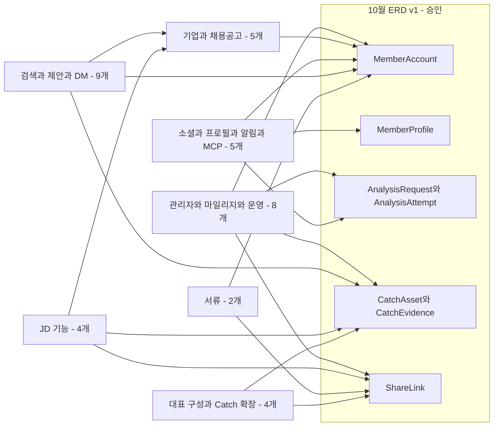
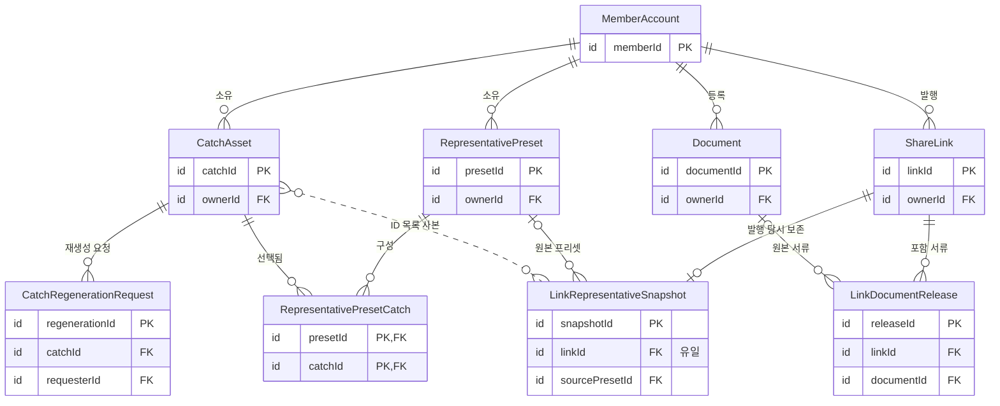
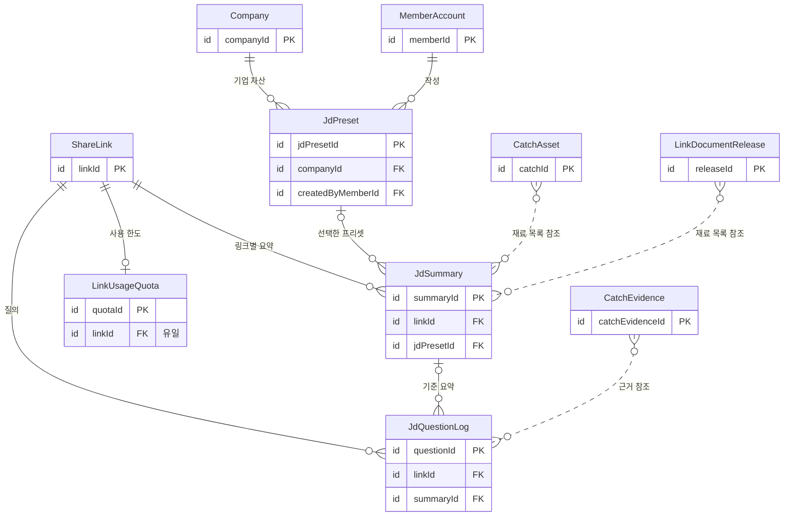
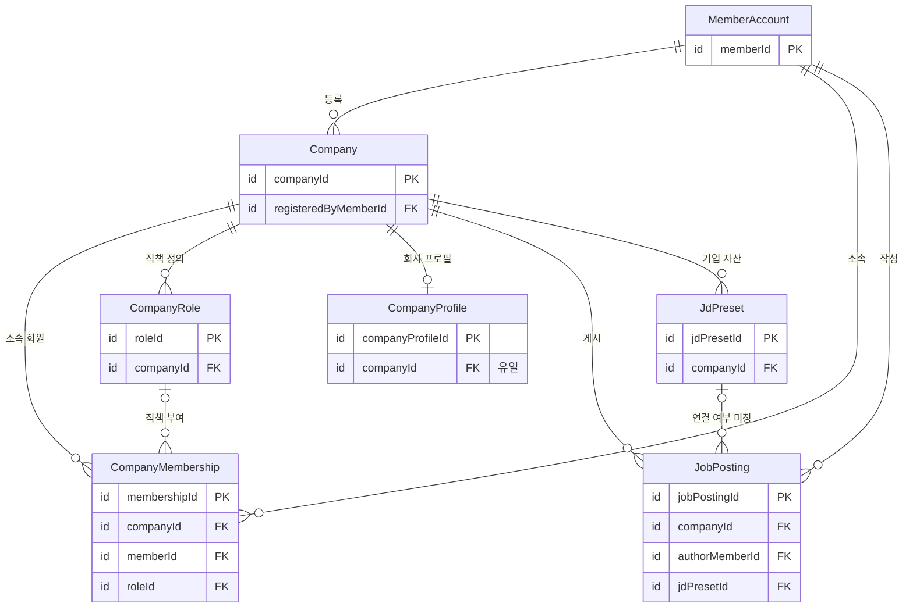
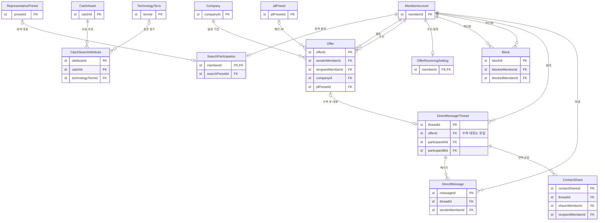
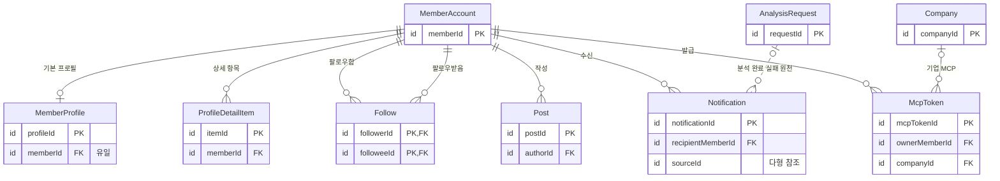
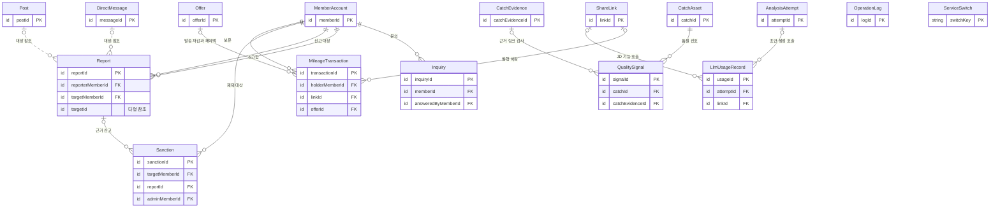

# 데이터베이스 요구사항 분석서 — 12월 계획

| 항목 | 내용 |
|---|---|
| 팀명 | Jaemin_AI |
| 과제명 | 이력서-채용공고 텍스트 매칭 시스템 |
| 서비스명 | CatchU(캐치유) |
| 문서 버전 | v1.0 |
| 작성일 | 2026-09-28 |
| 기준 | origin/dev 9093d2e |
| 문서 지위 | **미승인 계획 — 12월 intent 요구사항 분석 전, 팀장 결정 입력 기준.** 개념 수준 데이터 설계다. 엔티티 이름 자리는 공통 ID 대응표(제안안)를 따르고, 속성·타입·관계는 이 문서의 **제안안**이다 |

## 변경 이력

| 버전 | 일자 | 내용 | 작성 |
|---|---|---|---|
| v1.0 | 2026-09-28 | 최초 작성. 12월 가칭 FR 57개에 필요한 데이터 요구사항 48개, 가칭 엔티티 37개의 정의·개념 ERD·속성 초안·관계, 권한·공개 범위가 데이터에 주는 요구, 분석 기능–데이터–화면 대응, 10월 ERD v1과의 경계, 미결 정리. 같은 날 문서 간 정합성 점검으로 DR ID 규칙을 공통 ID 대응표로 옮기고, DR-110에 이력서 PDF의 JD 기능 적용 미정을 적고, 작성 메모를 9장 끝으로 옮김 | 팀장(AI 작성 보조) |

**미승인 계획 — 12월 intent 요구사항 분석 전, 팀장 결정 입력 기준.** 이 문서는 `docs/ai-dlc-input-december/CatchU_12월_범위_보완.md`(팀장 결정 입력, 9/15 기록·9/24·9/25 보완)와 첫 intent 승인 요구사항(2026-09-11)의 12월 항목을 근거로 한다. intent는 AI-DLC 절차에서 한 묶음의 작업(요구사항 분석부터 설계·구현까지)을 부르는 단위다. 기준 커밋(9093d2e)에는 12월 intent가 아직 없고, 12월 도메인 설계·계약·ERD는 10월 MVP 개발 뒤에 한다(12월 범위 보완 §5). 요구사항 분석에서 포함 여부·순서·세부 동작이 바뀔 수 있으며, 이 문서의 어떤 내용도 12월 구현 약속이나 승인된 설계가 아니다.

## 1. 개요

### 1.1 목적

12월 기능이 새로 요구하는 데이터를 개념 수준에서 정리하고, 그 데이터가 10월 ERD v1(승인)에 어떻게 이어지는지 보인다. 이 문서는 세 가지에 쓴다.

1. 12월 가칭 FR마다 필요한 데이터를 빠짐없이 적어, 12월 요구사항 분석에서 물어야 할 데이터 질문을 미리 드러낸다.
2. 12월 데이터가 10월 ERD v1의 규칙(본인 소유권, 전역 공개·미공개, 매 요청 현재 권한 확인, 링크–Catch 연결 없음)을 깨지 않고 새 테이블로 붙을 수 있는지 확인한다.
3. 10월 개발(특히 #86 물리 스키마)이 12월 확장을 막지 않도록 확인할 지점을 넘긴다(12월 범위 보완 §4).

### 1.2 범위

- **포함:** 공통 ID 대응표 §5.1의 12월 포함 가칭 FR 57개, 12월 NFR 3개(NFR-QUA-101·NFR-COS-101·NFR-SEC-101), 12월 가칭 업무규칙 5개(BR-101~BR-105), 12월 가칭 엔티티 37개(ID 대응표 §9.3).
- **데이터 설계를 하지 않는 것:** 보류·미정 항목(FR-OPS-105~107, DEF-01~DEF-16)과 제외 항목(EXC-01~EXC-12). 설계에 영향이 있는 것만 9장 미결에 적는다.
- **다른 문서에 있는 것:** 10월 엔티티 13개와 서비스 DB 밖 worker 논리 모델 4개의 정의는 05(데이터베이스 요구사항 분석서 — 10월 MVP)에 있다. 이 문서는 10월 엔티티를 이름으로만 참조한다.
- **다루지 않는 것:** 물리 스키마(DDL·인덱스·ID 형식·삭제 cascade·보관 기한). 10월 물리 규약은 #86에서, 12월 물리 설계는 12월 설계 단계에서 정한다.

### 1.3 설계 원칙 (제안안)

1. **10월 규칙을 바꾸지 않고 덧붙인다.** 12월 데이터는 새 테이블로 10월 엔티티를 참조한다. 대표 보존본·서류 발행본·JD 사용 한도·마일리지 차감은 ShareLink에 칼럼을 더하지 않고 자식 테이블로 둔다. 10월 링크의 "소유자의 현재 공개 Catch 전체" 규칙(BR-11)은 12월에도 GitHub 자산 열람 기준으로 남는다(첫 intent FR3.2).
2. **권한은 저장하지 않고 매 요청 현재 상태로 판정한다.** 맞팔, 공개 프로필, 검색 노출 대상은 원천 행에서 유도한다(NFR-SEC-01, NFR-SEC-101).
3. **보존 요구가 있는 것만 사본을 둔다.** 발행 당시 대표 구성(FR3.4)과 서류 발행본(FR5.3)은 의도한 사본이다. 그 밖의 값은 3정규형을 기준으로 한 곳에만 둔다(5.9).
4. **원문을 최소로 저장한다.** 운영 기록·품질 신호·LLM 호출 기록에는 코드·서류·JD·질의 원문과 토큰을 넣지 않는다(첫 intent FR10.3, NFR-OBS-01, NFR-PRV-02).
5. **점수 칼럼을 만들지 않는다.** 매칭 %·유사도 순위·일치 개수를 저장하는 칼럼을 두지 않는다(BR-101, BR-102, EXC-05).

### 1.4 지위 표기

| 표기 | 뜻 |
|---|---|
| 승인 | AI-DLC 단계별 승인 절차(게이트)를 통과한 내용. 이 문서에서는 첫 intent 요구사항(9/11)의 12월 항목과 10월 ERD v1(9/23, 9/24 팀장 결정 반영)이 해당한다 |
| 팀장 결정 | 12월 범위 보완 등 입력 문서에 기록된 팀장 결정. 12월 항목은 모두 미승인 계획이다 |
| 검토초안 | 공통 아키텍처 검토초안, P4 페르소나·설계 노트처럼 채택 확정이 아닌 자료 |
| 제안안 | 이 문서에서 새로 제안하는 것(칼럼 이름·타입·관계·판정 순서) |
| 미정 | 정해지지 않은 것. 정할 곳(12월 요구사항 분석, OQ, 이슈)을 함께 적는다 |

### 1.5 평가 항목과 이 문서의 절

| 평가 항목 | 이 문서의 절 |
|---|---|
| ERD·테이블 설계서(PK/FK·관계·정규화·데이터 타입) | 3장 엔티티 정의서, 4장 개념 ERD, 5장 속성 초안과 정규화, 6장 관계·카디널리티 |
| 요구사항–ERD–화면 일관성, 기획–데이터–화면–분석 정합성 | 2.1~2.10(데이터 요구사항 ↔ FR ↔ 엔티티 ↔ 화면), 2.11(분석 기능 ↔ 데이터 ↔ 화면) |
| ERD가 기능을 감당하는가(엔티티·관계·키) | 2장, 7장 권한·공개 범위, 8장 10월 설계 경계 |
| 할 것과 안 할 것 | 1.2, 1.3의 5번, 9장 미결 |

## 2. 데이터 요구사항 목록

DR ID의 규칙은 공통 ID 대응표 1.1절(12월 DR-101부터)을 따르고, 목록은 이 장이 정본이다. 관련 FR·화면·엔티티·BDA는 ID 대응표 §5.1·§8.3·§9.3·§10.2의 ID를 그대로 쓴다. 근거 칸의 §는 12월 범위 보완의 절이고 [8월]·[9/15] 등은 그 문서의 출처 표기다. FRn.n은 첫 intent 승인 요구사항의 원본 ID다. 12월 엔티티는 모두 가칭이며 이름 뒤에 "(가칭)"을 붙인다. **근거·지위 칸의 지위는 그 데이터 요구의 근거가 된 기능의 지위다.** 무엇을 어떤 엔티티·행으로 저장할지는 모두 이 문서의 제안안이다.

### 2.1 구직자 자산 — 대표 구성·Catch·분석 대상

| DR ID | 데이터 요구사항 | 관련 FR | 엔티티(10월 연결) | 관련 화면 | 근거·지위 |
|---|---|---|---|---|---|
| DR-101 | 구직자별 대표 주장 문구와 연결 Catch(표시 순서 포함)를 저장한다. 연결 Catch는 프리셋 소유자의 Catch만 허용한다. 미리보기는 이 데이터를 읽기만 한다 | FR-REP-101, FR-REP-102 | RepresentativePreset (가칭), RepresentativePresetCatch (가칭) → CatchAsset | SCR_ASSET_51, SCR_ASSET_52 | §2 대표 구성 [9/24] 1순위, FR3.1 / 팀장 결정 |
| DR-102 | 링크 발행 시점의 대표 주장 문구와 연결 Catch 구성을 링크별 보존본으로 저장한다. 원본 대표를 고쳐도 보존본은 바뀌지 않고, 열람 때는 현재 미공개·원본 보호 Catch를 뺀다 | FR-REP-103 | LinkRepresentativeSnapshot (가칭) → ShareLink, CatchAsset, RepositoryProtection | SCR_LINK_51 | §2 대표 구성 [9/24], FR3.4 / 팀장 결정 |
| DR-103 | 대표 프리셋을 여러 벌 저장하고, 링크마다 고른 프리셋과 검색에 쓸 공통 대표 하나를 구분한다 | FR-REP-104 | RepresentativePreset (가칭), LinkRepresentativeSnapshot (가칭), SearchParticipation (가칭) | SCR_ASSET_53, SCR_LINK_51 | FR3.3, §6 요구사항 분석 / 승인 12월 계획, 1순위 밖 |
| DR-104 | 서술 오류 Catch의 재생성 요청·결과·요청 횟수를 Catch별로 저장한다. 재생성 결과는 구직자 확인과 별도 공개 전까지 기존 공개 본문을 바꾸지 않는다 | FR-CAT-101 | CatchRegenerationRequest (가칭) → CatchAsset | SCR_ASSET_58 | FR3.6, NFR-COS-101, BDA-108 / 승인 12월 계획 |
| DR-105 | 본인 Catch를 제목·작업 사실 등으로 찾는다. 새 테이블 없이 CatchAsset을 조회하며 검색 방식은 12월 설계에서 정한다 | FR-CAT-102 | CatchAsset | SCR_ASSET_59 | §2 본인 카드 검색 [9/15] / 팀장 결정. `pg_trgm` 활용은 공통 아키텍처 검토초안의 구상 |
| DR-106 | 목록 밖 공개 저장소를 요청하기 전에 연결 계정의 소유·커밋 관계, 지원 조건, 개수·크기 한도를 판정하고 미지원 사유를 안내한다. 판정 결과를 요청 기록에 남길지는 미정 | FR-ANL-101, FR-ANL-102 | AnalysisRequest, AnalysisConsent, GitHubConnection | SCR_ANL_51 | FR1.2, FR1.3, BDA-109 / 승인 12월 계획. 확인 방식·한도 OQ1 |

### 2.2 서류

| DR ID | 데이터 요구사항 | 관련 FR | 엔티티(10월 연결) | 관련 화면 | 근거·지위 |
|---|---|---|---|---|---|
| DR-107 | 자기소개서(텍스트)·포트폴리오(PDF 또는 외부 URL)·이력서(PDF)를 종류별로 여러 벌 저장한다. 파일 본문의 저장 위치, 용량·보관 기준은 미정 | FR-DOC-101, FR-DOC-106 | Document (가칭) → MemberAccount | SCR_ASSET_54, SCR_ASSET_55, SCR_ASSET_56 | §2 서류와 프리셋 [8월]·[9/24], 이력서 [9/16], FR5.1 / 팀장 결정. 용량·보관 #56 |
| DR-108 | 링크 발행 때 고른 서류를 발행본으로 보존한다. 텍스트·업로드 PDF는 발행 당시 내용, 외부 URL은 주소만 보존한다. 서류 없이도 발행할 수 있다 | FR-DOC-102, FR-DOC-103 | LinkDocumentRelease (가칭) → ShareLink, Document (가칭) | SCR_LINK_51, SCR_VIEW_51 | FR5.2, FR5.3 / 승인 12월 계획 |
| DR-109 | 원본 서류마다 그 서류를 담은 기존 링크 목록을 찾을 수 있어야 한다. 원본 수정·삭제는 발행본을 바꾸거나 링크를 중단하지 않는다 | FR-DOC-104 | LinkDocumentRelease (가칭) | SCR_ASSET_57 | FR5.4 / 승인 12월 계획 |
| DR-110 | 업로드 PDF의 텍스트 PDF·이미지 PDF 판별 결과와 JD 기능용 추출 텍스트를 저장한다. 이미지 PDF는 원문 열람만 한다. 이력서 PDF를 JD 기능 근거로 쓸지는 미정이다(04 FR-DOC-105) | FR-DOC-105 | Document (가칭) | SCR_ASSET_54, SCR_ASSET_55, SCR_ASSET_56 | FR5.5, BDA-105 / 승인 12월 계획 |

### 2.3 JD 기능

| DR ID | 데이터 요구사항 | 관련 FR | 엔티티(10월 연결) | 관련 화면 | 근거·지위 |
|---|---|---|---|---|---|
| DR-111 | JD 기준 한 장 요약을 링크별로 저장하고, 요약에 쓴 재료(Catch·서류 발행본) 목록을 함께 남긴다. 매칭 % 칼럼은 두지 않는다 | FR-JDF-101 | JdSummary (가칭) → ShareLink, CatchAsset, LinkDocumentRelease (가칭) | SCR_VIEW_52, SCR_VIEW_53 | FR6.1, BR-101, BDA-101 / 승인 12월 계획 |
| DR-112 | 같은 JD 요약은 현재 재료·접근 조건이 같을 때만 재사용한다. 재사용 판정 키(링크·JD 내용·재료 조합)를 저장한다 | FR-JDF-103 | JdSummary (가칭) | SCR_VIEW_53 | FR6.3, BDA-104 / 승인 12월 계획. 동일 JD 판정 OQ6 |
| DR-113 | 요약 재료의 공개 상태가 바뀌거나 원본 보호가 적용되면 그 요약을 재생성 대상으로 표시하고 더 제공하지 않는다. 원본 서류 수정·삭제만으로는 표시하지 않는다 | FR-JDF-105 | JdSummary (가칭) → CatchAsset, RepositoryProtection | SCR_VIEW_53 | FR6.5, FR1.5 / 승인 12월 계획 |
| DR-114 | 링크 단위 JD 사용 한도와 사용량을 집계한다. 소진 뒤 새 LLM 호출은 막고 기존 요약·원자료 열람은 유지한다 | FR-JDF-103, FR-JDF-104 | LinkUsageQuota (가칭) → ShareLink | SCR_VIEW_53, SCR_VIEW_55 | FR6.3, FR6.4, NFR-COS-101 / 승인 12월 계획. 수치 OQ6 |
| DR-115 | 질의응답의 질문·응답·근거 참조를 질의자 맥락별로 저장하고 다른 수신자에게 공유하지 않는다 | FR-JDF-101 | JdQuestionLog (가칭) → ShareLink, JdSummary (가칭), CatchEvidence | SCR_VIEW_55 | FR6.1, NFR1, BDA-103 / 승인 12월 계획. 공개·보관 OQ6 |
| DR-116 | 사이드 패널은 현재 열람 중인 자료 안의 JD 관련 대목만 보인다. 결과를 저장할지(요약의 자료별 하위 결과) 매번 만들지는 미정 | FR-JDF-102 | JdSummary (가칭)(저장할 때) | SCR_VIEW_54 | FR6.2, BDA-102 / 승인 12월 계획 |
| DR-117 | JD 프리셋을 기업 자산으로 저장하고, 같은 기업 소속 회원이 직책 권한에 따라 함께 쓴다 | FR-JDF-106, FR-ENT-104 | JdPreset (가칭) → Company (가칭), CompanyRole (가칭) | SCR_VIEW_52, SCR_ENT_54 | FR6.6, §2 기업 JD 프리셋 [8월]·기업 안 공유 [9/24] / 팀장 결정 |

### 2.4 검색

| DR ID | 데이터 요구사항 | 관련 FR | 엔티티(10월 연결) | 관련 화면 | 근거·지위 |
|---|---|---|---|---|---|
| DR-118 | 구직자별 검색 참여 여부(기본 미노출)와 변경 시각을 저장한다. 참여 해제는 새 발견만 막고 기존 제안·대화 기록을 지우지 않는다 | FR-SRC-101, FR-OFR-102 | SearchParticipation (가칭) → MemberAccount | SCR_SRC_51 | FR7.1, FR8.2 / 승인 12월 계획 |
| DR-119 | 공개 Catch에서 규칙으로 추출한 사실 속성을 검색용 행으로 저장한다. 프로필 자가 입력값과 출처를 구분하고, 미공개·원본 보호 Catch와 서류는 검색 대상에서 뺀다 | FR-SRC-102 | CatchSearchAttribute (가칭) → CatchAsset, MemberProfile | SCR_SRC_52, SCR_SRC_53 | FR7.2, BR-103, BDA-106 / 승인 12월 계획. 속성 목록 OQ8 |
| DR-120 | 기술 명칭의 표준 표기와 변형 표기를 저장하고, Catch 생성 때 표준 표기로 정규화한 값을 검색 속성에 쓴다 | FR-SRC-103 | TechnologyTerm (가칭), CatchSearchAttribute (가칭) | SCR_SRC_52 | FR7.3, BDA-107 / 승인 12월 계획 |
| DR-121 | 검색 결과의 유사도 점수·일치 개수·순위를 저장하지 않는다. 무결과는 결과 없음으로만 처리한다 | FR-SRC-104 | 저장 없음(금지 요구) | SCR_SRC_52 | FR7.4, BR-102 / 승인 12월 계획 |

### 2.5 제안·차단·DM

| DR ID | 데이터 요구사항 | 관련 FR | 엔티티(10월 연결) | 관련 화면 | 근거·지위 |
|---|---|---|---|---|---|
| DR-122 | 채용 제안의 발송 계정·발송 당시 소속 기업·수신 구직자·포지션 또는 JD·관심 이유·응답 상태·시각을 저장하고, 반복 발송 제한을 판정할 이력을 남긴다 | FR-OFR-101 | Offer (가칭) → MemberAccount, Company (가칭), JdPreset (가칭) | SCR_OFR_51, SCR_OFR_52 | FR8.1 / 승인 12월 계획. 제한 조건 OQ9 |
| DR-123 | 구직자별 제안 수신 여부를 저장한다. 해제는 새 제안만 막는다 | FR-OFR-103 | OfferReceivingSetting (가칭) → MemberAccount | SCR_OFR_53 | FR8.3 / 승인 12월 계획 |
| DR-124 | 개별 차단을 계정 하나 단위로 저장한다. 같은 회사의 다른 계정에 자동 적용하지 않는다 | FR-OFR-104 | Block (가칭) → MemberAccount | SCR_OFR_53 | FR8.4, EXC-10 / 승인 12월 계획 |
| DR-125 | DM 대화방의 유형(제안 수락 후 기업↔구직자, 구직자 간)과 참여자, 텍스트 메시지를 저장한다. 기업↔구직자 대화의 새 메시지 허용은 제안 수락 상태와 개별 차단으로 판정한다(FR9.1). 구직자 간 DM의 허용·차단 조건은 미정이다. 첨부·읽음 표시는 두지 않는다 | FR-MSG-101, FR-MSG-103 | DirectMessageThread (가칭), DirectMessage (가칭) → MemberAccount, Offer (가칭), Block (가칭) | SCR_MSG_51, SCR_MSG_52 | FR9.1 / 승인 12월 계획, §2 구직자 간 DM [9/15] / 팀장 결정 |
| DR-126 | 연락 정보는 DM에서 구직자가 항목을 고르고 동의한 뒤 해당 계정에만 공유한다. 공유 항목·동의 시각·받는 계정을 저장한다 | FR-MSG-102 | ContactShare (가칭) → DirectMessageThread (가칭) | SCR_MSG_52 | FR9.2 / 승인 12월 계획. 연락 수단 종류 OQ10 |

### 2.6 소셜·프로필·온보딩

| DR ID | 데이터 요구사항 | 관련 FR | 엔티티(10월 연결) | 관련 화면 | 근거·지위 |
|---|---|---|---|---|---|
| DR-127 | 회원 간 팔로우를 방향 있는 관계로 저장한다. 맞팔은 두 방향 행이 모두 있을 때로 유도하고 따로 저장하지 않는다 | FR-SOC-101 | Follow (가칭) → MemberAccount | SCR_SOC_53, SCR_SOC_54 | §2 팔로우·포스팅·피드 [9/15] / 팀장 결정 |
| DR-128 | 포스팅과 글마다 읽기 권한(전체·맞팔)을 저장한다 | FR-SOC-102 | Post (가칭) → MemberAccount | SCR_SOC_51, SCR_SOC_52 | §2 팔로우·포스팅·피드 [9/15]·글 읽기 권한 [8월] / 팀장 결정 |
| DR-129 | 로그인 홈 피드는 팔로우한 사람의 글을, 팔로우한 사람이 없으면 팔로우가 많은 사람의 공개 글을 보인다. 팔로워 수는 Follow (가칭)에서 집계한다 | FR-SOC-103 | Follow (가칭), Post (가칭) | SCR_HOME_51 | §2 팔로우·포스팅·피드, BDA-116 / 팀장 결정 |
| DR-130 | 구직자끼리 볼 때 적용할 공개 범위(전체·맞팔)를 프로필·Catch마다 저장한다. 기업·링크 열람의 기준인 전역 공개·미공개(`visibility`)와 섞지 않는다 | FR-SOC-104 | MemberProfile·CatchAsset 확장, Post (가칭) | SCR_SOC_51, SCR_SOC_53 | §2 공개 범위 전체·맞팔 2단 [9/15], §4 공개 상태 모델, BR-104 / 팀장 결정 |
| DR-131 | 학력·경력 등 프로필 상세 항목을 여러 행으로 저장하고 자가 입력 출처를 표시한다. 보는 사람별 표시 항목은 미정 | FR-MEM-101 | ProfileDetailItem (가칭) → MemberAccount | SCR_PROF_51, SCR_SOC_53 | §2 프로필 상세 항목 [8월], BR-103 / 팀장 결정 |
| DR-132 | 온보딩 진행·완료 상태를 저장할지 미정이다. ID 대응표에 해당 엔티티가 없다 | FR-MEM-102 | 미정 | SCR_ONB_51 | §2 온보딩 [9/15] / 팀장 결정 |

### 2.7 알림·MCP

| DR ID | 데이터 요구사항 | 관련 FR | 엔티티(10월 연결) | 관련 화면 | 근거·지위 |
|---|---|---|---|---|---|
| DR-133 | 회원별 알림(종류·원천·생성 시각·읽음 시각)을 저장한다. 분석 완료·실패 알림은 10월 분석 요청·시도 기록을 원천으로 만든다(제안안. §4는 10월 기록의 활용 검토만 요구). 꺼 둔 알림은 새 알림 수에서 뺀다(9/16 결정) | FR-NTF-101 | Notification (가칭) → MemberAccount, AnalysisRequest | SCR_NTF_51 | §2 알림 [9/15]·헤더·설정 [9/16], 9/16 회의 결정 §1 / 팀장 결정 |
| DR-134 | MCP 접근 자격을 소유 회원(기업 MCP는 소속 기업 포함)·허용 범위·발급·만료·폐기 시각과 함께 저장한다. 토큰 원문은 저장하지 않는다(제안안, 10월 비밀값 보호 원칙 NFR-PRV-02를 따름). 판정은 화면·링크와 같은 권한 규칙을 쓴다 | FR-MCP-101, FR-MCP-102 | McpToken (가칭) → MemberAccount, Company (가칭). 판정에 ShareLink, SearchParticipation (가칭) 사용 | SCR_PROF_52 | §2 MCP [9/15]·목적·기업 검색 [9/24], NFR-SEC-101, BDA-114, BDA-115 / 팀장 결정 |

### 2.8 기업·채용공고

| DR ID | 데이터 요구사항 | 관련 FR | 엔티티(10월 연결) | 관련 화면 | 근거·지위 |
|---|---|---|---|---|---|
| DR-135 | 기업 등록 정보와 등록 상태를 저장한다. 기업 인증은 없으며, 관리자가 사칭 대응을 위해 등록을 관리한다 | FR-ENT-101, FR-ADM-102 | Company (가칭) → MemberAccount | SCR_ENT_51, SCR_ADM_54 | §2 기업 등록·소속·권한 [8월]·관리자 처리 기능 [9/25], EXC-02 / 팀장 결정 |
| DR-136 | 회원의 기업 소속(기업·회원·직책·소속 상태)을 저장한다. HR·HM은 기업 소속 회원이다 | FR-ENT-101 | CompanyMembership (가칭) → MemberAccount, Company (가칭), CompanyRole (가칭) | SCR_ENT_51, SCR_ENT_52 | §2 기업 등록·소속·권한 [8월] / 팀장 결정 |
| DR-137 | 기업마다 직책과 직책별 권한을 저장한다 | FR-ENT-102, FR-ENT-104 | CompanyRole (가칭) → Company (가칭) | SCR_ENT_52 | §2 기업 등록·소속·권한 [8월] / 팀장 결정. 직책 종류·권한 목록 §3-2 미결 |
| DR-138 | 회사 프로필을 저장한다. 구직자 프로필과 같은 구조로 처리하고, 차별점이 필요하면 따로 만든다 | FR-ENT-103 | CompanyProfile (가칭) → Company (가칭) | SCR_ENT_53 | §2 회사 프로필 [9/15], §4 계정 유형 / 팀장 결정 |
| DR-139 | 기업 채용공고(제목·본문·외부 지원 링크·게시 상태)를 저장한다. 지원 접수·전형 데이터는 두지 않는다 | FR-JOB-101, FR-ADM-103 | JobPosting (가칭) → Company (가칭), MemberAccount | SCR_JOB_51, SCR_JOB_52, SCR_JOB_53, SCR_ADM_55 | §2 채용공고 [9/15]·관리자 처리 기능 [9/25], EXC-04 / 팀장 결정 |

### 2.9 고객센터·관리자·마일리지

| DR ID | 데이터 요구사항 | 관련 FR | 엔티티(10월 연결) | 관련 화면 | 근거·지위 |
|---|---|---|---|---|---|
| DR-140 | 고객센터 문의와 처리 상태·답변·처리 운영자를 저장한다 | FR-SUP-101, FR-ADM-104 | Inquiry (가칭) → MemberAccount | SCR_SUP_51, SCR_ADM_56 | §2 고객센터 [9/15]·관리자 처리 기능 [9/25] / 팀장 결정 |
| DR-141 | 신고(신고자·대상·사유·처리 상태)와 제재(대상 회원·단계·사유·기간·해제·처리 운영자)를 저장한다. 제재에는 사유가 반드시 있어야 하고, 처리 화면에서 전후 맥락·양측 이력·유사 건 처리 결과를 함께 조회할 수 있어야 한다 | FR-ADM-101 | Report (가칭), Sanction (가칭) → MemberAccount, DirectMessage (가칭), Post (가칭) | SCR_ADM_53 | §2 관리자 처리 기능 [9/25], P4 페르소나 주 시나리오(검토초안), BDA-117 / 팀장 결정 |
| DR-142 | 마일리지를 거래 원장(지급·차감·페이백)으로 저장하고 차감 원인 행동(링크 발행·제안 발송·탐색 중 정보 열람)을 참조한다. 현금 결제·환전 칼럼은 두지 않고 직접 링크 열람은 차감하지 않는다 | FR-MIL-101, FR-MIL-102, FR-ADM-105 | MileageTransaction (가칭) → MemberAccount, ShareLink, Offer (가칭) | SCR_MIL_51, SCR_LINK_51, SCR_SRC_53, SCR_ADM_57 | §2 마일리지 [9/15]·마일리지 조건, BR-105 / 팀장 결정 |

### 2.10 운영

| DR ID | 데이터 요구사항 | 관련 FR | 엔티티(10월 연결) | 관련 화면 | 근거·지위 |
|---|---|---|---|---|---|
| DR-143 | 오류·권한 위반 징후를 운영 기록으로 저장한다. 원문 전체의 자동 기록은 요구되지 않으며(FR10.3), 코드·서류·JD·질의 원문과 토큰은 넣지 않는다(제안안, NFR-OBS-01 원칙 연장) | FR-OPS-102 | OperationLog (가칭) | SCR_ADM_52 | FR10.3, §2 운영 기능 [9/24], BDA-113 / 팀장 결정(후순위) |
| DR-144 | LLM 호출마다 기능·토큰·추정 비용·한도 도달 여부를 기록해 호출 수와 예산 상한 대비 비용을 집계한다 | FR-OPS-102, FR-OPS-104 | LlmUsageRecord (가칭) → AnalysisAttempt, ShareLink | SCR_ADM_51, SCR_ADM_52 | FR10.3, §2 운영 기능 지표 화면 [9/25], BDA-112 / 팀장 결정(후순위) |
| DR-145 | 신규 분석·신규 AI 호출의 중단·재개 스위치와 변경 이력(누가·언제·왜)을 저장한다. 중단 중에도 기존 자료 열람은 유지한다 | FR-OPS-103 | ServiceSwitch (가칭) | SCR_ADM_52 | FR10.4, §2 운영 기능 [9/24] / 팀장 결정(후순위) |
| DR-146 | 품질 신호(불일치 유형·건수, 근거 링크 자동 검사 실패)를 저장한다. 신호만으로 Catch 설명·근거 전체를 열람할 수 없다 | FR-OPS-101 | QualitySignal (가칭) → CatchAsset, CatchEvidence | SCR_ADM_51 | FR10.1, BDA-111 / 팀장 결정(후순위) |
| DR-147 | 관리자 지표의 분석 처리 묶음(요청 수, 성공·부분 실패·실패 비율, 실패 사유 분포, 처리 시간, 대기 작업 수)은 10월 분석 요청·시도 기록을 모아 계산한다. 별도 수집 플랫폼을 조건으로 삼지 않는다(§2). 처리 시간 계산에 필요한 시각이 10월 기록에 있어야 한다(8장) | FR-OPS-104 | AnalysisRequest, AnalysisAttempt, LlmUsageRecord (가칭), QualitySignal (가칭) | SCR_ADM_51 | §2 운영 기능 지표 화면 [9/25], BDA-112 / 팀장 결정(후순위) |
| DR-148 | 12월 전체 품질 판정(근거 링크 유효율 100%, 타인 기여 오귀속 0건)의 표본·결과 버전·검사 범위를 기록한다. 저장 구조는 미정이고 ID 대응표에 엔티티가 없다 | NFR-QUA-101 | 미정 | 없음(내부) | NFR3, BDA-110 / 승인 12월 목표. 판정 상세 OQ12 |

데이터 요구사항은 48개(DR-101~DR-148)다. 12월 가칭 FR 57개는 모두 하나 이상의 DR에 연결된다. DR-121은 저장하지 않아야 하는 금지 요구이고, DR-132·DR-148은 저장 여부·구조가 미정이다.

### 2.11 분석 기능이 쓰는 데이터와 반영 화면

12월 가칭 분석 기능(BDA-101~BDA-117, ID 대응표 §10.2)이 어떤 데이터 요구사항과 엔티티를 쓰고 어느 화면에 결과를 보이는지 한 표로 모은다. 알고리즘·생성 방법은 12월 설계에서 정하며, 이 표는 데이터 연결만 보인다.

| BDA | 분석 기능 | 데이터 요구사항 | 읽고 쓰는 엔티티 | 반영 화면 |
|---|---|---|---|---|
| BDA-101 | JD 기준 한 장 요약 | DR-111, DR-112 | JdSummary (가칭), CatchAsset, LinkDocumentRelease (가칭) | SCR_VIEW_53 |
| BDA-102 | 사이드 패널 JD 관련 대목 추출 | DR-116 | CatchAsset, LinkDocumentRelease (가칭), JdSummary (가칭)(저장할 때) | SCR_VIEW_54 |
| BDA-103 | JD 질의응답 | DR-115 | JdQuestionLog (가칭), CatchEvidence | SCR_VIEW_55 |
| BDA-104 | JD 요약 재사용·무효화 판정 | DR-112, DR-113, DR-114 | JdSummary (가칭), LinkUsageQuota (가칭), RepositoryProtection | SCR_VIEW_53 |
| BDA-105 | 서류 텍스트 추출·텍스트/이미지 PDF 판별 | DR-110 | Document (가칭) | SCR_ASSET_54, SCR_ASSET_55, SCR_ASSET_56 |
| BDA-106 | 검색용 Catch 사실 속성 추출 | DR-119 | CatchSearchAttribute (가칭), CatchAsset | SCR_SRC_52 |
| BDA-107 | 기술 표기 정규화 | DR-120 | TechnologyTerm (가칭), CatchSearchAttribute (가칭) | SCR_SRC_52, SCR_ASSET_01 |
| BDA-108 | 서술 오류 Catch 재생성 | DR-104 | CatchRegenerationRequest (가칭), CatchAsset | SCR_ASSET_58 |
| BDA-109 | 목록 밖 저장소의 소유·커밋 관계 확인 | DR-106 | GitHubConnection, AnalysisRequest, AnalysisConsent | SCR_ANL_51 |
| BDA-110 | 전체 품질 표본 판정 | DR-148 | 저장 구조 미정(CatchAsset, CatchEvidence를 표본으로 사용) | 없음(내부) |
| BDA-111 | 품질 신호 집계 | DR-146 | QualitySignal (가칭), CatchAsset, CatchEvidence | SCR_ADM_51 |
| BDA-112 | 관리자 지표 집계 | DR-144, DR-147 | AnalysisRequest, AnalysisAttempt, LlmUsageRecord (가칭), QualitySignal (가칭) | SCR_ADM_51 |
| BDA-113 | 운영 기록 수집 | DR-143, DR-144 | OperationLog (가칭), LlmUsageRecord (가칭) | SCR_ADM_52 |
| BDA-114 | 구직자 MCP 데이터 제공 | DR-134 | McpToken (가칭), CatchAsset, MemberProfile | SCR_PROF_52 |
| BDA-115 | 기업 MCP 링크 자료·검색 제공 | DR-134, DR-118 | McpToken (가칭), ShareLink, SearchParticipation (가칭) | SCR_PROF_52 |
| BDA-116 | 피드 구성 | DR-129 | Follow (가칭), Post (가칭) | SCR_HOME_51 |
| BDA-117 | 신고 처리 맥락 조회 | DR-141 | Report (가칭), Sanction (가칭), DirectMessage (가칭), Post (가칭) | SCR_ADM_53 |

## 3. 가칭 엔티티 정의서

엔티티 이름과 한글명은 ID 대응표 §9.3(제안안)을 따른다. 주요 속성·식별자는 이 문서의 제안안이며, 괄호 안 근거가 팀장 결정·승인 12월 계획을 가리킨다. 10월 엔티티와의 관계는 "부모 1 : 자식 개수"로 적는다.

### 3.1 대표 구성·Catch 확장

| 엔티티 | 한글명 | 설명 | 주요 속성 | 식별자 | 10월 엔티티와의 관계 |
|---|---|---|---|---|---|
| RepresentativePreset (가칭) | 대표 프리셋 | 대표 주장 1개와 연결 Catch 묶음. 12월 1순위는 대표 구성 한 벌이고, 여러 벌은 FR-REP-104 결정에 따른다 | 소유 회원, 대표 주장 문구, 프리셋 이름, 검색 대표 여부, 작성·수정 시각 | PK presetId | MemberAccount 1 : 0..N(ownerId) |
| RepresentativePresetCatch (가칭) | 대표 구성 Catch | 프리셋에 연결한 Catch와 표시 순서 | 프리셋, Catch, 표시 순서 | PK (presetId, catchId), 유일 (presetId, displayOrder) | CatchAsset 1 : 0..N. Catch 소유자와 프리셋 소유자가 같아야 한다 |
| LinkRepresentativeSnapshot (가칭) | 링크 대표 보존본 | 링크 발행 당시 대표 주장 문구와 연결 Catch 구성의 사본(FR3.4). 열람 때 현재 미공개·원본 보호 Catch를 거른다 | 링크, 원본 프리셋, 대표 주장 사본, 연결 Catch 목록 사본(순서 포함), 보존 시각 | PK snapshotId, 유일 linkId | ShareLink 1 : 0..1. Catch는 ID 사본으로만 가리킨다(FK 아님) |
| CatchRegenerationRequest (가칭) | Catch 재생성 요청 | 서술 오류 Catch의 한도 있는 재생성 요청과 결과(FR3.6). 결과는 확인 전까지 기존 본문과 분리한다 | Catch, 요청 회원, 상태, 재생성 초안, 요청·완료 시각 | PK regenerationId | CatchAsset 1 : 0..N. 10월 유일 조건 (ownerId, workIdentity) 때문에 재생성 결과로 새 CatchAsset 행을 만들지 않는다 |

### 3.2 서류

| 엔티티 | 한글명 | 설명 | 주요 속성 | 식별자 | 10월 엔티티와의 관계 |
|---|---|---|---|---|---|
| Document (가칭) | 서류 | 자기소개서·포트폴리오·이력서 원본. 종류별로 여러 벌 등록한다(§2 서류와 프리셋) | 소유 회원, 서류 종류, 형식, 제목, 텍스트 본문, 파일 참조, 외부 URL, PDF 유형 판별, 추출 텍스트 참조, 작성·수정 시각 | PK documentId | MemberAccount 1 : 0..N |
| LinkDocumentRelease (가칭) | 링크 서류 발행본 | 링크 발행 때 고른 서류의 발행 당시 사본(FR5.3). 원본 변경과 독립이다 | 링크, 원본 서류, 종류·형식 사본, 텍스트 사본, 파일 사본 참조, URL 사본, 발행 시각 | PK releaseId, 유일 (linkId, documentId) | ShareLink 1 : 0..N, Document (가칭) 0..1 : 0..N(원본 삭제 뒤 참조 처리 미정) |

### 3.3 JD 기능

| 엔티티 | 한글명 | 설명 | 주요 속성 | 식별자 | 10월 엔티티와의 관계 |
|---|---|---|---|---|---|
| JdSummary (가칭) | JD 요약 | 링크에서 현재 허용된 자료를 JD 기준으로 요약한 결과. 재사용 키와 무효화 상태를 가진다(FR6.1·FR6.3·FR6.5) | 링크, JD 출처(수신자 입력·기업 프리셋), JD 프리셋, JD 내용 지문, 재료 목록, 재료 지문, 요약 내용, 상태, 생성 시각 | PK summaryId | ShareLink 1 : 0..N. 재료로 CatchAsset·LinkDocumentRelease (가칭)를 목록으로 가리킨다(FK 아님) |
| JdQuestionLog (가칭) | JD 질의 기록 | 질의응답의 질문·응답·근거 참조. 질의자 맥락별로 분리한다 | 링크, 기준 요약, 질의자 맥락, 질문, 응답, 근거 참조, 생성 시각 | PK questionId | ShareLink 1 : 0..N. CatchEvidence를 근거로 가리킨다 |
| LinkUsageQuota (가칭) | 링크 JD 사용 한도 | 링크 단위 새 LLM 호출 한도와 사용량(FR6.3·FR6.4) | 링크, 한도, 사용량, 소진 시각 | PK quotaId, 유일 linkId(집계 기간을 두면 (linkId, 기간)) | ShareLink 1 : 0..1 |
| JdPreset (가칭) | JD 프리셋 | 기업 자산인 JD. 같은 기업 소속 회원이 직책 권한으로 함께 쓴다 | 기업, 작성 회원, 제목, JD 본문, 작성·수정 시각 | PK jdPresetId | MemberAccount(작성자) 1 : 0..N. 소유는 Company (가칭) |

### 3.4 검색·제안·DM

| 엔티티 | 한글명 | 설명 | 주요 속성 | 식별자 | 10월 엔티티와의 관계 |
|---|---|---|---|---|---|
| SearchParticipation (가칭) | 검색 참여 설정 | 구직자의 검색 노출 동의. 기본 미노출(FR7.1) | 회원, 참여 여부, 검색 대표 프리셋, 변경 시각 | PK memberId(회원당 1행) | MemberAccount 1 : 0..1. 행이 없으면 미참여 |
| CatchSearchAttribute (가칭) | Catch 검색 사실 속성 | 공개 Catch에서 규칙으로 추출한 검색용 사실 속성 한 개(FR7.2) | Catch, 속성 종류, 값, 표준 기술 표기, 추출 규칙 판본, 추출 시각 | PK attributeId, 유일 (catchId, attributeType, valueText) | CatchAsset 1 : 0..N |
| TechnologyTerm (가칭) | 표준 기술 표기 | 기술 명칭의 표준 표기와 변형 표기(FR7.3) | 표준 표기, 변형 표기 목록, 분류 | PK termId, 유일 canonicalName | 직접 관계 없음. MemberProfile.skills 정규화 여부는 미정 |
| Offer (가칭) | 채용 제안 | 로그인한 기업 계정이 보낸 제안(FR8.1) | 발송 회원, 발송 기업, 수신 구직자, 포지션, JD 프리셋 또는 JD 본문, 관심 이유, 상태, 발송·응답 시각 | PK offerId | MemberAccount(발송·수신) 1 : 0..N |
| OfferReceivingSetting (가칭) | 제안 수신 설정 | 구직자의 새 제안 수신 여부(FR8.3) | 회원, 수신 여부, 변경 시각 | PK memberId | MemberAccount 1 : 0..1. 기본값 미정 |
| Block (가칭) | 개별 차단 | 구직자가 계정 하나를 차단한 기록(FR8.4) | 차단한 회원, 차단된 회원, 차단 시각, 해제 시각 | PK blockId, 유일 (blockerMemberId, blockedMemberId) | MemberAccount를 두 번 참조 |
| DirectMessageThread (가칭) | DM 대화방 | 두 회원의 대화방. 제안 수락 후 대화와 구직자 간 대화를 유형으로 구분한다 | 유형, 제안, 참여 회원 둘, 생성 시각 | PK threadId, 수락 대화는 유일 offerId | MemberAccount 1 : 0..N(참여) |
| DirectMessage (가칭) | DM 메시지 | 대화방의 텍스트 메시지 | 대화방, 보낸 회원, 본문, 보낸 시각 | PK messageId | MemberAccount(보낸 회원) 1 : 0..N |
| ContactShare (가칭) | 연락 정보 공유 | 구직자가 DM에서 고른 연락 항목을 해당 계정에 공유한 기록(FR9.2) | 대화방, 공유 회원, 받는 회원, 공유 항목, 동의 시각 | PK contactShareId | MemberAccount를 두 번 참조 |

### 3.5 소셜·프로필·알림·MCP

| 엔티티 | 한글명 | 설명 | 주요 속성 | 식별자 | 10월 엔티티와의 관계 |
|---|---|---|---|---|---|
| Follow (가칭) | 팔로우 | 방향 있는 팔로우 관계 | 팔로우하는 회원, 팔로우받는 회원, 시각 | PK (followerId, followeeId) | MemberAccount를 두 번 참조 |
| Post (가칭) | 포스팅 | 회원의 글과 글별 읽기 권한(전체·맞팔) | 작성 회원, 본문, 읽기 권한, 작성·수정 시각 | PK postId | MemberAccount 1 : 0..N |
| ProfileDetailItem (가칭) | 프로필 상세 항목 | 학력·경력 등 자가 입력 항목 한 개 | 회원, 항목 종류, 내용, 기간, 입력 출처, 표시 순서 | PK itemId | MemberAccount 1 : 0..N(MemberProfile과 같은 회원) |
| Notification (가칭) | 알림 | 헤더 알림. 분석 완료·실패 안내를 포함한다 | 수신 회원, 알림 종류, 원천 종류·식별자, 생성 시각, 읽음 시각 | PK notificationId | MemberAccount 1 : 0..N. AnalysisRequest 등을 원천으로 가리킨다(다형 참조) |
| McpToken (가칭) | MCP 토큰 | 구직자·기업 MCP의 접근 자격 | 소유 회원, 기업, 허용 범위, 토큰 조회 키, 발급·만료·폐기 시각 | PK mcpTokenId, 유일 tokenLookupKey | MemberAccount 1 : 0..N |

### 3.6 기업·채용공고

| 엔티티 | 한글명 | 설명 | 주요 속성 | 식별자 | 10월 엔티티와의 관계 |
|---|---|---|---|---|---|
| Company (가칭) | 기업 | 서비스에 등록한 기업. 기업 인증은 없다 | 기업명, 등록 상태, 등록 회원, 등록 시각 | PK companyId | MemberAccount(등록자) 1 : 0..N |
| CompanyMembership (가칭) | 기업 소속 | 회원의 기업 소속과 직책 | 기업, 회원, 직책, 소속 상태, 시각 | PK membershipId, 유일 (companyId, memberId) | MemberAccount 1 : 0..N(여러 기업 소속 허용 여부 미정) |
| CompanyRole (가칭) | 기업 직책·권한 | 기업별 직책과 권한 목록 | 기업, 직책명, 권한 목록 | PK roleId, 유일 (companyId, roleName) | 직접 관계 없음 |
| CompanyProfile (가칭) | 회사 프로필 | 회사의 공개 프로필. 구직자 프로필 구조 재사용을 우선한다 | 기업, 표시 이름, 소개 등 | PK companyProfileId, 유일 companyId | MemberProfile 구조 재사용 여부 미정 |
| JobPosting (가칭) | 채용공고 | 기업이 등록하는 간단한 공고. 지원은 외부 링크 | 기업, 작성 회원, 제목, 본문, 외부 지원 링크, 게시 상태, JD 프리셋 | PK jobPostingId | MemberAccount(작성자) 1 : 0..N |

### 3.7 관리자·마일리지·운영

| 엔티티 | 한글명 | 설명 | 주요 속성 | 식별자 | 10월 엔티티와의 관계 |
|---|---|---|---|---|---|
| Inquiry (가칭) | 고객센터 문의 | 회원의 문의와 처리 | 문의 회원, 분류, 내용, 처리 상태, 답변, 처리 운영자, 접수·답변 시각 | PK inquiryId | MemberAccount 1 : 0..N |
| Report (가칭) | 신고 | 회원이 DM·포스팅 등을 신고한 기록 | 신고 회원, 대상 종류·식별자, 대상 회원, 사유, 처리 상태, 접수·처리 시각 | PK reportId | MemberAccount 1 : 0..N(신고자·대상) |
| Sanction (가칭) | 제재 | 운영자가 회원에게 내린 조치(경고·제한·정지) | 대상 회원, 단계, 사유, 근거 신고, 시작·종료·해제 시각, 처리 운영자 | PK sanctionId | MemberAccount 1 : 0..N |
| MileageTransaction (가칭) | 마일리지 거래 | 지급·차감·페이백 원장의 한 줄 | 보유 주체, 거래 종류, 사유, 수량, 링크·제안 참조, 처리 운영자, 시각 | PK transactionId | MemberAccount 1 : 0..N, ShareLink 0..1 : 0..N |
| OperationLog (가칭) | 운영 기록 | 오류·권한 위반 징후 기록 | 발생 시각, 종류, 구성요소, 안전한 오류 코드·메시지, 관련 식별자 | PK logId | 식별자만 담는다(FK 아님) |
| LlmUsageRecord (가칭) | LLM 호출 기록 | LLM 호출 한 건의 양과 추정 비용 | 발생 시각, 기능, 관련 식별자, 모델, 입력·출력 토큰, 추정 비용, 한도 도달 여부 | PK usageId | AnalysisAttempt 0..1 : 0..N, ShareLink 0..1 : 0..N |
| ServiceSwitch (가칭) | 운영 스위치 | 신규 분석·신규 AI 호출의 중단·재개 | 스위치 키, 켜짐 여부, 변경 운영자, 사유, 변경 시각 | PK switchKey | 없음 |
| QualitySignal (가칭) | 품질 신호 | 불일치 유형, 근거 링크 자동 검사 실패 | 신호 종류, 불일치 유형, Catch, 근거, 발생 시각 | PK signalId | CatchAsset 1 : 0..N, CatchEvidence 0..1 : 0..N |

가칭 엔티티는 37개다(대표 구성·Catch 4, 서류 2, JD 4, 검색·제안·DM 9, 소셜·프로필·알림·MCP 5, 기업·채용공고 5, 관리자·마일리지·운영 8).

### 3.8 10월 엔티티의 12월 확장 후보 (제안안)

"현재" 칸은 10월 ERD v1(승인)의 사실이고, "방식 후보"는 이 문서의 제안안이다.

| 10월 엔티티 | 현재(ERD v1) | 12월에 필요한 것 | 방식 후보(제안안) | 정할 곳 |
|---|---|---|---|---|
| MemberAccount | memberId, identityReference(인증 주체 네임스페이스 포함), accountState. 계정 유형 칼럼 없음 | 구직자·기업 소속 회원·운영자 구분(§4 계정 유형) | 기업 소속은 CompanyMembership (가칭) 유무로 유도. 운영자 구분 방식은 미정 | 12월 설계, P4 설계 노트 §7 |
| MemberProfile | 표시 이름·소개·직무·기술 스택, 입력 출처 SELF_REPORTED. 공개 프로필은 저장하지 않고 투영 | 구직자 간 공개 범위(전체·맞팔), 상세 항목 | 공개 범위는 새 속성 또는 별도 설정 행. 상세 항목은 ProfileDetailItem (가칭) | 12월 설계, §3-2 프로필 상세 |
| CatchAsset | `visibility` PRIVATE·PUBLIC, `mismatch` boolean, `title`, 유일 (ownerId, workIdentity) | 구직자 간 공개 범위, 불일치 유형, 재생성 결과 반영, 검색 속성 | 공개 범위는 `visibility`와 분리한 속성. 불일치 유형은 QualitySignal (가칭), 재생성은 CatchRegenerationRequest (가칭), 검색 속성은 CatchSearchAttribute (가칭) | 12월 설계, OQ3, OQ8 |
| AnalysisRequest·AnalysisAttempt | 요청에 submittedAt·updatedAt. 시도에는 processing·application·failures가 있고 시각 칼럼이 없다. 결과 수신 시각은 ResultApplicationRecord.receivedAt에 있다 | 처리 시간·대기 작업 수 지표, 분석 완료·실패 알림 원천, 목록 밖 저장소 판정 | 시도의 처리 시작·종료 시각을 물리 스키마에서 확보할지 확인 | #86, OQ13 |
| AnalysisConsent | noticeRevision·scopeRevision·consentedScope | 목록 밖 저장소 분석의 새 고지·범위 판본 | 같은 구조를 재사용. 판본 원천은 미정 | OQ1, OQ11 |
| ShareLink | 링크–Catch FK·사본 없음, 잔액·차감 칼럼 없음 | 대표 보존본, 서류 발행본, JD 사용 한도, 마일리지 차감 | 칼럼을 더하지 않고 LinkRepresentativeSnapshot (가칭)·LinkDocumentRelease (가칭)·LinkUsageQuota (가칭)·MileageTransaction (가칭)을 자식으로 연결 | 12월 설계 |
| IdempotencyRecord | operation은 createAnalysisRequest·createShareLink 두 가지, 대상 FK는 requestId·linkId | 제안 발송, 마일리지 차감이 붙은 링크 발행 등 새 생성 요청의 재전송 안전성 | operation 값과 대상 참조 방식을 확장 | 12월 설계 |
| RepositoryProtection | appliedRestriction NONE·SOURCE_PRIVATE | 원본 보호 시 검색·JD 요약 제외(FR1.5) | 검색 대상 판정과 JD 요약 무효화에 같은 값을 사용 | 12월 설계 |
| GitHubConnection | credentialReference, connectionState | 목록 밖 저장소의 소유·커밋 관계 확인(FR1.2) | 기존 연동 자격 참조를 사용 | OQ1, OQ-A1 |

## 4. 개념 ERD

아래 그림은 주요 키(PK·FK)만 보인다. 12월 엔티티 이름은 모두 가칭이며, mermaid 문법상 이름 뒤에 "(가칭)"을 붙이지 않았다. 점선은 FK가 아닌 참조(ID 목록 사본, 다형 참조)다. 그림 1은 12월 데이터 영역이 10월 ERD v1의 어느 엔티티에 붙는지를, 그림 2~7은 영역별 관계를 보인다.

그림 1. 12월 데이터 영역과 10월 ERD v1의 연결(미승인 계획)

그림 2. 대표 구성·Catch 재생성·서류(개념 ERD, 주요 키만)

그림 3. JD 기능(개념 ERD, 주요 키만)

그림 4. 기업·채용공고(개념 ERD, 주요 키만)

그림 5. 검색·제안·차단·DM(개념 ERD, 주요 키만)

그림 6. 소셜·프로필·알림·MCP(개념 ERD, 주요 키만)

그림 7. 관리자·마일리지·운영(개념 ERD, 주요 키만)

## 5. 주요 속성 초안

**초안(제안안).** 칼럼 이름과 타입은 이 문서의 제안이다. 물리 타입·길이·인덱스·ID 형식은 12월 물리 설계에서 정하며, 10월 물리 규약(#86)을 이어 쓴다. 값 목록(enum)에 적은 값 가운데 원천에 있는 것은 근거를 적고, 나머지는 예시다.

### 5.1 타입 표기

| 표기 | 뜻 | 근거 |
|---|---|---|
| ID | 비어 있지 않은 불투명 식별자. 물리 타입은 #86 규약을 따른다(05 문서 4.1의 제안안은 `uuid`) | ERD v1 conventions(id) |
| timestamptz | 시간대가 있는 서버 시각 | ERD v1 conventions(time) |
| text | 문자열. 길이 제한 수치는 원천에 없어 적지 않는다 | — |
| enum(…) | 값 목록. 저장 방식은 #86 규약을 따른다(05 문서 4.1의 제안안은 `text` + `CHECK`) | 11 시스템 구성·기술 검토 |
| boolean, integer, numeric, date | 일반 타입 | — |
| text[] | 문자열 목록 | ERD v1의 문자열 목록 타입(skills·workFacts 등)에 대응 |
| jsonb | 구조가 12월 설계에서 정해질 목록·객체 | 제안안 |
| 파일 참조(text) | DB 밖 파일 저장소 객체의 참조. 저장 위치는 미정 | #56, OQ5 |

### 5.2 대표 구성·Catch 확장

| 엔티티 | 칼럼 | 타입 초안 | 필수 | 키·제약 | 설명 |
|---|---|---|---|---|---|
| RepresentativePreset (가칭) | presetId | ID | 예 | PK | |
| RepresentativePreset (가칭) | ownerId | ID | 예 | FK → MemberAccount.memberId | 본인 소유 |
| RepresentativePreset (가칭) | claimText | text | 예 | | 대표 주장 문구. 구직자가 직접 쓴다(자동 작성 없음, EXC-07) |
| RepresentativePreset (가칭) | presetName | text | 아니오 | | 여러 벌일 때 구분 이름(FR-REP-104) |
| RepresentativePreset (가칭) | isSearchRepresentative | boolean | 예 | 회원당 true 최대 1행 | 검색 공통 대표(FR3.3). SearchParticipation (가칭).searchPresetId와 둘 중 하나만 둔다 |
| RepresentativePreset (가칭) | createdAt, updatedAt | timestamptz | 예 | | |
| RepresentativePresetCatch (가칭) | presetId | ID | 예 | PK, FK → RepresentativePreset (가칭) | |
| RepresentativePresetCatch (가칭) | catchId | ID | 예 | PK, FK → CatchAsset.catchId | Catch 소유자 = 프리셋 소유자 |
| RepresentativePresetCatch (가칭) | displayOrder | integer | 예 | 유일 (presetId, displayOrder) | 12월 범위 보완 §2는 2~3장. 12월 상한 수치는 OQ3 |
| LinkRepresentativeSnapshot (가칭) | snapshotId | ID | 예 | PK | |
| LinkRepresentativeSnapshot (가칭) | linkId | ID | 예 | FK → ShareLink.linkId, 유일 | 링크당 최대 1개 |
| LinkRepresentativeSnapshot (가칭) | sourcePresetId | ID | 아니오 | FK → RepresentativePreset (가칭) | 원본 프리셋 삭제 시 처리 미정 |
| LinkRepresentativeSnapshot (가칭) | claimTextSnapshot | text | 예 | | 발행 당시 문구 |
| LinkRepresentativeSnapshot (가칭) | catchIdsSnapshot | jsonb | 예 | FK 아님 | 발행 당시 Catch ID 순서 목록. 열람 때 현재 `visibility`·원본 보호로 거른다 |
| LinkRepresentativeSnapshot (가칭) | snapshotAt | timestamptz | 예 | | ShareLink.issuedAt과 같은 시각 |
| CatchRegenerationRequest (가칭) | regenerationId | ID | 예 | PK | |
| CatchRegenerationRequest (가칭) | catchId | ID | 예 | FK → CatchAsset.catchId | |
| CatchRegenerationRequest (가칭) | requesterId | ID | 예 | FK → MemberAccount.memberId | Catch 소유자만 |
| CatchRegenerationRequest (가칭) | status | enum(REQUESTED, RUNNING, COMPLETED, FAILED) | 예 | | 값은 예시 |
| CatchRegenerationRequest (가칭) | regeneratedDraft | text | 아니오 | | 완료 결과. 기존 본문 반영 방식은 OQ3 |
| CatchRegenerationRequest (가칭) | requestedAt, completedAt | timestamptz | 예, 아니오 | | 요청 행 수로 한도를 집계한다. 한도 수치는 미정(NFR-COS-101) |

### 5.3 서류

| 엔티티 | 칼럼 | 타입 초안 | 필수 | 키·제약 | 설명 |
|---|---|---|---|---|---|
| Document (가칭) | documentId | ID | 예 | PK | |
| Document (가칭) | ownerId | ID | 예 | FK → MemberAccount.memberId | |
| Document (가칭) | documentType | enum(COVER_LETTER, PORTFOLIO, RESUME) | 예 | | 자기소개서·포트폴리오·이력서(§2) |
| Document (가칭) | format | enum(TEXT, PDF, URL) | 예 | 종류별 허용 형식 검사 | 자기소개서는 TEXT, 포트폴리오는 PDF 또는 URL(FR5.1), 이력서는 PDF(9/16 결정) |
| Document (가칭) | title | text | 미정 | | 여러 벌 구분 |
| Document (가칭) | textBody | text | 아니오 | format=TEXT일 때만 | 문항·글자 수는 OQ5 |
| Document (가칭) | fileReference | 파일 참조(text) | 아니오 | format=PDF일 때만 | 용량·보관은 #56·OQ5 |
| Document (가칭) | externalUrl | text | 아니오 | format=URL일 때만 | 본문 자동 수집 없음(EXC-08) |
| Document (가칭) | pdfTextType | enum(TEXT_PDF, IMAGE_PDF, UNKNOWN) | 아니오 | | JD 기능 사용 가능 여부(FR5.5) |
| Document (가칭) | extractedTextReference | 파일 참조(text) | 아니오 | TEXT_PDF일 때만 | JD 기능 재료 |
| Document (가칭) | createdAt, updatedAt | timestamptz | 예 | | |
| LinkDocumentRelease (가칭) | releaseId | ID | 예 | PK | |
| LinkDocumentRelease (가칭) | linkId | ID | 예 | FK → ShareLink.linkId | |
| LinkDocumentRelease (가칭) | documentId | ID | 아니오 | FK → Document (가칭), 유일 (linkId, documentId) | 원본 삭제 뒤에도 발행본은 남는다. 참조를 비울지 원본을 보관할지는 OQ5 |
| LinkDocumentRelease (가칭) | documentType, format | enum | 예 | | 발행 당시 사본 |
| LinkDocumentRelease (가칭) | textSnapshot | text | 아니오 | | 자기소개서 발행본 |
| LinkDocumentRelease (가칭) | fileSnapshotReference | 파일 참조(text) | 아니오 | | PDF 발행본 사본 |
| LinkDocumentRelease (가칭) | urlSnapshot | text | 아니오 | | 외부 URL은 주소만(FR5.3) |
| LinkDocumentRelease (가칭) | releasedAt | timestamptz | 예 | | ShareLink.issuedAt과 같은 시각 |

### 5.4 JD 기능

| 엔티티 | 칼럼 | 타입 초안 | 필수 | 키·제약 | 설명 |
|---|---|---|---|---|---|
| JdSummary (가칭) | summaryId | ID | 예 | PK | |
| JdSummary (가칭) | linkId | ID | 예 | FK → ShareLink.linkId | |
| JdSummary (가칭) | jdSourceType | enum(RECIPIENT_INPUT, COMPANY_PRESET) | 예 | | 수신자 직접 입력(§2 JD 기능의 수신자 입력) 또는 기업 프리셋 |
| JdSummary (가칭) | jdPresetId | ID | 아니오 | FK → JdPreset (가칭) | COMPANY_PRESET일 때 |
| JdSummary (가칭) | jdFingerprint | text | 예 | | 같은 JD 판정용 지문. 판정 기준은 OQ6 |
| JdSummary (가칭) | materialReferences | jsonb | 예 | FK 아님 | 요약에 쓴 Catch ID·서류 발행본 ID 목록 |
| JdSummary (가칭) | materialFingerprint | text | 예 | 재사용 키 (linkId, jdFingerprint, materialFingerprint) | 재료·접근 조건 조합(FR6.3) |
| JdSummary (가칭) | summaryContent | jsonb | 예 | | 요약 본문과 근거 참조. 매칭 % 필드 없음(BR-101) |
| JdSummary (가칭) | state | enum(VALID, REGENERATION_REQUIRED) | 예 | | 재료 공개 상태 변경 시 REGENERATION_REQUIRED(FR6.5) |
| JdSummary (가칭) | createdAt | timestamptz | 예 | | |
| JdQuestionLog (가칭) | questionId | ID | 예 | PK | |
| JdQuestionLog (가칭) | linkId | ID | 예 | FK → ShareLink.linkId | |
| JdQuestionLog (가칭) | summaryId | ID | 아니오 | FK → JdSummary (가칭) | |
| JdQuestionLog (가칭) | askerContext | text | 예 | | 비로그인 수신자 세션 또는 기업 회원. 식별 방식은 OQ6 |
| JdQuestionLog (가칭) | questionText, answerText | text | 예, 아니오 | | 보관 기간·구직자 공개는 OQ6·OQ11 |
| JdQuestionLog (가칭) | evidenceReferences | jsonb | 예 | FK 아님 | CatchEvidence ID 등 응답 근거 |
| JdQuestionLog (가칭) | createdAt | timestamptz | 예 | | |
| LinkUsageQuota (가칭) | quotaId | ID | 예 | PK | |
| LinkUsageQuota (가칭) | linkId | ID | 예 | FK → ShareLink.linkId, 유일 | |
| LinkUsageQuota (가칭) | quotaLimit | integer | 예 | 0 이상 | 수치는 OQ6 |
| LinkUsageQuota (가칭) | usedCount | integer | 예 | 0 이상, quotaLimit 이하 | 새 호출 전에 원자적으로 증가 |
| LinkUsageQuota (가칭) | exhaustedAt | timestamptz | 아니오 | | 소진 시각 |
| JdPreset (가칭) | jdPresetId | ID | 예 | PK | |
| JdPreset (가칭) | companyId | ID | 예 | FK → Company (가칭) | 기업 자산 |
| JdPreset (가칭) | createdByMemberId | ID | 예 | FK → MemberAccount.memberId | 작성 기록. 소유 아님 |
| JdPreset (가칭) | title, jdText | text | 예 | | 외부 AI 이용 조건(NFR-PRV-01) 적용 대상 |
| JdPreset (가칭) | createdAt, updatedAt | timestamptz | 예 | | |

### 5.5 검색·제안·DM

| 엔티티 | 칼럼 | 타입 초안 | 필수 | 키·제약 | 설명 |
|---|---|---|---|---|---|
| SearchParticipation (가칭) | memberId | ID | 예 | PK, FK → MemberAccount.memberId | |
| SearchParticipation (가칭) | participating | boolean | 예 | 기본 false | 기본 미노출(FR7.1) |
| SearchParticipation (가칭) | searchPresetId | ID | 아니오 | FK → RepresentativePreset (가칭) | 검색 공통 대표를 여기에 둘 경우 |
| SearchParticipation (가칭) | changedAt | timestamptz | 예 | | |
| CatchSearchAttribute (가칭) | attributeId | ID | 예 | PK | |
| CatchSearchAttribute (가칭) | catchId | ID | 예 | FK → CatchAsset.catchId | |
| CatchSearchAttribute (가칭) | attributeType | enum(값 목록 미정) | 예 | | FR7.2 예시: 사용 기술·코드 위치·저자 구성·근거 등급·규모·궤적 패턴. 확정 목록은 OQ8 |
| CatchSearchAttribute (가칭) | valueText | text | 예 | 유일 (catchId, attributeType, valueText) | |
| CatchSearchAttribute (가칭) | technologyTermId | ID | 아니오 | FK → TechnologyTerm (가칭) | 사용 기술일 때 |
| CatchSearchAttribute (가칭) | extractionVersion | text | 예 | | 추출 규칙 판본 |
| CatchSearchAttribute (가칭) | extractedAt | timestamptz | 예 | | |
| TechnologyTerm (가칭) | termId | ID | 예 | PK | |
| TechnologyTerm (가칭) | canonicalName | text | 예 | 유일 | 표준 표기 |
| TechnologyTerm (가칭) | variants | text[] | 예 | | 변형 표기 |
| TechnologyTerm (가칭) | category | text | 아니오 | | 분류 기준 미정 |
| Offer (가칭) | offerId | ID | 예 | PK | |
| Offer (가칭) | senderMemberId | ID | 예 | FK → MemberAccount.memberId | 로그인 기업 소속 회원 |
| Offer (가칭) | companyId | ID | 예 | FK → Company (가칭) | 발송 당시 소속 기업 |
| Offer (가칭) | recipientMemberId | ID | 예 | FK → MemberAccount.memberId | 구직자 |
| Offer (가칭) | positionTitle | text | 예 | | 포지션 |
| Offer (가칭) | jdPresetId, jdText | ID, text | 아니오 | 둘 중 하나 이상 | 포지션/JD(FR8.1) |
| Offer (가칭) | interestReason | text | 예 | | 관심 이유 |
| Offer (가칭) | status | enum(SENT, ACCEPTED, DECLINED) | 예 | | 만료·철회 상태는 OQ9 |
| Offer (가칭) | sentAt, respondedAt | timestamptz | 예, 아니오 | | 반복 발송 제한 판정에 발송 이력을 쓴다 |
| OfferReceivingSetting (가칭) | memberId | ID | 예 | PK, FK → MemberAccount.memberId | |
| OfferReceivingSetting (가칭) | receiving | boolean | 예 | 기본값 미정 | 해제는 새 제안만 막는다 |
| OfferReceivingSetting (가칭) | changedAt | timestamptz | 예 | | |
| Block (가칭) | blockId | ID | 예 | PK | |
| Block (가칭) | blockerMemberId, blockedMemberId | ID | 예 | FK → MemberAccount 두 번, 유일 (blocker, blocked), 서로 다름 | 계정 단위(FR8.4) |
| Block (가칭) | createdAt, releasedAt | timestamptz | 예, 아니오 | | 해제 영향은 OQ9 |
| DirectMessageThread (가칭) | threadId | ID | 예 | PK | |
| DirectMessageThread (가칭) | threadType | enum(OFFER_ACCEPTED, PEER) | 예 | | 수락 후 기업↔구직자, 구직자 간 |
| DirectMessageThread (가칭) | offerId | ID | 아니오 | FK → Offer (가칭), OFFER_ACCEPTED이면 필수·유일 | 수락한 제안만 |
| DirectMessageThread (가칭) | participantAId, participantBId | ID | 예 | FK → MemberAccount 두 번 | |
| DirectMessageThread (가칭) | createdAt | timestamptz | 예 | | |
| DirectMessage (가칭) | messageId | ID | 예 | PK | |
| DirectMessage (가칭) | threadId | ID | 예 | FK → DirectMessageThread (가칭) | |
| DirectMessage (가칭) | senderMemberId | ID | 예 | FK → MemberAccount.memberId | 대화방 참여자만 |
| DirectMessage (가칭) | body | text | 예 | | 텍스트만. 첨부·읽음 표시 칼럼 없음(EXC-10) |
| DirectMessage (가칭) | sentAt | timestamptz | 예 | | |
| ContactShare (가칭) | contactShareId | ID | 예 | PK | |
| ContactShare (가칭) | threadId | ID | 예 | FK → DirectMessageThread (가칭) | |
| ContactShare (가칭) | sharerMemberId, recipientMemberId | ID | 예 | FK → MemberAccount 두 번 | 공유 대상은 해당 계정 하나 |
| ContactShare (가칭) | sharedItems | jsonb | 예 | | 고른 항목만. 항목 종류는 OQ10 |
| ContactShare (가칭) | consentedAt | timestamptz | 예 | | |

### 5.6 소셜·프로필·알림·MCP

| 엔티티 | 칼럼 | 타입 초안 | 필수 | 키·제약 | 설명 |
|---|---|---|---|---|---|
| Follow (가칭) | followerId | ID | 예 | PK, FK → MemberAccount.memberId | |
| Follow (가칭) | followeeId | ID | 예 | PK, FK → MemberAccount.memberId, followerId와 다름 | |
| Follow (가칭) | createdAt | timestamptz | 예 | | |
| Post (가칭) | postId | ID | 예 | PK | |
| Post (가칭) | authorId | ID | 예 | FK → MemberAccount.memberId | |
| Post (가칭) | body | text | 예 | | |
| Post (가칭) | readAudience | enum(ALL, MUTUAL) | 예 | | 글마다 전체·맞팔(§2) |
| Post (가칭) | createdAt, updatedAt | timestamptz | 예 | | |
| ProfileDetailItem (가칭) | itemId | ID | 예 | PK | |
| ProfileDetailItem (가칭) | memberId | ID | 예 | FK → MemberAccount.memberId | |
| ProfileDetailItem (가칭) | itemType | enum(EDUCATION, CAREER, …) | 예 | | 학력·경력 등(§2). 전체 목록은 §3-2 |
| ProfileDetailItem (가칭) | content | jsonb | 예 | | 항목별 필드 미정 |
| ProfileDetailItem (가칭) | periodStart, periodEnd | date | 아니오 | | |
| ProfileDetailItem (가칭) | inputProvenance | enum(SELF_REPORTED) | 예 | | GitHub 검증 사실과 구분(BR-103) |
| ProfileDetailItem (가칭) | displayOrder | integer | 예 | | |
| Notification (가칭) | notificationId | ID | 예 | PK | |
| Notification (가칭) | recipientMemberId | ID | 예 | FK → MemberAccount.memberId | |
| Notification (가칭) | notificationType | enum(ANALYSIS_COMPLETED, ANALYSIS_FAILED, SYSTEM_NOTICE, …) | 예 | | 분석 완료·실패(§2), 전체 시스템 공지(9/16 표시 기준). 그 밖의 종류는 요구사항 분석 |
| Notification (가칭) | sourceType, sourceId | text, ID | 아니오 | 다형 참조 | 예: AnalysisRequest.requestId |
| Notification (가칭) | createdAt | timestamptz | 예 | | |
| Notification (가칭) | readAt | timestamptz | 아니오 | | 비어 있으면 안 읽음 |
| McpToken (가칭) | mcpTokenId | ID | 예 | PK | |
| McpToken (가칭) | ownerMemberId | ID | 예 | FK → MemberAccount.memberId | |
| McpToken (가칭) | companyId | ID | 아니오 | FK → Company (가칭) | 기업 MCP일 때 |
| McpToken (가칭) | scope | jsonb | 예 | | 허용 범위. 읽을 항목·쓰기 여부는 §3-2 |
| McpToken (가칭) | tokenLookupKey | text | 예 | 유일 | 토큰 원문이 아닌 조회 키(10월 ShareLink의 secret-lookup-key와 같은 원칙) |
| McpToken (가칭) | issuedAt, expiresAt, revokedAt | timestamptz | 예, 미정, 아니오 | | 발급 방식은 §3-2 |

### 5.7 기업·채용공고

| 엔티티 | 칼럼 | 타입 초안 | 필수 | 키·제약 | 설명 |
|---|---|---|---|---|---|
| Company (가칭) | companyId | ID | 예 | PK | |
| Company (가칭) | name | text | 예 | 유일 여부 미정 | 사칭 대응과 연결 |
| Company (가칭) | registrationState | enum(값 목록 미정) | 예 | | 관리자 등록 관리(FR-ADM-102). 등록 자격은 §3-2 |
| Company (가칭) | registeredByMemberId | ID | 예 | FK → MemberAccount.memberId | |
| Company (가칭) | createdAt | timestamptz | 예 | | |
| CompanyMembership (가칭) | membershipId | ID | 예 | PK | |
| CompanyMembership (가칭) | companyId, memberId | ID | 예 | FK, 유일 (companyId, memberId) | |
| CompanyMembership (가칭) | roleId | ID | 아니오 | FK → CompanyRole (가칭)(같은 기업) | |
| CompanyMembership (가칭) | membershipState | enum(값 목록 미정) | 예 | | 소속 승인 주체는 §3-2 |
| CompanyMembership (가칭) | createdAt | timestamptz | 예 | | |
| CompanyRole (가칭) | roleId | ID | 예 | PK | |
| CompanyRole (가칭) | companyId | ID | 예 | FK → Company (가칭) | |
| CompanyRole (가칭) | roleName | text | 예 | 유일 (companyId, roleName) | |
| CompanyRole (가칭) | permissions | text[] | 예 | | 권한 목록 미정. 예: JD 프리셋 사용, DM(12월 범위 보완 §3-2가 v10 예시로 든 것) |
| CompanyProfile (가칭) | companyProfileId | ID | 예 | PK | |
| CompanyProfile (가칭) | companyId | ID | 예 | FK → Company (가칭), 유일 | |
| CompanyProfile (가칭) | displayName, introduction | text | 예 | | 그 밖 항목은 구직자 프로필 구조 재사용 여부에 따른다 |
| JobPosting (가칭) | jobPostingId | ID | 예 | PK | |
| JobPosting (가칭) | companyId | ID | 예 | FK → Company (가칭) | |
| JobPosting (가칭) | authorMemberId | ID | 예 | FK → MemberAccount.memberId | 소속 회원 |
| JobPosting (가칭) | title, body | text | 예 | | |
| JobPosting (가칭) | externalApplyUrl | text | 예 | | 지원은 외부 링크(§2 채용공고) |
| JobPosting (가칭) | postingState | enum(값 목록 미정) | 예 | | 관리자 공고 관리(FR-ADM-103) |
| JobPosting (가칭) | jdPresetId | ID | 아니오 | FK → JdPreset (가칭) | 연결 여부는 §3-2 |
| JobPosting (가칭) | createdAt, updatedAt | timestamptz | 예 | | |

### 5.8 관리자·마일리지·운영

| 엔티티 | 칼럼 | 타입 초안 | 필수 | 키·제약 | 설명 |
|---|---|---|---|---|---|
| Inquiry (가칭) | inquiryId | ID | 예 | PK | |
| Inquiry (가칭) | memberId | ID | 예 | FK → MemberAccount.memberId | |
| Inquiry (가칭) | category | enum(값 목록 미정) | 아니오 | | |
| Inquiry (가칭) | body | text | 예 | | |
| Inquiry (가칭) | status | enum(RECEIVED, ANSWERED, CLOSED) | 예 | | 값은 예시 |
| Inquiry (가칭) | answerText | text | 아니오 | | |
| Inquiry (가칭) | answeredByMemberId | ID | 아니오 | FK → MemberAccount.memberId | 운영자. 운영자 구분 방식 미정 |
| Inquiry (가칭) | createdAt, answeredAt | timestamptz | 예, 아니오 | | |
| Report (가칭) | reportId | ID | 예 | PK | |
| Report (가칭) | reporterMemberId, targetMemberId | ID | 예 | FK → MemberAccount 두 번 | |
| Report (가칭) | targetType | enum(DM_MESSAGE, POST, …) | 예 | | 신고 접수 경로는 미정 |
| Report (가칭) | targetId | ID | 예 | 다형 참조 | 신고 대상 행 |
| Report (가칭) | reasonText | text | 예 | | |
| Report (가칭) | status | enum(RECEIVED, HANDLED) | 예 | | 값은 예시 |
| Report (가칭) | createdAt, handledAt | timestamptz | 예, 아니오 | | 대기 건 체류 시간 확인에 쓸 수 있다(P4 설계 노트 §5) |
| Sanction (가칭) | sanctionId | ID | 예 | PK | |
| Sanction (가칭) | targetMemberId | ID | 예 | FK → MemberAccount.memberId | |
| Sanction (가칭) | level | enum(WARNING, RESTRICTION, SUSPENSION) | 예 | | 경고·제한·정지(§2). 단계·해제 세부는 §3-2, P4 설계 노트 §6 |
| Sanction (가칭) | reasonText | text | 예 | 빈 값 금지 | 모든 제재에 사유(P4 설계 노트 §8 제약 5, 검토초안) |
| Sanction (가칭) | reportId | ID | 아니오 | FK → Report (가칭) | |
| Sanction (가칭) | startsAt, endsAt, releasedAt | timestamptz | 예, 아니오, 아니오 | | |
| Sanction (가칭) | adminMemberId | ID | 예 | FK → MemberAccount.memberId | 누가 처리했는지(관리자 행위 기록 범위는 P4 설계 노트 §11) |
| MileageTransaction (가칭) | transactionId | ID | 예 | PK | |
| MileageTransaction (가칭) | holderMemberId | ID | 예 | FK → MemberAccount.memberId | 기업 쪽 보유 주체가 회원인지 기업인지는 미정 |
| MileageTransaction (가칭) | transactionType | enum(GRANT, DEDUCT, PAYBACK) | 예 | | 지급·차감·페이백(§2 마일리지) |
| MileageTransaction (가칭) | reasonType | enum(ADMIN_GRANT, LINK_ISSUE, OFFER_SEND, EXPLORATION_VIEW, RESPONSE_PAYBACK) | 예 | | §2 마일리지의 적용 행동 |
| MileageTransaction (가칭) | amount | integer | 예 | 0보다 큼 | 단위·수치 미정 |
| MileageTransaction (가칭) | linkId | ID | 아니오 | FK → ShareLink.linkId | LINK_ISSUE일 때 |
| MileageTransaction (가칭) | offerId | ID | 아니오 | FK → Offer (가칭) | OFFER_SEND·RESPONSE_PAYBACK일 때 |
| MileageTransaction (가칭) | adminMemberId | ID | 아니오 | FK → MemberAccount.memberId | ADMIN_GRANT일 때 |
| MileageTransaction (가칭) | createdAt | timestamptz | 예 | | 잔액은 원장 합계로 유도. 결제·현금 칼럼 없음(EXC-12, DEF-16) |
| OperationLog (가칭) | logId | ID | 예 | PK | |
| OperationLog (가칭) | occurredAt | timestamptz | 예 | | |
| OperationLog (가칭) | logType | enum(ERROR, PERMISSION_VIOLATION_SIGN) | 예 | | 오류·권한 위반 징후(FR10.3) |
| OperationLog (가칭) | component | text | 예 | | web·api·worker 등 |
| OperationLog (가칭) | safeCode, safeMessage | text | 예 | 원문·토큰 금지 | NFR-OBS-01 |
| OperationLog (가칭) | relatedReference | jsonb | 아니오 | FK 아님 | 관련 식별자 |
| LlmUsageRecord (가칭) | usageId | ID | 예 | PK | |
| LlmUsageRecord (가칭) | occurredAt | timestamptz | 예 | | |
| LlmUsageRecord (가칭) | feature | enum(값 목록 미정) | 예 | | 예: Catch 설명 초안, JD 요약, JD 질의응답, 재생성 |
| LlmUsageRecord (가칭) | attemptId | ID | 아니오 | FK → AnalysisAttempt.attemptId | 분석 쪽 호출 |
| LlmUsageRecord (가칭) | linkId | ID | 아니오 | FK → ShareLink.linkId | JD 기능 호출 |
| LlmUsageRecord (가칭) | modelName | text | 예 | | 서비스 LLM은 미선정 |
| LlmUsageRecord (가칭) | inputTokens, outputTokens | integer | 예 | 0 이상 | |
| LlmUsageRecord (가칭) | estimatedCost | numeric | 예 | | 통화·단가 기준 미정 |
| LlmUsageRecord (가칭) | limitReached | boolean | 예 | | 한도 도달 건수 집계(§2 지표 ②) |
| ServiceSwitch (가칭) | switchKey | text | 예 | PK | NEW_ANALYSIS, NEW_AI_CALL(FR10.4) |
| ServiceSwitch (가칭) | enabled | boolean | 예 | | |
| ServiceSwitch (가칭) | changedByMemberId | ID | 예 | FK → MemberAccount.memberId | 운영자 |
| ServiceSwitch (가칭) | reasonText | text | 아니오 | | |
| ServiceSwitch (가칭) | changedAt | timestamptz | 예 | | 변경 이력을 별도 행으로 둘지 운영 기록으로 남길지 미정 |
| QualitySignal (가칭) | signalId | ID | 예 | PK | |
| QualitySignal (가칭) | signalType | enum(MISMATCH, EVIDENCE_LINK_CHECK_FAILED) | 예 | | §2 지표 ③ 결과 품질 |
| QualitySignal (가칭) | mismatchCategory | enum(값 목록 미정) | 아니오 | | 구직자가 표시한 불일치 유형 |
| QualitySignal (가칭) | catchId | ID | 예 | FK → CatchAsset.catchId | |
| QualitySignal (가칭) | catchEvidenceId | ID | 아니오 | FK → CatchEvidence.catchEvidenceId | 근거 링크 검사 실패일 때 |
| QualitySignal (가칭) | occurredAt | timestamptz | 예 | | 설명·근거 본문 칼럼 없음(FR10.1) |

### 5.9 정규화와 의도적 사본

| 항목 | 처리(제안안) | 이유 |
|---|---|---|
| 맞팔 | 저장하지 않고 Follow (가칭) 두 방향 행으로 유도 | 중복 저장 시 한쪽 언팔로우와 어긋난다(3정규형) |
| 팔로워 수 | Follow (가칭)에서 집계 | 파생값. 피드 성능 문제가 생기면 집계 캐시를 12월 설계에서 검토 |
| 마일리지 잔액 | 원장 합계로 유도 | 잔액 칼럼을 둔다면 원장과 같은 트랜잭션에서만 갱신 |
| 권한 판정 결과, 공개 프로필 | 저장하지 않음 | 매 요청 현재 권한(NFR-SEC-01), 10월 ERD v1의 투영 원칙 유지 |
| 대표 보존본, 서류 발행본 | 사본 저장 | 발행 당시 상태 보존이 요구사항이다(FR3.4, FR5.3). 원본과 다른 시점의 사실이므로 중복이 아니다 |
| Offer (가칭)의 발송 기업 | 발송 당시 소속을 저장 | 소속이 바뀌어도 제안 맥락을 유지하는 이력 사실 |
| Catch 검색 속성 | 목록 칼럼이 아니라 행으로 분리 | 속성 종류·값별 필터(FR7.3)를 위해 제1정규형으로 둔다 |
| JD 요약 재료 목록 | jsonb 목록 | 재료별 무효화 조회가 잦으면 연결 테이블로 분리를 검토한다(FR6.5) |
| 표준 기술 표기의 변형 목록 | text[] | 변형 표기로 조회할 일이 많으면 별도 행으로 분리를 검토한다 |

## 6. 관계·카디널리티

카디널리티는 "부모 : 자식"이다. 규칙 칸의 FR·BR은 ID 대응표 ID 또는 첫 intent 원본 ID다. 전부 제안안이며, 근거가 있는 규칙은 근거를 적었다.

| 부모 | 자식 | 카디널리티 | 연결 키 | 규칙 |
|---|---|---|---|---|
| MemberAccount | RepresentativePreset (가칭) | 1 : 0..N | ownerId | 12월 1순위는 한 벌. 여러 벌은 FR-REP-104 |
| RepresentativePreset (가칭) | RepresentativePresetCatch (가칭) | 1 : 0..N | presetId | §2는 2~3장. 상한 수치는 OQ3 |
| CatchAsset | RepresentativePresetCatch (가칭) | 1 : 0..N | catchId | 프리셋 소유자와 Catch 소유자 일치 |
| ShareLink | LinkRepresentativeSnapshot (가칭) | 1 : 0..1 | linkId | 대표 없이도 발행 가능(FR3.1) |
| RepresentativePreset (가칭) | LinkRepresentativeSnapshot (가칭) | 0..1 : 0..N | sourcePresetId | 원본 수정이 사본을 바꾸지 않음(FR3.4) |
| CatchAsset | LinkRepresentativeSnapshot (가칭) | N : M(FK 아님) | catchIdsSnapshot | 열람 때 현재 `visibility`·원본 보호로 거름 |
| CatchAsset | CatchRegenerationRequest (가칭) | 1 : 0..N | catchId | 한도 있는 재생성(FR3.6) |
| MemberAccount | Document (가칭) | 1 : 0..N | ownerId | 종류별 여러 벌(§2) |
| ShareLink | LinkDocumentRelease (가칭) | 1 : 0..N | linkId | 서류 없이도 발행 가능(FR5.2) |
| Document (가칭) | LinkDocumentRelease (가칭) | 0..1 : 0..N | documentId | FR5.4의 관련 링크 조회 경로 |
| ShareLink | JdSummary (가칭) | 1 : 0..N | linkId | 링크 단위 요약 |
| JdPreset (가칭) | JdSummary (가칭) | 0..1 : 0..N | jdPresetId | 기업 프리셋으로 요약할 때 |
| CatchAsset, LinkDocumentRelease (가칭) | JdSummary (가칭) | N : M(FK 아님) | materialReferences | 재료 공개 상태 변경 시 재생성 대상(FR6.5) |
| ShareLink | LinkUsageQuota (가칭) | 1 : 0..1 | linkId | 링크 단위 한도(FR6.3) |
| ShareLink | JdQuestionLog (가칭) | 1 : 0..N | linkId | 질의자 맥락별로 분리 |
| JdSummary (가칭) | JdQuestionLog (가칭) | 0..1 : 0..N | summaryId | |
| Company (가칭) | JdPreset (가칭) | 1 : 0..N | companyId | 기업 자산(§2 기업 JD 프리셋) |
| MemberAccount | JdPreset (가칭) | 1 : 0..N | createdByMemberId | 작성 기록일 뿐 소유가 아님 |
| MemberAccount | SearchParticipation (가칭) | 1 : 0..1 | memberId | 행 없음 = 미참여(FR7.1) |
| RepresentativePreset (가칭) | SearchParticipation (가칭) | 0..1 : 0..1 | searchPresetId | 검색 공통 대표 하나(FR3.3) |
| CatchAsset | CatchSearchAttribute (가칭) | 1 : 0..N | catchId | 공개 Catch만 검색 대상 |
| TechnologyTerm (가칭) | CatchSearchAttribute (가칭) | 0..1 : 0..N | technologyTermId | 표준 표기(FR7.3) |
| MemberAccount(발송) | Offer (가칭) | 1 : 0..N | senderMemberId | 로그인 기업 소속 회원만(FR8.1) |
| MemberAccount(수신) | Offer (가칭) | 1 : 0..N | recipientMemberId | 제안 수신 설정·차단 확인 |
| Company (가칭) | Offer (가칭) | 1 : 0..N | companyId | 발송 당시 소속 |
| JdPreset (가칭) | Offer (가칭) | 0..1 : 0..N | jdPresetId | |
| MemberAccount | OfferReceivingSetting (가칭) | 1 : 0..1 | memberId | 해제는 새 제안만 중단(FR8.3) |
| MemberAccount(차단한 쪽) | Block (가칭) | 1 : 0..N | blockerMemberId | |
| MemberAccount(차단된 쪽) | Block (가칭) | 1 : 0..N | blockedMemberId | 회사 전체에 전파하지 않음(FR8.4) |
| Offer (가칭) | DirectMessageThread (가칭) | 0..1 : 0..1 | offerId | ACCEPTED 뒤에만 생성(FR9.1) |
| MemberAccount | DirectMessageThread (가칭) | 1 : 0..N | participantAId, participantBId | 대화방 참여자 둘 |
| DirectMessageThread (가칭) | DirectMessage (가칭) | 1 : 0..N | threadId | 새 메시지는 수락 상태·차단으로 판정 |
| MemberAccount | DirectMessage (가칭) | 1 : 0..N | senderMemberId | 참여자만 발송 |
| DirectMessageThread (가칭) | ContactShare (가칭) | 1 : 0..N | threadId | 수락만으로 공유하지 않음(FR9.2) |
| MemberAccount(팔로우하는 쪽) | Follow (가칭) | 1 : 0..N | followerId | |
| MemberAccount(팔로우받는 쪽) | Follow (가칭) | 1 : 0..N | followeeId | 맞팔은 두 방향 행으로 유도 |
| MemberAccount | Post (가칭) | 1 : 0..N | authorId | 글마다 읽기 권한 |
| MemberAccount | ProfileDetailItem (가칭) | 1 : 0..N | memberId | 자가 입력 출처 |
| MemberAccount | Notification (가칭) | 1 : 0..N | recipientMemberId | |
| AnalysisRequest | Notification (가칭) | 0..1 : 0..N(FK 아님) | sourceType, sourceId | 분석 완료·실패 알림의 원천 |
| MemberAccount | McpToken (가칭) | 1 : 0..N | ownerMemberId | |
| Company (가칭) | McpToken (가칭) | 0..1 : 0..N | companyId | 기업 MCP |
| MemberAccount | Company (가칭) | 1 : 0..N | registeredByMemberId | 등록 자격은 §3-2 |
| Company (가칭) | CompanyMembership (가칭) | 1 : 0..N | companyId | |
| MemberAccount | CompanyMembership (가칭) | 1 : 0..N | memberId | 한 기업만 허용하면 1 : 0..1(미정) |
| Company (가칭) | CompanyRole (가칭) | 1 : 0..N | companyId | |
| CompanyRole (가칭) | CompanyMembership (가칭) | 0..1 : 0..N | roleId | 같은 기업의 직책만 |
| Company (가칭) | CompanyProfile (가칭) | 1 : 0..1 | companyId | |
| Company (가칭) | JobPosting (가칭) | 1 : 0..N | companyId | |
| MemberAccount | JobPosting (가칭) | 1 : 0..N | authorMemberId | 소속 회원만 |
| JdPreset (가칭) | JobPosting (가칭) | 0..1 : 0..N | jdPresetId | 연결 여부 §3-2 |
| MemberAccount | Inquiry (가칭) | 1 : 0..N | memberId | |
| MemberAccount(신고자) | Report (가칭) | 1 : 0..N | reporterMemberId | |
| MemberAccount(대상) | Report (가칭) | 1 : 0..N | targetMemberId | 양측 이력 조회 경로 |
| DirectMessage (가칭), Post (가칭) | Report (가칭) | 0..1 : 0..N(FK 아님) | targetType, targetId | 전후 맥락 조회 경로 |
| MemberAccount | Sanction (가칭) | 1 : 0..N | targetMemberId | 사유 필수 |
| Report (가칭) | Sanction (가칭) | 0..1 : 0..N | reportId | 유사 건 처리 결과 조회 경로 |
| MemberAccount | MileageTransaction (가칭) | 1 : 0..N | holderMemberId | 보유 주체 미정 |
| ShareLink | MileageTransaction (가칭) | 0..1 : 0..N | linkId | 링크 발행 차감 |
| Offer (가칭) | MileageTransaction (가칭) | 0..1 : 0..N | offerId | 제안 발송 차감, 응답 페이백 |
| CatchAsset | QualitySignal (가칭) | 1 : 0..N | catchId | 신호만으로 본문 열람 불가(FR10.1) |
| CatchEvidence | QualitySignal (가칭) | 0..1 : 0..N | catchEvidenceId | 근거 링크 자동 검사 실패 |
| AnalysisAttempt | LlmUsageRecord (가칭) | 0..1 : 0..N | attemptId | 분석 쪽 호출 |
| ShareLink | LlmUsageRecord (가칭) | 0..1 : 0..N | linkId | JD 기능 호출 |

## 7. 권한·공개 범위가 데이터에 주는 요구

### 7.1 보는 사람별 판정 데이터

| 보는 사람·경로 | 볼 수 있는 자료 | 판정에 쓰는 데이터 | 근거 |
|---|---|---|---|
| 링크 수신자(비로그인, 직접 링크) | 링크가 유효할 때 기본 프로필(현재 공개 허용 항목), 전역 공개 Catch·근거, 발행 당시 대표 구성(현재 미공개 Catch 제외), 서류 발행본 | ShareLink(유효·비밀번호), CatchAsset.visibility, RepositoryProtection, LinkRepresentativeSnapshot (가칭), LinkDocumentRelease (가칭) | FR4.2, FR3.4, FR5.2·FR5.3, §2 공개 범위. 팔로우 관계는 쓰지 않는다 |
| 기업 회원(검색 경로, 로그인 기업만) | 검색 참여 구직자의 프로필 직무·기술 스택(자가 입력 출처 표시), 검색 공통 대표 주장과 연결 공개 Catch, 전역 공개 Catch의 사실 속성. 서류는 제외 | SearchParticipation (가칭), MemberProfile, RepresentativePreset (가칭), CatchAsset.visibility, RepositoryProtection, CatchSearchAttribute (가칭) | FR7.1·FR7.2, FR5.2 |
| 기업 회원(탐색 중 정보 열람) | 무료 범위 밖 정보는 마일리지를 차감하고 연다 | MileageTransaction (가칭) | §2 마일리지. 무료 범위는 미정 |
| 구직자끼리 | 전역 공개 Catch·프로필 중 구직자 간 공개 범위(전체 또는 맞팔)를 충족하는 것, 포스팅(글마다 읽기 권한) | Follow (가칭)(맞팔 유도), 구직자 간 공개 범위 속성, Post (가칭).readAudience | §2 공개 범위 전체·맞팔 2단, BR-104 |
| 구직자 MCP | 본인 CatchU 데이터. 구직자 LLM의 정보는 가져오지 않는다 | McpToken (가칭)(소유 회원) | §2 MCP. 읽을 항목은 §3-2 |
| 기업 MCP | 받은 링크 범위와 검색 참여 구직자 탐색. 화면 검색과 같은 조건(검색 참여 동의·로그인 기업·순위 없음) | McpToken (가칭) + 링크 판정 + 검색 판정 | §2 MCP, NFR-SEC-101 |
| 운영자 | 품질 신호(내용 열람 없음), 신고 대상과 전후 맥락·양측 이력·유사 건 처리 결과 | QualitySignal (가칭), Report (가칭), Sanction (가칭), DirectMessage (가칭), Post (가칭) | FR10.1, §2 관리자 처리 기능. 운영자 권한 범위는 미정 |

### 7.2 공개 상태의 적용 순서 (제안안)

1. 원본 보호(RepositoryProtection.appliedRestriction = SOURCE_PRIVATE)가 적용된 Catch는 미공개와 같은 규칙으로 본인 외 모든 경로(링크 수신자·기업 열람·검색·JD 이용·구직자끼리)에서 빠지고, 그 Catch를 재료로 쓴 기존 JD 요약도 제공하지 않는다(BR-10, FR1.5).
2. 미공개(`visibility` = PRIVATE) Catch는 본인 외 누구에게도 보이지 않는다(BR-22, FR4.1).
3. 공개(`visibility` = PUBLIC) Catch는 링크 수신자·기업 회원·기업 MCP에게 각 경로의 조건(링크 유효, 검색 참여)을 따라 보인다.
4. 구직자끼리 볼 때만 구직자 간 공개 범위를 한 번 더 적용한다. 맞팔로 둔 자료는 Follow (가칭)에 두 방향 행이 모두 있어야 보인다.

이 순서는 BR-104와 12월 범위 보완 §2를 데이터 판정으로 옮긴 제안안이다. 구직자 간 공개 범위를 `visibility`와 같은 필드에 넣을지, 저장값을 몇 개로 둘지는 12월 범위 보완 §4에 따라 지금 정하지 않는다. 링크 수신자에게 포스팅을 보일지, 기업 소속 회원에게 구직자 간 공개 범위를 적용할지는 미정이다(§3-2 기업 소속 회원의 소셜 이용).

### 7.3 맞팔과 피드

- 팔로우는 한 방향 행이다. 맞팔은 두 행이 모두 있을 때이고, 한쪽이 언팔로우하면 다음 요청부터 맞팔 권한이 사라진다(매 요청 판정).
- 피드의 대체 규칙("팔로우가 많은 사람의 공개 포스팅")은 Follow (가칭)의 followeeId별 집계와 Post (가칭).readAudience = ALL로 계산한다.
- 팔로우 방식·반응 기능 등 세부는 요구사항 분석에서 확인한다(§2 팔로우·포스팅·피드). 반응 데이터는 이 문서에 두지 않았다.

### 7.4 기업 소속·직책 권한

- HR·HM은 기업 소속 회원이다(§2). 따라서 기업 계정은 MemberAccount에 CompanyMembership (가칭)이 붙은 회원으로 모델링한다(제안안). 회사와 로그인 계정의 관계, 프로필 소유·편집 권한은 12월 설계에서 정한다(§4 계정 유형).
- 직책·권한은 CompanyRole (가칭)에 기업별로 둔다(네이버 카페의 등급·권한과 비슷한 형태, §2). 직책 종류와 직책별 권한 목록은 미정이다(§3-2).
- JD 프리셋은 기업 자산이다. JdPreset (가칭)은 companyId로 기업에 속하고, 작성 회원이 소속을 떠나도 기업에 남는다(제안안). 같은 기업 소속 회원은 직책 권한에 따라 함께 쓴다.
- 기업 안 공유가 지원자 자료의 열람 권한을 자동으로 넓히지 않는다(첫 intent, §3-2 인용). JD 질의 기록과 후보자 메모의 기업 안 공유는 미정이므로, JdQuestionLog (가칭)는 기업 단위로 묶지 않고 질의자 맥락 단위로 둔다.
- 차단은 계정 하나 단위다(Block (가칭).blockedMemberId). 회사 전체 일괄 차단은 두지 않는다(EXC-10).
- 기업 인증은 범위 밖이다(EXC-02). 사칭 대응은 관리자의 기업 등록 관리(Company (가칭).registrationState)로 하며, 인증 없는 기업 계정의 제안·DM은 반복 발송 제한과 개별 차단으로만 대응한다(§3-1).

### 7.5 검색·제안·DM 설정의 독립

| 설정 | 막는 것 | 유지하는 것 | 데이터 |
|---|---|---|---|
| 검색 참여 해제 | 새 검색 발견 | 기존 제안 응답, 수락한 기업과의 DM, 직접 링크 열람 | SearchParticipation (가칭) |
| 제안 수신 해제 | 새 제안 | 기존 수락 기업과의 DM 송수신 | OfferReceivingSetting (가칭) |
| 개별 차단 | 해당 계정 하나의 새 제안·새 DM | 같은 회사 다른 계정. 기존 기록의 표시·보관은 OQ9 | Block (가칭) |

세 설정은 서로 다른 행에 저장한다. 해제·차단이 Offer (가칭)·DirectMessageThread (가칭) 행을 지우거나 상태를 바꾸지 않는다(첫 intent 「금지된 파생 행동」의 설정 해제에 따른 기존 관계 자동 단절 금지).

### 7.6 JD 사용 한도·재사용·무효화

- 한도는 링크 단위다(LinkUsageQuota (가칭)). 소진 뒤 새 LLM 호출만 막고, 재사용이 허용된 기존 요약과 현재 허용된 원자료 열람은 유지한다(FR6.4).
- 재사용은 같은 링크에서 JD 지문과 재료 지문이 모두 같을 때만 한다(FR6.3). 다른 수신자의 JD·질의 기록을 재사용으로 공유하지 않는다(NFR1).
- 재료 Catch의 `visibility`가 PRIVATE로 바뀌거나 원본 보호가 적용되면 그 재료를 쓴 JdSummary (가칭)는 REGENERATION_REQUIRED가 된다(FR6.5, FR1.5). 원본 서류 수정·삭제만으로는 바꾸지 않는다(발행본 기준).
- 요약·패널·질의응답 어디에도 매칭 % 칼럼을 두지 않는다(BR-101).

### 7.7 서류 발행본과 현재 권한

- 링크에 담기 전 서류는 본인 관리 화면 밖에 보이지 않는다(FR5.2). 검색 프로필에도 서류를 넣지 않는다.
- 발행본에도 현재 링크 조건(유효·비밀번호)을 계속 적용한다(FR5.3). 보존은 권한 규칙을 우회하지 않는다(NFR1).
- 링크 다운로드 옵션은 재검토 중이다(DEF-03, #56). 다운로드 허용 여부에 따라 발행본 파일의 제공 방식이 달라질 수 있다.

### 7.8 마일리지 조건

- 운영진이 지급하고 서비스 안에서만 쓴다. 현금 구매·현금이나 재화로의 환전이 없으므로 결제 금액·결제 수단·환전 칼럼을 두지 않는다(§2 마일리지 조건, EXC-12).
- 적용 행동은 구직자의 링크 발행, 기업의 제안 발송, 구직자 응답 시 페이백, 기업의 구직자 탐색 중 정보 열람이다(§2). MileageTransaction (가칭).reasonType으로 구분하고 원인 행동(linkId·offerId)을 참조한다.
- 직접 링크 열람은 차감하지 않는다(§2, BR-105). 수신자 열람 경로의 판정에는 마일리지 데이터를 쓰지 않는다.
- 10월 링크 발행은 무료다(§4). 12월 차감은 ShareLink에 칼럼을 더하지 않고, 링크 생성과 같은 트랜잭션에서 MileageTransaction (가칭)을 기록하며 10월 멱등 키로 재전송 이중 차감을 막는다(제안안).
- 탐색 중 무엇을 무료로 둘지, 보유 주체(기업 회원 개인 또는 기업), 페이백을 받는 쪽, 수량 단위는 미정이다. 마일리지의 법적 성격(선불전자지급수단 등록 예외 해당 여부)은 12월 적용 전에 소속 기관이나 전문가에게 확인한다(§2 마일리지 조건).

### 7.9 MCP 권한

- 화면·링크·MCP는 같은 권한 판정을 따른다(NFR-SEC-101). McpToken (가칭)은 자격만 담고, 무엇을 볼 수 있는지는 7.1의 판정을 그대로 쓴다.
- 토큰 원문은 저장하지 않는다(10월 ShareLink의 linkTokenReference와 같은 원칙).
- 토큰 발급 주체·방식, 링크 비밀번호·만료·중단과 검색 참여 해제가 MCP 접근에 반영되는 방식, 쓰기 허용 범위, 검사용 MCP의 분리는 미정이다(§3-2). MCP 접근의 열람 기록은 링크 열람 기록과 함께 보류다(§3-1, DEF-01).

### 7.10 운영 데이터의 최소 접근

- 품질 신호에는 Catch 설명·근거 본문을 넣지 않는다. 신호만으로 본문을 열람하지 못한다(FR10.1).
- 운영 기록·LLM 호출 기록에는 원문과 토큰을 넣지 않는다(제안안). FR10.3은 원문 전체의 자동 기록을 요구하지 않고, 10월 NFR-OBS-01은 민감 원문·토큰을 진단 기록에 남기지 않는다.
- 제재에는 사유를 반드시 남긴다(P4 설계 노트 §8 제약 5, 검토초안). 관리자 행위 기록의 범위·보관 기간, 운영자 권한 분리는 미정이다(P4 설계 노트 §7·§11).
- 인젝션·시스템 이상은 자동 처리하고 사람이 여는 대응 화면을 두지 않는다(§2 운영 기능). 이를 위한 별도 데이터는 이 문서에 두지 않았다.

## 8. 10월 설계가 막지 않아야 할 것

12월 범위 보완 §4는 10월 MVP가 12월 기능을 구현하지 않되, 확장을 검토할 수 있게 설계하라는 원칙을 준다. 아래 "현재" 칸은 10월 ERD v1(승인, 9/24 팀장 결정 반영)의 사실이고, "확인할 점"은 이 문서의 제안안이다.

| §4 원칙 | 12월 데이터 요구 | 10월 ERD v1 현재 | 확인할 점(제안안) | 정할 곳 |
|---|---|---|---|---|
| 권한 판정 재사용 | 화면·링크·MCP가 같은 판정(DR-134) | 공개 프로필·Catch restriction·링크 state를 정본에서 유도하고 중복 열로 두지 않는다 | 판정을 화면 응답 조립에 묶지 않고 재사용할 수 있게 둔다. 물리 위치는 강제하지 않는다(§4) | 12월 요구사항 분석(MCP 허용 범위) |
| 공개 상태 모델 | 구직자 간 전체·맞팔 추가(DR-130) | CatchAsset.visibility는 PRIVATE·PUBLIC 두 값(9/24 결정). 링크는 소유자의 현재 공개 Catch 전체 | `visibility`의 뜻을 "기업·링크 열람 기준"으로 유지하면 구직자 간 범위를 별도 축으로 더할 수 있다. 저장값 개수·같은 필드 사용은 지금 정하지 않는다 | 12월 설계 |
| 분석 상태·기록 | 분석 완료·실패 알림(DR-133), 처리 시간·실패 사유 지표(DR-147) | AnalysisAttempt에 processing·application·failures가 있으나 시각 칼럼은 없다. 분석 쪽 시각은 AnalysisRequest의 submittedAt·updatedAt과 ResultApplicationRecord.receivedAt(검증된 종결 결과의 수신 시각)이다 | 요청 접수부터 결과 수신까지는 지금 칼럼으로 계산할 수 있지만, 대기·처리 구간을 나눠 시도 단위로 계산하려면 시도의 시작·종료 시각이 필요하다. #86 물리 스키마의 공통 생성·수정 시각 칼럼으로 확보할지 확인한다. 10월에 알림 발송·이벤트 전달 시스템은 만들지 않는다(§4) | #86, OQ13 |
| 계정 유형 | 구직자·기업 소속 회원·운영자 구분(DR-136) | MemberAccount에 유형 칼럼이 없고 accountState는 인증 상태다. identityReference는 인증 주체 네임스페이스를 포함한다 | 기업 소속은 새 테이블로 붙일 수 있다. 회사 프로필의 구조 재사용과 같은 데이터 구조 강제는 구분한다(§4) | 12월 설계 |
| 링크 발행 | 마일리지 차감(DR-142) | ShareLink는 무료 발행이며 잔액·차감 칼럼이 없다. IdempotencyRecord가 createShareLink 재전송을 막는다 | 차감은 MileageTransaction (가칭).linkId로 붙이고 링크 생성과 같은 트랜잭션·멱등 키로 처리한다. 10월에 잔액·차감을 구현하지 않는다(§4) | 12월 설계 |
| 홈·헤더 | 피드(DR-129), 헤더 알림(DR-133) | 10월 로그인 홈은 GitHub 연동 여부와 연결된 저장소 유무만 조회하고 분석 결과를 모으지 않는다(BR-24) | 10월 홈이 분석 결과 집계를 갖지 않으므로 12월 피드·알림으로 바꿀 때 옮길 데이터가 없다 | — |

§4 밖에서, 10월 ERD v1의 제약이 12월 설계 방식을 정하는 지점도 있다.

| 10월 ERD v1 제약 | 12월에 주는 영향 | 정할 곳 |
|---|---|---|
| CatchAsset 유일 (ownerId, workIdentity) | 재생성 결과를 같은 작업의 새 Catch로 만들 수 없다. CatchRegenerationRequest (가칭)에 결과를 두고 반영 방식을 정해야 한다 | OQ3 |
| ShareLink "링크–Catch FK·join·사본 없음" | 발행 당시 대표 보존(FR3.4)은 새 사본 테이블로 더한다. 10월 규칙은 GitHub 자산 전체 열람 기준으로 남는다 | 12월 설계 |
| CatchAsset.mismatch가 boolean | 관리자 지표의 불일치 유형을 보이려면 유형을 따로 저장해야 한다(QualitySignal (가칭)) | 12월 설계 |
| IdempotencyRecord.operation 두 값, 대상 FK 두 개 | 새 생성 요청(제안 발송 등)의 재전송 안전성을 위해 operation과 대상 참조를 확장해야 한다 | 12월 설계 |
| ERD v1은 삭제·cascade·보관 기한을 정하지 않는다 | 서류 원본 삭제, 탈퇴, 제재 뒤 자료(Catch·DM·포스팅·신고 이력)의 처리 기준이 12월에 필요하다 | OQ5, DEF-04, P4 설계 노트 §7 |

## 9. 미결

### 9.1 12월 범위 보완 §3-2의 미결

§3-2는 9/24 확인에서 남은 미결이며 결정이 아니다. 요구사항 분석에서 질문으로 다룬다.

| 미결 | 데이터에 주는 영향 | 정할 곳 |
|---|---|---|
| 프로필 상세: 보여 줄 항목 전체 목록, 보는 사람(구직자끼리·기업·링크 수신자)별 표시 항목 | ProfileDetailItem (가칭).itemType·content, 구직자 간 공개 범위 적용 대상 | 12월 요구사항 분석 |
| 기업 등록: 등록·소속 승인 주체, 직책 종류와 직책별 권한, 사칭 감소 방법 | Company (가칭).registrationState, CompanyMembership (가칭).membershipState, CompanyRole (가칭).permissions | 12월 요구사항 분석 |
| 기업 안 공유: 후보자 메모·질의 기록을 같은 기업 회원에게 공유할지 | JdQuestionLog (가칭)의 공유 단위. 후보자 메모는 엔티티가 없다 | 12월 요구사항 분석 |
| 채용공고와 JD 프리셋 연결 여부 | JobPosting (가칭).jdPresetId | 12월 요구사항 분석 |
| 기업 소속 회원의 소셜 이용(팔로우·포스팅·피드) | Follow (가칭)·Post (가칭)의 참여 주체, 공개 범위·피드 판정 | 12월 요구사항 분석 |
| MCP 인증·권한: 토큰 발급, 링크 비밀번호·만료·중단과 검색 참여 해제의 반영, 호출 한도 | McpToken (가칭).scope, 판정 규칙 | 12월 요구사항 분석 |
| MCP 쓰기 범위(제안 발송·주장 저장 등) | McpToken (가칭).scope, 쓰기 경로의 권한 | 12월 요구사항 분석 |
| 검사용 MCP가 사용자용과 같은 서버·권한인지 | McpToken (가칭) 발급 대상과 환경 구분 | 12월 요구사항 분석 |
| 관리자 처리 세부: 제재 단계와 해제, 처리 이력 조회, 관리자 권한 | Sanction (가칭).level·releasedAt, 운영자 구분·권한, 관리자 행위 기록 | 12월 요구사항 분석(P4 설계 노트 §6·§7이 출발 입력) |
| 지표 정의: 지표별 집계 주기·보관 기간, 품질 지표의 실시간 표시 여부 | LlmUsageRecord (가칭)·QualitySignal (가칭)·OperationLog (가칭)의 보관, 집계 테이블 여부 | 12월 요구사항 분석 |
| 운영 기능 나머지: 내부 선택 공유(FR-OPS-105), 조건별 경고(FR-OPS-106)의 포함 여부 | 선택 공유 기록·경고 기준 데이터(현재 엔티티 없음) | 12월 요구사항 분석 |
| §6에서 "요구사항 분석"으로 표시한 항목의 포함 여부와 순서 | FR-REP-104, FR-CAT-101, FR-ANL-101·102, FR-SRC·FR-OFR·FR-MSG 계열 등 관련 엔티티 전체 | 12월 요구사항 분석 |

### 9.2 그 밖의 데이터 관련 미정

| 미정 | 데이터에 주는 영향 | 정할 곳 |
|---|---|---|
| 자기소개서 문항·글자 수, PDF 크기·지원 형식·실패 안내, 여러 서류 수량, 발행본 보관·파기 | Document (가칭), LinkDocumentRelease (가칭) | OQ5 |
| 이력서 파일 용량, 열람·다운로드, 보관 기준 | Document (가칭)(RESUME), 발행본 제공 방식 | #56 |
| JD 한도 수치·집계·초기화, 동일 JD 판정, 질의 기록의 구직자 공개·보관 | LinkUsageQuota (가칭), JdSummary (가칭), JdQuestionLog (가칭) | OQ6 |
| 기업 소속 확인, 구독 관계, 가격·결제 | Company (가칭), MileageTransaction (가칭) | OQ7, DEF-16 |
| Catch 검색 사실 속성 목록·추출 규칙·표준 표기·검색 저장 구조·필터 조합 | CatchSearchAttribute (가칭), TechnologyTerm (가칭) | OQ8 |
| 반복 제안 제한, 미응답 제안 상태·만료·철회, 차단 해제와 기존 기록 | Offer (가칭).status, Block (가칭).releasedAt | OQ9 |
| 연락 수단 종류, 공유 후 변경·철회 | ContactShare (가칭).sharedItems | OQ10 |
| 구직자 간 DM의 허용 조건(맞팔 필요 여부 등)과 개별 차단 적용 여부 | DirectMessageThread (가칭)(PEER), Block (가칭)의 적용 범위 | 12월 요구사항 분석 |
| 외부 AI로 보내는 자료, 보관·처리 위치(JD·질의 원문, 서류 추출 텍스트 포함) | JdSummary (가칭), JdQuestionLog (가칭), Document (가칭) | OQ11, NFR-PRV-01 |
| 품질 표본·판정 상세 | DR-148의 저장 구조 | OQ12 |
| 운영 기록 정보·보관·도구 | OperationLog (가칭), LlmUsageRecord (가칭) | OQ13 |
| 마일리지 보유 주체, 페이백을 받는 쪽, 수량 단위, 탐색 중 무료 범위 | MileageTransaction (가칭) | 12월 요구사항 분석 |
| 마일리지의 법적 성격 | 마일리지 데이터 전체 | 소속 기관·전문가 확인 |
| 탈퇴 시점과 삭제 범위 | 전 엔티티의 삭제·보관 정책 | DEF-04, 12월 요구사항 분석 |
| 링크 열람 기록(보류)과 관리자 지표 사용 흐름의 "열람" 단계 인원 | 열람 사건을 저장할지. 사용 흐름 지표는 선택 항목이고 열람 기록은 보류라 두 결정의 관계를 정해야 한다 | DEF-01, 12월 요구사항 분석 |
| 알림 종류(분석 완료·실패 외)와 알림 설정 | Notification (가칭).notificationType, 알림 설정 저장(엔티티 없음) | 12월 요구사항 분석 |
| 신고 접수 경로 | Report (가칭).targetType | 12월 요구사항 분석 |
| 운영자 계정 구분 | MemberAccount 확장 또는 별도 구조 | 12월 설계(P4 설계 노트 §7) |
| 원본 비공개 확인 주기·재공개 처리 | RepositoryProtection 해제 시 검색 속성·JD 요약의 복귀 | DEF-12, OQ-B3 |

ID 대응표에 없는 자료(알림 설정, 온보딩 진행 상태, 운영자 계정 구분, 12월 품질 표본 판정 기록, 후보자 메모)는 엔티티를 새로 만들지 않고 2장(DR-132·DR-148)과 3.8절, 9장에 미정으로 두었다. 결정되면 공통 ID 대응표 9.3절에 엔티티 자리를 먼저 더한다(#126).

## 원본과 근거

| 경로(레포 기준) | 사용한 내용 | 지위 |
|---|---|---|
| `docs/ai-dlc-input-december/CatchU_12월_범위_보완.md` | §1 출처 표기, §2 12월 포함 항목·마일리지 조건·우선순위, §3-1 보류·제외, §3-2 미결, §4 10월 설계 제약, §5 다음 절차, §6 파트별 대조 | 팀장 결정 입력(미승인 계획) |
| `docs/deliverables/id-registry.md` | 12월 가칭 FR·NFR·BR·화면·엔티티·BDA·DEF·EXC ID, 10월 엔티티 요약 | 제안안(산출물 공통 ID 대응표) |
| `aidlc/spaces/default/intents/260909-catchu-definition-review/inception/requirements-analysis/requirements.md` | FR1.2·FR1.3·FR1.5, FR3.1~FR3.6, FR4.1~FR4.2, FR5~FR9, FR10.1~FR10.4, NFR1·NFR3·NFR5, 범위 밖·금지된 파생 행동, OQ1~OQ13 | 승인(2026-09-11) |
| `aidlc/spaces/default/intents/260914-catchu-october-mvp/inception/requirements-analysis/requirements.md` | 10월 적용·변경과 12월 계획 유지 항목 | 승인(2026-09-22) |
| `aidlc/spaces/default/intents/260914-catchu-october-mvp/construction/u2-api/functional-design/entities.md` | ERD v1 엔티티·속성·제약·관계, 물리 스키마 전환 제약, conventions(id·time·deletion) | 승인(9/23) + 9/24 팀장 결정 반영(PR #89) |
| `aidlc/spaces/default/intents/260914-catchu-october-mvp/inception/contract-design/contract-summary.md` | OQ-A1·OQ-B3의 뜻 | 승인 |
| `docs/ai-dlc-input-mvp/2026-09-14_followup.md` | 9/15 홈 분석 결과 안내의 알림 이동, 9/20 프로필·Catch 본문 기준 시점, 9/24 B 계약 확인·내 자산 구조 | 팀장 결정 |
| `docs/ai-dlc-input-mvp/2026-09-16_meeting-decisions.md` | §1 알림 표시·설정, §4 이력서 12월 포함·PDF 업로드·남은 결정 | 팀장 결정 |
| `docs/ai-dlc-input-mvp/CatchU_공통_아키텍처_검토초안.md` | §2 RAG·MCP 후속 구상, §5 향후 검색 `pg_trgm` 구상 | 검토초안 |
| `docs/페르소나_P4_운영자_v2_0.md`, `docs/P4_설계노트_v2_0.md` | 운영자 전제, 제재 단계 안(§6), 권한 모델 초안(§7), 설계 제약(§8), 미결(§11) | 검토초안(9/1, 12월 범위 보완이 출발 입력으로 지정) |
| `docs/deliverables/11_시스템구성_기술검토.md` | PostgreSQL·TypeORM 채택, 물리 규약(#86)의 범위 | 산출물(같은 기준 커밋) |
| `docs/deliverables/05_DB요구사항분석서_10월MVP.md` | 10월 엔티티 정의, 공통 물리 규약 제안안(ID `uuid`, enum `text`+`CHECK`), DR-01~DR-23 번호 체계 | 산출물(제안안 포함) |
| `aidlc/spaces/default/intents/intents.json` | 기준 커밋의 intent 목록(첫 intent·10월 MVP intent 두 개, 12월 intent 없음) | 기록 |
