# 화면 설계서 — 10월 MVP

| 항목 | 내용 |
|---|---|
| 팀명 | Jaemin_AI |
| 과제명 | 이력서-채용공고 텍스트 매칭 시스템 |
| 서비스명 | CatchU(캐치유) |
| 문서 버전 | v1.0 |
| 작성일 | 2026-09-28 |
| 기준 | origin/dev 9093d2e |
| 문서 지위 | 중간 평가 제출 산출물(10월 MVP판). 화면 구조·흐름·상태 의미는 승인된 web 기능 설계(9/23 AI-DLC 단계 승인)와 그 뒤의 9/24 팀장 결정(PR #89·#97, #64)을 따른다. 화면 그림은 검토초안(9/23 흑백 와이어프레임 v2.2)과 이 문서의 제안안 와이어프레임이다. 배치·문구·페이지 주소는 확정이 아니다 |

## 변경 이력

| 버전 | 일자 | 내용 | 작성 |
|---|---|---|---|
| v1.0 | 2026-09-28 | 최초 작성. 10월 화면 21개의 화면 목록(IA)과 FR·UC·NFR 대응, 메뉴 구성도·사용자 흐름도·핵심 기능 플로우차트 3개·화면별 장표(항목 정의·이벤트 처리·상태별 화면), v2.2 캡처 42장과 9/24 결정 반영 와이어프레임 8장. 같은 날 문서 간 정합성 점검으로 FR–화면 대응 보완(FR-GEN-01·02·03, FR-CAT-03, FR-LNK-04의 표시 화면) | 팀장(AI 작성 보조) |

## 1. 개요

### 1.1 목적

이 문서는 CatchU 10월 MVP에서 사용자가 보는 화면을 한곳에 모아, 화면마다 무엇을 보여 주고(항목 정의) 사용자가 무엇을 누르면 어떤 API가 호출되어 어디로 이동하는지(이벤트 처리)를 정의한다. 요구사항 정의서(03)의 기능 요구사항·업무규칙, 데이터베이스 요구사항 분석서(05)의 엔티티, API 명세 v1과 같은 ID·필드 이름을 써서 요구사항–데이터–화면이 서로 맞는지 추적할 수 있게 한다.

### 1.2 범위

- **사용자:** 10월 사용자는 두 부류다. 구직자는 Google로 로그인한 회원이고, 링크 수신자는 구직자가 보낸 공유 링크를 로그인 없이 여는 사람이다. 기업 계정은 12월이다.
- **포함 화면:** 공통 영역 1·모달 5·페이지 15, 모두 21개(2절). 공통 ID 대응표 8.1절의 10월 화면 전부다.
- **제외 화면:** 대표 구성(옛 W06)·서류(자기소개서·포트폴리오·이력서) 기능·JD 선택·RAG 질의응답·AI 화면 요약·알림 목록·채용공고·운영자 화면은 12월 계획판(08 화면 설계서 12월 계획)에서 다룬다. v2.2에 있던 GitHub 분석 이력 탭(W03 GitHub 탭)·분석별 결과 목록(W03-R)·분석 상태/실패 별도 화면(A-02·A-03)은 9/24 팀장 결정으로 없어졌다(1.3절).
- **시스템 유스케이스:** 분석 결과 생성(UC-07)과 결과 반영·Catch 등록(UC-08)은 화면이 없다. 그 결과는 SCR_ASSET_03의 상태 아이콘과 SCR_ASSET_01·SCR_ASSET_04의 Catch로 나타난다.

### 1.3 근거와 지위

| 근거 | 이 문서에서 쓴 내용 | 지위 |
|---|---|---|
| 10월 MVP 요구사항(AI-DLC 두 번째 작업 단위, 9/22) | FR·NFR, M01~M07 추적 | 승인 |
| 범위 문서 scope-document(9/22) | 10월 포함·제외, 후속 검토 후보 | 승인 |
| 거친 화면 설계(Rough Mockups) `wireframes.md`·`user-flow.md`(9/21 작성) | 화면 구조, 주 흐름, 접근성·작은 화면 검토 주석 | 승인(9/22). 자산 GitHub 탭·W03-R·A-02·A-03 배치는 9/24 결정으로 대체 |
| web 기능 설계 `functional-spec.md` | 흐름 W1~W8, 내 자산 화면 구조, 화면 상태 전이, API 소비 경계 | 승인(9/23). 9/24 팀장 결정 반영분은 단독 정정·검토를 거쳤으나 단계 재승인 기록은 없음 |
| API 명세 v1(`contract-summary.md`·`member-api.yaml`·`recipient-api.yaml`·`common.yaml`) | 호출 경로·요청/응답 필드·오류 코드 | 승인(9/23). 9/24 팀장 결정 반영분(title·repositoryId·저장소 필터·OQ-B1)은 정정·자체 검증 완료, 단계 재승인 기록은 없음(PR #89) |
| 후속 입력 `2026-09-14_followup.md` | 인증·홈 진입, 링크 제목·5개 한도, 접근 불가 공통 문구, 프로필·본문 기준 시점(9/20), B 계약 확인·내 자산 화면 구조(9/24) | 팀장 결정 |
| 9/16 회의 결정 `2026-09-16_meeting-decisions.md` | 헤더 구성, 수신자 헤더, 홈 단계 표시 | 팀장 결정(회의) |
| 와이어프레임 초안 6종, 공유 링크 정보·판단조건 초안 | 버튼·문구·예외 동작의 화면 제안, #55·#51 합의 기록 | 검토초안(합의 기록 부분은 팀 합의) |
| 9/23 흑백 와이어프레임 v2.2(최수영 작성) | 화면 그림 PNG 42장 | 검토초안 |
| 이 문서의 SVG 와이어프레임 8장, 일부 표시 방식 | 9/24 결정으로 달라진 화면과 v2.2 그림이 10월 범위를 벗어난 화면 | 제안안 |
| GitHub 이슈 #22·#51·#55·#64·#88·#106 | 헤더·프로필 메뉴 합의, 홈 구성 미결, 공통 오류·web 공통 기반·페이지 주소 | 이슈 기록(조회만) |

**9/24 팀장 결정(승인 요구사항보다 뒤의 결정)이 화면에 미친 영향.** 출처는 후속 입력 「팀장 확인 (2026-09-24): B 계약 확인·내 자산 화면 구조」와 이를 반영한 web 기능 설계 「내 자산 화면 구조」다.

- 내 자산의 자료 탭은 **Catch 탭 하나**다. GitHub 탭은 없다. 포트폴리오·자기소개서·이력서는 준비 중 탭이며 누르면 안내만 보인다(SCR_ASSET_01·SCR_ASSET_02).
- Catch 탭 위쪽에 **GitHub 저장소 연결 관리** 영역과 [연결 관리] 모달을 둔다. 모달 위쪽은 연결된 저장소의 상태 아이콘(분석 중·성공·부분 실패·실패)과 아코디언, 아래쪽은 연결할 수 있는 저장소의 선택·동의·요청이다(SCR_ASSET_03).
- Catch 탭 아래쪽은 **저장소 필터가 있는 Catch 목록**, Catch 상세는 **모달**이다(SCR_ASSET_04). 필터와 상세 모달은 주소 파라미터에 담는다.
- Catch에 F가 만든 **제목(title)** 을 두고 구직자는 고칠 수 없다. 공개 상태는 **공개·미공개 두 가지**이며 숨기기는 미공개로 바꾸는 행동이다. 불일치 표시는 공개를 막지 않고, 표시된 Catch를 공개할 때 화면에서 알린다.
- 분석 결과의 **Catch 등록(B)과 반영 완료 기록(E)을 한 트랜잭션**으로 저장한다(OQ-B1 결정, BR-21). 화면에서는 반영 완료(`application` APPLIED)가 기록된 요청만 성공·부분 실패·실패 아이콘으로 보이고, 반영 트랜잭션이 실패하면 변경이 모두 되돌려져 '분석 중' 아이콘의 반영 실패(APPLY_FAILED)로 보인다(SCR_ASSET_03).
- 로그인 홈 CTA와 GitHub 연동 뒤 복귀 목적지가 '자산 GitHub 탭'에서 **Catch 탭의 저장소 연결 관리**로 바뀌었다(SCR_HOME_02·SCR_PROF_04).

### 1.4 화면 ID 규칙

화면 ID는 공통 ID 대응표(`docs/deliverables/id-registry.md`) 8.1절을 그대로 쓴다. 형식은 `SCR_영역_NN`이고, 10월은 01~50, 12월 가칭은 51부터다. 초안의 옛 ID(W01·H-01·L01 등)와 v2.2 PNG 접두사는 장표에 함께 적는다.

| 영역 코드 | 뜻 | 10월 화면 |
|---|---|---|
| COMMON | 여러 화면이 함께 쓰는 영역 | SCR_COMMON_01~02 |
| AUTH | 로그인과 로그인 직후 확인 | SCR_AUTH_01~02 |
| PROF | 기본 프로필·프로필 메뉴·GitHub 연결 | SCR_PROF_01~04 |
| HOME | 비로그인 홈·로그인 홈 | SCR_HOME_01~02 |
| ASSET | 내 자산(Catch 탭·준비 중 탭·저장소 연결 관리·Catch 상세) | SCR_ASSET_01~04 |
| LINK | 발행자의 공유 링크 발행·관리 | SCR_LINK_01~04 |
| VIEW | 링크 수신자의 열람 | SCR_VIEW_01~03 |

기능 설계의 W1~W8은 화면 ID가 아니라 흐름 ID다(W1 회원 진입·프로필·저장소 선택, W2 동의·요청, W3 진행·결과 진입, W4 Catch 확인, W5 공개, W6 링크 발행·중단, W7 수신자 열람, W8 오류·재요청).

### 1.5 표기 규칙

- **지위 표기:** 승인 / 팀장 결정 / 검토초안 / 제안안 / 미정. '승인'은 팀이 쓰는 AI 개발 절차(AI-DLC)의 단계별 승인 절차를 통과한 산출물, '팀장 결정'은 입력 문서에 기록된 팀장 결정, '검토초안'은 담당자 초안, '제안안'은 이 문서에서 새로 제안한 것이다. 미정은 정할 곳(이슈·OQ·담당)을 함께 적는다. OQ는 승인 요구사항·API 명세에 남은 미결 질문 번호다.
- **화면 그림:** v2.2 캡처(PNG)는 검토초안이다. 9/24 결정으로 달라진 화면과 v2.2 그림에 12월 요소가 섞인 화면은 이 문서에서 흑백 와이어프레임을 새로 그렸다(제안안). 새 그림에는 검은 원 안 흰 숫자로 번호를 달았고, 항목 정의 표의 번호와 같다.
- **v2.2 캡처의 번호:** v2.2 PNG에는 번호 표시가 없다. 항목 정의 표의 번호는 그림의 위→아래, 왼쪽→오른쪽 순서로 매겼다.
- **합성 예시:** 그림 속 이름(김가람)·저장소(sample-lab/…)·커밋·URL(example.invalid)·날짜는 v2.2와 이 문서가 만든 합성 예시다. 실제 사용자 자료나 과거 실험(C01/C02) 자료가 아니다.
- **문구:** 그림과 표의 안내 문구는 초안·v2.2의 화면 제안이다. 최종 카피가 아니다. 다만 수신자 접근 불가 공통 문구("이 링크는 열람할 수 없습니다.", "현재 열람할 수 없는 자료입니다.")는 팀장 확인과 API 명세 v1에 적힌 문구다.
- **API 표기:** 모든 경로는 API 명세 v1의 `/v1` 아래다(예: `GET /me`는 `GET /v1/me`). 회원 경로는 Access JWT가 필요하고, 수신자 경로는 로그인 없이 쓰며 비밀번호 링크는 `X-Link-Grant`를 보낸다. 계약에 없는 동작은 '계약 미정'으로 쓰고 정할 곳을 적는다. 오류는 `HTTP 상태/code`로 쓴다(예: `409/LINK_LIMIT_REACHED`).
- **버튼:** 대괄호로 쓴다(예: [연결 관리]).
- **작성자:** 화면 장표의 '작성자'는 해당 화면의 구현 담당 팀원이다(9/17 재배분, `team-allocation.md`, 9/24 결정의 담당 표). 이 원고 자체는 팀장(이재민)이 AI 작성 보조로 정리했다.

## 2. 화면 목록(IA)

### 2.1 화면 목록

페이지 주소는 모두 **#106에서 확정**한다(최수영, 검토 이영연·이채아). 로그인 홈·내 자산(Catch 탭)·공유 링크·프로필·수신자 링크의 주소, 홈 CTA가 가리킬 '저장소 연결 관리'와 GitHub 연동 뒤 돌아올 주소가 #106의 범위다.

| 화면 ID | 화면 이름 | 유형 | 사용자 | 경로·주소 | 관련 UC | 관련 FR | 담당 | 옛 ID·v2.2 |
|---|---|---|---|---|---|---|---|---|
| SCR_COMMON_01 | 10월 공통 헤더 | 공통 영역 | 구직자, 비로그인 방문자, 링크 수신자 | 모든 화면 상단 | UC-01, UC-14 | FR-MEM-01 | 최수영 | 홈 초안 §5.1.1, 링크 초안 §3.1 |
| SCR_COMMON_02 | 준비 중 안내창(채용공고·알림) | 모달 | 구직자 | 헤더 위 안내창 | — | 없음(12월 기능 안내) | 최수영 | 없음 |
| SCR_AUTH_01 | 로그인 | 페이지 | 구직자 | #106에서 확정 | UC-01 | FR-MEM-01 | 이영연 | W01 |
| SCR_AUTH_02 | 로그인 후 표시 이름 확인 | 페이지 | 구직자 | #106에서 확정 | UC-01 | FR-MEM-01, FR-MEM-03 | 이영연 | W01-R |
| SCR_PROF_01 | 기본 프로필 입력·수정 | 페이지 | 구직자 | #106에서 확정 | UC-02 | FR-MEM-03 | 이영연 | W02 |
| SCR_PROF_02 | 프로필 메뉴 모달 | 모달 | 구직자 | 헤더 [프로필] 위 모달 | UC-01, UC-02 | FR-MEM-01, FR-MEM-03 | 이영연 | W02-P(모달) |
| SCR_PROF_03 | 프로필 상세 보기 | 페이지 | 구직자 | #106에서 확정 | UC-02, UC-03 | FR-MEM-03 | 이영연 | W02-P(상세) |
| SCR_PROF_04 | GitHub 연결 | 페이지 | 구직자 | #106에서 확정(연동 복귀 주소 포함) | UC-03 | FR-MEM-02 | 이영연 | W02-G |
| SCR_HOME_01 | 비로그인 홈 | 페이지 | 비로그인 방문자 | #106에서 확정 | UC-01 | FR-MEM-01 | 최수영 | H-01(비로그인) |
| SCR_HOME_02 | 로그인 홈 | 페이지 | 구직자 | #106에서 확정 | UC-01, UC-03, UC-04 | FR-MEM-01, FR-MEM-02 | 최수영 | H-01(로그인) |
| SCR_ASSET_01 | 내 자산 — Catch 탭 | 페이지 | 구직자 | #106에서 확정. 저장소 필터는 주소 파라미터(이름은 이채아) | UC-03, UC-05, UC-09 | FR-CAT-01, FR-CAT-03, FR-MEM-02, FR-GEN-03 | 이채아(연결 관리 영역 최수영) | W03(Catch 부분), W03-R 대체 |
| SCR_ASSET_02 | 내 자산 — 준비 중 탭 | 페이지 탭 | 구직자 | SCR_ASSET_01 안의 탭, #106에서 확정 | UC-09 | 없음(12월 FR-DOC 자리) | 이채아 | W03 준비 중 탭 |
| SCR_ASSET_03 | 저장소 연결 관리 모달 | 모달 | 구직자 | SCR_ASSET_01 위 모달 | UC-04, UC-05, UC-06 | FR-ANL-01, FR-ANL-02, FR-MEM-02, FR-CAT-03 | 최수영(상태 묶음 검토 이영연) | A-01·A-02·A-03 대체 |
| SCR_ASSET_04 | Catch 상세 모달 | 모달 | 구직자 | SCR_ASSET_01 위 모달. catchId는 주소 파라미터(이름은 이채아) | UC-10, UC-11, UC-16 | FR-CAT-01, FR-CAT-02, FR-GEN-01, FR-GEN-02, FR-GEN-03, FR-ANL-03, FR-LNK-03 | 이채아 | W04, W05 |
| SCR_LINK_01 | 링크 발행 | 페이지 | 구직자 | #106에서 확정 | UC-12 | FR-LNK-01, FR-LNK-04, FR-LNK-06, FR-LNK-07 | 최수영 | L01 |
| SCR_LINK_02 | 링크 발행 완료 | 페이지 | 구직자 | #106에서 확정 | UC-12 | FR-LNK-04, FR-LNK-07 | 최수영 | L02 |
| SCR_LINK_03 | 공유 링크 관리 | 페이지 | 구직자 | #106에서 확정 | UC-13 | FR-LNK-05, FR-LNK-07 | 최수영 | L03 |
| SCR_LINK_04 | 링크 중단 확인 | 모달 | 구직자 | SCR_LINK_03 위 모달 | UC-13 | FR-LNK-05 | 최수영 | L03 중단 확인 창 |
| SCR_VIEW_01 | 링크 비밀번호 입력 | 페이지 | 링크 수신자 | 수신자 링크 주소(링크 토큰 포함), #106에서 확정 | UC-14 | FR-LNK-04, FR-LNK-05, FR-LNK-06, FR-LNK-07 | 최수영 | V01 |
| SCR_VIEW_02 | 공개 프로필·Catch 목록 | 페이지 | 링크 수신자 | 수신자 링크 주소, #106에서 확정 | UC-14, UC-15 | FR-LNK-02, FR-LNK-03, FR-LNK-04, FR-MEM-03, FR-GEN-03 | 최수영 | V02 |
| SCR_VIEW_03 | Catch·근거 상세 | 페이지 | 링크 수신자 | 수신자 링크 주소 + catchId, #106에서 확정 | UC-15, UC-16 | FR-LNK-02, FR-LNK-03, FR-LNK-04, FR-ANL-03, FR-GEN-01, FR-GEN-02, FR-GEN-03 | 최수영 | V03 |

접근 불가 안내는 별도 화면이 아니라 SCR_VIEW_01~03의 상태다. 로딩·조회 실패·정상 빈 자료의 공통 표시 요소는 #106·#88이 만드는 공통 요소이며 화면 ID를 주지 않는다.

### 2.2 화면–API–데이터 대응

화면이 부르는 API와 그 API가 읽고 쓰는 ERD v1 엔티티(`construction/u2-api/functional-design/entities.md`), 적용되는 업무규칙이다. 엔티티 이름은 ERD v1 그대로다.

| 화면 ID | 조회 API | 변경 API | 주요 엔티티(ERD v1) | 업무규칙·NFR |
|---|---|---|---|---|
| SCR_COMMON_01 | 없음(로그인 여부는 web이 가진 토큰으로 판단, #106) | — | — | NFR-SEC-01 |
| SCR_COMMON_02 | 없음 | — | — | — |
| SCR_AUTH_01 | 계약 미정(Google OAuth, OQ-A1). 개발 중에는 #87 개발용 로그인 | — | MemberAccount | BR-01 |
| SCR_AUTH_02 | `GET /me` | 로그아웃: 계약 미정(OQ-A1) | MemberAccount, MemberProfile | BR-01 |
| SCR_PROF_01 | `GET /me` | `PUT /me/profile` | MemberProfile | BR-01, BR-23 |
| SCR_PROF_02 | `GET /me`(표시 이름) | 로그아웃: 계약 미정(OQ-A1) | MemberProfile | — |
| SCR_PROF_03 | `GET /me` | — | MemberProfile, GitHubConnection | BR-01, BR-23 |
| SCR_PROF_04 | `GET /me`(github.state) | GitHub 연결: 계약 미정(OQ-A1) | GitHubConnection | BR-01 |
| SCR_HOME_01 | 없음(고정 소개 콘텐츠) | — | — | — |
| SCR_HOME_02 | `GET /me`(github.state). 연결된 저장소 유무는 홈 전용 계약 없음(7절) | — | GitHubConnection, AnalysisRequest | BR-24 |
| SCR_ASSET_01 | `GET /catches`(repositoryId 필터), `GET /me/repositories`(저장소 이름), `GET /me`(연동 여부) | — | CatchAsset, AnalysisRequest(repositoryId 유도) | BR-07, BR-22, NFR-PRV-02 |
| SCR_ASSET_02 | 없음 | — | — | — |
| SCR_ASSET_03 | `GET /analysis-requests`, `GET /analysis-requests/{requestId}`, `GET /me/repositories`, `GET /analysis-notice` | `POST /analysis-requests`(Idempotency-Key) | AnalysisRequest, AnalysisConsent, AnalysisAttempt, IdempotencyRecord | BR-02, BR-03, BR-04, BR-06, BR-14, BR-18, BR-21, NFR-PRV-01, NFR-REL-01 |
| SCR_ASSET_04 | `GET /catches/{catchId}` | `PUT /catches/{catchId}/confirmation`, `PUT /catches/{catchId}/visibility`, `PUT /catches/{catchId}/mismatch` | CatchAsset, CatchEvidence, RepositoryProtection | BR-08, BR-09, BR-10, BR-22, NFR-PRV-02 |
| SCR_LINK_01 | `GET /me`, `GET /catches`, `GET /share-links` | `POST /share-links`(Idempotency-Key) | ShareLink, IdempotencyRecord, MemberProfile, CatchAsset | BR-11, BR-12, BR-14 |
| SCR_LINK_02 | 없음(발행 응답 사용) | — | ShareLink | BR-12 |
| SCR_LINK_03 | `GET /share-links` | — | ShareLink | BR-12, BR-13 |
| SCR_LINK_04 | — | `PUT /share-links/{linkId}/stop` | ShareLink | BR-13 |
| SCR_VIEW_01 | `GET /public/links/{token}`(비밀번호 분기 확인) | `POST /public/links/{token}/unlock` | ShareLink | BR-13, NFR-SEC-01 |
| SCR_VIEW_02 | `GET /public/links/{token}` | — | ShareLink, MemberProfile, CatchAsset, CatchEvidence | BR-10, BR-11, BR-13, BR-23, NFR-SEC-01 |
| SCR_VIEW_03 | `GET /public/links/{token}/catches/{catchId}` | — | CatchAsset, CatchEvidence, RepositoryProtection | BR-10, BR-13, NFR-SEC-01 |

모든 회원·수신자 응답은 `Cache-Control: no-store`이고 web도 응답을 영속 캐시하지 않는다(BR-14, 6.4절).

### 2.3 기능 요구사항–화면 대응

10월 기능 요구사항 19개(승인 17개 + 9/24 팀장 결정 추가 2개인 FR-GEN-03·FR-CAT-03)가 모두 화면에 대응한다. M은 10월 범위 항목(M01~M07)이다.

| FR | 요구사항명 | M | 화면 |
|---|---|---|---|
| FR-MEM-01 | 기본 로그인(Google)과 본인 홈 진입 | M01 | SCR_COMMON_01, SCR_AUTH_01, SCR_AUTH_02, SCR_PROF_02, SCR_HOME_01, SCR_HOME_02 |
| FR-MEM-02 | GitHub 연동 상태 확인과 분석 전 연동 확인 | M01 | SCR_PROF_04, SCR_HOME_02, SCR_ASSET_01, SCR_ASSET_03 |
| FR-MEM-03 | 기본 프로필 본인 관리와 공개 프로필 투영 | M01·M04 | SCR_AUTH_02, SCR_PROF_01, SCR_PROF_02, SCR_PROF_03, SCR_VIEW_02 |
| FR-ANL-01 | 선정 공개 저장소 선택·분석 동의·분석 요청 | M01·M02 | SCR_ASSET_03 |
| FR-ANL-02 | 진행·실패 상태, 명시 재요청, 중복 방지, 기존 자료·링크 보존 | M05 | SCR_ASSET_03 |
| FR-ANL-03 | 원본 저장소 비공개 확인 시 보호와 소유자 안내 | M05 | SCR_ASSET_04, SCR_VIEW_03 |
| FR-GEN-01 | 경험 후보·근거·최소 생각해볼 질문 | M02 | SCR_ASSET_04, SCR_VIEW_03(근거만. 최소 질문은 본인 화면에만) |
| FR-GEN-02 | 근거에 연결된 짧은 Catch 설명 초안 | M02 | SCR_ASSET_04, SCR_VIEW_03 |
| FR-GEN-03 | Catch 제목 생성(9/24 팀장 결정) | M02·M03 | SCR_ASSET_01, SCR_ASSET_04, SCR_VIEW_02, SCR_VIEW_03 |
| FR-CAT-01 | 본인 Catch 목록·상세·확인 완료·불일치 표시 | M03 | SCR_ASSET_01, SCR_ASSET_04 |
| FR-CAT-02 | 확인과 공개 선택 분리, '지금 공개' 제안, 개별 공개·숨기기 | M03·M04 | SCR_ASSET_04 |
| FR-CAT-03 | 본인 Catch 목록의 저장소 필터(9/24 팀장 결정) | M03 | SCR_ASSET_01, SCR_ASSET_03([이 저장소 Catch 보기]) |
| FR-LNK-01 | 대표 구성 없이 기본 링크 발행 | M04 | SCR_LINK_01 |
| FR-LNK-02 | 링크에서 기본 프로필·공개 자산/근거 열람 | M03·M04 | SCR_VIEW_02, SCR_VIEW_03 |
| FR-LNK-03 | 기존 링크에 현재 공개 권한·숨김 반영 | M03·M04 | SCR_ASSET_04, SCR_VIEW_02, SCR_VIEW_03 |
| FR-LNK-04 | 비로그인 열람, 링크 제목, 유효 제목 중복 금지, 유효 링크 5개 | M04 | SCR_LINK_01, SCR_LINK_02, SCR_VIEW_01, SCR_VIEW_02, SCR_VIEW_03 |
| FR-LNK-05 | 소유자의 링크 중단 | M04 | SCR_LINK_03, SCR_LINK_04, SCR_VIEW_01 |
| FR-LNK-06 | 링크 선택 비밀번호 | M04 | SCR_LINK_01, SCR_VIEW_01 |
| FR-LNK-07 | 발행 시점부터 30일 고정 만료 | M04 | SCR_LINK_01, SCR_LINK_02, SCR_LINK_03, SCR_VIEW_01 |

### 2.4 유스케이스–화면 대응

| UC | 이름 | 화면 |
|---|---|---|
| UC-01 | 로그인·로그아웃과 본인 홈 진입 | SCR_COMMON_01, SCR_AUTH_01, SCR_AUTH_02, SCR_PROF_02, SCR_HOME_01, SCR_HOME_02 |
| UC-02 | 기본 프로필 입력·수정 | SCR_PROF_01, SCR_PROF_02, SCR_PROF_03 |
| UC-03 | GitHub 연동 | SCR_PROF_03, SCR_PROF_04, SCR_HOME_02, SCR_ASSET_01 |
| UC-04 | 저장소 선택·분석 동의·분석 요청 | SCR_HOME_02, SCR_ASSET_03 |
| UC-05 | 연결된 저장소의 분석 상태 확인 | SCR_ASSET_01, SCR_ASSET_03 |
| UC-06 | 실패한 분석 재요청(새 동의) | SCR_ASSET_03 |
| UC-07 | 분석 결과 생성·전달 | 화면 없음(worker). 결과는 SCR_ASSET_03 상태로 나타남 |
| UC-08 | 결과 수신·반영과 Catch 등록 | 화면 없음(api). 등록과 반영 완료는 한 트랜잭션(BR-21). 등록된 Catch는 SCR_ASSET_01·SCR_ASSET_04에 나타남 |
| UC-09 | 본인 Catch 목록 조회·저장소 필터 | SCR_ASSET_01, SCR_ASSET_02 |
| UC-10 | Catch 상세 확인·확인 완료·불일치 표시 | SCR_ASSET_04 |
| UC-11 | Catch 공개·숨기기 | SCR_ASSET_04 |
| UC-12 | 공유 링크 발행 | SCR_LINK_01, SCR_LINK_02 |
| UC-13 | 공유 링크 관리·중단 | SCR_LINK_03, SCR_LINK_04 |
| UC-14 | 링크 접근·비밀번호 확인 | SCR_COMMON_01, SCR_VIEW_01, SCR_VIEW_02 |
| UC-15 | 공개 프로필·Catch 목록·상세 열람 | SCR_VIEW_02, SCR_VIEW_03 |
| UC-16 | 원본 저장소 비공개 확인 시 보호 적용·안내 | SCR_ASSET_04, SCR_VIEW_03 |

### 2.5 비기능 요구사항–화면 대응

10월 비기능 요구사항 8개(승인 7개 + 정량 기준 자리 1개)가 화면에서 어떻게 드러나는지 정리했다. 화면에 직접 대응하지 않는 요구사항은 그렇다고 적었다.

| NFR | 요구사항명 | 화면에서의 반영 | 관련 절 |
|---|---|---|---|
| NFR-SEC-01 | 접근 통제(본인 소유·명시적 공개·매 요청 현재 권한·유효 링크 조건, 수신 응답 캐시 금지) | 회원 경로 가드와 401 처리, 수신자 전용 헤더, 수신자 요청마다 현재 권한 판정, no-store | 5.1, 5.19~5.21, 6.4 |
| NFR-PRV-01 | 외부 AI 이용 조건(동의·최소 전송·비밀값·보관/삭제·처리 위치) | SCR_ASSET_03에서 동의 내용을 요청 버튼 앞에 보이고 버튼 하나로 동의와 요청을 함. 실제 고지 문구·전송 자료는 OQ11 | 5.13 |
| NFR-REL-01 | 실패 격리·중복 방지·자료 보존과 복구 | 요청 버튼 즉시 잠금, 같은 Idempotency-Key 재확인, 실패해도 기존 Catch·링크 유지 안내, 반영 실패를 분석 실패로 바꾸지 않음 | 5.13, 5.15, 6.3 |
| NFR-COS-01 | 요청별 호출·시간·출력·자원 상한 | 화면 직접 대응 없음. 화면은 자동 재요청·재생성 버튼을 두지 않아 사용자 몰래 추가 호출을 만들지 않는다. 상한 수치는 미정 | 6.3 |
| NFR-ACC-01 | 빈·로딩·실패·권한·중단·만료 안내와 실제 동작 일치, 기본 접근성 | 화면마다 ⑤ 상태별 화면, 조회 실패와 0건 구분, 상태를 색만으로 표현하지 않음 | 5장 각 ⑤, 6.2, 6.5 |
| NFR-PRV-02 | 미공개 자료 본인 외 열람 금지·자료 최소화 | 미공개 Catch·최소 질문·확인/불일치 표시는 수신자 화면에 없음 | 5.14, 5.20, 5.21, 6.4 |
| NFR-OBS-01 | 배포·복구·통합 증거, 민감 원문·토큰 진단 기록 금지 | 화면 직접 대응 없음. 토큰·grant·비밀번호를 URL·로그·브라우저 저장소에 남기지 않음 | 6.4 |
| NFR-PER-01 | 성능·가용성·수용량 목표 수치(자리) | 미정. 이 문서에 응답 시간 등 수치를 넣지 않음 | 7 |

## 3. 메뉴 구성도

로그인 회원의 공통 헤더는 로고·내 자산·공유 링크·채용공고(준비 중)·알림(준비 중)·프로필이다(#55 합의, 9/16 회의 결정 §1). 별도 [홈] 메뉴는 없고 로고로 홈에 간다. 링크 수신자 화면은 로그인 여부와 관계없이 이동 없는 브랜드만 있는 전용 헤더를 쓴다(9/16 회의 결정 §3, #55 9/22 합의).

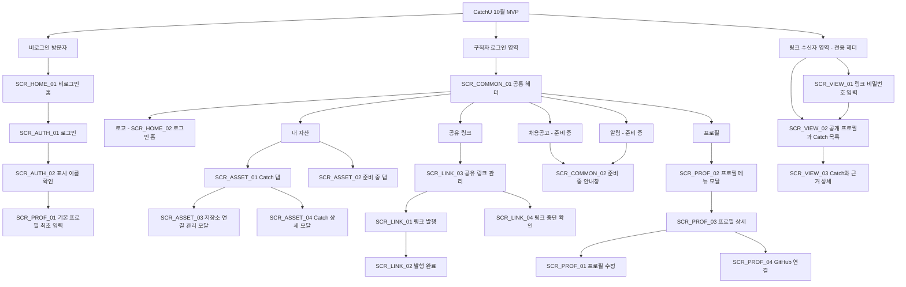
그림 1. 10월 MVP 메뉴 구성도

- 내 자산 안의 대표 구성 진입점은 10월에 숨긴다(#55 합의). 대표 구성은 첫 MVP 이후 개발이며 날짜는 미정이다.
- SCR_ASSET_01의 [링크 발행으로]로 SCR_LINK_01에 바로 갈 수도 있다(링크 초안의 연결 제안, 검토초안).
- 로그인 홈에서 저장소 선택 화면으로 바로 가지 않는다. 저장소 선택·동의·요청은 모두 SCR_ASSET_03에서 한다(9/15·9/24 팀장 결정).

## 4. 사용자 흐름

### 4.1 전체 흐름도

구직자는 로그인 → 프로필 → GitHub 연동 → 저장소 선택·동의·분석 요청 → 결과 확인 → 공개 선택 → 링크 발행 순서로 진행한다. 수신자는 받은 URL로 접속해 비밀번호(설정된 경우) → 공개 프로필·Catch 목록 → Catch 상세를 본다. 분석 요청·결과 확인·공개는 각각 사용자의 별도 행동이다(`user-flow.md` 주 흐름, 9/24 구조 반영).

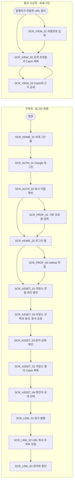
그림 2. 전체 사용자 흐름도(구직자와 링크 수신자)

- 공개 Catch가 0개여도 링크를 발행할 수 있다. 공개는 발행 조건이 아니다(9/14 팀장 확인, FR-LNK-01).
- 없는 URL·중단·만료 링크는 비밀번호 입력보다 먼저 "이 링크는 열람할 수 없습니다." 한 문구를 보인다(4.3절).

### 4.2 플로우차트 기호

학교 양식의 표준 기호를 mermaid 모양으로 그렸다.

| 기호 | 모양 | 뜻 |
|---|---|---|
| 시작·끝 | 둥근 양끝 상자 | 흐름의 시작과 끝 |
| 처리 | 사각형 | 화면 이동, API 호출 등 시스템 처리 |
| 입력 | 평행사변형 | 사용자의 선택·입력·버튼 누름 |
| 판단 | 마름모 | 조건에 따른 분기 |
| 출력 | 문서 모양 | 사용자에게 보이는 결과·안내 |

### 4.3 핵심 기능 ① 저장소 연결 → 분석 요청 → 진행 → 결과 확인

근거: web 기능 설계 W1·W2·W3·W8과 「내 자산 화면 구조」, API 명세 v1 「분석 접수·상태·재요청」.

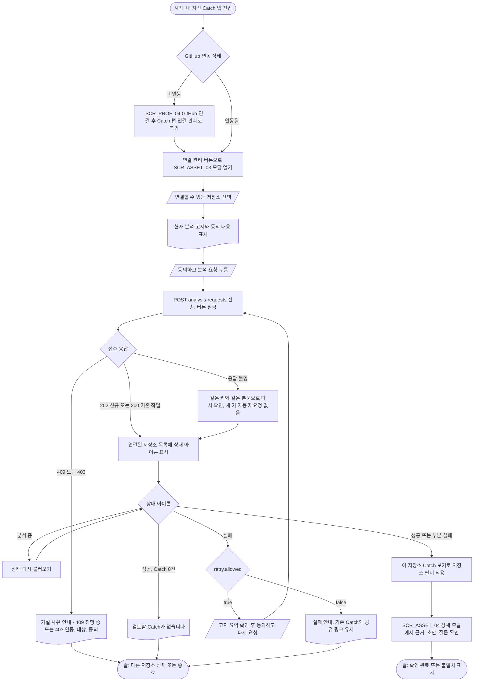
그림 3. 핵심 기능 ① 저장소 연결·분석 요청·진행·결과 확인 플로우차트

- '분석 중'은 대기·실행 중, 실행 불명(UNCERTAIN), 반영 중·반영 실패·복구 중을 묶은 아이콘이다. 조회 실패는 작업 실패나 0건이 아니며 다시 불러오기만 한다(5.13절 상태 표).
- [이 저장소 Catch 보기]는 성공·부분 실패이고 서버가 본인 열람 준비(ownerResultsReady)를 확인했을 때만 쓸 수 있다. 부분 실패는 10월 재요청 대상이 아니다.
- 재요청 버튼은 서버의 `retry.allowed`가 true일 때만 보인다. 재요청은 새 동의로 새 요청을 만들며 이전 동의를 다시 쓰지 않는다(BR-04). 자동 재시도는 없다.

### 4.4 핵심 기능 ② Catch 공개 → 링크 발행 → 수신자 열람

근거: web 기능 설계 W5·W6·W7, API 명세 v1 「P — 수신자 API」, 후속 입력 9/14·9/15 링크 관련 팀장 확인.

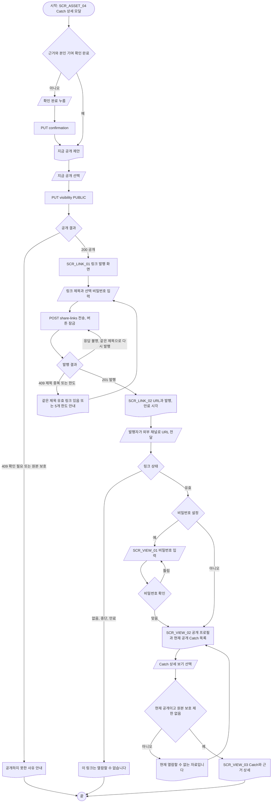
그림 4. 핵심 기능 ② Catch 공개·링크 발행·수신자 열람 플로우차트

- 확인 완료만으로 공개되지 않는다. 공개는 서버가 현재 확인·원본 보호 조건을 검사한 뒤 반영한다(BR-09). 불일치 표시가 있는 Catch도 공개할 수 있으며, 공개할 때 화면에서 알린다(BR-22, 알림 표현은 미정).
- 링크는 소유자의 **현재 공개 Catch 전체**를 연다. 링크와 특정 Catch를 연결하지 않으며, 숨긴 Catch는 기존 링크의 다음 요청부터 빠진다(BR-11, FR-LNK-03).
- 발행자가 [링크 중단](SCR_LINK_04)을 하면 수신자는 다음 이동·새로고침부터 "이 링크는 열람할 수 없습니다."를 본다. 이미 열린 화면을 실시간으로 지우지 않는다(9/15 팀장 확인).

### 4.5 핵심 기능 ③ 로그인 → 프로필 → GitHub 연결

근거: web 기능 설계 W1, 후속 입력 「인증·홈 진입」(9/14)·「GitHub 연동·자산 탭 분석 경로」(9/15, 9/24 일부 대체), 회원·자산 초안 W01~W02-G(검토초안).

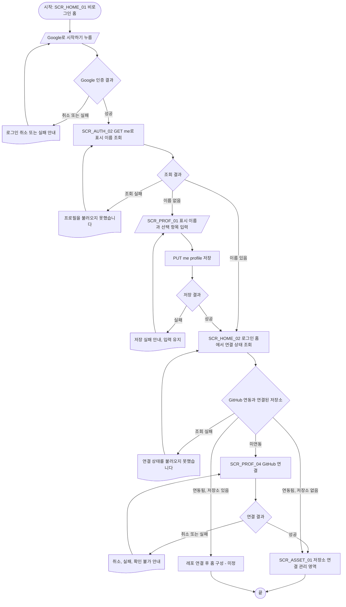
그림 5. 핵심 기능 ③ 로그인·프로필·GitHub 연결 플로우차트

- 실제 Google·GitHub OAuth 경로는 OQ-A1에서 정한다. 개발 중에는 #87 개발용 로그인을 #106의 진입 화면으로 쓴다(개발 설정에서만 보임).
- '이름 없음 → 프로필 입력' 분기는 회원 초안(A)의 원안이다. 이름을 저장하지 않은 회원의 이동 규칙과 표시 이름 필수 여부는 미정이다(#106·A 담당).
- GitHub 연결 없이도 홈에 들어갈 수 있다. 분석 요청 전에는 연동이 필요하다(9/15 팀장 결정). 조회 중·조회 실패를 미연동으로 단정하지 않는다.

## 5. 화면별 설계

화면마다 ① 화면 정보 ② 화면 그림 ③ 항목 정의 ④ 이벤트 처리 ⑤ 상태별 화면 순서로 적는다. 항목의 '데이터'는 API 명세 v1의 필드 이름이다. 학교 양식의 '번호별 설명(기능·사용자 입력·세부·결과)'은 ③ 항목 정의(무엇을 보여 주는지·세부 조건)와 ④ 이벤트 처리(사용자 입력·처리·결과)로 나눠 적었다. ④의 '번호'는 ③과 그림의 번호이며, '—'는 화면 진입처럼 특정 항목이 없는 동작이다.

### 5.1 SCR_COMMON_01 10월 공통 헤더

**① 화면 정보**

| 항목 | 내용 |
|---|---|
| 화면 ID | SCR_COMMON_01 |
| 화면 이름 | 10월 공통 헤더 |
| 유형·사용자 | 공통 영역 / 구직자, 비로그인 방문자, 링크 수신자 |
| 관련 UC | UC-01, UC-14 |
| 관련 FR | FR-MEM-01 |
| 관련 규칙 | NFR-SEC-01(수신자 화면에 관리 메뉴를 노출하지 않음) |
| 작성자(담당) | 최수영(#106 루트 레이아웃과 10월 헤더) |
| 메뉴 경로 | 모든 화면 상단 |
| 화면 개요 | 로그인 여부와 화면 종류에 따라 세 가지 헤더를 쓴다. 로그인 회원 헤더, 비로그인 홈 헤더, 링크 수신자 전용 헤더 |
| 근거·지위 | #55 10월 헤더 합의(이영연·최수영, 9/22·9/23), 9/16 회의 결정 §1·§3 — 팀 합의·팀장 결정. 그림은 제안안 |
| 옛 ID | 홈 초안 §5.1.1 헤더, 링크 초안 §3.1 수신자 전용 헤더 |

**② 화면 그림**

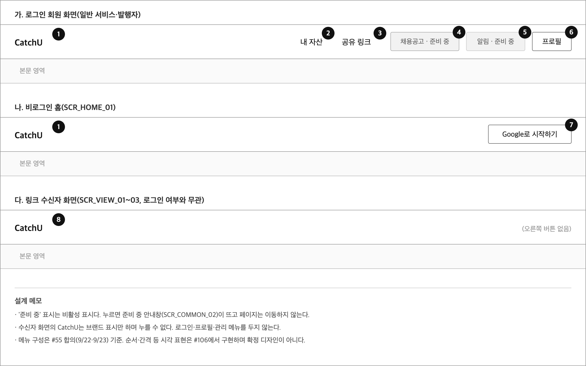

**③ 항목 정의**

| 번호 | 항목 | 유형 | 데이터·설명 | 필수/조건 |
|---|---|---|---|---|
| 1 | CatchU 로고 | 링크 | 로그인 상태면 SCR_HOME_02, 비로그인이면 SCR_HOME_01로 간다. 별도 [홈] 메뉴는 없다 | 로그인·비로그인 헤더 |
| 2 | 내 자산 | 메뉴 | SCR_ASSET_01로 간다. 현재 위치면 굵게 표시 | 로그인 |
| 3 | 공유 링크 | 메뉴 | SCR_LINK_03으로 간다 | 로그인 |
| 4 | 채용공고 · 준비 중 | 비활성 메뉴 | 누를 수 있으나 기능은 없다. 누르면 SCR_COMMON_02. 채용공고는 12월 | 로그인 |
| 5 | 알림 · 준비 중 | 비활성 메뉴 | 같음. 알림 목록·배지·설정은 10월에 없다 | 로그인 |
| 6 | [프로필] | 버튼 | SCR_PROF_02 모달을 연다 | 로그인 |
| 7 | [Google로 시작하기] | 버튼 | SCR_AUTH_01의 로그인 흐름. 본문 버튼과 같은 흐름 | 비로그인 홈 |
| 8 | 수신자 브랜드 표시 | 표시 | 글자만 있고 누를 수 없다. 로그인 여부에 따라 바뀌지 않는다. 로그인·프로필·관리 메뉴 없음 | SCR_VIEW_01~03 |

**④ 이벤트 처리**

| 번호 | 사용자 액션 | 처리(API) | 결과·이동 | 예외 처리 |
|---|---|---|---|---|
| 1 | 로고 누름 | API 없음. web이 가진 로그인 토큰으로 판단(#106) | 로그인 홈 또는 비로그인 홈 | 로그인 상태 확인 중에는 개인 메뉴와 CTA를 판정 전에 실행하지 않음(홈 초안 §6.2) |
| 2·3 | 내 자산·공유 링크 누름 | 회원 경로 가드(#106) | SCR_ASSET_01·SCR_LINK_03 | 토큰이 없거나 401(`AUTH_REQUIRED`·`AUTH_INVALID`)이면 토큰을 버리고 로그인 진입으로 보냄(#106) |
| 4·5 | 채용공고·알림 누름 | API 없음 | 현재 화면 위에 SCR_COMMON_02. 페이지 이동 없음 | — |
| 6 | [프로필] 누름 | API 없음 | SCR_PROF_02 | — |
| 7 | [Google로 시작하기] 누름 | 로그인 흐름 시작(계약 미정, OQ-A1) | SCR_AUTH_01 | — |
| 8 | 수신자 브랜드 누름 | 없음 | 이동하지 않음 | — |

**⑤ 상태별 화면**

| 상태 | 표시 |
|---|---|
| 표시 이름 확인·최초 프로필 입력 중(SCR_AUTH_02, SCR_PROF_01 최초 입력) | 로고와 [로그아웃]만 보인다(v2.2 검토초안). 최초 입력의 이름 저장 조건을 헤더 이동으로 우회하지 않는다(#55 합의) |
| 로그인 세션 만료 확인 | 개인 메뉴 표시를 멈추고 로그인 경로를 안내한다(홈 초안 §6.2) |

### 5.2 SCR_COMMON_02 준비 중 안내창(채용공고·알림)

**① 화면 정보**

| 항목 | 내용 |
|---|---|
| 화면 ID | SCR_COMMON_02 |
| 화면 이름 | 준비 중 안내창(채용공고·알림) |
| 유형·사용자 | 모달 / 구직자 |
| 관련 UC | 없음 |
| 관련 FR | 없음(12월 채용공고·알림 기능의 자리) |
| 작성자(담당) | 최수영(#106 완료 기준) |
| 메뉴 경로 | 헤더 > 채용공고 또는 알림 |
| 화면 개요 | 10월에 제공하지 않는 메뉴를 누르면 현재 화면 위에 작은 안내창을 띄운다 |
| 근거·지위 | #55 9/23 합의(이영연·최수영), 링크 초안 §4.1 — 팀 합의. 그림은 제안안 |

**② 화면 그림**

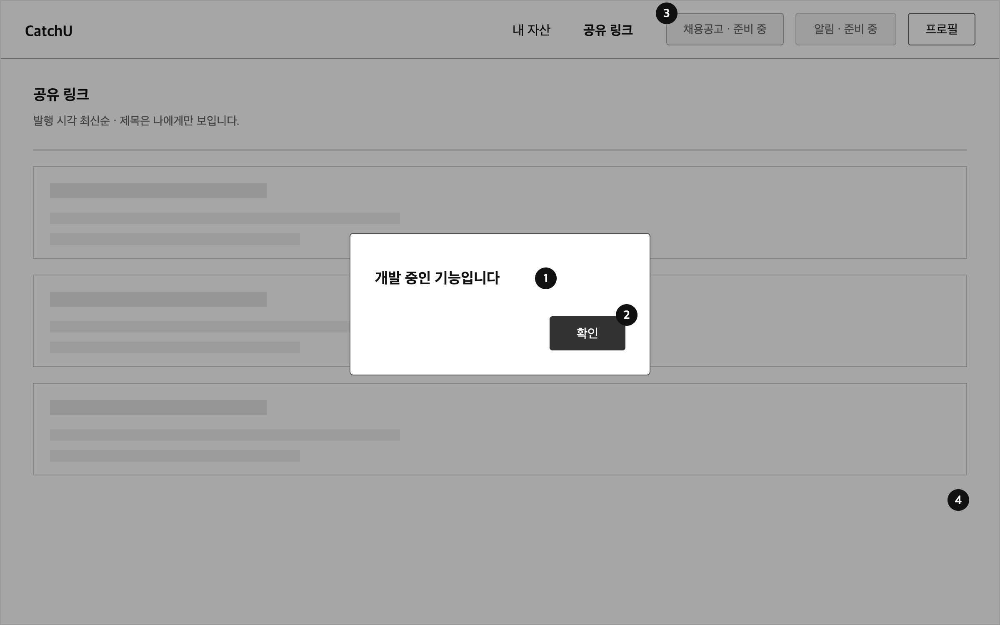

**③ 항목 정의**

| 번호 | 항목 | 유형 | 데이터·설명 | 필수/조건 |
|---|---|---|---|---|
| 1 | 안내 문구 | 표시 | "개발 중인 기능입니다" | 항상 |
| 2 | [확인] | 버튼 | 안내창만 닫는다 | 항상 |
| 3 | 누른 메뉴 | 트리거 | 헤더의 채용공고 또는 알림 | — |
| 4 | 뒤 화면 | 표시 | 기존 화면을 그대로 유지한다 | — |

**④ 이벤트 처리**

| 번호 | 사용자 액션 | 처리(API) | 결과·이동 | 예외 처리 |
|---|---|---|---|---|
| 3 | 채용공고·알림 누름 | API 없음 | 안내창 열림. 페이지 이동 없음 | — |
| 2 | [확인] 누름 | API 없음 | 안내창 닫힘, 기존 화면 유지. 초점은 누른 메뉴로 돌아감(접근성 제안) | X·Esc·바깥 클릭으로 닫을지는 미정(#55) |

**⑤ 상태별 화면**

상태 구분이 없다. 마우스 올림 툴팁은 합의에 없다.

### 5.3 SCR_AUTH_01 로그인

**① 화면 정보**

| 항목 | 내용 |
|---|---|
| 화면 ID | SCR_AUTH_01 |
| 화면 이름 | 로그인 |
| 유형·사용자 | 페이지 / 구직자 |
| 관련 UC | UC-01 |
| 관련 FR | FR-MEM-01 |
| 관련 규칙 | BR-01 |
| 작성자(담당) | 이영연(A) |
| 메뉴 경로 | SCR_HOME_01 > [Google로 시작하기] |
| 화면 개요 | Google 계정으로 로그인한다. 로그인은 GitHub 연결·분석 동의·Catch 공개가 아니다 |
| 근거·지위 | 9/14 팀장 확인(기본 로그인은 Google OAuth), 회원·자산 초안 W01(검토초안), v2.2 W01(검토초안) |
| 옛 ID | W01 |

**② 화면 그림**

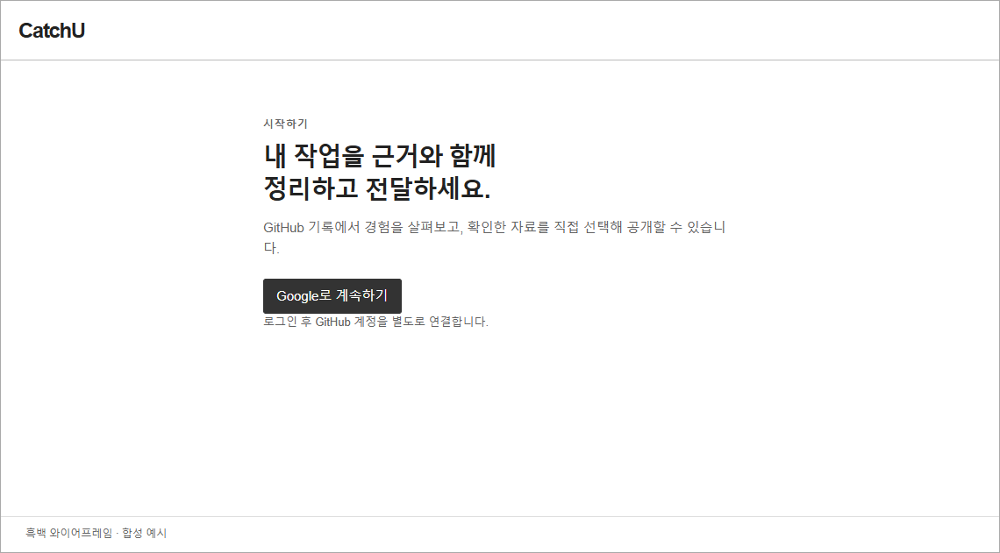

**③ 항목 정의**

| 번호 | 항목 | 유형 | 데이터·설명 | 필수/조건 |
|---|---|---|---|---|
| 1 | CatchU 로고 | 표시 | 헤더. 메뉴 없음 | 항상 |
| 2 | 서비스 안내 | 표시 | 제목과 한 줄 설명(문구 제안) | 항상 |
| 3 | [Google로 계속하기] | 버튼 | Google 인증을 시작한다 | 항상 |
| 4 | 보조 안내 | 표시 | "로그인 후 GitHub 계정을 별도로 연결합니다." | 항상 |
| 5 | 안내 영역 | 표시 | 취소·실패·세션 만료 문구(⑤) | 해당 상태 |
| 6 | 개발용 로그인 진입 | 버튼 | #87 개발용 로그인을 부른다. 그림에는 없다 | 개발 설정에서만 보임(#106). api는 운영 설정(`NODE_ENV=production`)에서 개발용 로그인을 거부한다(api README) |

**④ 이벤트 처리**

| 번호 | 사용자 액션 | 처리(API) | 결과·이동 | 예외 처리 |
|---|---|---|---|---|
| 3 | [Google로 계속하기] 누름 | Google OAuth — 계약 미정(OQ-A1) | 성공하면 SCR_AUTH_02 | 취소: "로그인을 취소했습니다." / 실패: "로그인하지 못했습니다. 다시 시도해 주세요." 인증 응답을 확인하지 못한 것을 계정 없음으로 단정하지 않음 |
| 6 | 개발용 로그인 누름 | #87 개발용 토큰 발급(운영 OpenAPI에 없음) | 토큰을 브라우저 메모리에만 두고 SCR_AUTH_02 | 새로고침하면 토큰이 사라져 다시 로그인(#106). 토큰을 localStorage·쿠키·URL·로그에 남기지 않음 |

**⑤ 상태별 화면**

| 상태 | 조건 | 표시·행동 |
|---|---|---|
| 취소 | 사용자가 Google 인증을 취소 | "로그인을 취소했습니다." + [Google로 계속하기] |
| 실패 | 인증 실패 확인 | "로그인하지 못했습니다. 다시 시도해 주세요." |
| 세션 만료 | 다른 화면에서 만료가 확인되어 돌아옴 | "로그인이 만료되었습니다." 재로그인 뒤 표시 이름부터 다시 확인 |

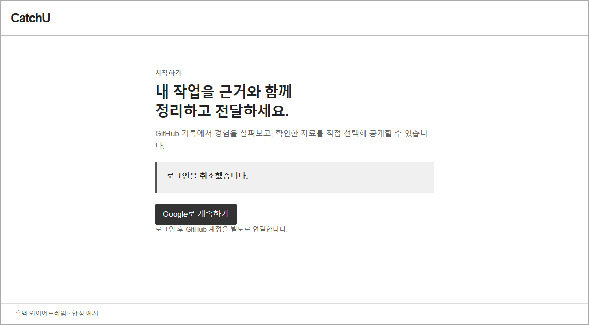

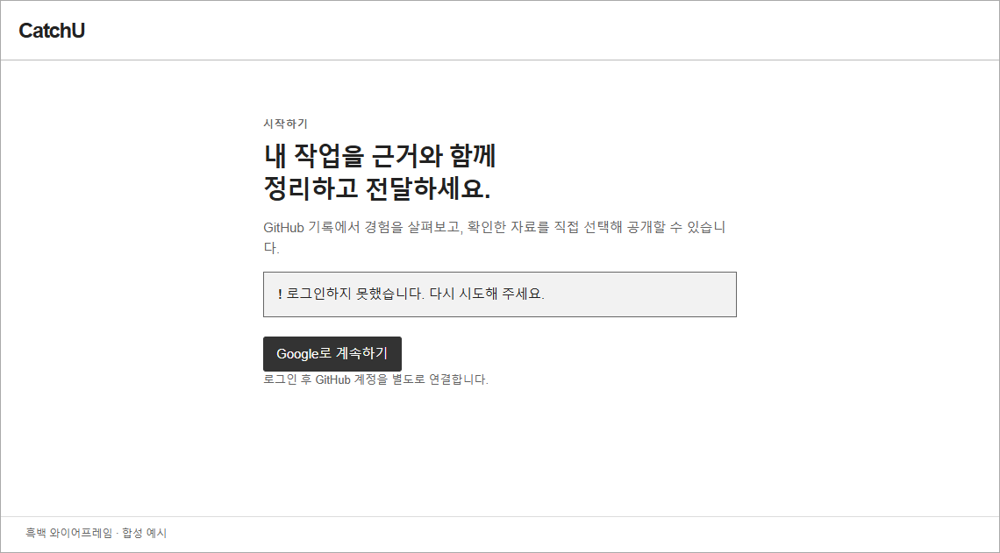

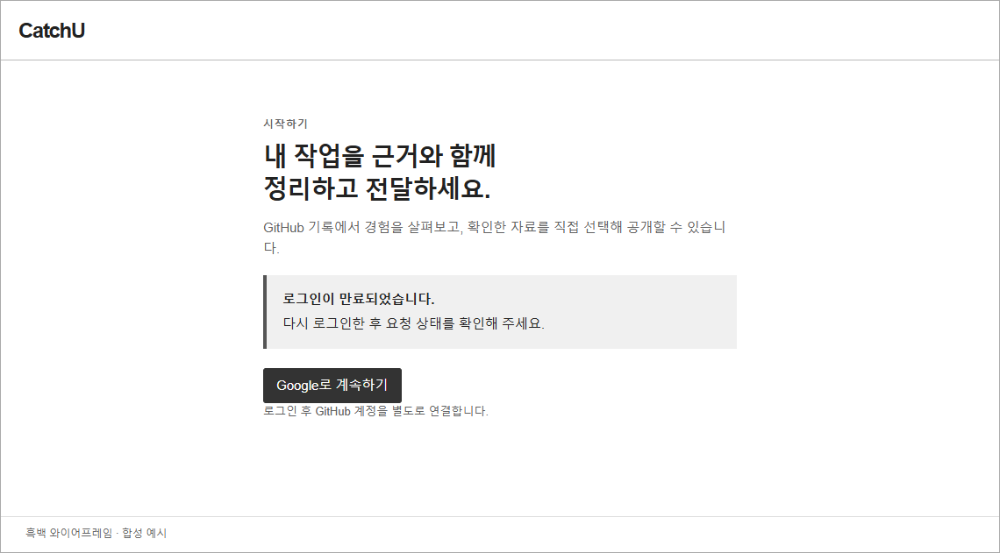

### 5.4 SCR_AUTH_02 로그인 후 표시 이름 확인

**① 화면 정보**

| 항목 | 내용 |
|---|---|
| 화면 ID | SCR_AUTH_02 |
| 화면 이름 | 로그인 후 표시 이름 확인 |
| 유형·사용자 | 페이지 / 구직자 |
| 관련 UC | UC-01 |
| 관련 FR | FR-MEM-01, FR-MEM-03 |
| 관련 규칙 | BR-01 |
| 작성자(담당) | 이영연(A) |
| 메뉴 경로 | SCR_AUTH_01 > 로그인 성공 |
| 화면 개요 | 로그인 직후 서비스에 저장된 표시 이름을 조회해 다음 화면을 정한다. 조회 실패를 이름 없음으로 처리하지 않는다 |
| 근거·지위 | 회원·자산 초안 W01-R, v2.2 W01-R — 검토초안. 이름을 저장하지 않은 회원의 이동 규칙은 미정(#106·A) |
| 옛 ID | W01-R |

**② 화면 그림**

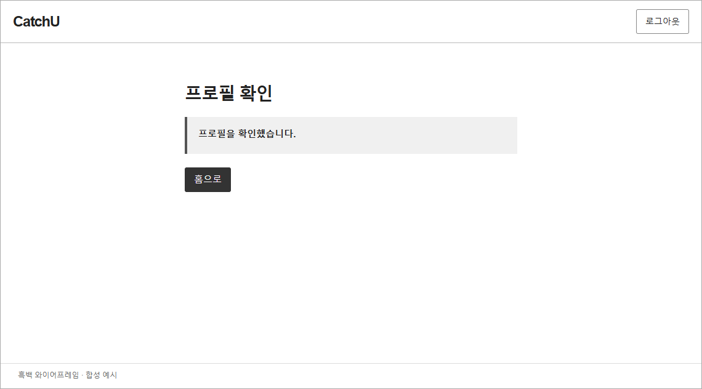

**③ 항목 정의**

| 번호 | 항목 | 유형 | 데이터·설명 | 필수/조건 |
|---|---|---|---|---|
| 1 | [로그아웃] | 버튼 | 헤더 오른쪽. CatchU 세션만 끝낸다(Google 계정 로그아웃 아님) | 항상 |
| 2 | 제목 "프로필 확인" | 표시 | — | 항상 |
| 3 | 결과 안내 | 표시 | `GET /me`의 `profile.displayName` 조회 결과: 조회 중·확인됨·이름 없음(빈 문자열)·조회 실패 | 항상 |
| 4 | 다음 행동 버튼 | 버튼 | 확인됨 [홈으로] / 이름 없음 [프로필 입력] / 조회 실패 [다시 불러오기] / 조회 중 비활성 | 상태별 |

**④ 이벤트 처리**

| 번호 | 사용자 액션 | 처리(API) | 결과·이동 | 예외 처리 |
|---|---|---|---|---|
| — | 화면 진입 | `GET /me` | 표시 이름 유무로 안내·버튼 결정 | 401이면 로그인 진입. 조회 실패를 빈 프로필이나 Google 이름으로 대체하지 않음 |
| 4 | [홈으로] 누름 | API 없음 | SCR_HOME_02 | — |
| 4 | [프로필 입력] 누름 | API 없음 | SCR_PROF_01 최초 입력 | 이동 규칙은 A 원안, 확정은 #106 |
| 4 | [다시 불러오기] 누름 | `GET /me` 재조회. 조회 중 버튼 비활성 | 결과에 따라 분기 | 자동 재시도 없음. 유효한 세션에서 Google 인증을 반복하지 않음 |
| 1 | [로그아웃] 누름 | 계약 미정(OQ-A1의 logout) | 성공: SCR_HOME_01 | 실패: 현재 화면 유지, 완료로 표시하지 않음(#51 합의) |

**⑤ 상태별 화면**

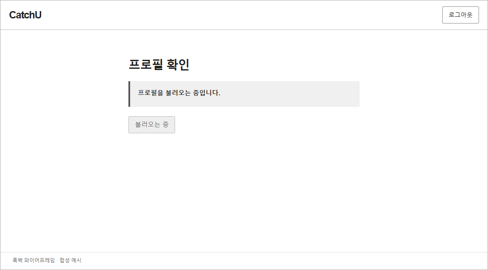

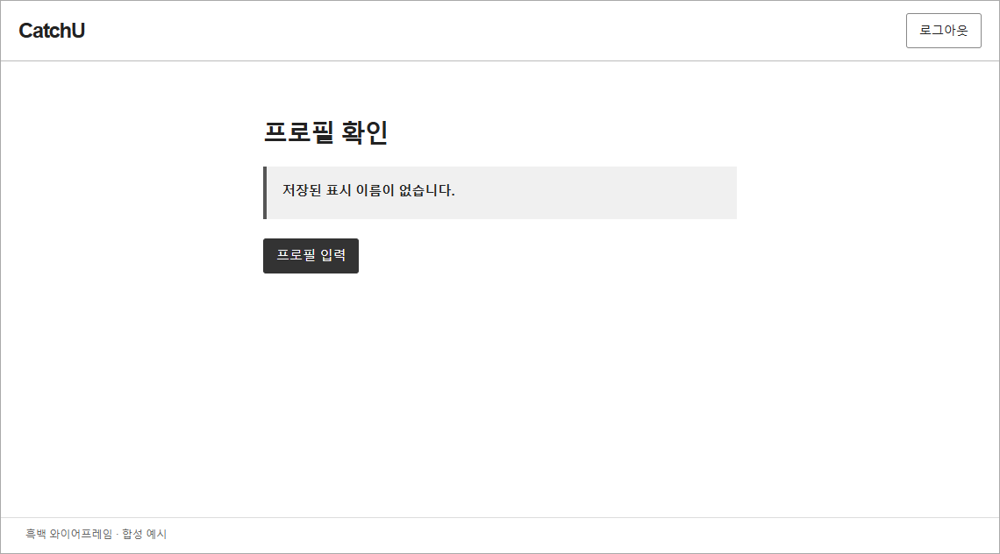

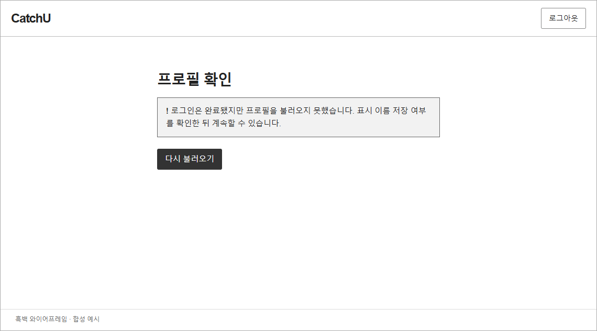

### 5.5 SCR_PROF_01 기본 프로필 입력·수정

**① 화면 정보**

| 항목 | 내용 |
|---|---|
| 화면 ID | SCR_PROF_01 |
| 화면 이름 | 기본 프로필 입력·수정 |
| 유형·사용자 | 페이지 / 구직자 |
| 관련 UC | UC-02 |
| 관련 FR | FR-MEM-03 |
| 관련 규칙 | BR-01(본인 소유·자가 입력 출처), BR-23(공개 프로필 항목·열람 시점 현재 내용) |
| 작성자(담당) | 이영연(A) |
| 메뉴 경로 | 최초 입력: SCR_AUTH_02 > [프로필 입력] / 수정: 헤더 > [프로필] > [프로필 보기] > [프로필 수정] |
| 화면 개요 | 표시 이름·한 줄 소개·직무·기술 스택을 저장한다. 최초 입력과 이후 수정은 같은 화면의 두 상태다 |
| 근거·지위 | API 명세 v1(프로필 4항목은 자가 입력) — 승인. 9/20 팀장 결정(공개 항목·현재 내용 반영). 회원·자산 초안 W02·#51 합의(수정 후 상세로 복귀). 표시 이름만 필수로 두는 안은 검토용 제안 U2 |
| 옛 ID | W02 |

**② 화면 그림**

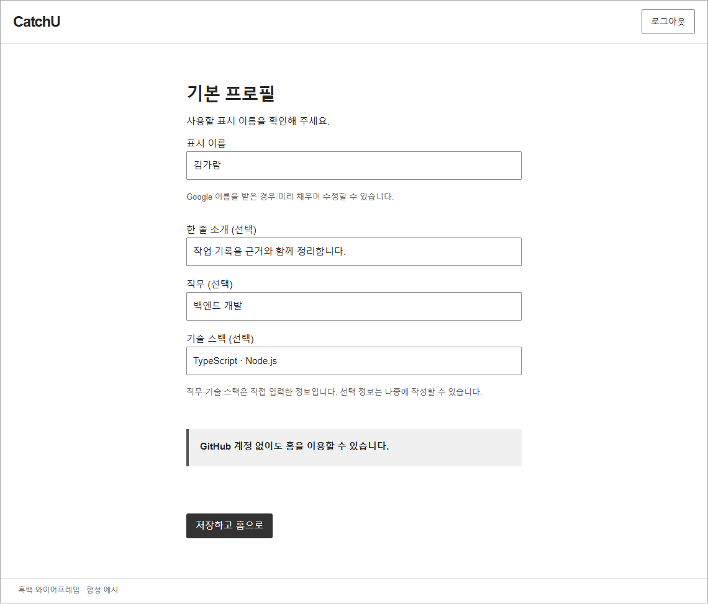

**③ 항목 정의**

| 번호 | 항목 | 유형 | 데이터·설명 | 필수/조건 |
|---|---|---|---|---|
| 1 | [로그아웃] | 버튼 | 헤더. 최초 입력 중에는 다른 메뉴가 없다 | 최초 입력 |
| 2 | 제목·안내 | 표시 | "기본 프로필 / 사용할 표시 이름을 확인해 주세요." | 항상 |
| 3 | 표시 이름 | 입력 | `displayName`(string). Google 이름을 받으면 최초 입력에만 미리 채운다. 수정 때 Google 이름으로 덮어쓰지 않는다 | 필수(검토용 제안 U2, 필수 여부 미정). 길이·허용 문자 미정 |
| 4 | 한 줄 소개 | 입력 | `introduction`(string, 없으면 빈 문자열) | 선택 |
| 5 | 직무 | 입력 | `desiredRole`(string) | 선택 |
| 6 | 기술 스택 | 입력 | `skills`(문자열 목록, 없으면 빈 배열). 입력 방식은 화면 제안 | 선택 |
| 7 | 자가 입력 안내 | 표시 | "직무·기술 스택은 직접 입력한 정보입니다." 저장값의 출처는 SELF_REPORTED | 항상 |
| 8 | GitHub 안내 | 표시 | "GitHub 계정 없이도 홈을 이용할 수 있습니다."(9/14 팀 합의) | 최초 입력 |
| 9 | [저장하고 홈으로] | 버튼 | 저장 성공 뒤 SCR_HOME_02 | 최초 입력 |
| 10 | 공개 반영 안내 | 표시 | "프로필 수정은 기존 공유 링크의 다음 조회에도 반영됩니다."(9/20 팀장 결정에 따른 안내) | 수정 |
| 11 | [취소]·[저장] | 버튼 | 저장 성공·취소 후 SCR_PROF_03으로 복귀(#51 합의) | 수정 |

**④ 이벤트 처리**

| 번호 | 사용자 액션 | 처리(API) | 결과·이동 | 예외 처리 |
|---|---|---|---|---|
| 9 | [저장하고 홈으로] 누름 | `PUT /me/profile`(4항목 전체 저장). 저장 중 버튼 비활성 | 200이면 SCR_HOME_02 | 표시 이름 빈 값: "표시 이름을 입력해 주세요."(제안) / `400/VALIDATION_FAILED`: `details.violations`의 필드에 안내 / 실패: "저장하지 못했습니다. 입력 내용을 유지합니다." / 응답 불명: `GET /me`로 저장 여부 재확인, 자동 재제출 없음 |
| 11 | [저장] 누름 | `PUT /me/profile` | 200이면 SCR_PROF_03 | 실패하면 입력 유지. 응답 불명은 "저장 여부를 확인하지 못했습니다" + [저장된 프로필 확인](제안) |
| 11 | [취소] 누름 | API 없음 | SCR_PROF_03 | 미저장 변경이 있으면 "작성한 내용을 저장하지 않고 나갈까요?" [계속 작성]/[나가기](제안) |
| 1 | [로그아웃] 누름 | 로그아웃 계약 미정(OQ-A1) | 성공 뒤 입력 폐기, SCR_HOME_01 | 변경이 있으면 먼저 확인. 확인에 동의해도 입력은 성공 뒤에만 폐기. 실패하면 화면·입력 유지(#51) |
| — | 수정 상태 진입 | `GET /me` | 저장된 값을 채움 | 조회 중 저장 막음. 조회 실패는 오류·[다시 불러오기]·[돌아가기], 빈 프로필로 대체하지 않음 |

**⑤ 상태별 화면**

| 상태 | 표시 |
|---|---|
| 수정 | 제목 "프로필 수정", 공개 반영 안내, [취소]·[저장](그림 17) |
| 표시 이름 비어 있음 | 저장 시 "표시 이름을 입력해 주세요."(그림 18) |
| 저장 실패 | "저장하지 못했습니다. 입력 내용을 유지합니다."(그림 19) |
| 저장 중 | 저장·로그아웃 버튼 비활성, 중복 저장 방지 |

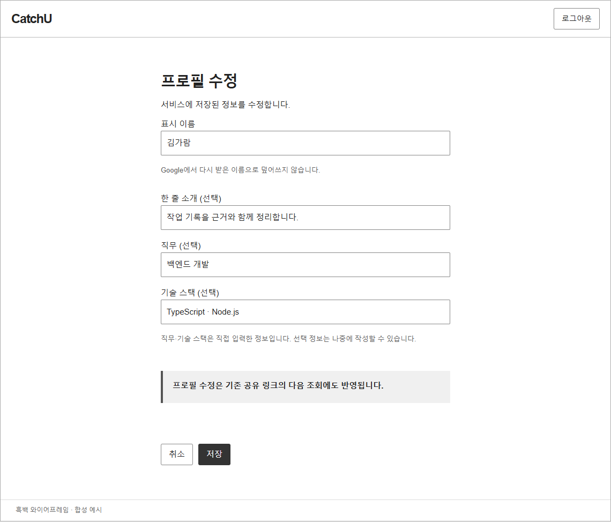

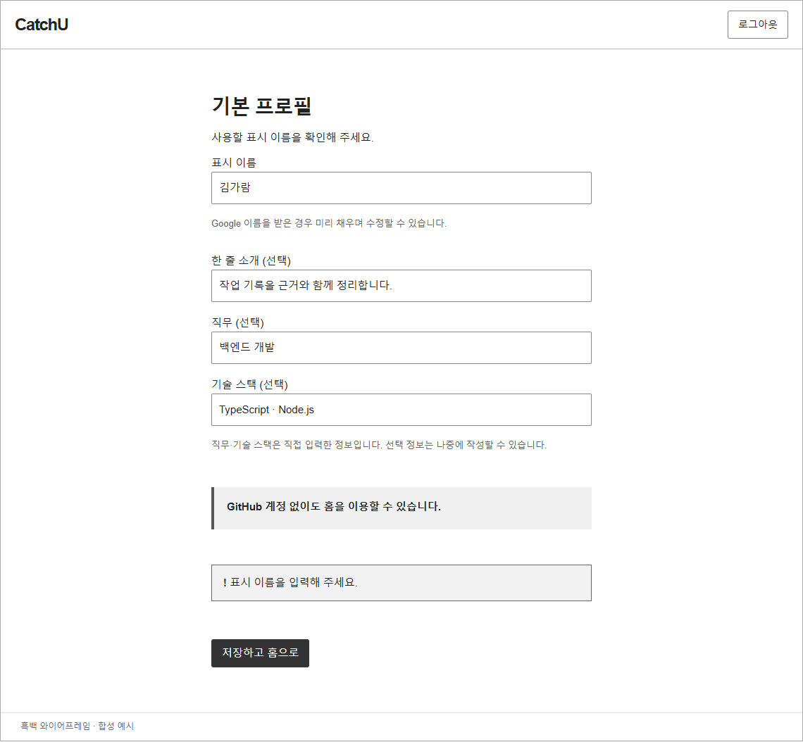

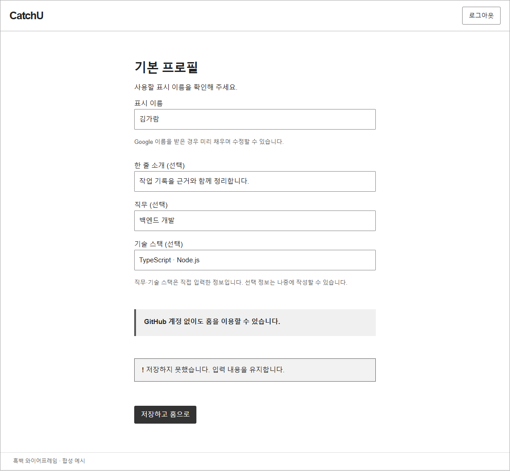

### 5.6 SCR_PROF_02 프로필 메뉴 모달

**① 화면 정보**

| 항목 | 내용 |
|---|---|
| 화면 ID | SCR_PROF_02 |
| 화면 이름 | 프로필 메뉴 모달 |
| 유형·사용자 | 모달 / 구직자 |
| 관련 UC | UC-01, UC-02 |
| 관련 FR | FR-MEM-01, FR-MEM-03 |
| 작성자(담당) | 이영연(A) |
| 메뉴 경로 | 헤더 > [프로필] |
| 화면 개요 | 프로필 버튼 근처에 모달을 열어 프로필 보기와 로그아웃을 제공한다. 수정·GitHub 연결은 상세 프로필에서 들어간다 |
| 근거·지위 | 9/15 오후 회의 결론(프로필 → 모달 → [프로필 보기] → 상세), #51 합의(모달 항목은 프로필 보기·로그아웃) — 팀장 결정·팀 합의. 그림은 v2.2 검토초안 |
| 옛 ID | W02-P(모달) |

**② 화면 그림**

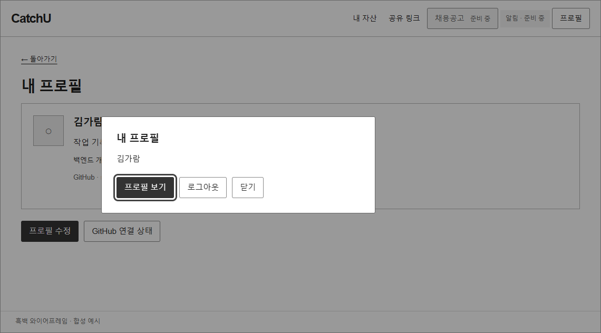

**③ 항목 정의**

| 번호 | 항목 | 유형 | 데이터·설명 | 필수/조건 |
|---|---|---|---|---|
| 1 | 모달 제목 "내 프로필" | 표시 | — | 항상 |
| 2 | 표시 이름 | 표시 | `GET /me`의 `profile.displayName` | 항상 |
| 3 | [프로필 보기] | 버튼 | SCR_PROF_03 | 항상 |
| 4 | [로그아웃] | 버튼 | CatchU 세션 종료 | 항상 |
| 5 | [닫기] | 버튼 | 모달을 닫는다(v2.2 검토초안) | 닫기 조작 조합은 미정(#51) |

**④ 이벤트 처리**

| 번호 | 사용자 액션 | 처리(API) | 결과·이동 | 예외 처리 |
|---|---|---|---|---|
| — | [프로필] 누름 | 이미 받은 `GET /me` 결과 사용 | 모달 열림, 초점은 모달 안(접근성 제안) | — |
| 3 | [프로필 보기] 누름 | API 없음 | SCR_PROF_03 | 미저장 변경이 있는 화면이면 이탈 확인 먼저 |
| 4 | [로그아웃] 누름 | 로그아웃 계약 미정(OQ-A1) | 성공: SCR_HOME_01 | 실패: 현재 화면 유지, 완료로 표시하지 않음. 실패 안내 문구는 미정(#51) |
| 5 | [닫기] 누름 | API 없음 | 연 화면 유지, 초점은 [프로필] 버튼으로 | — |

**⑤ 상태별 화면**

로그아웃 실패 안내 외 별도 상태가 없다. 알림 설정 진입은 12월이다(9/16 회의 결정 §1).

### 5.7 SCR_PROF_03 프로필 상세 보기

**① 화면 정보**

| 항목 | 내용 |
|---|---|
| 화면 ID | SCR_PROF_03 |
| 화면 이름 | 프로필 상세 보기 |
| 유형·사용자 | 페이지 / 구직자 |
| 관련 UC | UC-02, UC-03 |
| 관련 FR | FR-MEM-03 |
| 관련 규칙 | BR-01, BR-23 |
| 작성자(담당) | 이영연(A) |
| 메뉴 경로 | 헤더 > [프로필] > [프로필 보기] |
| 화면 개요 | 저장된 본인 프로필과 GitHub 연결 상태를 보고, 수정·GitHub 연결로 들어간다 |
| 근거·지위 | #51 합의, 회원·자산 초안 W02-P, v2.2 W02-P — 검토초안 |
| 옛 ID | W02-P(상세) |

**② 화면 그림**

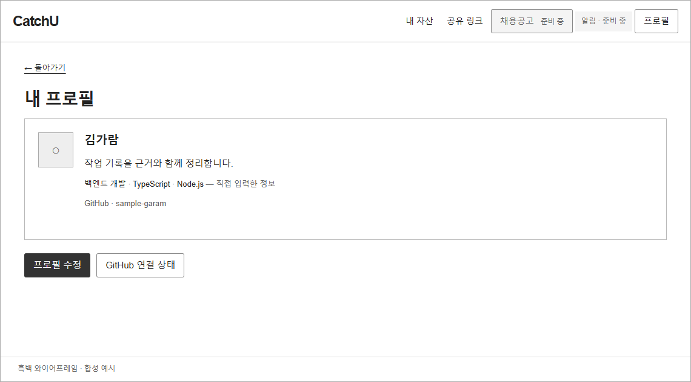

**③ 항목 정의**

| 번호 | 항목 | 유형 | 데이터·설명 | 필수/조건 |
|---|---|---|---|---|
| 1 | [← 돌아가기] | 링크 | 상세를 연 화면으로 복귀 | 항상 |
| 2 | 제목 "내 프로필" | 표시 | — | 항상 |
| 3 | 프로필 이미지 자리 | 표시 | 자리 표시만 있다. 프로필 사진 필드는 API 명세 v1에 없다 | — |
| 4 | 표시 이름 | 표시 | `profile.displayName` | 항상 |
| 5 | 한 줄 소개 | 표시 | `profile.introduction` | 값 있을 때 |
| 6 | 직무·기술 스택 | 표시 | `profile.desiredRole`, `profile.skills` + "직접 입력한 정보" | 값 있을 때 |
| 7 | GitHub 계정 | 표시 | `github.accountLogin` | 연동 시 |
| 8 | [프로필 수정] | 버튼 | SCR_PROF_01 수정 상태 | 항상 |
| 9 | [GitHub 연결 상태] | 버튼 | SCR_PROF_04 | 항상 |

**④ 이벤트 처리**

| 번호 | 사용자 액션 | 처리(API) | 결과·이동 | 예외 처리 |
|---|---|---|---|---|
| — | 화면 진입 | `GET /me` | 항목 표시 | 조회 중 로딩. 조회 실패는 "프로필을 불러오지 못했습니다." + [다시 불러오기], 빈 프로필로 표시하지 않음 |
| 8 | [프로필 수정] 누름 | API 없음 | SCR_PROF_01 수정 상태 | — |
| 9 | [GitHub 연결 상태] 누름 | API 없음 | SCR_PROF_04 | — |
| 1 | [← 돌아가기] 누름 | API 없음 | 이전 화면 | — |

**⑤ 상태별 화면**

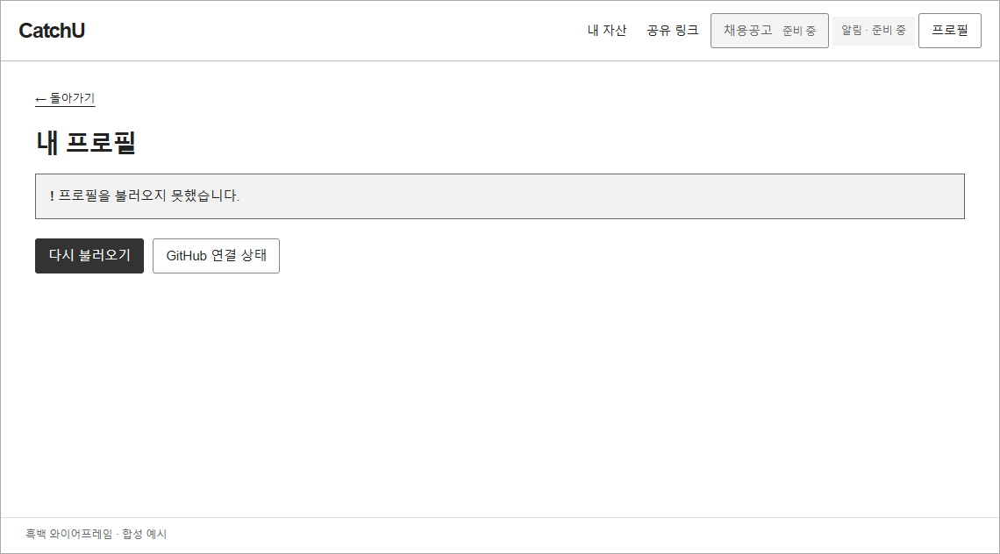

### 5.8 SCR_PROF_04 GitHub 연결

**① 화면 정보**

| 항목 | 내용 |
|---|---|
| 화면 ID | SCR_PROF_04 |
| 화면 이름 | GitHub 연결 |
| 유형·사용자 | 페이지 / 구직자 |
| 관련 UC | UC-03 |
| 관련 FR | FR-MEM-02 |
| 관련 규칙 | BR-01 |
| 작성자(담당) | 이영연(A) |
| 메뉴 경로 | SCR_PROF_03 > [GitHub 연결 상태] / SCR_HOME_02 > [연결하러 가기] / SCR_ASSET_01 연결 관리 영역의 GitHub 연결 안내 |
| 화면 개요 | GitHub 계정 연동 상태를 보고 연결한다. 연동은 계정 연결일 뿐 저장소 소유 검증·분석 동의·분석 요청이 아니다 |
| 근거·지위 | 9/15 팀장 결정(분석 전 연동 필요), 9/24 팀장 결정(**연동 성공 뒤 복귀 목적지를 Catch 탭의 저장소 연결 관리로 변경**). 회원·자산 초안 W02-G, v2.2 W02-G — 검토초안 |
| 옛 ID | W02-G |

**② 화면 그림**

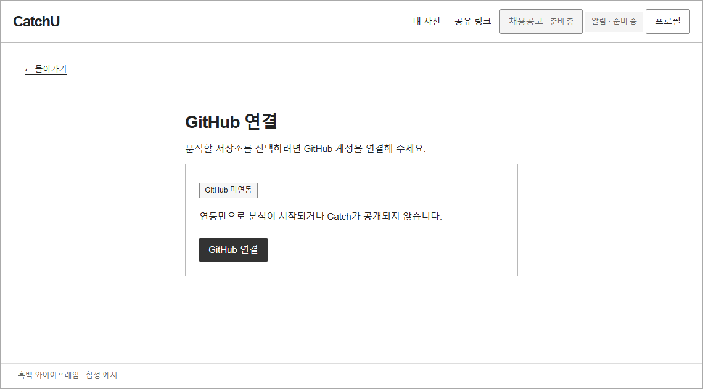

**③ 항목 정의**

| 번호 | 항목 | 유형 | 데이터·설명 | 필수/조건 |
|---|---|---|---|---|
| 1 | [← 돌아가기] | 링크 | 진입한 홈·프로필·내 자산으로 복귀. 출처를 모르면 홈 | 항상 |
| 2 | 제목·설명 | 표시 | "GitHub 연결 / 분석할 저장소를 선택하려면 GitHub 계정을 연결해 주세요." | 항상 |
| 3 | 연결 상태 | 표시 | `github.state`: DISCONNECTED "GitHub 미연동" / CONNECTED "GitHub 연동됨" / REAUTH_REQUIRED "GitHub 연결을 다시 확인해 주세요" | 조회 성공 시 |
| 4 | 연동 의미 안내 | 표시 | "연동만으로 분석이 시작되거나 Catch가 공개되지 않습니다." | 항상 |
| 5 | [GitHub 연결] / [다시 연결] | 버튼 | 외부 GitHub 인증 시작 | 미연동 / 재인증 필요 |
| 6 | 연결 계정 | 표시 | `github.accountLogin` | 연동됨 |
| 7 | 연동 후 이동 버튼 | 버튼 | SCR_ASSET_01의 저장소 연결 관리 영역으로 간다(9/24). v2.2 그림(W02-G-connected)의 [내 자산 GitHub 탭으로]는 쓰지 않는다 | 연동됨 |

**④ 이벤트 처리**

| 번호 | 사용자 액션 | 처리(API) | 결과·이동 | 예외 처리 |
|---|---|---|---|---|
| — | 화면 진입 | `GET /me`의 `github` | 상태 표시 | 조회 중 연동·미연동으로 단정하지 않음. 조회 실패: "연결 상태를 확인하지 못했습니다" + [상태 다시 확인], 미연동으로 표시하지 않음 |
| 5 | [GitHub 연결] 누름 | GitHub 연동 — 계약 미정(OQ-A1, GitHub 앱 종류·권한 포함). 진행 중 반복 요청 막음 | 외부 인증 뒤 CatchU 연결 저장 상태를 확인하고, 성공이면 SCR_ASSET_01 저장소 연결 관리 영역으로 복귀 | 취소: "GitHub 연결을 취소했습니다." / 실패: "GitHub 계정을 연결하지 못했습니다." / 응답 유실: 상태 재조회만, 자동 재연결·분석 요청 없음 |
| 7 | 연동 후 이동 버튼 누름 | API 없음 | SCR_ASSET_01 저장소 연결 관리 영역 | 복귀할 때 SCR_ASSET_03 모달을 자동으로 열지는 담당 개발 이슈에서 정함 |

**⑤ 상태별 화면**

| 상태 | 표시 |
|---|---|
| 연동 취소 | "GitHub 연결을 취소했습니다." + [GitHub 연결](그림 24). 기존 연결 삭제로 해석하지 않음 |
| 재인증 필요(REAUTH_REQUIRED) | "GitHub 연결을 다시 확인해 주세요. CatchU 로그인과 GitHub 권한·연결은 별개입니다. 기존 자료를 삭제하지 않습니다." + [다시 연결](그림 25) |
| 연동됨 | 연결 계정과 연동 후 이동 버튼. 목적지가 9/24에 바뀌어 v2.2 그림을 싣지 않는다 |
| 연결 해제 | 10월에는 GitHub 연결 해제·계정 교체 기능이 없다(회원·자산 초안). 해제 뒤 자료 처리는 OQ2 |

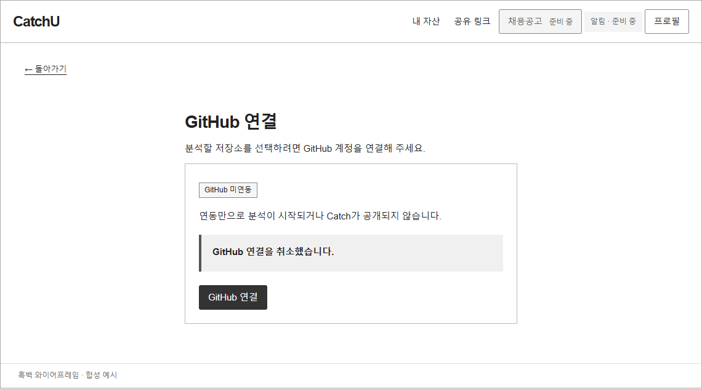

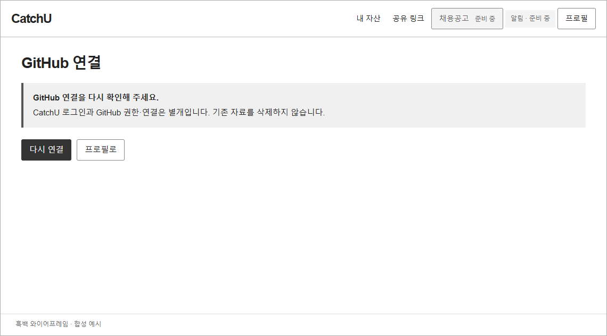

### 5.9 SCR_HOME_01 비로그인 홈

**① 화면 정보**

| 항목 | 내용 |
|---|---|
| 화면 ID | SCR_HOME_01 |
| 화면 이름 | 비로그인 홈 |
| 유형·사용자 | 페이지 / 비로그인 방문자 |
| 관련 UC | UC-01 |
| 관련 FR | FR-MEM-01 |
| 작성자(담당) | 최수영(D) |
| 메뉴 경로 | 로고(비로그인) / 서비스 첫 방문 / 로그아웃 성공 뒤 |
| 화면 개요 | 서비스 소개와 가상 Catch 예시, Google 시작 버튼을 보여 준다 |
| 근거·지위 | 서비스 홈 초안 §5.2, v2.2 H-01 — 검토초안 |
| 옛 ID | H-01(비로그인) |

**② 화면 그림**

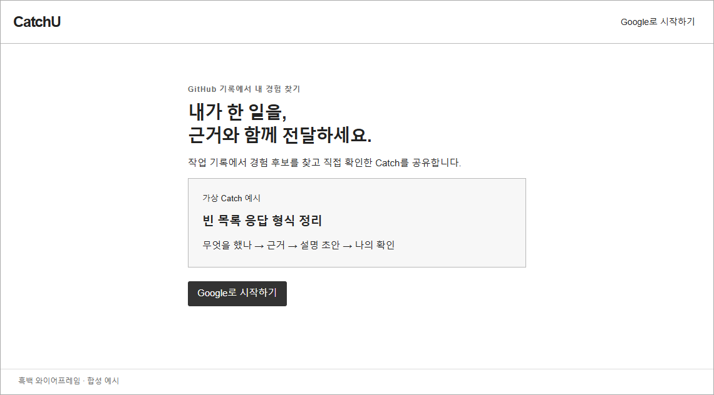

**③ 항목 정의**

| 번호 | 항목 | 유형 | 데이터·설명 | 필수/조건 |
|---|---|---|---|---|
| 1 | CatchU 로고 | 링크 | SCR_HOME_01 | 항상 |
| 2 | 헤더 [Google로 시작하기] | 버튼 | SCR_AUTH_01 로그인 흐름 | 항상 |
| 3 | 소개 문구 | 표시 | 서비스 설명(문구 제안) | 항상 |
| 4 | 가상 Catch 예시 | 표시 | 고정 설명 콘텐츠. 실제 사용자·저장소·분석 결과가 아니다. 누르거나 저장할 수 없다 | 항상 |
| 5 | 본문 [Google로 시작하기] | 버튼 | 헤더 버튼과 같은 흐름 | 항상 |

**④ 이벤트 처리**

| 번호 | 사용자 액션 | 처리(API) | 결과·이동 | 예외 처리 |
|---|---|---|---|---|
| 2·5 | [Google로 시작하기] 누름 | 로그인 흐름 시작(계약 미정, OQ-A1). 홈에서 OAuth를 따로 구현하지 않음 | SCR_AUTH_01 | — |
| — | 화면 진입 | 로그인 여부 확인(#106) | 비로그인이면 이 화면 | 확인 중: "로그인 상태를 확인하고 있습니다" / 실패: "로그인 상태를 확인하지 못했습니다" + [로그인 상태 다시 확인]. 비로그인으로 단정하지 않음(홈 초안 §6.2) |

**⑤ 상태별 화면**

로그인 여부 확인 중·실패만 있다(④). 가상 예시는 고정 콘텐츠라 '결과 없음'이나 로딩 상태가 없다.

### 5.10 SCR_HOME_02 로그인 홈

**① 화면 정보**

| 항목 | 내용 |
|---|---|
| 화면 ID | SCR_HOME_02 |
| 화면 이름 | 로그인 홈 |
| 유형·사용자 | 페이지 / 구직자 |
| 관련 UC | UC-01, UC-03, UC-04 |
| 관련 FR | FR-MEM-01, FR-MEM-02 |
| 관련 규칙 | BR-24(홈은 GitHub 연동 여부와 연결된 저장소 유무만 확인, 분석 상태·결과 조회 없음) |
| 작성자(담당) | 최수영(D) |
| 메뉴 경로 | 헤더 > 로고(로그인) / 로그인 뒤 |
| 화면 개요 | 'GitHub 연결 — 레포 연결' 두 단계를 표시하고 현재 단계의 다음 행동 버튼 하나를 준다 |
| 근거·지위 | 9/15 팀장 결정(CTA 분기·연결된 repo의 뜻), 9/16 회의 결정 §2(단계 표시), **9/24 팀장 결정(레포 연결 CTA 목적지를 Catch 탭의 저장소 연결 관리로 변경)**. 그림은 제안안. 레포 연결 뒤 구성은 미정(#22) |
| 옛 ID | H-01(로그인: GitHub 연결 전·레포 연결 전·후) |

**② 화면 그림**

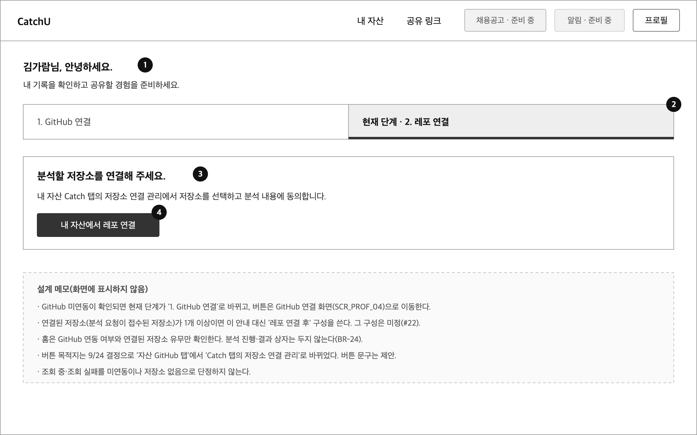

**③ 항목 정의**

| 번호 | 항목 | 유형 | 데이터·설명 | 필수/조건 |
|---|---|---|---|---|
| 1 | 인사·안내 | 표시 | "○○님, 안녕하세요." `profile.displayName` 사용 | 항상 |
| 2 | 단계 표시 | 표시 | "1. GitHub 연결 — 2. 레포 연결". 현재 단계만 진하게(9/16 회의 결정) | 미연동 또는 연결된 저장소 없음 |
| 3 | 현재 단계 안내 | 표시 | GitHub 단계: "GitHub 계정을 연결해 주세요. 분석 전에 GitHub 계정 연결이 필요합니다. 연결만으로 분석은 시작되지 않습니다." / 레포 단계: "분석할 저장소를 연결해 주세요."(문구 제안) | 같음 |
| 4 | CTA 버튼 | 버튼 | GitHub 단계 [연결하러 가기] → SCR_PROF_04 / 레포 단계 [내 자산에서 레포 연결] → SCR_ASSET_01 저장소 연결 관리 영역. 9/16 회의 결정의 버튼 이름은 '연결하러 가기'이며, 레포 단계 문구는 바뀐 목적지를 드러내려는 제안안이다(최종 카피는 별도) | 같음 |
| — | 안내 아래 영역 | 영역 | 9/16 회의 결정은 두 안내 화면 모두 안내 아래에 피드를 두는 것이나 피드는 12월이다. 10월 대체 구성은 미정이라 그림에 넣지 않았다 | — |

'연결된 저장소'는 분석 요청이 접수된 저장소가 1개 이상이라는 뜻이며 진행 중·실패 여부와 무관하다(9/15 팀장 결정). 저장소를 잠깐 고르거나 동의를 체크만 한 상태는 포함하지 않는다.

**④ 이벤트 처리**

| 번호 | 사용자 액션 | 처리(API) | 결과·이동 | 예외 처리 |
|---|---|---|---|---|
| — | 화면 진입 | `GET /me`의 `github.state`. 연결된 저장소 유무는 홈 전용 계약이 없다 — 계약 미정. 제안안: `GET /analysis-requests`의 `items`가 비었는지만 보고 상태·결과는 표시하지 않음 | 미연동 → GitHub 단계 / 연동·저장소 없음 → 레포 단계 / 연동·저장소 있음 → 레포 연결 후 구성(미정) | 확인 중: "연결 상태를 확인하고 있습니다. 연결 여부가 확인되기 전에는 다음 단계를 확정하지 않습니다." / 실패: "연결 상태를 불러오지 못했습니다. GitHub 미연동이나 저장소 없음으로 판단하지 않습니다." + [다시 불러오기] |
| 4 | [연결하러 가기] 누름 | API 없음 | SCR_PROF_04 | — |
| 4 | [내 자산에서 레포 연결] 누름 | API 없음 | SCR_ASSET_01 저장소 연결 관리 영역(주소는 #106). 홈에서 저장소 선택·동의·요청을 받지 않음 | — |

**⑤ 상태별 화면**

| 상태 | 조건 | 표시 |
|---|---|---|
| GitHub 연결 전 | `github.state`가 DISCONNECTED로 확인됨 | 현재 단계 "1. GitHub 연결" + [연결하러 가기](그림 28) |
| 확인 중 | 조회 응답 전 | 안내만, 단계 표시 없음(그림 29) |
| 조회 실패 | 조회 오류 | 미연동으로 단정하지 않고 [다시 불러오기](그림 30) |
| 레포 연결 후 | 연결된 저장소 1개 이상 | **미정(#22).** v2.2의 두 상자 안(내 자산 확인·공유 링크 관리)은 미채택 비교안이라 싣지 않는다. 분석 상태·결과 상자와 결과 단위 검토 집계는 두지 않는다(팀장 결정). 12월에는 피드가 중심이 된다(12월 계획판) |
| GitHub 연결 만료·권한 이상 | REAUTH_REQUIRED | 미정(홈 초안 §6.2) |

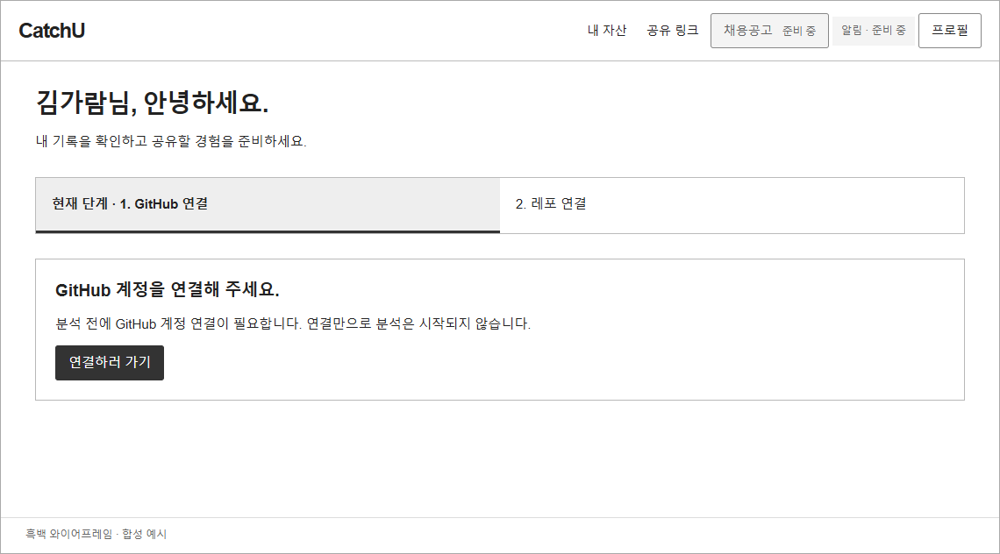

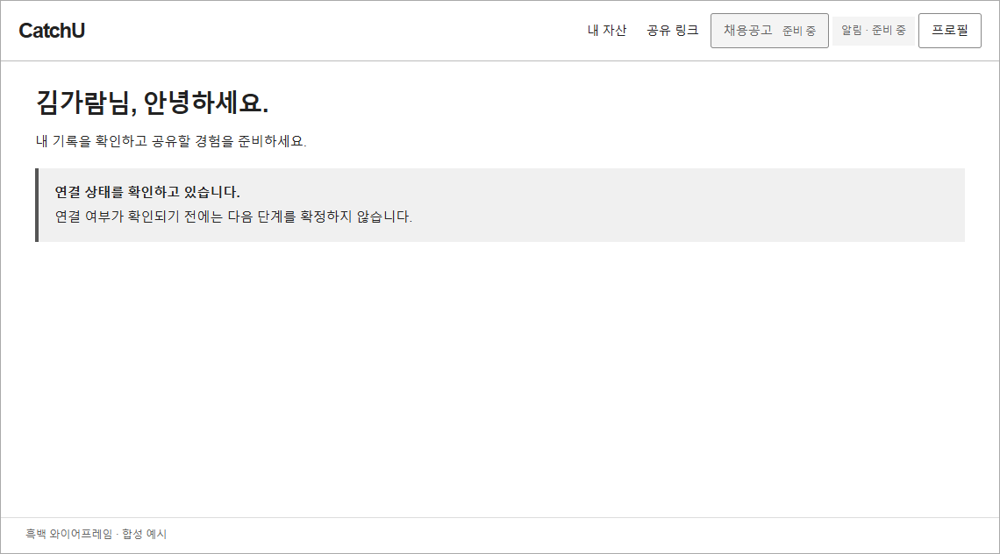

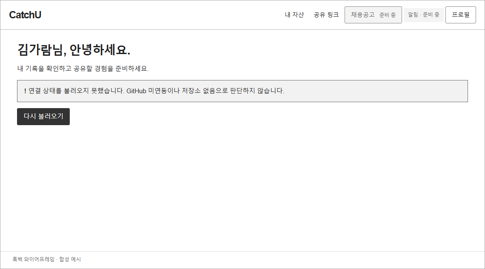

### 5.11 SCR_ASSET_01 내 자산 — Catch 탭

**① 화면 정보**

| 항목 | 내용 |
|---|---|
| 화면 ID | SCR_ASSET_01 |
| 화면 이름 | 내 자산 — Catch 탭 |
| 유형·사용자 | 페이지 / 구직자 |
| 관련 UC | UC-03, UC-05, UC-09 |
| 관련 FR | FR-CAT-01, FR-CAT-03, FR-MEM-02, FR-GEN-03 |
| 관련 규칙 | BR-07(B 정본 중복 없는 등록), BR-22(공개·미공개 두 상태), NFR-PRV-02(미공개 자료는 본인만) |
| 작성자(담당) | 이채아(B: 페이지 틀·탭 머리·저장소 필터·Catch 목록). 저장소 연결 관리 영역은 최수영(D) |
| 메뉴 경로 | 헤더 > 내 자산 |
| 화면 개요 | 위쪽에 GitHub 저장소 연결 관리 영역, 아래쪽에 저장소 필터가 있는 본인 Catch 목록을 둔다 |
| 근거·지위 | **9/24 팀장 결정**과 web 기능 설계 「내 자산 화면 구조」, API 명세 v1(`GET /catches`의 repositoryId 필터). 그림은 제안안 |
| 옛 ID | W03(Catch 부분), W03-R 대체 |

**② 화면 그림**

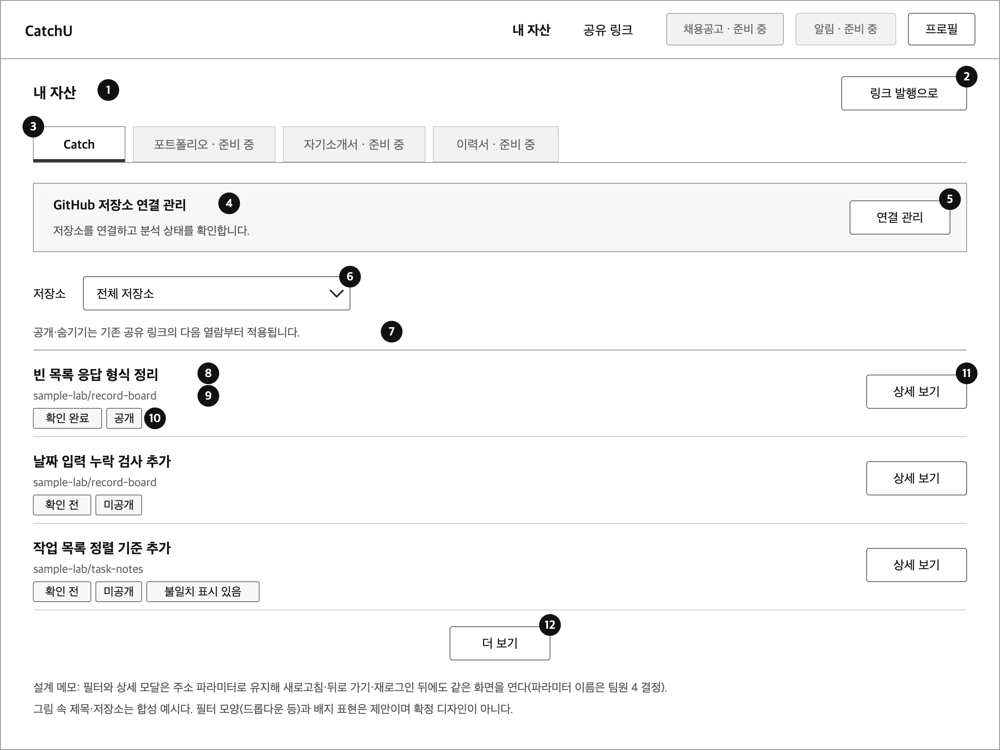

**③ 항목 정의**

| 번호 | 항목 | 유형 | 데이터·설명 | 필수/조건 |
|---|---|---|---|---|
| 1 | 페이지 제목 "내 자산" | 표시 | — | 항상 |
| 2 | [링크 발행으로] | 버튼 | SCR_LINK_01로 간다(링크 초안의 연결 제안, 검토초안) | 항상 |
| 3 | 탭 머리 | 탭 | [Catch](선택) + 포트폴리오·자기소개서·이력서 준비 중 탭(SCR_ASSET_02). GitHub 탭은 없다 | 항상 |
| 4 | GitHub 저장소 연결 관리 영역 | 영역 | 저장소 연결과 분석 상태 확인의 입구. GitHub 미연동이면 GitHub 연결 안내로 바뀌고 SCR_PROF_04로 보낸다 | 항상 |
| 5 | [연결 관리] | 버튼 | SCR_ASSET_03 모달을 연다 | GitHub 연동됨 |
| 6 | 저장소 필터 | 선택 | 연결된 저장소 중 하나 또는 전체. 값은 `repositoryId`, 이름은 `GET /me/repositories`의 `name`으로 합쳐 표시. 모양(드롭다운 등)은 제안 | 선택(기본 전체) |
| 7 | 공개 반영 안내 | 표시 | "공개·숨기기는 기존 공유 링크의 다음 열람부터 적용됩니다." | 항상 |
| 8 | Catch 제목 | 표시 | `Catch.title`. F가 만든 제목이며 구직자가 고칠 수 없다 | 목록 항목마다 |
| 9 | 저장소 이름 | 표시 | `Catch.repositoryId`를 선정 목록 이름으로 표시 | 목록 항목마다 |
| 10 | 상태 배지 | 표시 | 확인: `confirmation` 두 값이 모두 true면 "확인 완료", 아니면 "확인 전" / 공개: `visibility` PUBLIC "공개", PRIVATE "미공개" / `mismatch` true면 "불일치 표시 있음" / `restriction` SOURCE_PRIVATE면 원본 보호 표시(제안). 결과 단위 검토 집계는 두지 않는다 | 목록 항목마다 |
| 11 | [상세 보기] | 버튼 | SCR_ASSET_04 모달. `catchId`를 주소 파라미터에 담는다 | 목록 항목마다 |
| 12 | [더 보기] | 버튼 | 다음 페이지(`page.nextCursor`). 기본 20개, 최대 100개 | 다음 페이지가 있을 때 |

**④ 이벤트 처리**

| 번호 | 사용자 액션 | 처리(API) | 결과·이동 | 예외 처리 |
|---|---|---|---|---|
| — | 화면 진입 | `GET /catches`(주소 파라미터에 필터가 있으면 `repositoryId` 포함), `GET /me/repositories`, `GET /me` | 연결 관리 영역과 목록 표시 | 응답 전 빈 배열을 0건으로 확정하지 않음. 조회 실패는 안내 + [다시 불러오기], 0건으로 대체하지 않음. 401이면 로그인 진입 |
| 6 | 저장소 선택 | `GET /catches?repositoryId=…`. 주소 파라미터 갱신 | 해당 저장소 Catch만 표시. 새로고침·뒤로 가기·재로그인 뒤에도 같은 필터 | `repositoryId`와 `sourceRequestId`를 함께 주면 둘 다 만족하는 Catch만 반환(계약) |
| 5 | [연결 관리] 누름 | API 없음 | SCR_ASSET_03 모달 열림 | — |
| 4 | 미연동 상태의 GitHub 연결 안내 누름 | API 없음 | SCR_PROF_04, 연동 성공 뒤 이 영역으로 복귀 | 복귀 시 모달 자동 열기는 담당 개발 이슈 |
| — | SCR_ASSET_03 모달이 닫힘 | `GET /catches` 다시 호출 | 목록 갱신 | 담당 접점(최수영 ↔ 이채아) |
| 11 | [상세 보기] 누름 | 주소 파라미터에 `catchId` | SCR_ASSET_04 모달 | — |
| 12 | [더 보기] 누름 | `GET /catches?cursor=…` | 다음 페이지 추가 | 다음 페이지도 새 권한 판정 결과. cursor는 공개 상태 스냅샷이 아님 |
| 2 | [링크 발행으로] 누름 | API 없음 | SCR_LINK_01 | — |

**⑤ 상태별 화면**

| 상태 | 조건 | 표시·행동 |
|---|---|---|
| 로딩 | 조회 응답 전 | 공통 로딩 표시(#106). 빈 목록을 먼저 보이지 않음 |
| Catch 0건 | 200 + 빈 `items` | "아직 확인할 Catch가 없습니다." + 위쪽 저장소 연결 관리로 안내(v2.2 문구를 9/24 구조에 맞춘 제안) |
| 필터 결과 0건 | 선택 저장소의 Catch 없음 | 해당 저장소에 Catch가 없다는 안내. 분석 상태는 SCR_ASSET_03에서 확인 |
| 조회 실패 | HTTP 오류·네트워크 실패(LOOKUP_FAILED) | "Catch 목록을 불러오지 못했습니다." + [다시 불러오기](제안). 0건·분석 실패로 바꾸지 않음 |
| GitHub 미연동 | `github.state` DISCONNECTED | 연결 관리 영역에 GitHub 연결 안내. 기존 Catch 목록은 그대로 |
| 권한 없음 | 401 | 로그인 진입(#106) |

목록 키워드 검색, 저장소·기간·기술 복합 필터, 정렬 선택, 일괄 공개/숨김, 보기 전환은 첫 MVP 후 재판단할 후보다(scope-document, DEF-07). 저장소 필터 하나만 둔다.

### 5.12 SCR_ASSET_02 내 자산 — 준비 중 탭

**① 화면 정보**

| 항목 | 내용 |
|---|---|
| 화면 ID | SCR_ASSET_02 |
| 화면 이름 | 내 자산 — 준비 중 탭(포트폴리오·자기소개서·이력서) |
| 유형·사용자 | 페이지 탭 / 구직자 |
| 관련 UC | UC-09 |
| 관련 FR | 없음(12월 FR-DOC-101·FR-DOC-106의 자리) |
| 작성자(담당) | 이채아(B: 탭 머리) |
| 메뉴 경로 | 헤더 > 내 자산 > 포트폴리오·자기소개서·이력서 탭 |
| 화면 개요 | 세 탭 모두 준비 중 안내만 보인다 |
| 근거·지위 | **9/24 팀장 결정**, v2.1·v2.2 준비 중 탭 문구(검토초안). 그림은 제안안 |
| 옛 ID | W03 준비 중 탭 |

**② 화면 그림**

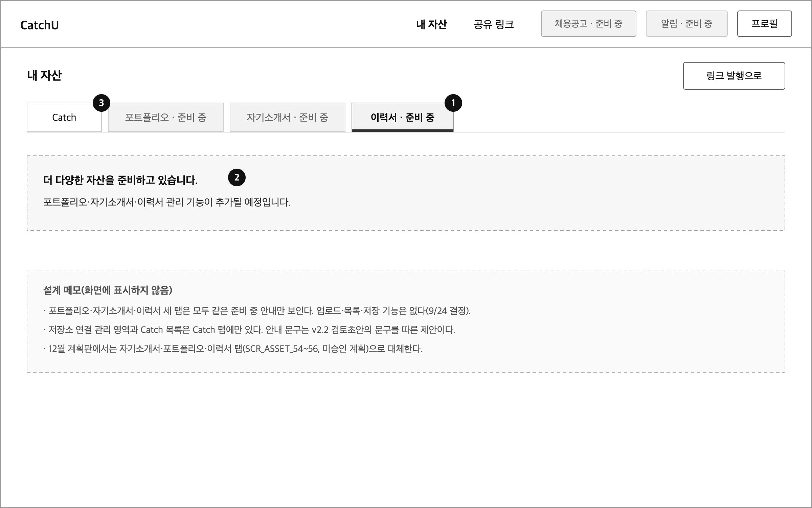

**③ 항목 정의**

| 번호 | 항목 | 유형 | 데이터·설명 | 필수/조건 |
|---|---|---|---|---|
| 1 | 준비 중 탭(선택됨) | 탭 | 포트폴리오·자기소개서·이력서 중 누른 탭 | 항상 |
| 2 | 준비 중 안내 | 표시 | "더 다양한 자산을 준비하고 있습니다. 포트폴리오·자기소개서·이력서 관리 기능이 추가될 예정입니다." | 항상 |
| 3 | Catch 탭 | 탭 | SCR_ASSET_01로 돌아간다 | 항상 |

**④ 이벤트 처리**

| 번호 | 사용자 액션 | 처리(API) | 결과·이동 | 예외 처리 |
|---|---|---|---|---|
| 1 | 준비 중 탭 누름 | API 없음 | 안내만 표시. 업로드·목록·저장 없음 | — |
| 3 | Catch 탭 누름 | API 없음 | SCR_ASSET_01 | — |

**⑤ 상태별 화면**

상태 구분이 없다. 12월 계획판에서는 자기소개서·포트폴리오·이력서 탭(SCR_ASSET_54~56, 미승인 계획)으로 바뀐다.

### 5.13 SCR_ASSET_03 저장소 연결 관리 모달

**① 화면 정보**

| 항목 | 내용 |
|---|---|
| 화면 ID | SCR_ASSET_03 |
| 화면 이름 | 저장소 연결 관리 모달 |
| 유형·사용자 | 모달 / 구직자 |
| 관련 UC | UC-04, UC-05, UC-06 |
| 관련 FR | FR-ANL-01, FR-ANL-02, FR-MEM-02, FR-CAT-03 |
| 관련 규칙 | BR-02(새 동의·지원 저장소·허용 범위를 요청에 묶음), BR-03(사용자당 진행 중 요청 하나), BR-04(유효 결과 없는 확정 실패만 새 동의 재요청), BR-06(처리·반영·조회 실패 구분), BR-14(재전송 안전성·no-store), BR-18(정상 0건과 부분·전체 실패 구분), BR-21(Catch 등록과 반영 완료는 한 트랜잭션, 9/24 팀장 결정), NFR-REL-01 |
| 작성자(담당) | 최수영(D). 상태 묶음은 이영연(A/E)가 PR에서 검토 |
| 메뉴 경로 | 헤더 > 내 자산 > Catch 탭 > [연결 관리] |
| 화면 개요 | 위쪽은 연결된 저장소(분석 요청이 접수된 저장소)의 상태 아이콘과 아코디언, 아래쪽은 연결할 수 있는 저장소의 선택·동의·분석 요청이다. 버튼 하나로 동의와 요청을 처리한다 |
| 근거·지위 | **9/24 팀장 결정**과 web 기능 설계 「내 자산 화면 구조」·「화면 상태 전이」(승인), API 명세 v1 「분석 접수·상태·재요청」(승인), 9/15 팀장 결정(단일 동의 버튼). 동의 문구는 v2.2 A-01 검토초안 예시. 그림은 제안안 |
| 옛 ID | A-01·A-02·A-03 대체 |

**② 화면 그림**

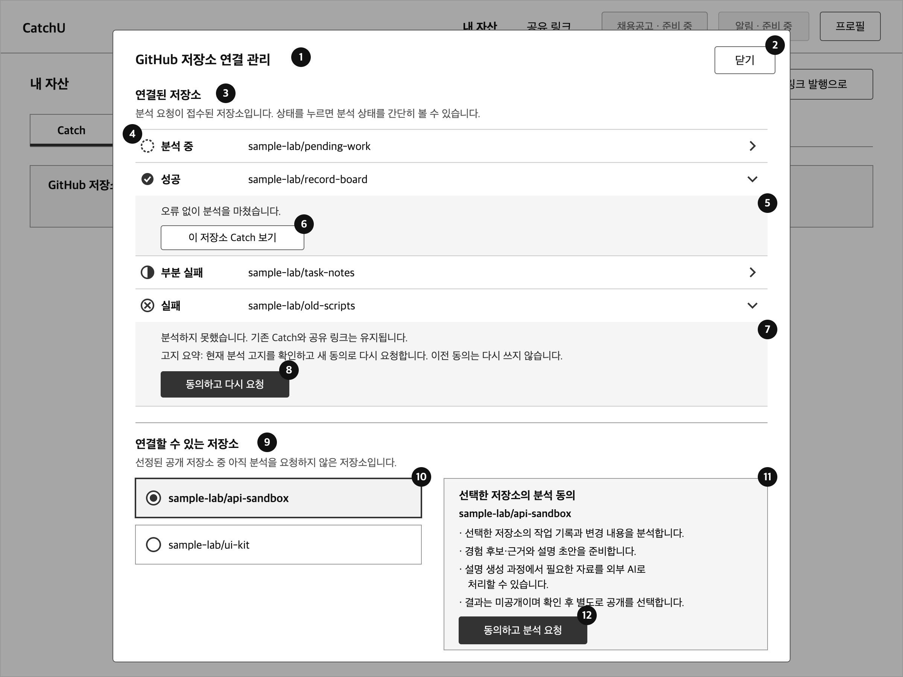

**③ 항목 정의**

| 번호 | 항목 | 유형 | 데이터·설명 | 필수/조건 |
|---|---|---|---|---|
| 1 | 모달 제목 | 표시 | "GitHub 저장소 연결 관리" | 항상 |
| 2 | [닫기] | 버튼 | 모달을 닫고 Catch 목록을 다시 불러온다 | 항상 |
| 3 | 연결된 저장소 | 목록 | `GET /analysis-requests`의 `items`(AnalysisStatus). 저장소 이름은 분석 상태 응답에 없으므로 `GET /me/repositories`의 `name`과 `repositoryId`로 합쳐 표시. 연결 해제 버튼 없음 | 요청 이력 있을 때 |
| 4 | 상태 아이콘 | 표시·버튼 | 분석 중·성공·부분 실패·실패 네 가지. 모양과 글자를 함께 표시(색만으로 구분하지 않음). 누르면 아코디언이 열림. 판정 기준은 아래 상태 표 | 행마다 |
| 5 | 아코디언 상태 설명 | 표시 | 상태별 짧은 설명(아래 상태 표). 성공이고 Catch가 없으면 "검토할 Catch가 없습니다" | 아이콘 누름 |
| 6 | [이 저장소 Catch 보기] | 버튼 | SCR_ASSET_01에 해당 `repositoryId` 필터를 건다. 본인 결과 진입 조건은 `ownerResultsReady`(W3) | 성공·부분 실패이고 `ownerResultsReady` true |
| 7 | 실패 설명·고지 요약 | 표시 | 확정 실패 안내, 기존 Catch와 공유 링크 유지 안내, 현재 고지 요약 | 실패 |
| 8 | [동의하고 다시 요청] | 버튼 | 새 동의·새 요청을 만든다. 기존 동의를 다시 쓰지 않는다 | 실패이고 `retry.allowed` true일 때만 |
| 9 | 연결할 수 있는 저장소 | 목록 | `GET /me/repositories`의 선정 공개 저장소(Repository: repositoryId·name·ownerLogin·url·allowedScopeRevision). 이미 연결된 저장소를 빼는 것은 제안안 | GitHub 연동됨 |
| 10 | 저장소 선택 | 선택(라디오) | 한 번에 하나 | 필수 |
| 11 | 동의 내용 | 표시 | `GET /analysis-notice`의 `text`와 `noticeRevision`, 선택한 저장소 이름. 버튼 앞에 보인다. 그림 속 네 줄은 v2.2 예시이며 실제 고지 문구는 OQ11 | 저장소 선택 후 |
| 12 | [동의하고 분석 요청] | 버튼 | 버튼 이름에 동의를 담아 누르는 행동이 동의와 요청임을 드러낸다(9/15). 선택 전 비활성 | 저장소 선택 후 |

**상태 아이콘 판정과 아코디언 설명.** 근거는 web 기능 설계 「내 자산 화면 구조」의 아이콘 표와 「화면 상태 전이」, API 명세 v1의 enum이다. 설명 문구는 제안이다.

| 아이콘 | 판정(API 값) | 아코디언 설명 | 가능한 행동 |
|---|---|---|---|
| 분석 중 | `processing` QUEUED·RUNNING | 접수·진행 중. 근거 없는 진행률·남은 시간을 보이지 않음 | 상태 다시 불러오기 |
| 분석 중 | `processing` UNCERTAIN | 실행 확인이 아직 안 됨. 시간이 지났다는 이유로 실패로 확정하지 않음 | 상태 다시 불러오기 |
| 분석 중 | `application` PENDING·APPLYING | 결과를 서비스에 반영하는 중 | 상태 다시 불러오기 |
| 분석 중 | `application` APPLY_FAILED | 처리 결과의 서비스 반영 실패. 분석 실패 재요청으로 바꾸지 않음 | 상태 다시 불러오기 |
| 분석 중 | `application` RECOVERING | 반영 복구 중 | 상태 다시 불러오기 |
| 성공 | `processing` SUCCEEDED 또는 EMPTY, `application` APPLIED | 오류 없이 정상 완료. EMPTY면 "검토할 Catch가 없습니다" | `ownerResultsReady`면 [이 저장소 Catch 보기] |
| 부분 실패 | `processing` PARTIAL_FAILED, `application` APPLIED | 제공된 결과와 실패 영향(`failures`의 단계)을 나눠 표시. 등록·열람 준비된 `registeredCatchIds`만 열람 | [이 저장소 Catch 보기]. 10월 재요청 대상 아님 |
| 실패 | `processing` FAILED, `application` APPLIED, `lifecycle` CLOSED | 확정 실패. 기존 Catch와 링크는 유지 | `retry.allowed` true면 [동의하고 다시 요청] |
| (아이콘 없음) | 조회 HTTP 오류·네트워크 실패(LOOKUP_FAILED) | 상태를 불러오지 못함. 작업 실패·0건으로 바꾸지 않음 | [다시 불러오기]. 새 분석을 자동 요청하지 않음 |

`sourceMode`가 MOCK인 결과(개발용 합성 예시 자료로 연결한 결과)를 실제 분석 성공으로 표시하지 않는다.

Catch 등록(B)과 반영 완료 기록(E)은 한 트랜잭션이다(9/24 팀장 결정 OQ-B1, BR-21, api 기능 설계 F4). 그래서 `application`이 APPLIED인 성공·부분 실패 행에서는 그 결과로 등록된 Catch가 이미 저장되어 있다. 반영 트랜잭션이 실패하면 변경을 모두 되돌리고 APPLY_FAILED로 기록하며, 복구는 같은 결과로 반영을 다시 하는 것이지 새 분석이 아니다. 화면은 이 동안 '분석 중' 아이콘에 반영 실패·복구 중 문구를 보이고 재요청 버튼을 두지 않는다.

**④ 이벤트 처리**

| 번호 | 사용자 액션 | 처리(API) | 결과·이동 | 예외 처리 |
|---|---|---|---|---|
| — | 모달 열림 | `GET /analysis-requests`, `GET /me/repositories`, `GET /analysis-notice` | 두 목록과 고지 표시 | 목록 조회 실패는 선정 목록 0개·요청 없음과 구분. 401이면 로그인 진입 |
| 4 | 상태 아이콘 누름 | 필요하면 `GET /analysis-requests/{requestId}`로 최신 상태 | 아코디언 열림·닫힘 | 상태 갱신으로 초점을 빼앗지 않음(접근성 주석). 조회 실패는 위 표의 마지막 행 |
| 6 | [이 저장소 Catch 보기] 누름 | API 없음 | 모달 닫힘, SCR_ASSET_01에 필터(주소 파라미터) 적용, 목록 다시 불러오기 | 필터 파라미터 이름은 이채아가 정함 |
| 8 | [동의하고 다시 요청] 누름 | `POST /analysis-requests`(`repositoryId`, `consent`의 `accepted`·`noticeRevision`·`scopeRevision`, `retryOfRequestId`) + 새 Idempotency-Key. 즉시 전송 중 표시·재클릭 차단 | 202면 새 요청이 '분석 중'으로 표시 | `409/RETRY_NOT_ALLOWED`·`409/REANALYSIS_DEFERRED`: 재요청할 수 없다는 안내 / 응답 불명: 같은 키·같은 본문으로 재확인, 새 키 자동 재요청 없음 |
| 10 | 저장소 선택 | API 없음 | 동의 내용 표시, 요청 버튼 활성 | 선택 전환 시 미저장 선택을 자동 재전송하지 않음 |
| 12 | [동의하고 분석 요청] 누름 | `POST /analysis-requests`(`repositoryId`, `consent`) + Idempotency-Key. 즉시 전송 중 표시·재클릭 차단 | 202: 신규 접수, 연결된 저장소에 '분석 중' 추가 / 200: 같은 저장소의 진행 중 작업을 그대로 표시 | `409/ANALYSIS_IN_PROGRESS`: 다른 저장소 분석이 진행 중이라는 안내(`details.existingRequestId`의 행 표시) / `403/GITHUB_CONNECTION_REQUIRED`·`REPOSITORY_NOT_ALLOWED`·`CONSENT_REQUIRED`: 조건 안내 / `409/IDEMPOTENCY_CONFLICT` / 응답 불명: 미접수로 단정하지 않고 같은 키·같은 본문으로 확인 |
| 2 | [닫기] 누름 | API 없음 | 모달 닫힘, SCR_ASSET_01 목록 다시 불러오기 | — |

접수(202·200)는 처리·반영 완료가 아니다. 모달을 닫거나 새로고침해도 새 분석을 만들지 않고 기존 요청을 조회만 한다(9/15 팀장 결정). 사용자당 진행 중(ACTIVE) 요청은 하나다(BR-03).

**⑤ 상태별 화면**

| 상태 | 조건 | 표시·행동 |
|---|---|---|
| 로딩 | 모달 조회 응답 전 | 공통 로딩 표시 |
| 연결된 저장소 없음 | `items` 빈 배열 | 위쪽 목록 자리에 연결된 저장소가 없다는 안내, 아래쪽 선택은 그대로 |
| 선정 저장소 없음 | `GET /me/repositories`가 빈 배열 | 선택할 수 있는 저장소가 없다는 안내(v2.2 A-01-empty 검토초안). 선정 목록은 OQ1 |
| 목록 조회 실패 | 오류 응답 | 안내 + [다시 불러오기]. 0개로 바꾸지 않음 |
| 전송 중 | POST 응답 전 | 버튼 잠금, 반복 제출 막음. 화면 이탈이 요청 취소라는 안내 없음 |
| 응답 불명 | 네트워크 오류 등 | "요청 여부를 확인하지 못했습니다"류 안내 + 확인 행동. 자동 재제출 없음(A-01 초안) |
| 세션 만료 | 401 | 로그인 진입. 접수 여부가 불명이었으면 재인증 뒤에도 접수 여부 확인부터(user-flow) |

같은 저장소에 요청이 여러 건(실패 뒤 재요청 등)일 때 '연결된 저장소' 행에 어느 요청의 상태를 보일지는 원천에 규칙이 없다(7절 미정).

### 5.14 SCR_ASSET_04 Catch 상세 모달

**① 화면 정보**

| 항목 | 내용 |
|---|---|
| 화면 ID | SCR_ASSET_04 |
| 화면 이름 | Catch 상세 모달 |
| 유형·사용자 | 모달 / 구직자(본인만) |
| 관련 UC | UC-10, UC-11, UC-16 |
| 관련 FR | FR-CAT-01, FR-CAT-02, FR-GEN-01, FR-GEN-02, FR-GEN-03, FR-ANL-03, FR-LNK-03 |
| 관련 규칙 | BR-08(초안·질문 상태와 공개 조건은 독립), BR-09(확인과 공개 선택 분리), BR-10(확인된 원본 비공개는 수신 접근 차단), BR-22(공개·미공개 두 상태, 불일치는 공개를 막지 않음), NFR-PRV-02 |
| 작성자(담당) | 이채아(B) |
| 메뉴 경로 | 헤더 > 내 자산 > Catch 탭 > [상세 보기] |
| 화면 개요 | 작업 사실·본인 기여·근거·설명 초안·최소 질문을 확인하고, 확인 완료 → '지금 공개' 제안 → 공개·숨기기를 한다. 설명 문구는 직접 고칠 수 없다 |
| 근거·지위 | **9/24 팀장 결정**(별도 페이지에서 모달로, title 표시, 공개·미공개 두 상태, 불일치는 공개를 막지 않음), web 기능 설계 W4·W5(승인), API 명세 v1 Catch 스키마. 그림은 제안안(v2.2 W04·W05의 정보 구성을 모달로 옮김) |
| 옛 ID | W04, W05 |

**② 화면 그림**

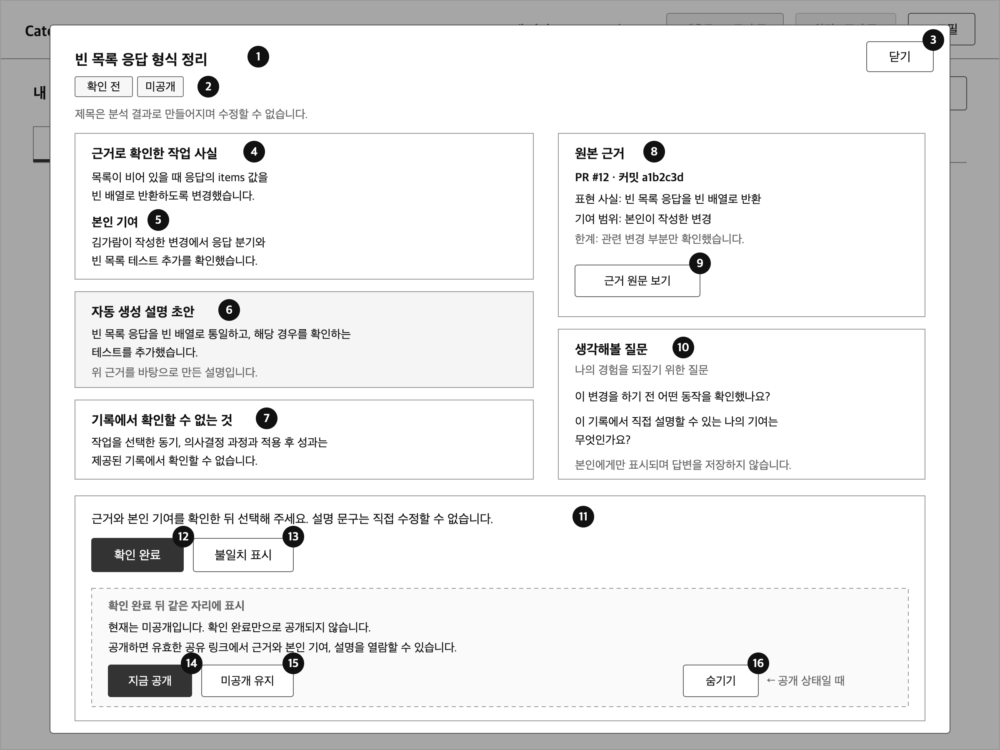

**③ 항목 정의**

| 번호 | 항목 | 유형 | 데이터·설명 | 필수/조건 |
|---|---|---|---|---|
| 1 | Catch 제목 | 표시 | `title`(1자 이상). F가 '무엇을 했나'를 짧은 명사구로 생성, 실패하면 `workFacts` 첫 항목. 편집 불가. 수신자 화면과 같은 제목 | 항상 |
| 2 | 상태 배지 | 표시 | 확인 전·확인 완료 / 미공개·공개 / 불일치 표시 있음 / 설명 초안 없음 / 원본 보호 | 항상 |
| 3 | [닫기] | 버튼 | 모달을 닫고 목록으로(주소 파라미터 제거) | 항상 |
| 4 | 근거로 확인한 작업 사실 | 표시 | `workFacts`(1개 이상). 관측하지 않은 동기·성과를 넣지 않음 | 항상 |
| 5 | 본인 기여 | 표시 | `subjectContribution`. 타인 기여를 본인에게 귀속하지 않음 | 항상 |
| 6 | 자동 생성 설명 초안 | 표시 | `draft.status` GENERATED면 `draft.content`. FAILED·NOT_GENERATED면 초안 없음 안내(`content`가 null인 것을 설명으로 표시하지 않음) | 항상 |
| 7 | 기록에서 확인할 수 없는 것 | 표시 | 근거의 한계(`evidence[].coverageLimits`)와 기록으로 확인할 수 없는 범위 안내. 고정 문구 여부는 B 개발 이슈 | 항상 |
| 8 | 원본 근거 | 표시 | `evidence[]`(1개 이상): `sourceUrl`·`sourceRevision`·`representedFacts`(표현 사실)·`contributionScope`(기여 범위)·`coverageLimits`(한계) | 항상 |
| 9 | [근거 원문 보기] | 링크 | `sourceUrl`을 새 탭으로 연다(외부 GitHub) | 근거마다 |
| 10 | 생각해볼 질문 | 표시 | `reflection.questions`(`reflection.status`). 본인에게만 보이고 답변을 저장하지 않음. 상세 표시는 B 개발 이슈 | GENERATED일 때 질문, 아니면 상태 안내 |
| 11 | 확인 안내 | 표시 | "근거와 본인 기여를 확인한 뒤 선택해 주세요. 설명 문구는 직접 수정할 수 없습니다." | 항상 |
| 12 | [확인 완료] | 버튼 | 근거·본인 기여 확인. 공개하지 않음 | 확인 전 |
| 13 | [불일치 표시] | 버튼 | 기록과 맞지 않는다고 표시. 본문·공개·생성 상태는 그대로 | 표시 전(해제 표현은 미정) |
| 14 | [지금 공개] | 버튼 | 확인 완료 뒤 같은 자리에 보이는 기본 제안 | 확인 완료·미공개 |
| 15 | [미공개 유지] | 버튼 | 요청 없이 미공개를 유지 | 확인 완료·미공개 |
| 16 | [숨기기] | 버튼 | 미공개로 바꾼다. 확인 완료·원본 보호 없음이면 다시 공개할 수 있다 | 공개 |

**④ 이벤트 처리**

| 번호 | 사용자 액션 | 처리(API) | 결과·이동 | 예외 처리 |
|---|---|---|---|---|
| — | 모달 열림 | `GET /catches/{catchId}` | 항목 표시 | `404/RESOURCE_UNAVAILABLE`(타인·없는 Catch 공통): 열람할 수 없다는 안내 / 조회 실패: 안내 + [다시 불러오기]. 열람만으로 확인·공개되지 않음 |
| 12 | [확인 완료] 누름 | `PUT /catches/{catchId}/confirmation`(`workFactsConfirmed`·`contributionConfirmed` 모두 true) | 200: "확인 완료" 배지, '지금 공개' 제안 표시 | 저장 중 버튼 잠금. 실패를 확인 완료로 표시하지 않음. 응답 불명은 재조회로 확인 |
| 13 | [불일치 표시] 누름 | `PUT /catches/{catchId}/mismatch`(`mismatch` true) | 200: "불일치 표시 있음" 배지 | 실패 시 상태 유지. 계약은 false로 되돌리기를 허용하나 화면 표현은 미정 |
| 14 | [지금 공개] 누름 | `PUT /catches/{catchId}/visibility`(`visibility` PUBLIC). 서버가 확인·현재 보호 조건을 원자적으로 검사 | 200: "공개" 배지. 기존 링크의 다음 조회부터 열람 가능 | `409/CONFIRMATION_REQUIRED`: 확인이 필요하다는 안내 / `409/SOURCE_RESTRICTED`: 원본 보호 안내 / `mismatch`가 true면 공개할 때 화면에서 알림(표현은 B 담당 미정). 초안이 없어도 다른 조건을 충족하면 공개 가능(W5) |
| 15 | [미공개 유지] 누름 | API 없음 | 미공개 유지, 제안 닫힘 | — |
| 16 | [숨기기] 누름 | `PUT /catches/{catchId}/visibility`(`visibility` PRIVATE) | 200: "미공개" 배지. 기존 링크의 다음 요청부터 제외(링크 중단과 다름) | 실패를 성공으로 표시하지 않음 |
| 9 | [근거 원문 보기] 누름 | 외부 URL 새 탭 | GitHub 원문 | 일시 접근 실패를 원본 비공개로 단정하지 않음 |
| 3 | [닫기] 누름 | API 없음 | 모달 닫힘, 목록의 배지 갱신 | — |

**⑤ 상태별 화면**

| 상태 | 조건 | 표시·행동 |
|---|---|---|
| 설명 초안 없음 | `draft.status` FAILED 또는 NOT_GENERATED | 초안 자리에 "설명 초안을 만들지 못했습니다. 근거·기여가 확인된 Catch로 등록되었으며 다른 공개 조건을 충족하면 확인 후 별도로 공개할 수 있습니다."(v2.2 W04 문구, 검토초안). 배지 "설명 초안 없음" |
| 확인 완료·미공개 | `confirmation` 모두 true, PRIVATE | '지금 공개' 제안(그림의 점선 상자): "현재는 미공개입니다. 확인 완료만으로 공개되지 않습니다." + [지금 공개]·[미공개 유지] |
| 공개 | PUBLIC | [숨기기] |
| 불일치 표시 있음 | `mismatch` true | 배지 표시. 공개는 막지 않고 공개 시 알림(9/24). v2.2 W04-mismatch 그림처럼 공개 버튼을 숨기지 않는다 |
| 원본 보호 | `restriction` SOURCE_PRIVATE | "원본 저장소의 비공개 전환이 확인되었습니다. 관련 Catch는 기존 링크에서도 열람할 수 없습니다."(v2.2 W04-protected 문구) — FR-ANL-03의 소유자 안내. 공개하려 하면 `409/SOURCE_RESTRICTED`. 관측 경로·주기는 OQ-B3 |
| 저장 중·실패·응답 불명 | 상태 변경 PUT | 진행·성공·실패를 서버 값 기준으로 표시. 거부된 공개를 성공으로 처리하지 않음 |

v2.2의 '공개 후 숨김' 상태는 9/24 결정으로 미공개에 합쳤다(BR-22). 내부 선택 공유(G) 버튼, 본문 편집·재생성 버튼은 10월에 두지 않는다.

### 5.15 SCR_LINK_01 링크 발행

**① 화면 정보**

| 항목 | 내용 |
|---|---|
| 화면 ID | SCR_LINK_01 |
| 화면 이름 | 링크 발행 |
| 유형·사용자 | 페이지 / 구직자(발행자) |
| 관련 UC | UC-12 |
| 관련 FR | FR-LNK-01, FR-LNK-04, FR-LNK-06, FR-LNK-07 |
| 관련 규칙 | BR-11(링크는 현재 공개 Catch 전체 대상), BR-12(유효 링크 5개·trim 제목 유일, 원자적), BR-14(Idempotency-Key) |
| 작성자(담당) | 최수영(C) |
| 메뉴 경로 | 헤더 > 공유 링크 > [새 링크 발행] / 내 자산 > [링크 발행으로] |
| 화면 개요 | 현재 공개 프로필·공개 Catch를 확인하고, 제목과 선택 비밀번호로 링크를 발행한다. 대표 구성 없이 발행하며 공개 Catch가 0개여도 된다 |
| 근거·지위 | 9/14·9/15 팀장 확인(0개 발행 허용, 제목 필수, 유효 제목 중복 금지, 5개 한도, 발행 중 버튼 잠금), API 명세 v1 — 승인·팀장 결정. 공유 링크 초안 §4.1·§4.8, v2.2 L01 — 검토초안 |
| 옛 ID | L01 |

**② 화면 그림**

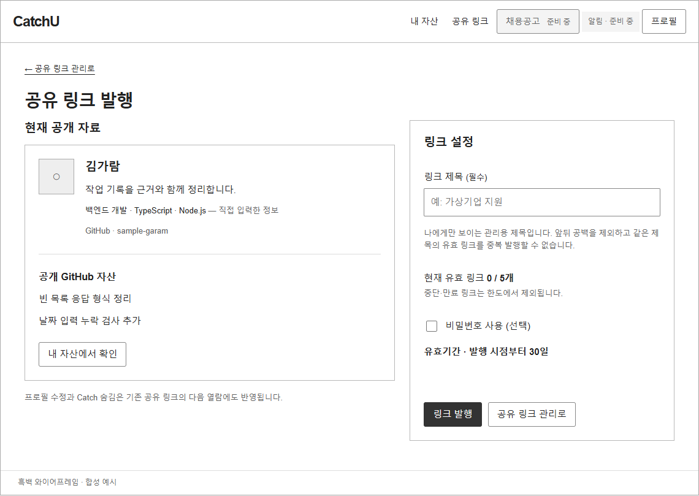

**③ 항목 정의**

| 번호 | 항목 | 유형 | 데이터·설명 | 필수/조건 |
|---|---|---|---|---|
| 1 | [← 공유 링크 관리로] | 링크 | SCR_LINK_03 | 항상 |
| 2 | 제목 "공유 링크 발행" | 표시 | — | 항상 |
| 3 | 현재 공개 자료 — 기본 프로필 | 표시 | 표시 이름·한 줄 소개·직무·기술 스택("직접 입력한 정보")·GitHub 계정. `GET /me` | 항상 |
| 4 | 공개 GitHub 자산 | 목록 | 현재 PUBLIC Catch의 제목. 0개면 "현재 공개된 GitHub 자산이 없습니다. 프로필만으로도 링크를 발행할 수 있습니다." | 항상 |
| 5 | [내 자산에서 확인] | 버튼 | SCR_ASSET_01. 필수 단계로 강제하지 않음 | 항상 |
| 6 | 반영 안내 | 표시 | "프로필 수정과 Catch 숨김은 기존 공유 링크의 다음 열람에도 반영됩니다." | 항상 |
| 7 | 링크 제목(필수) | 입력 | `ShareCreate.title`. 나에게만 보이는 관리용 제목, 수신자에게 보이지 않음. 앞뒤 공백을 뺀 값으로 유효 링크끼리 비교. 발행 후 수정 불가 | 필수. 길이 제한 미정 |
| 8 | 현재 유효 링크 N / 5개 | 표시 | `GET /share-links`에서 `state` ACTIVE인 수. 중단·만료는 세지 않음 | 항상 |
| 9 | 비밀번호 사용(선택) | 체크·입력 | 체크하면 비밀번호 입력란(`ShareCreate.password`)과 [비밀번호 보기]가 나타남. 발행 후 변경·해제 불가 | 선택 |
| 10 | 유효기간 안내 | 표시 | "유효기간 · 발행 시점부터 30일" 고정 | 항상 |
| 11 | [링크 발행] | 버튼 | 누르는 즉시 발행 중 표시·버튼 잠금 | 제목 입력 후 |
| 12 | [공유 링크 관리로] | 버튼 | SCR_LINK_03 | 항상 |

**④ 이벤트 처리**

| 번호 | 사용자 액션 | 처리(API) | 결과·이동 | 예외 처리 |
|---|---|---|---|---|
| — | 화면 진입 | `GET /me`, `GET /share-links`. 현재 공개 Catch 요약은 전용 계약이 없다 — 제안안: `GET /catches` 결과에서 `visibility` PUBLIC만 표시 | 요약·유효 링크 수 표시 | 조회 중이면 발행 버튼 잠시 잠금. 조회 실패를 자료 없음·0개로 바꾸지 않고 [자료 다시 불러오기](링크 초안 §4.8) |
| 7 | 제목 입력 | API 없음 | — | 공백만 입력: "링크 제목을 입력해 주세요." 입력 중 중복 미리 알림은 편의 기능일 뿐 중복 방지 장치가 아님 |
| 9 | 비밀번호 사용 체크·[비밀번호 보기] | API 없음 | 입력란 표시, 보기/숨기기 전환 | 비밀번호를 브라우저 저장소에 보관하지 않음 |
| 11 | [링크 발행] 누름 | `POST /share-links`(`title`, 선택 `password`) + Idempotency-Key. 서버가 제목 중복·5개 한도 확인과 생성을 사용자 단위로 한 번에 처리 | 201(발급) 또는 200(같은 키의 기존 결과): SCR_LINK_02 | `409/LINK_TITLE_CONFLICT`: "같은 제목의 유효한 링크가 이미 있습니다. 공유 링크 관리에서 제목과 상태를 확인해 주세요." 발행 실패로 표시하지 않음 / `409/LINK_LIMIT_REACHED`: "유효 링크는 최대 5개입니다. 사용하지 않는 링크를 중단한 뒤 발행해 주세요." / `400/VALIDATION_FAILED` / 응답 불명: "발행 여부를 확인하지 못했습니다." + [같은 제목으로 다시 발행] / 실패 확정: "링크를 발행하지 못했습니다." |
| 12 | [공유 링크 관리로] 누름 | API 없음 | SCR_LINK_03 | — |

**⑤ 상태별 화면**

| 상태 | 표시 |
|---|---|
| 공개 자산 0개 | 발행 허용, 0개 안내(그림 36) |
| 같은 제목 유효 링크 있음 | 안내 + 공유 링크 관리 경로(그림 37) |
| 유효 링크 5개 | 한도 안내, [링크 발행] 비활성(그림 38). 서버가 생성 때 다시 확인 |
| 발행 응답 불명 | "발행 여부를 확인하지 못했습니다." + [같은 제목으로 다시 발행](그림 39) |
| 요약 뒤 공개 상태 변경 확인 | "자료 상태가 변경되었습니다. 다시 확인해 주세요." + [자료 다시 확인], 자동 발행 없음(링크 초안 §4.8) |

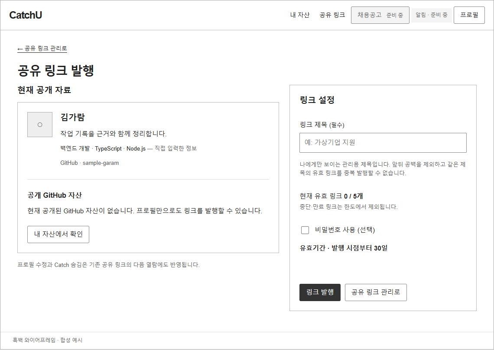

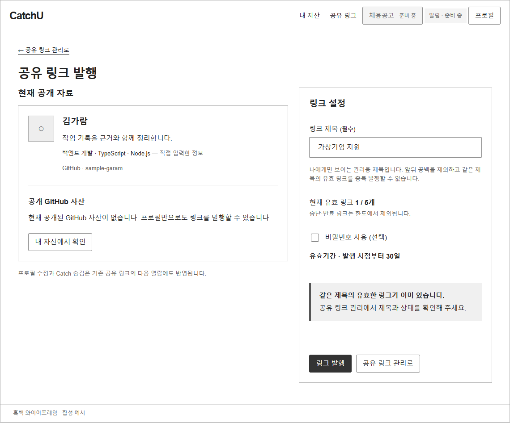

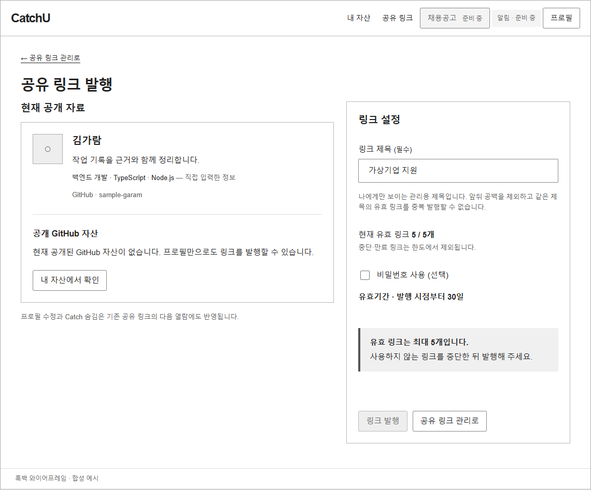

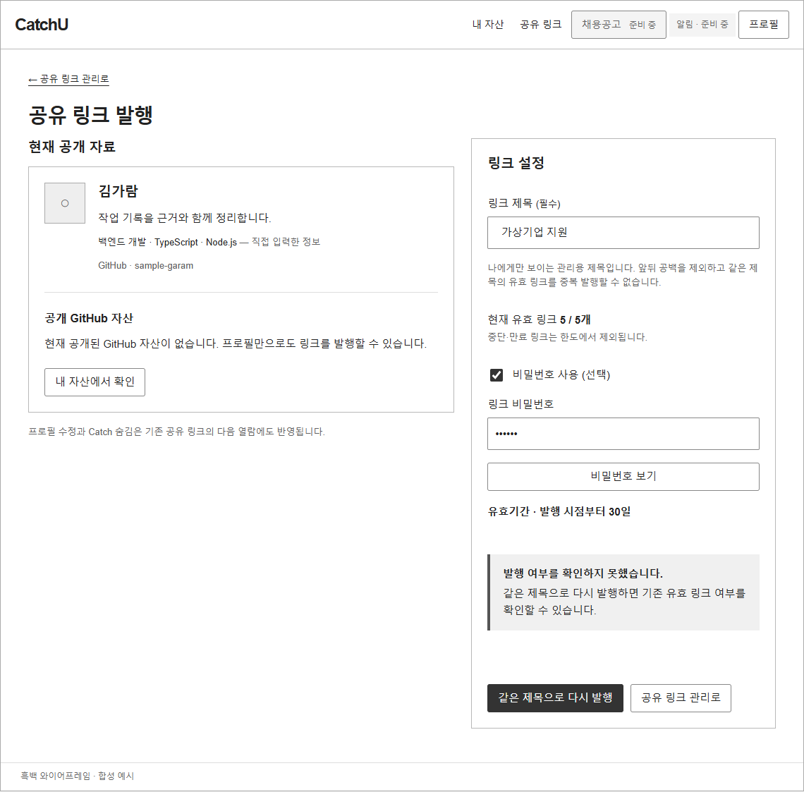

### 5.16 SCR_LINK_02 링크 발행 완료

**① 화면 정보**

| 항목 | 내용 |
|---|---|
| 화면 ID | SCR_LINK_02 |
| 화면 이름 | 링크 발행 완료 |
| 유형·사용자 | 페이지 / 구직자(발행자) |
| 관련 UC | UC-12 |
| 관련 FR | FR-LNK-04, FR-LNK-07 |
| 관련 규칙 | BR-12 |
| 작성자(담당) | 최수영(C) |
| 메뉴 경로 | SCR_LINK_01 > [링크 발행] 성공 |
| 화면 개요 | 서버의 생성 성공 응답을 받은 뒤에만 들어온다. URL·발행/만료 시각·비밀번호 설정 여부를 보여 주고 복사하게 한다 |
| 근거·지위 | 공유 링크 초안 §4.2, v2.2 L02 — 검토초안. 30일 고정 만료는 승인 FR |
| 옛 ID | L02 |

**② 화면 그림**

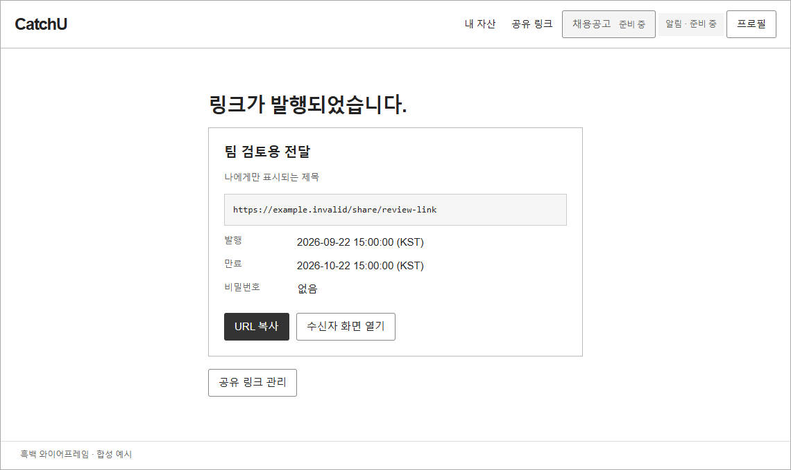

**③ 항목 정의**

| 번호 | 항목 | 유형 | 데이터·설명 | 필수/조건 |
|---|---|---|---|---|
| 1 | 완료 제목 | 표시 | "링크가 발행되었습니다." | 항상 |
| 2 | 링크 제목 | 표시 | `ShareLink.title` + "나에게만 표시되는 제목" | 항상 |
| 3 | URL | 표시 | `ShareLink.url`. 선택해 수동 복사 가능 | 항상 |
| 4 | 발행 시각 | 표시 | `createdAt`. 표시 형식 `YYYY-MM-DD HH:mm:ss (KST)`는 화면 제안 | 항상 |
| 5 | 만료 시각 | 표시 | `expiresAt`(발행 시점 + 30일, 서버 기준). 기간 선택·연장 없음 | 항상 |
| 6 | 비밀번호 | 표시 | `passwordRequired`: "설정됨" 또는 "없음". 비밀번호 원문은 다시 보여 주지 않음 | 항상 |
| 7 | [URL 복사] | 버튼 | 클립보드에 URL 복사 | 항상 |
| 8 | [수신자 화면 열기] | 버튼 | URL을 새 탭으로 연다(v2.2 검토초안) | 항상 |
| 9 | [공유 링크 관리] | 버튼 | SCR_LINK_03 | 항상 |

**④ 이벤트 처리**

| 번호 | 사용자 액션 | 처리(API) | 결과·이동 | 예외 처리 |
|---|---|---|---|---|
| — | 화면 진입 | 별도 조회 없음. `POST /share-links` 응답의 ShareLink 사용 | 항목 표시 | 응답 없이 이 화면으로 오지 않음 |
| 7 | [URL 복사] 누름 | 클립보드 쓰기(API 없음) | 복사 확인 문구 | 실패: "URL을 복사하지 못했습니다. 주소를 직접 선택해 복사할 수 있습니다." 새 링크 발행을 실행하지 않음 |
| 8 | [수신자 화면 열기] 누름 | 새 탭 | SCR_VIEW_01 또는 SCR_VIEW_02 | — |
| 9 | [공유 링크 관리] 누름 | API 없음 | SCR_LINK_03 | — |

**⑤ 상태별 화면**

비밀번호를 설정한 링크는 "비밀번호를 설정했다면 비밀번호도 수신자에게 전달하세요."를 함께 보인다. 전달은 발행자가 외부 채널로 하며 서비스가 이메일·메신저를 보내지 않는다.

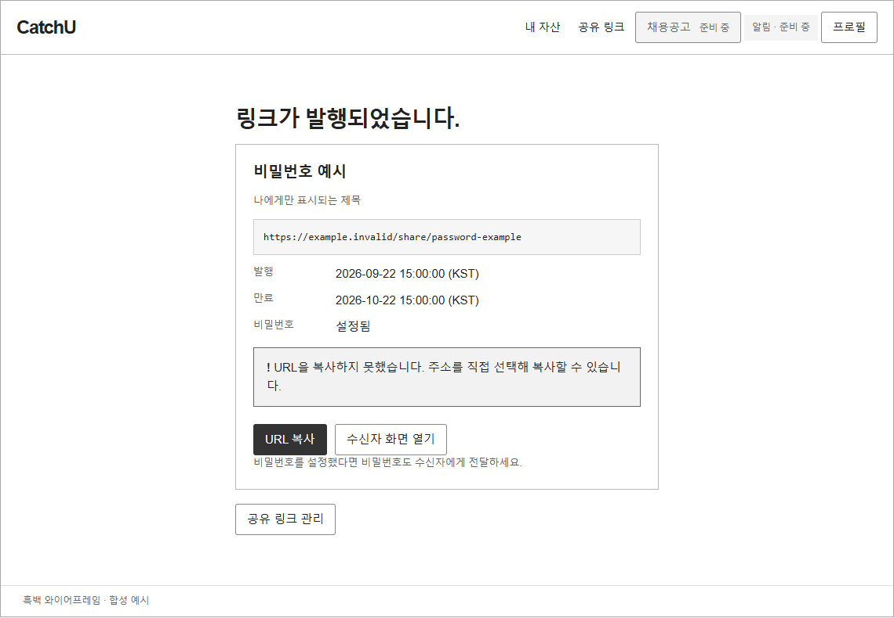

### 5.17 SCR_LINK_03 공유 링크 관리

**① 화면 정보**

| 항목 | 내용 |
|---|---|
| 화면 ID | SCR_LINK_03 |
| 화면 이름 | 공유 링크 관리 |
| 유형·사용자 | 페이지 / 구직자(발행자) |
| 관련 UC | UC-13 |
| 관련 FR | FR-LNK-05, FR-LNK-07 |
| 관련 규칙 | BR-12, BR-13 |
| 작성자(담당) | 최수영(C) |
| 메뉴 경로 | 헤더 > 공유 링크 |
| 화면 개요 | 본인이 발행한 링크를 발행 시각 최신순 한 목록으로 보여 주고, 복사·중단한다. 상태는 아이콘만 쓰지 않고 유효·중단됨·만료됨 글자로 보인다 |
| 근거·지위 | 9/15 팀장 확인(제목·상태 글자, 목록에서 URL 재복사), 공유 링크 초안 §4.3, v2.2 L03 — 검토초안 |
| 옛 ID | L03 |

**② 화면 그림**

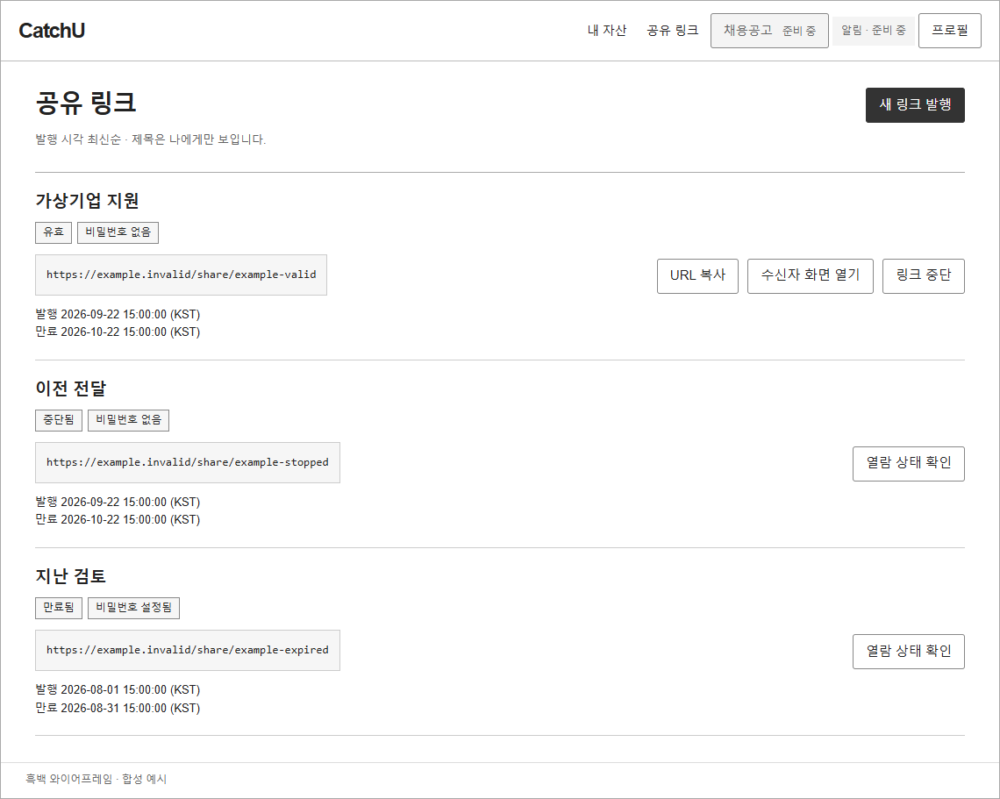

**③ 항목 정의**

| 번호 | 항목 | 유형 | 데이터·설명 | 필수/조건 |
|---|---|---|---|---|
| 1 | 제목·정렬 안내 | 표시 | "공유 링크 / 발행 시각 최신순 · 제목은 나에게만 보입니다." | 항상 |
| 2 | [새 링크 발행] | 버튼 | SCR_LINK_01. 기존 링크 조건을 복제하지 않음 | 항상 |
| 3 | 링크 제목 | 표시 | `title` | 행마다 |
| 4 | 상태·비밀번호 배지 | 표시 | `state` ACTIVE "유효" / STOPPED "중단됨" / EXPIRED "만료됨", `passwordRequired` "비밀번호 설정됨"/"비밀번호 없음" | 행마다 |
| 5 | URL | 표시 | `url` | 행마다 |
| 6 | 발행·만료 시각 | 표시 | `createdAt`, `expiresAt` | 행마다 |
| 7 | [URL 복사] | 버튼 | 클립보드 복사 | 유효 |
| 8 | [수신자 화면 열기] | 버튼 | URL 새 탭(v2.2 검토초안) | 유효 |
| 9 | [링크 중단] | 버튼 | SCR_LINK_04 확인창 | 유효 |
| 10 | [열람 상태 확인] | 버튼 | URL을 열어 접근 불가 안내를 확인(v2.2 검토초안) | 중단됨·만료됨 |

**④ 이벤트 처리**

| 번호 | 사용자 액션 | 처리(API) | 결과·이동 | 예외 처리 |
|---|---|---|---|---|
| — | 화면 진입 | `GET /share-links`(기본 20개) | 목록 표시 | 조회 중 빈 목록·유효 상태를 먼저 보이지 않음. 실패: "공유 링크 목록을 불러오지 못했습니다." + [목록 다시 불러오기], 0개로 대체하지 않음 |
| 2 | [새 링크 발행] 누름 | API 없음 | SCR_LINK_01 | 버튼 클릭만으로 발행하지 않음 |
| 7 | [URL 복사] 누름 | 클립보드 쓰기 | 복사 확인 | 복사 확인은 클립보드 쓰기 성공만 뜻하며 이후 열람을 보장하지 않음 |
| 9 | [링크 중단] 누름 | API 없음 | SCR_LINK_04 | — |
| 10 | [열람 상태 확인] 누름 | 새 탭 | 수신자 화면의 공통 접근 불가 안내 | — |
| — | 다음 페이지 | `GET /share-links?cursor=…` | 목록 추가 | — |

중단·만료 URL의 복구, 제목·비밀번호 변경, 기간 연장 기능은 없다(API 명세 v1). 중단은 Catch를 지우거나 숨기지 않는다.

**⑤ 상태별 화면**

| 상태 | 표시 |
|---|---|
| 0개 | "발행한 링크가 없습니다. 공개 Catch가 없어도 링크를 발행할 수 있습니다." + [새 링크 발행](그림 43) |
| 조회 실패 | [목록 다시 불러오기](그림 44) |
| 중단 응답 불명 | "중단 여부를 확인하지 못했습니다. 완료나 실패로 단정하지 않습니다. 먼저 상태를 확인해 주세요." + [상태 다시 확인], 확인 전 중단 버튼 잠금(그림 45) |
| 중단과 만료가 함께 성립 | 주 상태 '중단됨', 보조로 만료 시각도 지났다는 표시(링크 초안의 제안) |
| 발행자 세션 만료 | 본인 목록 표시 중지, 로그인 경로 |

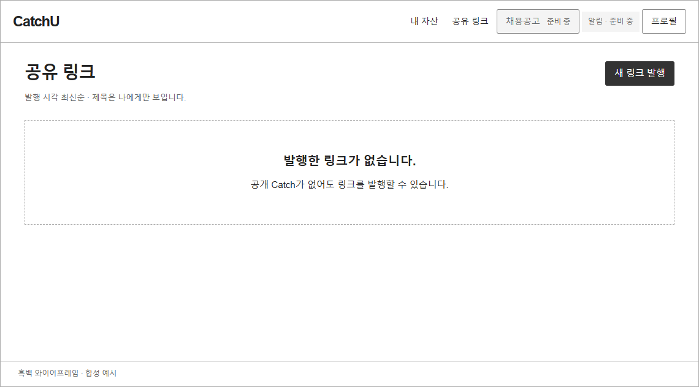

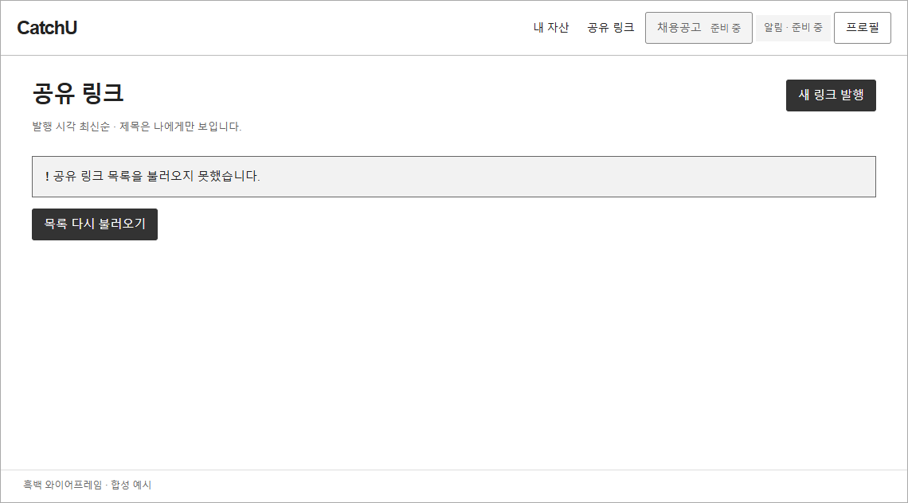

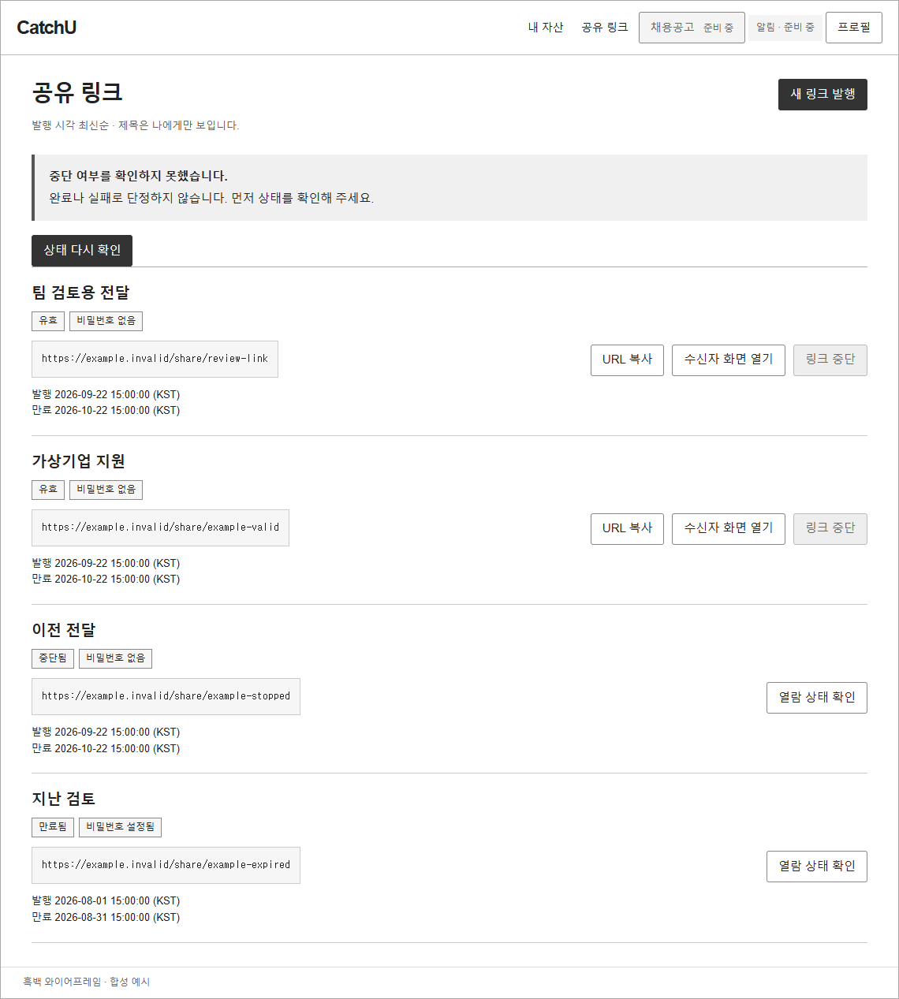

### 5.18 SCR_LINK_04 링크 중단 확인

**① 화면 정보**

| 항목 | 내용 |
|---|---|
| 화면 ID | SCR_LINK_04 |
| 화면 이름 | 링크 중단 확인 |
| 유형·사용자 | 모달 / 구직자(발행자) |
| 관련 UC | UC-13 |
| 관련 FR | FR-LNK-05 |
| 관련 규칙 | BR-13 |
| 작성자(담당) | 최수영(C) |
| 메뉴 경로 | 헤더 > 공유 링크 > 유효 링크의 [링크 중단] |
| 화면 개요 | 중단할 링크를 명시하고 영향을 알린 뒤 중단을 실행한다 |
| 근거·지위 | 9/15 팀장 확인(이미 열린 수신자 화면에는 다음 이동·새로고침부터 반영된다고 알림), 공유 링크 초안 §4.3.2, v2.2 L03-confirm — 검토초안 |
| 옛 ID | L03 중단 확인 창 |

**② 화면 그림**

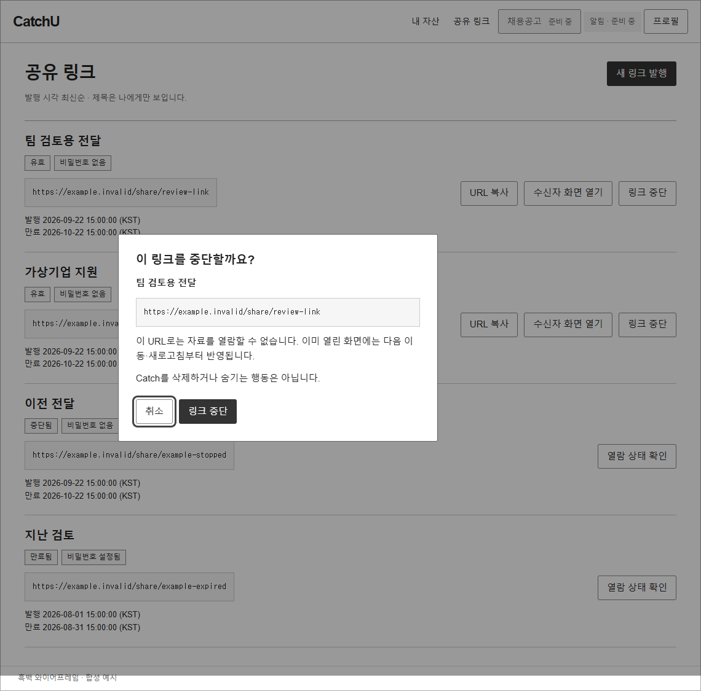

**③ 항목 정의**

| 번호 | 항목 | 유형 | 데이터·설명 | 필수/조건 |
|---|---|---|---|---|
| 1 | 질문 "이 링크를 중단할까요?" | 표시 | — | 항상 |
| 2 | 대상 링크 제목 | 표시 | `title` | 항상 |
| 3 | 대상 URL | 표시 | `url` | 항상 |
| 4 | 영향 안내 | 표시 | "이 URL로는 자료를 열람할 수 없습니다. 이미 열린 화면에는 다음 이동·새로고침부터 반영됩니다. Catch를 삭제하거나 숨기는 행동은 아닙니다." 초안은 "중단한 URL은 다시 활성화할 수 없습니다."도 제안 | 항상 |
| 5 | [취소] | 버튼 | 요청 없이 닫음 | 항상 |
| 6 | [링크 중단] | 버튼 | 중단 실행 | 항상 |

**④ 이벤트 처리**

| 번호 | 사용자 액션 | 처리(API) | 결과·이동 | 예외 처리 |
|---|---|---|---|---|
| 5 | [취소] 누름 | API 없음 | 확인창 닫힘, 초점은 [링크 중단] 버튼으로 | 전송 후에는 [취소]를 제공하지 않음 |
| 6 | [링크 중단] 누름 | "중단을 요청하고 있습니다." + 반복 제출 차단 → `PUT /share-links/{linkId}/stop` | 200: 확인창 닫힘, 해당 행 '중단됨', "링크가 중단되었습니다." | 실패 확정: "링크를 중단하지 못했습니다." + [상태 다시 확인] / 응답 불명: "중단 여부를 확인하지 못했습니다." + [상태 다시 확인](`GET /share-links` 조회만). 중단은 반복해도 같은 결과(PUT 상태 지정) |

**⑤ 상태별 화면**

요청 중·성공·실패 확정·응답 불명의 네 결과는 ④와 같다. 응답 불명 뒤 목록은 그림 45다.

### 5.19 SCR_VIEW_01 링크 비밀번호 입력

**① 화면 정보**

| 항목 | 내용 |
|---|---|
| 화면 ID | SCR_VIEW_01 |
| 화면 이름 | 링크 비밀번호 입력 |
| 유형·사용자 | 페이지 / 링크 수신자(로그인 없음) |
| 관련 UC | UC-14 |
| 관련 FR | FR-LNK-04, FR-LNK-05, FR-LNK-06, FR-LNK-07 |
| 관련 규칙 | BR-13(없는·중단·만료는 공통 안내, 비밀번호 분기 유지), NFR-SEC-01 |
| 작성자(담당) | 최수영(C) |
| 메뉴 경로 | 발행자가 전달한 URL 접속(비밀번호가 설정된 유효 링크) |
| 화면 개요 | 비밀번호가 설정된 유효 링크에서 비밀번호를 확인한다. 없는·중단·만료 링크는 비밀번호보다 먼저 공통 접근 불가 문구를 보인다 |
| 근거·지위 | 9/14 팀장 확인(사유 구분 없는 공통 문구, 비밀번호보다 먼저), API 명세 v1 판정 순서 — 팀장 결정·승인. v2.2 V01 — 검토초안 |
| 옛 ID | V01 |

**② 화면 그림**

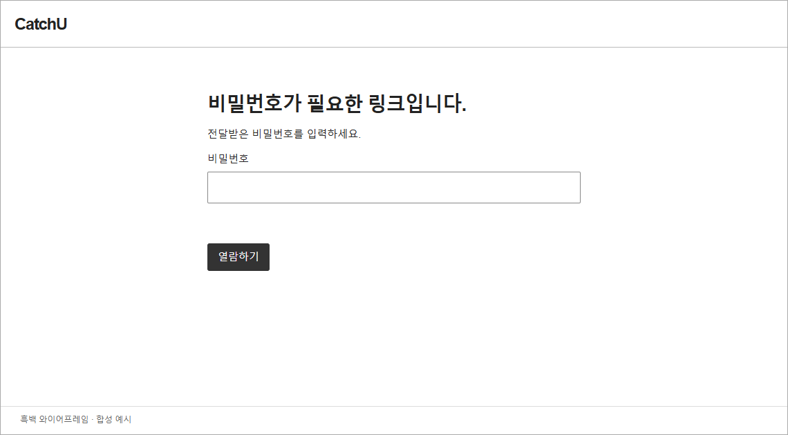

**③ 항목 정의**

| 번호 | 항목 | 유형 | 데이터·설명 | 필수/조건 |
|---|---|---|---|---|
| 1 | 수신자 헤더 | 표시 | 브랜드만, 이동 없음(SCR_COMMON_01의 8) | 항상 |
| 2 | 제목·안내 | 표시 | "비밀번호가 필요한 링크입니다. 전달받은 비밀번호를 입력하세요." | 항상 |
| 3 | 비밀번호 | 입력 | 가려진 입력. unlock 요청의 `password` | 필수 |
| 4 | [열람하기] | 버튼 | 비밀번호 확인 | 항상 |
| 5 | 안내 영역 | 표시 | 빈 입력·오입력·통신 실패 안내 | 해당 상태 |

**④ 이벤트 처리**

| 번호 | 사용자 액션 | 처리(API) | 결과·이동 | 예외 처리 |
|---|---|---|---|---|
| — | URL 접속 | `GET /public/links/{token}`(grant 없이). 판정 순서: 링크 존재·중단·만료 → 비밀번호 → 현재 허용 자료 | `401/LINK_PASSWORD_REQUIRED`: 이 화면 / 200: 비밀번호 없는 링크이므로 SCR_VIEW_02 | `404/LINK_UNAVAILABLE`(없는·중단·만료 공통): "이 링크는 열람할 수 없습니다." 사유를 구분하지 않음 |
| 4 | [열람하기] 누름 | `POST /public/links/{token}/unlock`(`password`). 검증 중 반복 제출 차단 | 200이면 링크 한정 `grant`를 받아 `X-Link-Grant`로 SCR_VIEW_02 조회 | 빈 입력: 입력 필요 안내 / `401/LINK_PASSWORD_INVALID`: "비밀번호가 맞지 않습니다." / `404/LINK_UNAVAILABLE`: 공통 접근 불가 / 통신 실패: "비밀번호 확인을 완료하지 못했습니다." + [다시 확인], 오입력으로 대체하지 않음 |

grant는 링크에 묶인 값이며 회원 JWT·영구 접근권이 아니다. 매 요청에서 링크 상태를 다시 검사하므로 grant로 중단·만료를 우회할 수 없다. grant 수명·브라우저 저장·시도 제한은 OQ-C1이다. 비밀번호를 URL·로그에 남기지 않는다.

**⑤ 상태별 화면**

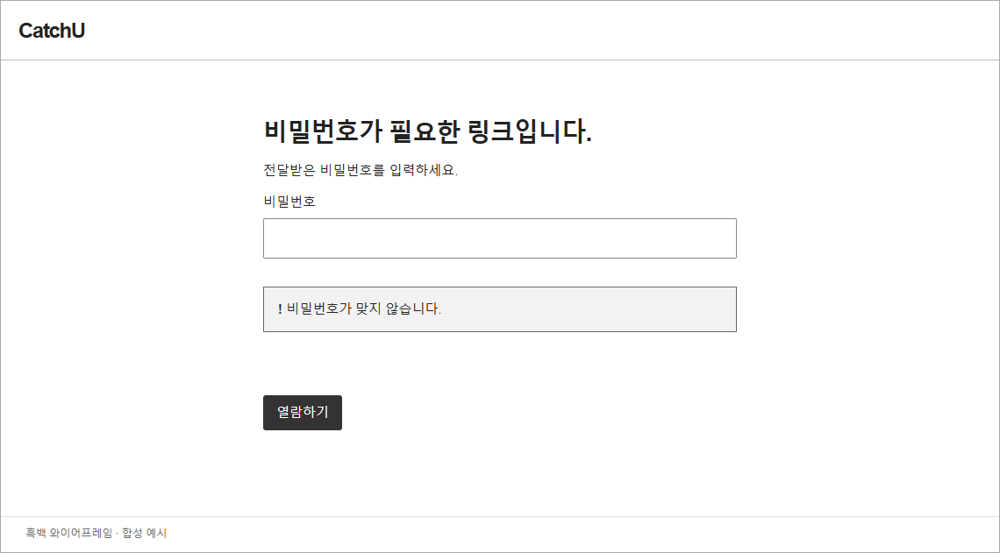

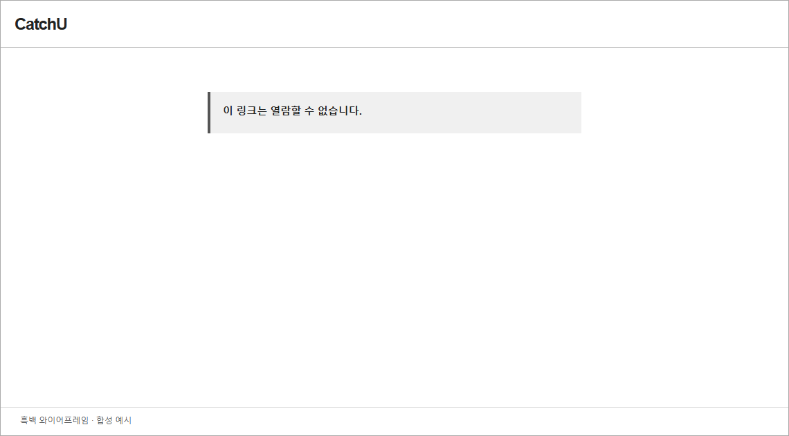

### 5.20 SCR_VIEW_02 공개 프로필·Catch 목록

**① 화면 정보**

| 항목 | 내용 |
|---|---|
| 화면 ID | SCR_VIEW_02 |
| 화면 이름 | 공개 프로필·Catch 목록 |
| 유형·사용자 | 페이지 / 링크 수신자(로그인 없음) |
| 관련 UC | UC-14, UC-15 |
| 관련 FR | FR-LNK-02, FR-LNK-03, FR-LNK-04, FR-MEM-03, FR-GEN-03 |
| 관련 규칙 | BR-10, BR-11(소유자의 현재 공개 Catch 전체), BR-13, BR-23(프로필은 열람 시점 현재 공개 허용 내용), NFR-SEC-01 |
| 작성자(담당) | 최수영(C) |
| 메뉴 경로 | URL 접속 > (비밀번호 확인) |
| 화면 개요 | 링크 소유자의 공개 프로필과 현재 공개 Catch 목록을 보여 준다. 링크 제목·최소 질문·확인/불일치 표시는 보이지 않는다 |
| 근거·지위 | API 명세 v1 수신자 API·PublicProfile·PublicCatch(승인), 9/20 팀장 결정(프로필 항목·현재 내용). 그림은 제안안 — v2.2 V02의 정상 그림에는 12월 검토 요소(자료 탭·AI 화면 요약·JD 선택)가 섞여 있어 10월 범위로 다시 그렸다 |
| 옛 ID | V02 |

**② 화면 그림**

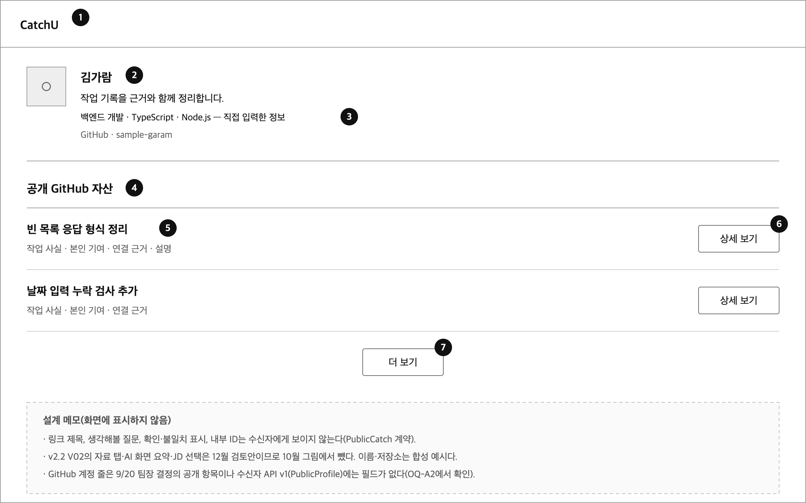

**③ 항목 정의**

| 번호 | 항목 | 유형 | 데이터·설명 | 필수/조건 |
|---|---|---|---|---|
| 1 | 수신자 헤더 | 표시 | 브랜드만, 이동 없음 | 항상 |
| 2 | 표시 이름·한 줄 소개 | 표시 | `profile.displayName`, `profile.introduction`. 열람 시점의 현재 공개 허용 내용 | 항상 |
| 3 | 직무·기술 스택 | 표시 | `profile.desiredRole`, `profile.skills` + "직접 입력한 정보"(`fieldSource` SELF_REPORTED). 그림의 GitHub 계정 줄은 9/20 팀장 결정의 공개 항목이나 PublicProfile v1에 필드가 없어 OQ-A2에서 확인한다 | 항상 |
| 4 | "공개 GitHub 자산" | 표시 | 섹션 제목 | 항상 |
| 5 | Catch 제목과 구성 | 목록 | `catches[].title`과 담긴 정보(작업 사실·본인 기여·연결 근거, 초안이 있으면 설명). 구성 요약 표시는 제안 | 공개 Catch마다 |
| 6 | [상세 보기] | 버튼 | SCR_VIEW_03 | 공개 Catch마다 |
| 7 | [더 보기] | 버튼 | `page.nextCursor` | 다음 페이지가 있을 때 |

**④ 이벤트 처리**

| 번호 | 사용자 액션 | 처리(API) | 결과·이동 | 예외 처리 |
|---|---|---|---|---|
| — | 화면 진입·새로고침 | `GET /public/links/{token}`(비밀번호 링크는 `X-Link-Grant`). 요청마다 서버가 현재 링크·공개 상태를 판정 | 200: 프로필과 목록 | `404/LINK_UNAVAILABLE`: "이 링크는 열람할 수 없습니다."(그림 49) / `401/LINK_PASSWORD_REQUIRED`: SCR_VIEW_01 / `500`: "자료를 불러오지 못했습니다." + [다시 불러오기], 빈 자료로 대체하지 않음 |
| 6 | [상세 보기] 누름 | API 없음 | SCR_VIEW_03 | — |
| 7 | [더 보기] 누름 | `GET /public/links/{token}?cursor=…` | 목록 추가 | 다음 페이지도 새 권한 판정 |

숨긴 Catch·원본 보호 Catch는 목록에서 빠지며 제목·개수·내용을 알리지 않는다. 이미 열린 화면을 실시간으로 회수하지 않고 다음 요청부터 반영한다.

**⑤ 상태별 화면**

| 상태 | 조건 | 표시 |
|---|---|---|
| 공개 Catch 0개 | 200 + 빈 `catches` | 프로필은 보이고 "현재 열람할 수 있는 공개 GitHub 자산이 없습니다." 조회 실패와 구분 |
| 조회 실패 | 500·통신 실패 | 그림 51 |
| 접근 불가 | 404/LINK_UNAVAILABLE | 그림 49 공통 문구 |
| 열람 상태 확인 실패 | 요청 시 상태 확인의 통신 실패 | "열람 상태를 확인하지 못했습니다." + [다시 확인]. 이미 표시된 화면은 유지 |

### 5.21 SCR_VIEW_03 Catch·근거 상세

**① 화면 정보**

| 항목 | 내용 |
|---|---|
| 화면 ID | SCR_VIEW_03 |
| 화면 이름 | Catch·근거 상세 |
| 유형·사용자 | 페이지 / 링크 수신자(로그인 없음) |
| 관련 UC | UC-15, UC-16 |
| 관련 FR | FR-LNK-02, FR-LNK-03, FR-LNK-04, FR-ANL-03, FR-GEN-01, FR-GEN-02, FR-GEN-03 |
| 관련 규칙 | BR-10, BR-13, NFR-SEC-01 |
| 작성자(담당) | 최수영(C) |
| 메뉴 경로 | URL 접속 > SCR_VIEW_02 > [상세 보기] |
| 화면 개요 | 현재 열람이 허용된 Catch의 제목·작업 사실·본인 기여·설명·근거를 보여 준다. 본인 확인·공개·불일치 조작은 없다 |
| 근거·지위 | API 명세 v1 PublicCatch·PublicEvidence(승인), 9/14 팀장 확인(숨김·없는 Catch 공통 문구), 도메인 설계 질문 Q4·Q5 답변(PR #68)과 PR #57 팀장 리뷰(9/22)(초안 없는 공개 Catch도 열람 허용, 링크 초안에 기록). v2.2 V03 — 검토초안 |
| 옛 ID | V03 |

**② 화면 그림**

**③ 항목 정의**

| 번호 | 항목 | 유형 | 데이터·설명 | 필수/조건 |
|---|---|---|---|---|
| 1 | [← 공개 자료 목록으로] | 링크 | 같은 링크의 SCR_VIEW_02(현재 조건으로 다시 조회) | 항상 |
| 2 | Catch 제목 | 표시 | `title`. 본인 화면과 같은 제목 | 항상 |
| 3 | 작성자 표시 | 표시 | "○○ · GitHub 기록 기반"(표시 이름) | 항상 |
| 4 | 근거로 확인한 작업 사실·본인 기여 | 표시 | `workFacts`, `subjectContribution` | 항상 |
| 5 | 생성된 설명 | 표시 | `draft` GENERATED면 `content`. 없으면 초안 없음 안내(표시 방식은 B/C 미정, v2.2 V03-noDraft는 검토초안) | 항상 |
| 6 | 기록에서 확인할 수 없는 것 | 표시 | 근거 한계(`coverageLimits`)와 확인 범위 밖 안내 | 항상 |
| 7 | 원본 근거 | 표시 | `evidence[]`(PublicEvidence): `sourceUrl`·`sourceRevision`·`representedFacts`·`contributionScope`·`coverageLimits`. v2.2 그림의 '합성 원문 발췌' 상자는 계약에 해당 필드가 없는 검토초안 표현이다 | 항상 |
| 8 | [근거 원문 보기] | 링크 | `sourceUrl` 새 탭(외부 GitHub) | 근거마다 |

생각해볼 질문, 본인 확인·불일치 표시, 요청·결과·후보 ID, 링크 제목은 수신자에게 내보내지 않는다(PublicCatch 계약).

**④ 이벤트 처리**

| 번호 | 사용자 액션 | 처리(API) | 결과·이동 | 예외 처리 |
|---|---|---|---|---|
| — | 화면 진입 | `GET /public/links/{token}/catches/{catchId}`(비밀번호 링크는 `X-Link-Grant`). 같은 링크 소유자의 현재 PUBLIC·보호 제한 없음만 허용 | 200: 상세 표시 | `404/RESOURCE_UNAVAILABLE`(숨김·타인·없음·보호 공통): "현재 열람할 수 없는 자료입니다." + 목록 복귀 / `404/LINK_UNAVAILABLE`: 링크 공통 문구 우선 / `401/LINK_PASSWORD_REQUIRED`: Catch 존재를 알리지 않고 SCR_VIEW_01 / `500`: "자료를 불러오지 못했습니다." + [다시 불러오기] |
| 8 | [근거 원문 보기] 누름 | 외부 URL 새 탭 | GitHub 원문 | 확인 가능한 경우 "근거 원문에 접근하지 못했습니다. 현재 허용된 자료를 확인해 주세요." 일시 실패를 원본 비공개로 단정하지 않음 |
| 1 | [← 공개 자료 목록으로] 누름 | `GET /public/links/{token}` | SCR_VIEW_02 | — |

**⑤ 상태별 화면**

## 6. 공통 규칙

원천에 있는 규칙만 모았다. 각 항목 끝에 근거를 적는다.

### 6.1 헤더와 이동

- 로그인 회원: 왼쪽 로고·내 자산·공유 링크·채용공고(비활성), 오른쪽 알림(비활성)·프로필. 비로그인 홈: 로고와 [Google로 시작하기]. 수신자: 이동 없는 브랜드만(#55 합의, 9/16 회의 결정 §1·§3).
- 비활성 메뉴는 누를 수 있고, 누르면 '개발 중인 기능입니다' 안내창을 띄운다. 페이지는 이동하지 않는다(#55 9/23 합의).
- 프로필은 모달 → [프로필 보기] → 상세 순서다. 수정 저장 성공·취소 뒤 상세로 돌아온다(#51 합의).
- 로그아웃 성공은 비로그인 홈, 실패는 현재 화면·입력 유지이며 완료로 표시하지 않는다(#51 합의).
- 미저장 변경이 있는 취소·이동·로그아웃은 이탈 확인을 거친다. 로그아웃은 확인에 동의해도 성공한 뒤에만 입력을 폐기한다(#51 합의).

### 6.2 오류·상태 안내

- web은 오류 응답의 `code`로 분기한다. `message` 문자열을 비교하지 않는다. 예상 밖 응답·네트워크 실패는 클라이언트의 LOOKUP_FAILED로 분류하고 빈 결과나 작업 실패로 바꾸지 않는다(API 명세 v1 「공통 오류」, #88 공통 해석 함수).
- 응답 전의 빈 배열을 정상 0건으로 확정하지 않는다. 정상 0건(200 + 빈 목록)과 조회 실패(오류 응답)를 다른 화면으로 보인다(web 기능 설계 「화면 상태 전이」).
- 조회 실패는 분석 실패·미연동·자료 없음·링크 중단으로 단정하지 않는다. 다시 불러오기만 제공한다(9/15 팀장 확인, 홈·링크 초안).
- 로딩·조회 실패·정상 빈 자료를 구분하는 공통 표시는 #106이 만든다.

| HTTP/code | 쓰이는 화면 | 화면 처리 |
|---|---|---|
| 400/INVALID_REQUEST, VALIDATION_FAILED | SCR_PROF_01, SCR_LINK_01, SCR_VIEW_01 | `details.violations`의 필드 옆에 안내 |
| 401/AUTH_REQUIRED, AUTH_INVALID | 모든 회원 화면 | 토큰을 버리고 로그인 진입(#106) |
| 401/LINK_PASSWORD_REQUIRED, LINK_PASSWORD_INVALID | SCR_VIEW_01~03 | 비밀번호 입력, 오입력 안내. 로그인 유도와 구분 |
| 403/GITHUB_CONNECTION_REQUIRED, REPOSITORY_NOT_ALLOWED, CONSENT_REQUIRED | SCR_ASSET_03 | 연동·대상·동의 조건 안내 |
| 404/RESOURCE_UNAVAILABLE | SCR_ASSET_04, SCR_VIEW_03 | 타인·없음·숨김을 구분하지 않는 공통 안내 |
| 404/LINK_UNAVAILABLE | SCR_VIEW_01~03 | "이 링크는 열람할 수 없습니다." 사유 구분 없음 |
| 409/ANALYSIS_IN_PROGRESS, RETRY_NOT_ALLOWED, REANALYSIS_DEFERRED | SCR_ASSET_03 | 진행 중·재요청 불가·재분석 보류 안내 |
| 409/IDEMPOTENCY_CONFLICT | SCR_ASSET_03, SCR_LINK_01 | 같은 키에 다른 본문. 새 요청으로 다시 시도 안내(제안) |
| 409/CONFIRMATION_REQUIRED, SOURCE_RESTRICTED | SCR_ASSET_04 | 확인 필요·원본 보호 안내 |
| 409/LINK_TITLE_CONFLICT, LINK_LIMIT_REACHED | SCR_LINK_01 | 같은 제목 유효 링크 있음·5개 한도 안내 |
| 500/INTERNAL_ERROR | 모든 화면 | "처리 중 오류가 발생했습니다." 조회 실패로 다시 불러오기 |

### 6.3 재전송·중복 방지

- 생성 POST(분석 요청·링크 발행)는 Idempotency-Key를 쓴다. 같은 요청을 다시 보낼 때는 같은 키·같은 본문을 쓰고, 응답이 불명확할 때 새 키로 자동 재요청하지 않는다(API 명세 v1, #106).
- 요청 버튼은 누르는 즉시 전송 중으로 바꾸고 다시 누르지 못하게 한다. 이는 같은 탭의 연속 클릭만 줄이며, 중복 방지는 서버의 원자적 판정이 보장한다(9/15 팀장 확인).
- Catch 확인·공개·불일치와 링크 중단은 PUT 상태 지정이라 반복해도 추가 생성이 없다.
- HTTP timeout은 실패 확정 증거가 아니다. 재조회와 사용자 재요청을 구분한다.

### 6.4 권한·보호

- 권한·등록·공개·링크 유효성·재요청 가능성은 api가 판정한다. web은 worker와 직접 통신하지 않는다(web 기능 설계 「API 소비 경계」).
- 모든 응답은 no-store이며 web도 응답·본문을 영속 캐시하지 않는다. 중단 뒤 뒤로 가기로 이전 응답을 재사용하지 않게 하기 위해서다(9/15 팀장 확인).
- JWT·grant·비밀번호·민감 원문을 URL·로그에 남기지 않는다. Access Token은 브라우저 메모리에만 둔다(#106).
- 수신자 화면은 요청마다 현재 링크·공개 상태를 판정하고, 이미 열린 화면을 실시간으로 회수하지 않는다(9/15 팀장 확인).
- 미공개 Catch와 최소 질문은 본인만 본다(NFR-PRV-02, PublicCatch 계약).

### 6.5 접근성

`wireframes.md` 「접근성·작은 화면 검토 주석」과 NFR-ACC-01(NFR6)의 기본 접근성이다. WCAG 적합성 시험을 수행했다고 주장하지 않으며, 정량 사용성·접근성 기준은 OQ14에서 정한다.

- 화면마다 main 영역과 h1 제목을 둔다. 모달은 연결된 제목을 두고 dialog로 표시한다.
- 모달이 열리면 초점을 안에 두고, 닫으면 연 버튼으로 초점을 돌린다.
- 상태는 색만으로 표현하지 않는다. 상태 아이콘에는 글자를 붙이고(분석 중·성공·부분 실패·실패), 링크 상태는 유효·중단됨·만료됨 글자로 보인다.
- 오류는 텍스트로 알리고 해당 입력과 연결한다. 상태 갱신으로 초점을 빼앗지 않는다.
- 키보드로 순서대로 이동할 수 있게 한다(예: 저장소 목록 → 동의 내용 → 요청 버튼, 근거 링크 → 확인 → 공개).
- 동의 설명을 버튼과 함께 읽을 수 있게 버튼 앞에 둔다.

### 6.6 반응형·작은 화면

- PC 저해상도 원안을 우선한다. 정확한 브레이크포인트·색상·컴포넌트 구현은 후속이다(`wireframes.md`).
- 작은 화면에서는 한 열로 쌓는다. 모달 폭·스크롤 상세는 후속 검토다(회원·자산 초안).
- 작은 화면에서 확인할 항목: 긴 근거 줄이 화면을 가로로 밀지 않는지, 비밀번호·URL·완료 안내가 숨지 않는지, 동의 설명과 요청 버튼이 함께 읽히는지(`wireframes.md`).
- v2.2 검토초안은 PC 1440px와 모바일 390px에서 주요 배치를 점검했다(합성 와이어프레임 점검이며 구현 검증이 아니다).

### 6.7 표시 규칙

- 직무·기술 스택은 "직접 입력한 정보"로 구분해 보이며 GitHub 검증 사실로 표시하지 않는다(API 명세 v1, 9/20 팀장 결정).
- 결과 단위 검토 현황 집계(검토 수·불일치 수)를 두지 않고 Catch마다 상태를 보인다(9/15 팀장 결정).
- 분석 완료를 Catch 확인·공개 완료로 표시하지 않는다. 확인 완료를 공개로 표시하지 않는다(9/15 팀장 결정, W5, BR-09·BR-20).
- 개발용 합성 예시 결과(`sourceMode` MOCK)를 실제 분석 성공으로 표시하지 않는다(API 명세 v1).
- 근거 없는 진행률·남은 시간·단계별 소요 시간을 보이지 않는다(분석 진행 초안, 허용 대기 시간은 OQ14). 적합도를 매칭 %로 보이지 않는다는 원칙은 승인 요구사항 FR6(12월 JD 기능)의 것이며, 10월 화면에는 해당 표시가 없다.

## 7. 미정 사항

| 항목 | 현재 상태 | 정할 곳 |
|---|---|---|
| 페이지 주소(로그인 홈·내 자산·공유 링크·프로필·수신자 링크, 홈 CTA·연동 복귀 주소) | 미정 | #106(최수영, 검토 이영연·이채아) |
| 내 자산 필터·상세 모달의 주소 파라미터 이름 | 주소 파라미터에 담는 것은 결정, 이름은 미정 | 이채아 |
| 연동 성공 뒤 SCR_ASSET_03 모달 자동 열기 | 미정 | 담당 개발 이슈 |
| 이름을 저장하지 않은 회원의 이동 규칙, 표시 이름 필수 여부 | A 원안(표시 이름만 필수, 미저장이면 프로필 입력)만 있음 | #106·A 담당(이영연) |
| 레포 연결 후 로그인 홈 구성 | v2.2 두 상자 안은 미채택 비교안. 대체 구성 없음 | #22 |
| GitHub 연결 만료·권한 이상 때 홈 표시 | 미정 | 홈 초안 §6.2, 회원 담당 |
| 재요청 허용 조건 | 서버 판정 기준(FAILED·APPLIED·CLOSED, 적합 후보 0, 등록 Catch 없음, 진행·복구 없음, 실패 확정 증거)은 계약으로 확정. 실패 확정 시점·실행 불명 해소는 #77 이후, 정상 완료·부분 실패의 재분석·보완은 보류 | #77, OQ-B2 |
| 부분 결과의 의미·0건·근거 부족의 세부 표시 문구 | 상태 아이콘 네 가지는 결정. 세부 문구는 미정 | OQ3, 담당 개발 이슈 |
| 같은 저장소에 요청이 여러 건일 때 '연결된 저장소' 행의 표시 기준 | 원천에 규칙 없음(이 문서 작성 중 확인한 공백) | D 담당 개발 이슈(최수영) |
| 로그인 홈의 연결된 저장소 유무 조회 방식 | 홈 전용 계약 없음. `GET /analysis-requests` 사용은 제안안 | 홈 담당 이슈, 필요하면 계약 변경 이슈 |
| 링크 발행 화면의 현재 공개 Catch 요약 조회 방식 | 전용 계약 없음. `GET /catches`에서 공개만 거르는 것은 제안안 | 링크 담당 이슈 |
| 불일치 표시 Catch를 공개할 때 알림 표현, 불일치 표시 해제 화면 | 알림은 결정(9/24), 표현은 미정. 해제는 계약상 가능하나 화면 미정 | B 담당 개발 이슈(이채아) |
| 초안 없는 공개 Catch의 수신자 설명 영역 표시 | 열람 허용은 결정, 빈 영역 표시·문구는 미정 | B/C 설계 |
| 최소 질문의 상세 표시 | 본인만·답변 저장 없음은 결정 | B 개발 이슈 |
| 링크 제목 길이 제한 | 미정 | 링크 담당 화면 제안 |
| grant 수명·저장, 비밀번호 시도 제한, 응답 시간 은닉 | 미정 | OQ-C1 |
| 발행 후 Catch 구성·본문 변화·새 공개 자산의 기존 링크 영향 | 보류. 현재 권한·숨김·현재 프로필·생성 본문 유지 시나리오만 적용 | OQ3 |
| 공개 프로필 투영과 GitHub 계정 표시 | 9/20 팀장 결정은 GitHub 계정 포함, PublicProfile v1에는 필드 없음 | OQ-A2(A 이영연·C 최수영) |
| 실제 Google·GitHub OAuth, refresh·logout·쿠키·CORS·CSRF | 미정. 개발용 로그인으로 개발 | OQ-A1, #87, #106 |
| 선정 저장소 목록·규모·지원 크기 | 미정 | OQ1 |
| 분석 동의 고지 문구·전송 자료·보관·처리 위치 | 동의 선행은 확정, 세부는 미정 | OQ11 |
| 원본 상태 관측 경로·주기·재공개 | 확인된 비공개 차단은 확정, 관측은 미정 | OQ-B3, OQ2 |
| 안내창·모달의 추가 닫기 조작(X·Esc·바깥 클릭), 로그아웃 실패 안내 문구 | 미정 | #55, #51 |
| 정량 성능·가용성·사용성·접근성 기준 | 미정. 이 문서에 수치를 넣지 않음 | OQ14 |

## 부록 A. 화면 그림 파일 목록

### A.1 v2.2에서 복사한 그림

원본 폴더는 9/23 흑백 와이어프레임 v2.2의 `screens/`이며, 레포 보관본은 `docs/deliverables/원본/2026-09-23_와이어프레임/CatchU-october-mvp-wireframes-v2.2.zip`이다. 쓰는 파일만 `images/screens/`로 복사하고 이름을 바꿨다(내용 수정 없음). V02의 JD 선택·RAG 질의응답·자료 탭 상태(V02-normal·V02-empty 포함)는 12월 검토 요소가 있어 쓰지 않았다. 9/24 결정 이전 배치(W03·W03-R·W04·W05·A-01~A-03 화면, W02-G-connected, H-01-linked·H-01-ready)도 쓰지 않았다.

| 그림 | 복사한 파일(`images/screens/`) | v2.2 원래 파일명 |
|---|---|---|
| 8 | SCR_AUTH_01__normal.png | W01-normal.png |
| 9 | SCR_AUTH_01__cancel.png | W01-cancel.png |
| 10 | SCR_AUTH_01__error.png | W01-error.png |
| 11 | SCR_AUTH_01__expired.png | W01-expired.png |
| 12 | SCR_AUTH_02__normal.png | W01-R-saved.png |
| 13 | SCR_AUTH_02__loading.png | W01-R-loading.png |
| 14 | SCR_AUTH_02__missing.png | W01-R-missing.png |
| 15 | SCR_AUTH_02__error.png | W01-R-error.png |
| 16 | SCR_PROF_01__normal.png | W02-normal.png |
| 17 | SCR_PROF_01__edit.png | W02-edit.png |
| 18 | SCR_PROF_01__emptyName.png | W02-emptyName.png |
| 19 | SCR_PROF_01__error.png | W02-error.png |
| 20 | SCR_PROF_02__normal.png | W02-P-modal.png |
| 21 | SCR_PROF_03__normal.png | W02-P-normal.png |
| 22 | SCR_PROF_03__error.png | W02-P-error.png |
| 23 | SCR_PROF_04__normal.png | W02-G-normal.png |
| 24 | SCR_PROF_04__cancel.png | W02-G-cancel.png |
| 25 | SCR_PROF_04__reauth.png | W02-G-reauth.png |
| 26 | SCR_HOME_01__normal.png | H-01-normal.png |
| 28 | SCR_HOME_02__unlinked.png | H-01-unlinked.png |
| 29 | SCR_HOME_02__loading.png | H-01-loading.png |
| 30 | SCR_HOME_02__error.png | H-01-error.png |
| 35 | SCR_LINK_01__normal.png | L01-normal.png |
| 36 | SCR_LINK_01__empty.png | L01-empty.png |
| 37 | SCR_LINK_01__duplicate.png | L01-duplicate.png |
| 38 | SCR_LINK_01__limit.png | L01-limit.png |
| 39 | SCR_LINK_01__unknown.png | L01-unknown.png |
| 40 | SCR_LINK_02__normal.png | L02-normal.png |
| 41 | SCR_LINK_02__copyError.png | L02-copyError.png |
| 42 | SCR_LINK_03__normal.png | L03-examples.png |
| 43 | SCR_LINK_03__empty.png | L03-empty.png |
| 44 | SCR_LINK_03__error.png | L03-error.png |
| 45 | SCR_LINK_03__stopUnknown.png | L03-stopUnknown.png |
| 46 | SCR_LINK_04__normal.png | L03-confirm.png |
| 47 | SCR_VIEW_01__normal.png | V01-normal.png |
| 48 | SCR_VIEW_01__wrong.png | V01-wrong.png |
| 49 | SCR_VIEW_01__blocked.png | V01-blocked.png |
| 51 | SCR_VIEW_02__error.png | V02-error.png |
| 52 | SCR_VIEW_03__normal.png | V03-normal.png |
| 53 | SCR_VIEW_03__noDraft.png | V03-noDraft.png |
| 54 | SCR_VIEW_03__unavailable.png | V03-hidden.png |
| 55 | SCR_VIEW_03__sourceError.png | V03-sourceError.png |

### A.2 이 문서에서 새로 그린 와이어프레임(제안안)

SVG 원본을 `images/screens/`에 두고, 원고는 같은 이름의 PNG를 참조한다(PNG 변환은 다음 단계). 규격은 너비 1200·흰 배경·회색 상자와 선, 번호는 검은 원 안 흰 숫자다.

| 그림 | 파일 | 새로 그린 이유 |
|---|---|---|
| 6 | SCR_COMMON_01__normal.svg | 세 가지 헤더를 한 그림에서 번호로 대응시키기 위해 |
| 7 | SCR_COMMON_02__normal.svg | v2.2에 안내창 그림이 없음 |
| 27 | SCR_HOME_02__normal.svg | 9/24 결정으로 레포 연결 CTA 목적지가 바뀜 |
| 31 | SCR_ASSET_01__normal.svg | 9/24 결정의 Catch 탭 신구조(연결 관리 영역·저장소 필터) |
| 32 | SCR_ASSET_02__normal.svg | 9/24 결정의 준비 중 탭 |
| 33 | SCR_ASSET_03__normal.svg | 9/24 신설 저장소 연결 관리 모달 |
| 34 | SCR_ASSET_04__normal.svg | 9/24 결정으로 페이지에서 모달로, title·공개 두 상태·불일치 비차단 반영 |
| 50 | SCR_VIEW_02__normal.svg | v2.2 V02 정상 그림에 12월 검토 요소(자료 탭·AI 화면 요약·JD 선택)가 섞임 |

## 부록 B. 옛 화면 ID와 새 ID

공통 ID 대응표 8.2절을 옮겼다.

| 옛 ID(초안·v2.2) | 새 ID | 처리 |
|---|---|---|
| W01 / W01-R | SCR_AUTH_01 / SCR_AUTH_02 | 유지 |
| W02 | SCR_PROF_01 | 유지 |
| W02-P | SCR_PROF_02(모달), SCR_PROF_03(상세) | 둘로 나눔 |
| W02-G | SCR_PROF_04 | 복귀 목적지 변경(9/24) |
| H-01 | SCR_HOME_01(비로그인), SCR_HOME_02(로그인) | 둘로 나눔 |
| W03 | SCR_ASSET_01, SCR_ASSET_02 | GitHub 분석 이력 탭 폐지(9/24) |
| W03-R | SCR_ASSET_01(저장소 필터) | 폐지·대체(9/24) |
| A-01 / A-02 / A-03 | SCR_ASSET_03 | 별도 화면 폐지, 모달로 통합(9/24) |
| W04 / W05 | SCR_ASSET_04 | 모달로 통합(9/24) |
| W06 대표 구성 | SCR_ASSET_51(12월) | 첫 MVP 이후 |
| L01 / L02 / L03 | SCR_LINK_01 / SCR_LINK_02 / SCR_LINK_03, SCR_LINK_04 | 중단 확인 창 분리 |
| V01 / V02 / V03 | SCR_VIEW_01 / SCR_VIEW_02 / SCR_VIEW_03 | 유지 |

## 원본과 근거

| 경로(레포 기준) | 사용한 내용 | 지위 |
|---|---|---|
| `docs/deliverables/id-registry.md` | 화면·UC·FR·BR·엔티티 ID, 화면 목록 8.1·8.2, 미정 항목 13절 | 산출물 공통 기준(ID 체계는 제안안) |
| `aidlc/spaces/default/intents/260914-catchu-october-mvp/inception/requirements-analysis/requirements.md` | 10월 FR·NFR6(이해 가능성·접근성)·OQ14 | 승인(2026-09-22) |
| `aidlc/spaces/default/intents/260909-catchu-definition-review/inception/requirements-analysis/requirements.md` | FR 원문, NFR6·OQ14 | 승인(2026-09-11) |
| `aidlc/spaces/default/intents/260914-catchu-october-mvp/ideation/scope-definition/scope-document.md` | M01~M07, 후속 검토 후보(복합 필터·정렬·일괄 공개 등) | 승인(2026-09-22) |
| `aidlc/spaces/default/intents/260914-catchu-october-mvp/ideation/rough-mockups/wireframes.md`, `user-flow.md` | 화면 구조, 주 흐름, 접근성·작은 화면 검토 주석, 재인증 원안 | 승인(2026-09-22, 9/24 결정으로 일부 대체) |
| `aidlc/spaces/default/intents/260914-catchu-october-mvp/construction/u1-web/functional-design/functional-spec.md` | 흐름 W1~W8, 내 자산 화면 구조, 상태 아이콘 표, 화면 상태 전이, API 소비 경계 | 승인(2026-09-23). 9/24 팀장 결정 반영분은 단계 재승인 기록 없음 |
| `aidlc/spaces/default/intents/260914-catchu-october-mvp/construction/u1-web/functional-design/single-2026-09-24-questions.md`, `inception/contract-design/single-2026-09-24-verification.md` | 9/24 단독 정정 범위와 검증·완료 기록 상태 | 9/24 팀장 결정 반영 기록 |
| `aidlc/spaces/default/intents/260914-catchu-october-mvp/audit/` | 단계 승인 시각(거친 화면 설계 9/22, API 명세·기능 설계 9/23) 확인(읽기만) | 감사 기록 |
| `aidlc/spaces/default/intents/260914-catchu-october-mvp/inception/contract-design/contract-summary.md`, `member-api.yaml`, `recipient-api.yaml`, `common.yaml` | API 경로·요청/응답 필드·enum·오류 코드·판정 순서·OQ-A1~OQ-L | 승인(2026-09-23). 9/24 팀장 결정 반영분은 정정·자체 검증 완료, 단계 재승인 기록 없음(PR #89) |
| `aidlc/spaces/default/intents/260914-catchu-october-mvp/construction/u2-api/functional-design/entities.md` | ERD v1 엔티티·속성 | 승인(2026-09-23). 9/24 팀장 결정(title) 반영분은 단계 재승인 기록 없음 |
| `aidlc/spaces/default/intents/260914-catchu-october-mvp/construction/u2-api/functional-design/functional-spec.md` | F4 등록·반영 단계, 반영 트랜잭션 실패 처리, OQ-B1 결정(Catch 등록과 반영 완료 한 트랜잭션) | 승인(2026-09-23). OQ-B1 행은 9/24 팀장 결정 |
| `aidlc/spaces/default/intents/260914-catchu-october-mvp/inception/delivery-planning/team-allocation.md` | 팀원별 담당 | 승인 |
| `docs/ai-dlc-input-mvp/2026-09-14_followup.md` | 인증·홈 진입(9/14), GitHub 연동·CTA(9/15), 링크 용어·접근 불가 공통 문구(9/14), 링크 제목·5개·열람 중 변경(9/15), 홈 분석 결과 제외(9/15), 프로필·본문 기준 시점(9/20), B 계약 확인·내 자산 화면 구조(9/24) | 팀장 결정 |
| `docs/ai-dlc-input-mvp/2026-09-16_meeting-decisions.md` | 내비게이션 구성, 홈 단계 표시, 수신자 헤더 | 팀장 결정(회의) |
| `docs/ai-dlc-input-mvp/CatchU_회원자산_흐름_와이어프레임_초안.md` | W01~W02-G 문구·예외, #51·#55 합의 반영 | 검토초안(합의 기록 부분은 팀 합의) |
| `docs/ai-dlc-input-mvp/CatchU_서비스홈_흐름_와이어프레임_초안.md` | 홈 상태·버튼·연결된 repo 판단, #55 합의 반영 | 검토초안 |
| `docs/ai-dlc-input-mvp/CatchU_공유링크_흐름_와이어프레임_초안.md` | L01~V03 문구·예외 동작·중단 결과 4분기·수신자 헤더 | 검토초안 |
| `docs/ai-dlc-input-mvp/CatchU_공유링크_정보_판단조건_초안.md` | 링크 정보·판단 조건 | 검토초안 |
| `docs/ai-dlc-input-mvp/CatchU_저장소선택_분석동의_흐름_와이어프레임_초안.md`, `CatchU_분석진행_흐름_와이어프레임_초안.md`, `CatchU_분석실패_재요청_흐름_와이어프레임_초안.md` | 선택·동의·진행·실패 화면 원안(9/24 모달로 통합) | 검토초안 |
| `docs/deliverables/원본/2026-09-23_와이어프레임/CatchU-october-mvp-wireframes-v2.2.zip` | 화면 그림 PNG 42장(부록 A.1), README·sources.md의 범위 설명 | 검토초안(레포 밖 원본 보관본) |
| `docs/deliverables/images/screens/*.svg` | 새로 그린 와이어프레임 8장(부록 A.2) | 제안안 |
| `api/README.md`, `api/src/auth/auth.config.ts` | 개발용 로그인이 운영 설정에서 거부됨(#87 구현, PR #110) | 기준 커밋의 코드 |
| GitHub 이슈 #22·#51·#55·#64·#85·#88·#106 | 홈 구성 미결, 프로필 메뉴·헤더 합의, 화면 배치, v2.2 작성자(#85), 공통 오류, web 공통 기반·페이지 주소 | 이슈 기록(조회만) |
