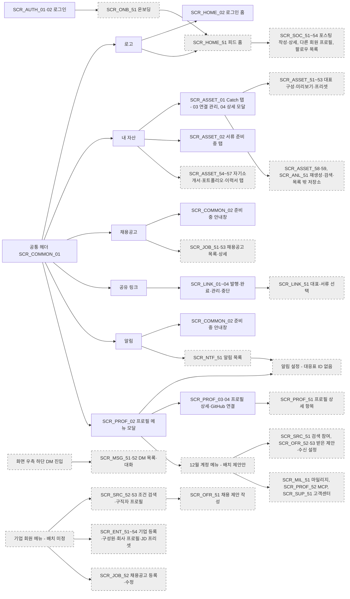
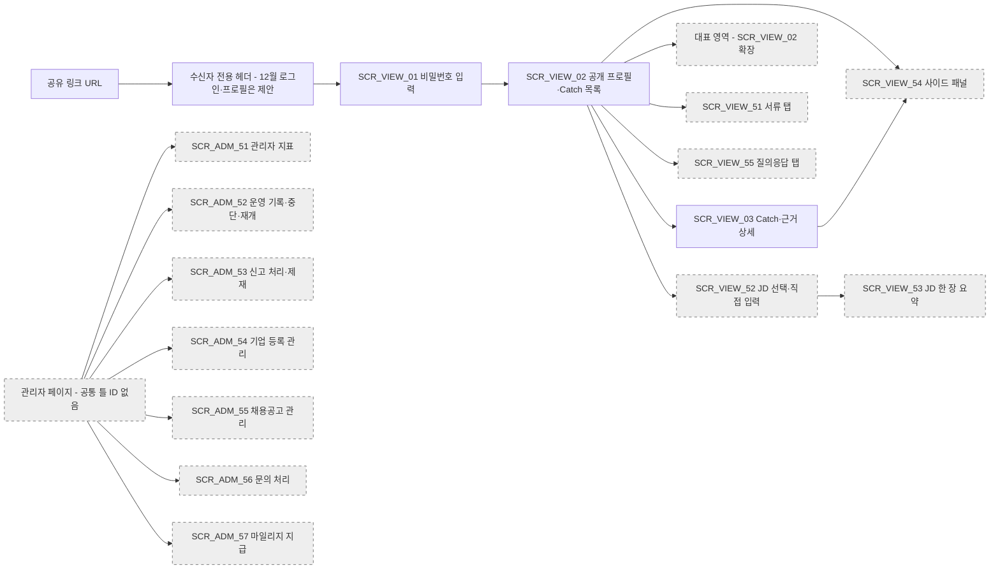
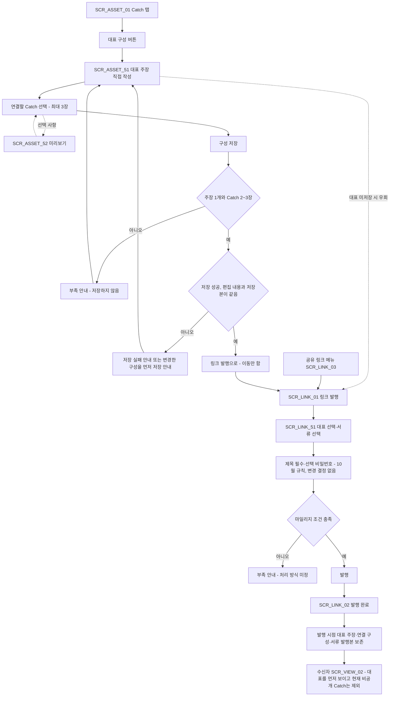
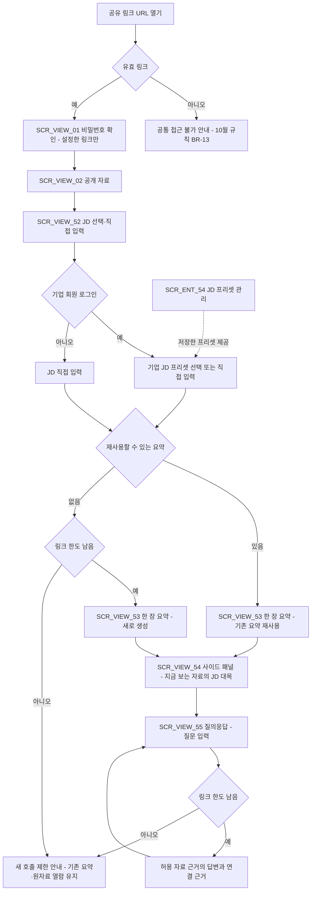
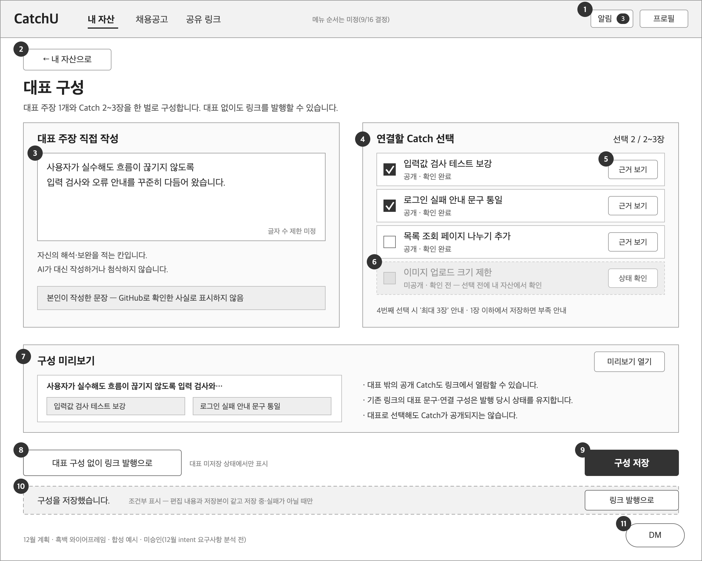
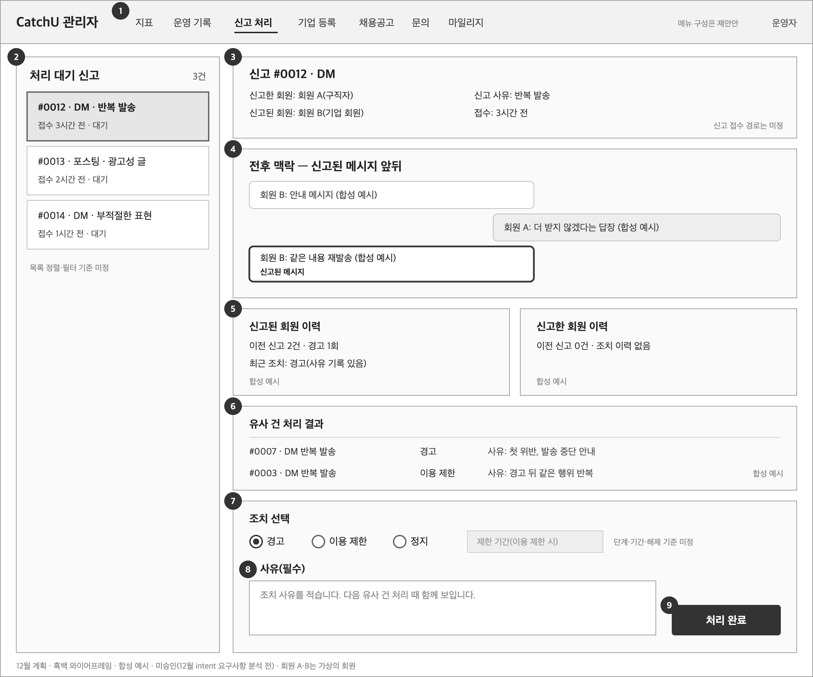
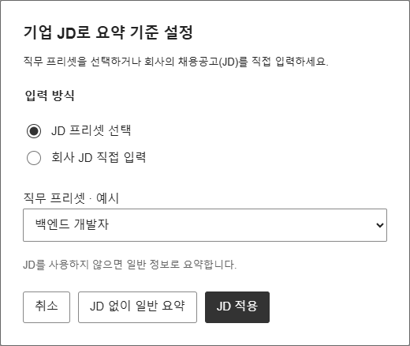
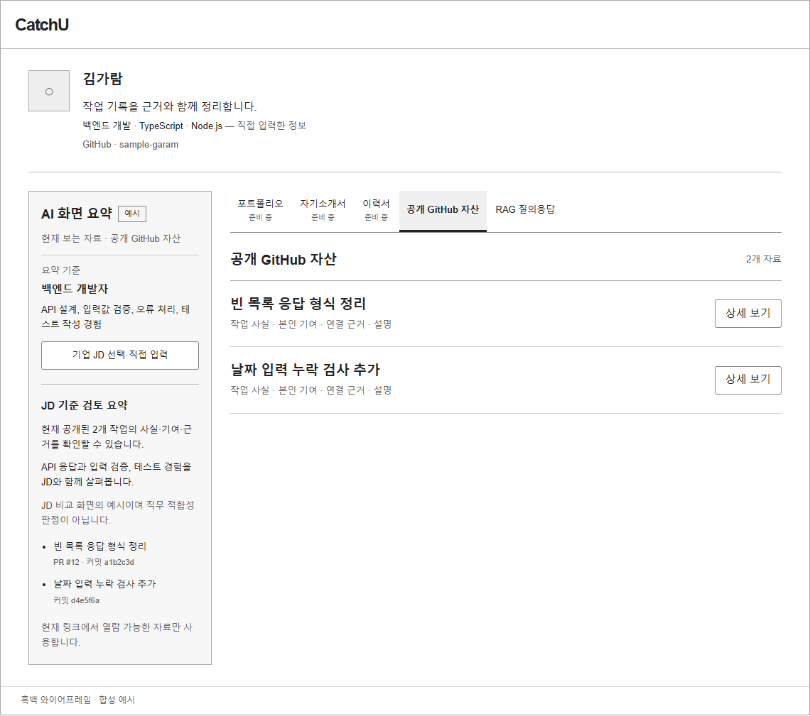
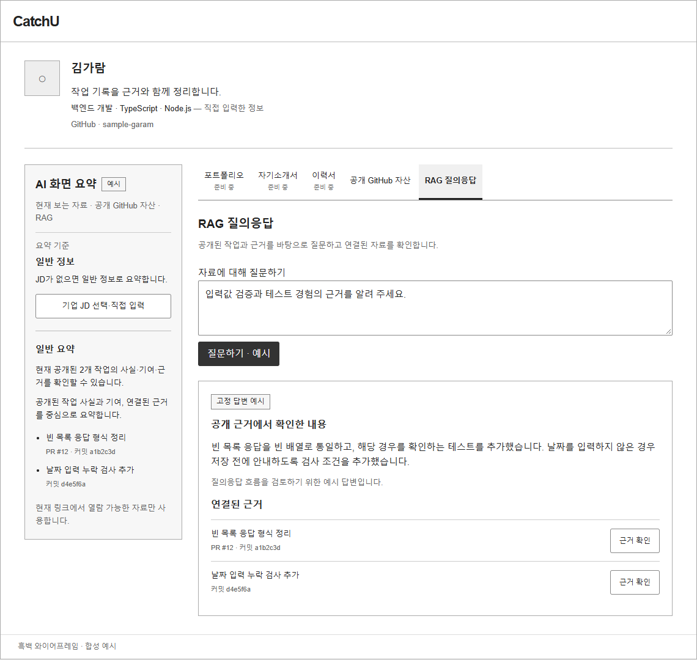

# 화면 설계서 — 12월 계획

| 항목 | 내용 |
|---|---|
| 팀명 | Jaemin_AI |
| 과제명 | 이력서-채용공고 텍스트 매칭 시스템 |
| 서비스명 | CatchU(캐치유) |
| 문서 버전 | v1.0 |
| 작성일 | 2026-09-28 |
| 기준 | origin/dev 9093d2e |
| 문서 지위 | **미승인 계획 — 12월 intent 요구사항 분석 전, 팀장 결정 입력 기준.** 중간 평가 제출 산출물. 화면 ID는 공통 ID 대응표의 12월 가칭 ID이며, 화면 단위·배치·문구는 12월 설계에서 바뀔 수 있다. 이 문서 자체는 AI-DLC 승인 기록이 아니다 |

## 변경 이력

| 버전 | 일자 | 내용 | 작성 |
|---|---|---|---|
| v1.0 | 2026-09-28 | 최초 작성. 12월 가칭 화면 49개 목록, 메뉴 구성도 2개, 주요 흐름 2개, 화면별 개요, 핵심 화면 2개 와이어프레임(대표 구성 편집·신고 처리), 9/23 검토안 참고 그림 3장, 미정 사항 정리. 제출 전 검토에서 원천 대조로 표현 정정(10월 규칙 '유지' 단정, 링크별 '대표 없음' 선택지, 제재 기간 입력의 지위 등)과 2.8절 요구사항–데이터–분석 대응 추가. 문서 간 정합성 점검으로 SCR_ASSET_55·SCR_LINK_51·SCR_VIEW_53의 관련 FR 보완(대응표에도 반영), 작성 메모를 7.2절 36번과 2.8절로 옮김 | 팀장(AI 작성 보조) |

## 1. 개요

**미승인 계획 — 12월 intent 요구사항 분석 전, 팀장 결정 입력 기준.** 이 문서의 12월 화면은 12월 범위 보완(팀장 결정 입력)과 첫 intent 승인 요구사항의 12월 항목에서 나온 계획이다. 12월 범위를 다룰 AI-DLC 작업 단위(intent)는 요구사항 분석 승인까지만 진행하고, 도메인 설계·계약·ERD는 10월 MVP 개발 뒤에 한다(12월 범위 보완 §5). 따라서 아래 화면은 "무엇을 보여 주고 무엇을 할 수 있어야 하는가" 수준이며 확정 설계가 아니다.

### 1.1 문서 목적

- 12월에 더할 화면을 가칭 ID로 빠짐없이 나열하고, 각 화면이 어떤 12월 기능 요구사항(FR)을 받는지, 어떤 12월 엔티티·분석 기능과 이어지는지 보인다(2절).
- 10월 MVP 메뉴에 12월 메뉴가 어떻게 붙는지 보인다(3절).
- 12월 1순위인 대표 구성과, 기업 회원·링크 수신자의 JD 기능 흐름을 보인다(4절).
- 화면마다 목적·주요 항목·주요 이벤트·권한 조건을 정리한다(5절).
- 핵심 화면 2개를 흑백 와이어프레임으로 그리고 항목·이벤트를 정의한다(6절).
- 정해지지 않은 것을 정할 곳과 함께 모은다(7절).

### 1.2 범위와 기준

| 구분 | 내용 |
|---|---|
| 다루는 화면 | 공통 ID 대응표 8.3절의 12월 가칭 화면 49개(`SCR_*_51`~) |
| 함께 다루는 10월 화면 | 12월에 바뀌거나 확장되는 10월 화면 10개(2.7절, 헤더는 일반 서비스·수신자로 나눠 11행). 10월 화면 자체의 설계는 07 화면 설계서(10월 MVP)가 다룬다 |
| 기준 문서 | `docs/ai-dlc-input-december/CatchU_12월_범위_보완.md`(9/15 기록, 9/24·25 보완), 첫 intent 승인 요구사항(2026-09-11)의 12월 항목, 9/16 회의 결정(헤더·알림·DM·홈·수신자 헤더·이력서) |
| 화면 배치의 출발점 | 10월 화면 구조(9/24 팀장 결정: 내 자산은 Catch 탭 하나 + 저장소 연결 관리 모달, Catch 상세는 모달). 12월 설계는 10월 계약 v1·ERD v1 위에 쌓는다(12월 범위 보완 §5) |
| 다루지 않는 것 | 화면 주소, 컴포넌트, 시각 디자인, API·테이블 설계. 12월 엔티티 이름 자리는 06 데이터베이스 요구사항 분석서(12월 계획), 분석 기능은 10 빅데이터 분석 정의서(12월 계획)가 다룬다 |

### 1.3 지위 표기

| 표기 | 뜻 |
|---|---|
| 승인 | AI-DLC의 단계별 승인 절차(게이트)를 통과한 산출물의 내용. 이 문서에서는 주로 첫 intent 승인 요구사항(2026-09-11)의 12월 계획 항목 |
| 팀장 결정 | 입력 문서에 기록된 팀장 결정(12월 범위 보완, 9/16 회의 결정, 9/24 후속 입력). 12월 intent 요구사항 분석에서 질문으로 다시 확인한다 |
| 검토초안 | 담당자 초안·팀 검토 자료. 회원·자산 와이어프레임 초안의 W06(대표 구성), 공유 링크 초안의 12월 제안, 9/23 v2.2 흑백 와이어프레임의 V02 JD·RAG 검토안, P4 설계 노트 |
| 제안안 | 이 문서에서 새로 제안하는 배치·표현. 6절 와이어프레임의 배치와 합성 예시, 3절의 메뉴 묶음 |
| 미정 | 정해지지 않음. 7절에 정할 곳을 적는다 |

### 1.4 사용자와 권한 표기

| 사용자 | 설명 | 12월 화면의 권한 조건 | 근거 |
|---|---|---|---|
| 구직자 | 로그인한 회원. 10월의 주 사용자 | 본인 자료만 만들고 바꾼다. 다른 구직자의 프로필·포스팅·Catch를 볼 때는 공개 범위(전체·맞팔)를 적용한다 | FR-SOC-104, BR-104 |
| 링크 수신자 | 링크를 받아 여는 사람. 비로그인 가능 | 유효 링크·비밀번호 조건을 충족하면 현재 공개 자료와 그 링크에 담긴 서류 발행본만 본다. JD 기능은 링크 단위 한도 안에서 쓴다 | FR-LNK-04, FR-DOC-102, FR-JDF-103 |
| 기업 회원 | 기업에 소속된 로그인 회원(HR·HM) | 검색·제안·JD 프리셋은 로그인한 기업 계정만 쓴다. 기업 안 직책별 권한은 미정 | FR-SRC-101, FR-OFR-101, FR-ENT-102 |
| 회원 | 구직자와 기업 회원을 함께 이르는 말 | 기업 소속 회원이 팔로우·포스팅·피드를 쓰는지는 미정 | 12월 범위 보완 §3-2 |
| 신규 회원 | 처음 로그인한 회원 | 온보딩 대상 | FR-MEM-102 |
| 운영자 | 개발을 겸하는 운영자 1명, 한 건에 몇 분만 쓰는 전제 | 관리자 페이지 권한. 관리자 권한 모델은 미정 | 12월 범위 보완 §2 관리자 처리 기능, P4 설계 노트 7장(초안) |

기업 회원·운영자 액터와 신고 접수 경로는 12월 요구사항 분석의 미결이다(공통 ID 대응표 7.2절).

### 1.5 12월 화면 설계 원칙

| 번호 | 원칙 | 근거와 지위 |
|---|---|---|
| 1 | 12월 화면은 10월 화면 위에 붙인다. 로그인 홈을 피드 홈으로 바꾸는 것 말고는 10월 내 자산·링크·수신자 화면에 탭·영역·모달을 더하는 방식으로 계획했다 | 12월 범위 보완 §4·§5(팀장 결정), 더하는 방식은 이 문서의 제안안 |
| 2 | 화면·링크·MCP는 같은 권한 판정을 따른다 | NFR-SEC-101(팀장 결정, 미승인 계획), 첫 intent NFR1(승인) |
| 3 | JD 요약·사이드 패널·질의응답은 JD 적합도를 매칭 %로 보이지 않는다. 검색 결과는 유사도·일치 개수 순위를 만들지 않고, 무결과를 역량 부재로 표시하지 않는다 | BR-101·BR-102, EXC-05(승인 12월 계획) |
| 4 | 프로필 자가 입력값은 GitHub에서 확인한 사실과 구분해 표시한다 | BR-103(승인 12월 계획) |
| 5 | 구직자 간 공개 범위(전체·맞팔)는 구직자끼리 볼 때만 적용한다. 기업 열람과 직접 링크 열람은 전역 공개·숨김을 따른다 | BR-104, 12월 범위 보완 §2(팀장 결정) |
| 6 | 대표 선택만으로 링크의 GitHub 자산 공개 범위가 달라지지 않고, 대표로 고른다고 Catch가 공개되지 않는다. 서류는 링크 발행 때 링크별로 고르며 계정 전체 서류 공개 설정을 두지 않는다 | 첫 intent FR3.2·FR5.2(승인), EXC-09, W06 화면 제안(검토초안) |
| 7 | 기존 링크는 발행 당시 대표 문구·연결 구성·서류 발행본을 유지하되 현재 비공개 Catch는 뺀다 | FR-REP-103, FR-DOC-103(승인 12월 계획) |
| 8 | 알림은 숫자로 표시하고 꺼 둔 알림은 집계에서 뺀다. 색 변경·움직이는 효과를 쓰지 않고, 안 읽음은 검정·읽음은 회색, 빨강은 전체 시스템 공지에만 쓴다 | 9/16 회의 결정 §1(팀장 결정) |
| 9 | 운영자 화면은 한 건의 판단에 필요한 것을 한 화면에 모은다. 시스템 이상·인젝션은 자동 처리하며 사람이 여는 대응 화면을 두지 않는다 | 12월 범위 보완 §2 운영 기능·관리자 처리 기능, P4 페르소나 |
| 10 | 마일리지는 현금 구매·환전을 두지 않고, 직접 링크 열람은 차감하지 않는다 | BR-105(팀장 결정, 미승인 계획) |

## 2. 화면 목록

화면 ID·이름·유형·사용자·UC·FR은 공통 ID 대응표 8.3절을 그대로 쓴다. 우선순위는 대응표 12절 규칙을 따른다(대표 구성 FR-REP-101~103은 상, 운영 기능 FR-OPS-101~104는 하, 순서를 밝히지 않은 나머지는 중(미정)). "10월 화면과의 관계"는 대체(10월 화면을 바꿔 끼움)·확장(10월 화면에 영역·모달을 더함)·신규로 적는다.

### 2.1 구직자 — 내 자산·대표·서류

| 가칭 화면 ID | 화면 이름 | 유형(예정) | 사용자 | 관련 UC | 관련 12월 FR | 10월 화면과의 관계 | 우선순위 |
|---|---|---|---|---|---|---|---|
| SCR_ASSET_51 | 대표 구성 편집 | 페이지 | 구직자 | UC-101 | FR-REP-101 | 신규. 옛 W06 원안. SCR_ASSET_01에서 진입(10월에는 진입 버튼을 숨김) | 상 |
| SCR_ASSET_52 | 대표 미리보기 | 모달 | 구직자 | UC-101 | FR-REP-102 | 신규. SCR_ASSET_51에서 연다 | 상 |
| SCR_ASSET_53 | 대표 프리셋 관리 | 페이지 | 구직자 | UC-102 | FR-REP-104 | 신규. SCR_ASSET_51을 여러 벌로 넓힘 | 중(미정) |
| SCR_ASSET_54 | 내 자산 — 자기소개서 탭 | 페이지 탭 | 구직자 | UC-103 | FR-DOC-101 | SCR_ASSET_02(준비 중 탭) 대체 | 중(미정) |
| SCR_ASSET_55 | 내 자산 — 포트폴리오 탭 | 페이지 탭 | 구직자 | UC-103 | FR-DOC-101, FR-DOC-105 | SCR_ASSET_02 대체. PDF 유형(텍스트·이미지 전용) 구분 표시 | 중(미정) |
| SCR_ASSET_56 | 내 자산 — 이력서 탭 | 페이지 탭 | 구직자 | UC-103 | FR-DOC-106 | SCR_ASSET_02 대체 | 중(미정) |
| SCR_ASSET_57 | 서류 원본 수정·삭제 안내 | 모달 | 구직자 | UC-103 | FR-DOC-104 | 신규. SCR_ASSET_54~56에서 연다 | 중(미정) |
| SCR_ASSET_58 | Catch 재생성 요청 | 모달 | 구직자 | UC-106 | FR-CAT-101 | 신규. SCR_ASSET_04(Catch 상세 모달)에서 진입 | 중(미정) |
| SCR_ASSET_59 | 본인 Catch 검색 | 영역 | 구직자 | UC-107 | FR-CAT-102 | SCR_ASSET_01 확장 | 중(미정) |
| SCR_ANL_51 | 목록 밖 저장소 선택 | 영역 | 구직자 | UC-105 | FR-ANL-101, FR-ANL-102 | SCR_ASSET_03(저장소 연결 관리 모달) 확장 | 중(미정) |

### 2.2 공유 링크·수신자·JD

| 가칭 화면 ID | 화면 이름 | 유형(예정) | 사용자 | 관련 UC | 관련 12월 FR | 10월 화면과의 관계 | 우선순위 |
|---|---|---|---|---|---|---|---|
| SCR_LINK_51 | 링크 발행 — 대표·서류 선택 | 영역 | 구직자 | UC-104 | FR-REP-103, FR-REP-104, FR-DOC-102, FR-DOC-103, FR-MIL-101 | SCR_LINK_01(링크 발행) 확장 | 상(대표 보존) 중(미정)(서류·프리셋·마일리지) |
| SCR_VIEW_51 | 수신자 자료 탭(자기소개서·포트폴리오·이력서) | 페이지 탭 | 링크 수신자 | UC-104 | FR-DOC-102, FR-DOC-103 | SCR_VIEW_02 확장. v2.2 V02-coverLetter·portfolio·resume(검토초안) | 중(미정) |
| SCR_VIEW_52 | JD 선택·직접 입력 | 모달 | 링크 수신자, 기업 회원 | UC-108 | FR-JDF-101, FR-JDF-103, FR-JDF-106 | 신규. SCR_VIEW_02에서 연다. v2.2 V02-jdPreset·jdCustom(검토초안) | 중(미정) |
| SCR_VIEW_53 | JD 한 장 요약 | 페이지 | 링크 수신자, 기업 회원 | UC-108 | FR-JDF-101, FR-JDF-103, FR-JDF-104, FR-JDF-105, FR-DOC-105 | 신규. 이미지 전용 PDF는 근거에서 제외 | 중(미정) |
| SCR_VIEW_54 | 사이드 패널(현재 자료 AI 요약) | 영역 | 링크 수신자, 기업 회원 | UC-109 | FR-JDF-102 | SCR_VIEW_02·SCR_VIEW_03 확장. v2.2 사이드바 교체안(검토초안) | 중(미정) |
| SCR_VIEW_55 | 질의응답 탭 | 페이지 탭 | 링크 수신자, 기업 회원 | UC-110 | FR-JDF-101, FR-JDF-104 | SCR_VIEW_02 확장. v2.2 V02-rag·ragAnswer(검토초안) | 중(미정) |

### 2.3 홈·소셜·알림·DM

| 가칭 화면 ID | 화면 이름 | 유형(예정) | 사용자 | 관련 UC | 관련 12월 FR | 10월 화면과의 관계 | 우선순위 |
|---|---|---|---|---|---|---|---|
| SCR_HOME_51 | 로그인 홈 — 피드 | 페이지 | 구직자 | UC-119 | FR-SOC-103 | SCR_HOME_02(로그인 홈) 대체 | 중(미정) |
| SCR_SOC_51 | 포스팅 작성 | 페이지 | 회원 | UC-118 | FR-SOC-102, FR-SOC-104 | 신규 | 중(미정) |
| SCR_SOC_52 | 포스팅 상세 | 페이지 | 회원 | UC-118, UC-119 | FR-SOC-102 | 신규 | 중(미정) |
| SCR_SOC_53 | 다른 회원 프로필 | 페이지 | 회원 | UC-117 | FR-SOC-101, FR-SOC-104, FR-MEM-101 | 신규. 링크 수신자가 보는 공개 프로필(SCR_VIEW_02)과 다른 경로 | 중(미정) |
| SCR_SOC_54 | 팔로우 목록 | 페이지 | 회원 | UC-117 | FR-SOC-101 | 신규 | 중(미정) |
| SCR_NTF_51 | 알림 목록 | 모달 | 회원 | UC-121 | FR-NTF-101 | SCR_COMMON_02(준비 중 안내창)의 알림 쪽 대체 | 중(미정) |
| SCR_MSG_51 | DM 목록 | 페이지 | 회원 | UC-116, UC-120 | FR-MSG-101, FR-MSG-103 | 신규. 화면 우측 하단 DM 진입(9/16 결정) | 중(미정) |
| SCR_MSG_52 | DM 대화·연락 정보 공유 | 페이지 | 회원 | UC-116, UC-120 | FR-MSG-101, FR-MSG-102, FR-MSG-103 | 신규 | 중(미정) |

### 2.4 기업 회원 — 검색·제안·기업·채용공고

| 가칭 화면 ID | 화면 이름 | 유형(예정) | 사용자 | 관련 UC | 관련 12월 FR | 10월 화면과의 관계 | 우선순위 |
|---|---|---|---|---|---|---|---|
| SCR_SRC_51 | 검색 참여 설정 | 페이지 | 구직자 | UC-112 | FR-SRC-101, FR-OFR-102 | 신규 | 중(미정) |
| SCR_SRC_52 | 기업 조건 검색 | 페이지 | 기업 회원 | UC-113 | FR-SRC-102, FR-SRC-103, FR-SRC-104 | 신규 | 중(미정) |
| SCR_SRC_53 | 검색 결과 구직자 프로필 | 페이지 | 기업 회원 | UC-113 | FR-SRC-102, FR-MIL-101 | 신규 | 중(미정) |
| SCR_OFR_51 | 채용 제안 작성 | 모달 | 기업 회원 | UC-114 | FR-OFR-101 | 신규 | 중(미정) |
| SCR_OFR_52 | 받은 제안 목록·응답 | 페이지 | 구직자 | UC-115 | FR-OFR-101, FR-MIL-102 | 신규 | 중(미정) |
| SCR_OFR_53 | 제안 수신 설정·차단 관리 | 페이지 | 구직자 | UC-115 | FR-OFR-103, FR-OFR-104 | 신규 | 중(미정) |
| SCR_ENT_51 | 기업 등록·소속 신청 | 페이지 | 기업 회원 | UC-124 | FR-ENT-101 | 신규 | 중(미정) |
| SCR_ENT_52 | 기업 구성원·직책 권한 관리 | 페이지 | 기업 회원 | UC-124 | FR-ENT-102 | 신규 | 중(미정) |
| SCR_ENT_53 | 회사 프로필 | 페이지 | 기업 회원 | UC-125 | FR-ENT-103 | 신규. 구직자 프로필과 같은 구조로 처리(12월 범위 보완 §2) | 중(미정) |
| SCR_ENT_54 | JD 프리셋 관리 | 페이지 | 기업 회원 | UC-111 | FR-JDF-106, FR-ENT-104 | 신규 | 중(미정) |
| SCR_JOB_51 | 채용공고 목록 | 페이지 | 회원 | UC-126 | FR-JOB-101 | SCR_COMMON_02의 채용공고 쪽 대체(헤더 채용공고 메뉴) | 중(미정) |
| SCR_JOB_52 | 채용공고 등록·수정 | 페이지 | 기업 회원 | UC-126 | FR-JOB-101 | 신규 | 중(미정) |
| SCR_JOB_53 | 채용공고 상세 | 페이지 | 회원 | UC-126 | FR-JOB-101 | 신규. 지원은 외부 링크 | 중(미정) |

### 2.5 계정·지원·마일리지

| 가칭 화면 ID | 화면 이름 | 유형(예정) | 사용자 | 관련 UC | 관련 12월 FR | 10월 화면과의 관계 | 우선순위 |
|---|---|---|---|---|---|---|---|
| SCR_PROF_51 | 프로필 상세 항목 입력 | 페이지 | 구직자 | UC-129 | FR-MEM-101 | SCR_PROF_01·SCR_PROF_03 확장 | 중(미정) |
| SCR_PROF_52 | MCP 연결 관리 | 페이지 | 구직자, 기업 회원 | UC-122, UC-123 | FR-MCP-101, FR-MCP-102 | 신규 | 중(미정) |
| SCR_ONB_51 | 온보딩 | 페이지 | 신규 회원 | UC-128 | FR-MEM-102 | 신규. 10월 로그인 뒤 흐름(SCR_AUTH_02)과의 연결은 미정 | 중(미정) |
| SCR_SUP_51 | 고객센터 문의 | 페이지 | 회원 | UC-127 | FR-SUP-101 | 신규 | 중(미정) |
| SCR_MIL_51 | 마일리지 잔액·내역 | 페이지 | 회원 | UC-104, UC-114, UC-115 | FR-MIL-101, FR-MIL-102 | 신규 | 중(미정) |

### 2.6 운영자 — 관리자 페이지

| 가칭 화면 ID | 화면 이름 | 유형(예정) | 사용자 | 관련 UC | 관련 12월 FR | 10월 화면과의 관계 | 우선순위 |
|---|---|---|---|---|---|---|---|
| SCR_ADM_51 | 관리자 지표 | 페이지 | 운영자 | UC-133 | FR-OPS-101, FR-OPS-104 | 신규(10월 운영 화면 없음) | 하 |
| SCR_ADM_52 | 운영 기록·신규 처리 중단·재개 | 페이지 | 운영자 | UC-133 | FR-OPS-102, FR-OPS-103 | 신규 | 하 |
| SCR_ADM_53 | 신고 처리·제재 | 페이지 | 운영자 | UC-130 | FR-ADM-101 | 신규. P4 주 시나리오 입력 | 중(미정) |
| SCR_ADM_54 | 기업 등록 관리 | 페이지 | 운영자 | UC-131 | FR-ADM-102 | 신규 | 중(미정) |
| SCR_ADM_55 | 채용공고 관리 | 페이지 | 운영자 | UC-131 | FR-ADM-103 | 신규 | 중(미정) |
| SCR_ADM_56 | 문의 처리 | 페이지 | 운영자 | UC-132 | FR-ADM-104 | 신규 | 중(미정) |
| SCR_ADM_57 | 마일리지 지급 | 페이지 | 운영자 | UC-132 | FR-ADM-105 | 신규 | 중(미정) |

화면 수 합계: 2.1절 10개, 2.2절 6개, 2.3절 8개, 2.4절 13개, 2.5절 5개, 2.6절 7개로 49개다(공통 ID 대응표 8.3절과 같다). 유형별로는 페이지 34개, 페이지 탭 5개, 모달 6개, 영역 4개다.

### 2.7 12월에 바뀌는 10월 화면

| 10월 화면 | 12월 변화 | 이어지는 12월 화면·FR | 근거와 지위 |
|---|---|---|---|
| SCR_COMMON_01 10월 공통 헤더(일반 서비스) | 채용공고·알림 메뉴가 기능 화면으로 연결된다. 알림에 새 알림 숫자를 표시한다. 메뉴 구성은 로고·내 자산·채용공고·공유 링크·알림·프로필이며 순서는 미정 | SCR_JOB_51, SCR_NTF_51, FR-JOB-101, FR-NTF-101 | 9/16 회의 결정 §1(팀장 결정) |
| SCR_COMMON_01 10월 공통 헤더(수신자 헤더) | 10월은 이동 없는 브랜드 표시만. 12월에 비로그인 [로그인]·로그인 [프로필]을 두는 안이 있다 | 없음(헤더 변화) | 공유 링크 초안 §3.1 12월 후속 제안(검토초안, 합의 아님) |
| SCR_COMMON_02 준비 중 안내창 | 채용공고·알림이 제공되면 쓰지 않는다 | SCR_JOB_51, SCR_NTF_51 | 공통 ID 대응표 8.3 |
| SCR_HOME_02 로그인 홈 | 피드가 로그인 홈의 중심이 된다. GitHub·레포 연결 안내 아래에 피드를 둔다 | SCR_HOME_51, FR-SOC-103 | 12월 범위 보완 §4 홈·헤더, 9/16 회의 결정 §2(팀장 결정) |
| SCR_ASSET_01 내 자산 — Catch 탭 | 내 자산 안의 [대표 구성] 진입 버튼을 보인다(10월 숨김). 본인 Catch 검색을 더한다 | SCR_ASSET_51, SCR_ASSET_59 | 9/16 회의 결정 §1(대표 구성은 내 자산 안), 회원·자산 초안 #55 합의 기록(검토초안) |
| SCR_ASSET_02 준비 중 탭 | 자기소개서·포트폴리오·이력서 탭으로 바뀐다 | SCR_ASSET_54~56 | 12월 범위 보완 §2 서류와 프리셋 [9/24] |
| SCR_ASSET_03 저장소 연결 관리 모달 | 선정 목록 밖 저장소 선택과 미지원 사전 안내를 더한다 | SCR_ANL_51, FR-ANL-101·102 | 첫 intent FR1.2·FR1.3(승인 12월 계획) |
| SCR_ASSET_04 Catch 상세 모달 | 서술 오류 Catch의 재생성 요청 진입을 더한다. 설명 직접 수정은 12월에도 채택하지 않는 방향이다 | SCR_ASSET_58, FR-CAT-101, EXC-06 | 첫 intent FR3.5·FR3.6(승인) |
| SCR_LINK_01 링크 발행 | 대표·서류 선택과 마일리지 차감 안내를 더한다. 10월의 제목 필수·유효 링크 5개·선택 비밀번호·30일 만료를 바꾸는 결정은 없다(만료 연장·비밀번호 변경은 7.2절 22번 미정) | SCR_LINK_51 | 12월 범위 보완 §2 마일리지·§4 링크 발행(팀장 결정), 10월 규칙은 BR-12·FR4.5(승인) |
| SCR_VIEW_02 공개 프로필·Catch 목록 | 대표를 구성한 링크는 대표 주장·연결 Catch를 먼저 보인다. 서류 탭·JD 선택·사이드 패널·질의응답을 더한다 | SCR_VIEW_51~55 | 첫 intent FR3.1 통과 기준·FR5·FR6(승인) |
| SCR_PROF_02 프로필 메뉴 모달 | 알림 설정 진입을 더한다(알림 목록의 톱니바퀴와 같은 설정 화면) | 알림 설정 화면(대응표에 ID 없음, 7.2절 36번) | 9/16 회의 결정 §1(팀장 결정) |

분석 완료·실패 안내는 10월 홈에 두지 않았고, 12월에는 헤더 알림에서 다룬다(후속 입력 「팀장 확인 (2026-09-15): 홈 분석 결과 안내를 알림으로 이동」).

### 2.8 요구사항–데이터–분석과의 대응

12월 가칭 FR 57개가 어느 화면에 걸리는지와, 그 화면이 기대는 12월 엔티티(가칭)·분석 기능(BDA)을 묶음별로 대조했다. 엔티티와 BDA는 공통 ID 대응표 9.3·10.2절의 이름 자리이며, 06 데이터베이스 요구사항 분석서(12월 계획)와 10 빅데이터 분석 정의서(12월 계획)가 상세를 다룬다. 모두 미승인 계획이다.

| 화면 묶음 | 관련 12월 FR | 12월 엔티티(가칭) | 분석 기능 | 걸리는 규칙·NFR |
|---|---|---|---|---|
| 대표 구성(SCR_ASSET_51~53, SCR_LINK_51) | FR-REP-101~104 | RepresentativePreset, RepresentativePresetCatch, LinkRepresentativeSnapshot | 없음 | FR3.2·FR3.4 보존 규칙, NFR-SEC-101 |
| 서류(SCR_ASSET_54~57, SCR_LINK_51, SCR_VIEW_51) | FR-DOC-101~106 | Document, LinkDocumentRelease | BDA-105 | EXC-08·EXC-09 |
| Catch 확장(SCR_ASSET_58·59, SCR_ANL_51) | FR-CAT-101·102, FR-ANL-101·102 | CatchRegenerationRequest | BDA-108, BDA-109 | EXC-06, NFR-COS-101(재생성 한도) |
| JD 기능(SCR_VIEW_52~55, SCR_ENT_54) | FR-JDF-101~106, FR-ENT-104, FR-DOC-105 | JdSummary, JdQuestionLog, LinkUsageQuota, JdPreset | BDA-101~104 | BR-101, NFR-COS-101, 첫 intent NFR1 |
| 소셜·알림·DM(SCR_HOME_51, SCR_SOC_51~54, SCR_NTF_51, SCR_MSG_51·52) | FR-SOC-101~104, FR-NTF-101, FR-MSG-101~103, FR-MEM-101 | Follow, Post, Notification, DirectMessageThread, DirectMessage, ContactShare, ProfileDetailItem | BDA-116 | BR-103, BR-104, EXC-10 |
| 검색·제안(SCR_SRC_51~53, SCR_OFR_51~53) | FR-SRC-101~104, FR-OFR-101~104 | SearchParticipation, CatchSearchAttribute, TechnologyTerm, Offer, OfferReceivingSetting, Block | BDA-106, BDA-107 | BR-102, BR-103, EXC-05, EXC-11 |
| 기업·채용공고(SCR_ENT_51~53, SCR_JOB_51~53) | FR-ENT-101~103, FR-JOB-101 | Company, CompanyMembership, CompanyRole, CompanyProfile, JobPosting | 없음 | EXC-02, EXC-04 |
| 계정·지원·마일리지(SCR_PROF_51·52, SCR_ONB_51, SCR_SUP_51, SCR_MIL_51) | FR-MEM-101·102, FR-MCP-101·102, FR-SUP-101, FR-MIL-101·102 | ProfileDetailItem, McpToken, Inquiry, MileageTransaction | BDA-114, BDA-115 | NFR-SEC-101, BR-105, EXC-12 |
| 관리자(SCR_ADM_51~57) | FR-OPS-101~104, FR-ADM-101~105 | QualitySignal, OperationLog, LlmUsageRecord, ServiceSwitch, Report, Sanction, Company, JobPosting, Inquiry, MileageTransaction | BDA-111~113, BDA-117 | FR10.3·FR10.4 조건 |

대조 결과는 다음과 같다.

- 12월 가칭 FR 57개 모두 한 개 이상의 화면에 걸린다. FR-DOC-105(텍스트 PDF만 JD 근거로 사용)는 SCR_ASSET_55(PDF 유형 구분 표시)와 SCR_VIEW_53(근거 제외)에 걸린다. 이 대응과 SCR_LINK_51의 FR-DOC-103(서류 발행본 보존), SCR_VIEW_53의 FR-JDF-103(요약 재사용)은 정합성 점검에서 공통 ID 대응표 8.3절에도 반영했다. 이력서 PDF를 JD 근거로 쓸지는 원천에 없어 미정이다(04 요구사항 정의서 FR-DOC-105).
- 12월 NFR 3개 중 NFR-SEC-101·NFR-COS-101은 위 화면의 권한 조건과 한도 안내로 드러난다. NFR-QUA-101(근거 링크 유효율·오귀속 표본 판정, BDA-110)은 내부 검사라 화면이 없다.
- 12월 가칭 엔티티 37개 가운데 위 표에 나오지 않는 것은 없다.

## 3. 메뉴 구성도

### 3.1 일반 서비스 메뉴 — 구직자와 기업 회원

흰 상자는 10월 화면, 회색 점선 상자는 12월 계획 화면이다. 헤더 메뉴의 종류는 9/16 결정이고, 12월 계정 메뉴 묶음과 기업 회원 메뉴의 위치는 이 문서의 제안안 또는 미정이다.

그림 1. 일반 서비스 메뉴 구성 — 10월 메뉴(흰 상자)에 12월 화면(회색 점선)이 붙는 모습

- 로고는 별도 홈 메뉴 없이 홈으로 간다. 12월에는 로그인 홈이 피드 홈(SCR_HOME_51)으로 바뀐다(9/16 결정 §1, 12월 범위 보완 §4).
- 대표 구성은 상단 메뉴가 아니라 내 자산 안에서 들어간다(9/16 결정 §1). 10월에는 내 자산 안의 진입 버튼도 숨긴다(#55 합의 기록).
- 알림 설정은 프로필 모달과 알림 목록 톱니바퀴가 같은 설정 화면으로 간다(9/16 결정 §1). 이 화면의 ID는 대응표에 없다(7.2절 36번).
- DM은 상단 메뉴·알림과 분리해 화면 우측 하단에 둔다(9/16 결정 §1).
- 검색 참여·받은 제안·마일리지·MCP·고객센터의 진입 위치는 정한 곳이 없어 프로필 메뉴 아래 묶음으로 둔 제안안이다. 기업 회원의 메뉴 위치와 기업 소속 회원의 소셜 이용 여부는 미정이다(12월 범위 보완 §3-2).

### 3.2 링크 수신자 화면과 관리자 페이지

그림 2. 링크 수신자 화면과 관리자 페이지 메뉴 구성

- 수신자는 로그인 여부와 관계없이 일반 서비스와 다른 헤더를 쓴다(9/16 결정 §3). 없는·중단·만료 링크는 비밀번호보다 먼저 공통 접근 불가 안내를 보이는 10월 규칙(BR-13)은 바꾸는 결정이 없으므로 12월 화면에도 그대로 적용한다고 보았다(제안안).
- 서류 탭·질의응답 탭의 배치는 9/23 v2.2 검토안(자료 탭에 포트폴리오·자기소개서·이력서·공개 GitHub 자산·RAG 질의응답을 나란히 둠)을 따랐다. 확정 배치가 아니다.
- 관리자 페이지 한 곳에서 지표·운영 기록·신고 처리·기업 등록 관리·채용공고 관리·문의 처리·마일리지 지급을 한다(12월 범위 보완 §2 운영 기능·관리자 처리 기능·고객센터).

### 3.3 메뉴 배치에서 정해진 것과 정하지 않은 것

| 대상 | 정해진 것(출처) | 정하지 않은 것 |
|---|---|---|
| 일반 서비스 헤더 | 메뉴 종류(로고·내 자산·채용공고·공유 링크·알림·프로필), 별도 홈 메뉴 없음, 대표 구성은 내 자산 안(9/16 결정) | 메뉴 순서, DM 아이콘 모양, 숫자 형식(99+ 등), 전체 색상 체계 |
| 알림 | 종 아이콘 진입, 숫자 표시, 읽음 표현, 설정 진입 두 곳(9/16 결정), 분석 완료·실패 안내 포함(12월 범위 보완 §2) | 그 밖의 알림 종류, 알림 필터(개발 후순위) |
| 수신자 헤더 | 일반 서비스와 다른 헤더(9/16 결정 §3) | 12월 로그인·프로필 버튼과 로그인 뒤 복귀(제안 단계) |
| 기업 회원 메뉴 | 기업 기능은 로그인한 기업 계정만 쓴다(첫 intent FR6.6·FR7.1·FR8.1) | 메뉴 위치, 구직자 메뉴와의 관계, 소셜 이용 여부 |
| 관리자 페이지 | 기능 묶음(12월 범위 보완 §2) | 메뉴 틀, 관리자 권한 분리 |

## 4. 주요 흐름

### 4.1 대표 구성 작성에서 링크 발행까지

UC-101(대표 구성 작성·미리보기)과 UC-104(링크 발행 시 대표·서류 선택)의 흐름이다. 대표 구성의 저장·발행 연결은 회원·자산 초안 W06과 공유 링크 초안 §6.1~6.2의 수용 답변(검토초안)을 출발점으로 했다.

그림 3. 대표 구성 작성에서 링크 발행까지의 흐름(12월 계획)

| 단계 | 규칙 | 근거와 지위 |
|---|---|---|
| 대표 주장 작성 | 구직자가 직접 쓴다. 자동 작성·첨삭은 두지 않는다 | 첫 intent FR3.1·「현재 미채택」(승인), EXC-07 |
| Catch 선택 | 2~3장. 4번째 선택은 '최대 3장' 안내로 막는다. 선택 후보는 확인을 마친 현재 공개 Catch 중심으로 보인다 | FR3.1(승인), 후보 기준·안내는 W06 화면 제안(검토초안) |
| 미리보기 | 선택 사항이다. 저장 전에도 현재 편집 내용으로 열 수 있다 | FR3.1 이후 개발분(FR-REP-102), 열기 시점은 제안안 |
| 구성 저장 | 저장 성공 결과에 구성 참조와 저장본을 구별하는 버전 표식을 받는다. 필드명·형식은 미정 | W06 수용 답변 §5.3(검토초안) |
| 링크 발행으로 | 편집 내용과 저장본이 같고 저장 중·실패가 아닐 때만 보인다. 누르면 발행 화면으로 갈 뿐 발행을 실행하지 않는다 | W06 수용 답변 §5.3(검토초안) |
| 대표 없는 발행 | 대표 구성은 발행의 필수 조건이 아니다 | FR3.1(승인), FR-LNK-01 |
| 마일리지 | 링크 발행은 마일리지 차감 우선 적용 대상이다. 차감량·부족 시 처리는 미정. 10월 발행은 무료 | 12월 범위 보완 §2 마일리지·§4 링크 발행(팀장 결정) |
| 발행본 보존 | 기존 링크의 대표 문구·연결 구성·서류는 발행 당시 상태를 유지하고, 그중 현재 비공개 Catch는 열람되지 않는다. 숨긴 Catch 자리를 다른 카드로 자동 보충하지 않는다 | FR3.4·FR5.3(승인), FR-REP-103, FR-DOC-103 |

### 4.2 JD 입력에서 요약·질의응답까지

UC-108~110의 흐름이다. 링크 수신자는 비로그인으로도 JD 기능을 쓰고, 로그인한 기업 회원은 여기에 기업 JD 프리셋을 더해 쓴다.

그림 4. 링크 수신자·기업 회원의 JD 입력에서 요약·질의응답까지의 흐름(12월 계획)

| 단계 | 규칙 | 근거와 지위 |
|---|---|---|
| 사용할 자료 | 현재 접근이 허용된 프로필·GitHub 근거·링크에 담긴 서류만 쓴다. 비공개·미포함 서류와 이미지 전용 PDF 내용은 근거로 쓰지 않는다 | FR6.1·FR5.5(승인 12월 계획), FR-DOC-105 |
| 요약 재사용 | 같은 JD라도 현재 자료·접근 조건을 만족하는 요약만 재사용한다. 요약에 쓴 Catch·서류의 공개 상태가 바뀌면 그 요약 전체를 재생성 대상으로 둔다 | FR6.3·FR6.5(승인 12월 계획), BDA-104 |
| 한도 | 링크 단위 기본 사용 한도. 소진되면 새 LLM 호출을 막고 안내하되 기존 요약·원자료 열람은 유지한다. 수치·집계·초기화는 OQ6 | FR6.3·FR6.4(승인 12월 계획), NFR-COS-101 |
| 사이드 패널 | 지금 보는 자료 안의 JD 관련 대목만. 없으면 미발견 안내와 한 장 요약의 해당 JD 항목으로 이동. 다른 자료 문장을 끌어오지 않고, 대응 개수·비율·색으로 세지 않는다. 링크 한도는 요약·패널·질의응답 모두에 걸리며(FR6.3), 패널 호출의 집계 방식은 OQ6에서 정한다 | FR6.2·FR6.3(승인 12월 계획) |
| 질의응답 | 허용 자료만 근거로 답하고 연결된 근거를 함께 보인다. 질문마다 새 LLM 호출이 생기므로 링크 한도를 적용한다고 보았다. 한도 적용 단위는 OQ6에서 정한다 | FR6.1·FR6.3·FR6.4(승인 12월 계획), 적용 단위 해석은 제안안 |
| 매칭 % | 요약·패널·질의응답 어디에서도 JD 적합도를 매칭 %로 보이지 않는다. 매칭 %를 요청하는 질문에도 매칭 %를 제공하지 않는다 | FR6 공통 원칙(승인), BR-101 |
| 기업 JD 프리셋 | 로그인한 기업 계정이 저장·재사용한다. 같은 기업 소속 회원이 직책 권한에 따라 함께 쓴다 | FR6.6(승인 12월 계획), 12월 범위 보완 §2 기업 JD 프리셋, 9/24 기록(팀장 결정) |
| 다른 수신자의 기록 | 다른 수신자의 JD·질의 기록을 요약 재사용만으로 공유하지 않는다 | 첫 intent NFR1(승인) |

## 5. 화면별 개요

각 표의 권한 조건은 1.4절의 사용자 표기를 쓴다. 근거가 첫 intent FR이면 승인(12월 계획), 12월 범위 보완이면 팀장 결정(미승인 계획), 초안이면 검토초안이다.

### 5.1 구직자 — 내 자산·대표·서류

| 화면 ID | 목적 | 주요 항목 | 주요 이벤트 | 권한 조건 |
|---|---|---|---|---|
| SCR_ASSET_51 대표 구성 편집 | 대표 주장 1개와 Catch 2~3장을 한 벌로 구성해 링크에서 먼저 보이게 한다 | 대표 주장 입력, 연결할 Catch 목록(제목·공개/확인 상태·근거 보기), 선택 수, 구성 미리보기, 안내 문구 | Catch 선택·해제, 구성 저장, 미리보기 열기, 링크 발행으로, 대표 없이 링크 발행으로. 상세는 6.1절 | 구직자 본인. 대표 선택은 Catch 공개 상태를 바꾸지 않는다(FR3.2) |
| SCR_ASSET_52 대표 미리보기 | 대표 구성이 수신자 화면에서 어떻게 보일지 확인한다 | 대표 주장, 선택 Catch의 제목·요약 | 닫기, 편집으로 돌아가기 | 본인. 미리보기에서 비공개 Catch를 어떻게 보일지는 미정 |
| SCR_ASSET_53 대표 프리셋 관리 | 대표 구성을 여러 벌 두고 링크별로 고르며, 검색에 쓸 공통 대표 하나를 정한다 | 프리셋 목록(주장 요약·연결 Catch 수), 검색 공통 대표 표시 | 새 프리셋, 편집(SCR_ASSET_51), 삭제, 검색 공통 대표 지정 | 본인. 상한·삭제·검색 대표 변경 반영은 OQ3(FR3.3) |
| SCR_ASSET_54 자기소개서 탭 | 자기소개서를 직접 텍스트 입력으로 여러 벌 등록한다 | 자기소개서 목록, 텍스트 입력 칸 | 등록, 수정·삭제(SCR_ASSET_57 경유) | 본인. 링크에 담기 전에는 본인 관리 화면 밖에 보이지 않고 검색 프로필에도 나오지 않는다(FR5.2). 문항·글자 수는 OQ5 |
| SCR_ASSET_55 포트폴리오 탭 | 포트폴리오를 PDF 업로드 또는 외부 URL로 여러 벌 등록한다 | 포트폴리오 목록(형식: PDF·URL), 업로드, URL 입력, 텍스트 PDF와 이미지 전용 PDF 구분 표시 | 업로드, URL 등록, 원문 열기(PDF는 서비스 안, URL은 외부로 이동), 수정·삭제(SCR_ASSET_57 경유) | 본인. 이미지 전용 PDF는 원문 열람만, JD 기능 근거에서 제외(FR5.5, FR-DOC-105). 크기·형식·실패 안내는 OQ5 |
| SCR_ASSET_56 이력서 탭 | 이력서 PDF를 여러 벌 업로드한다. 지원처마다 다른 이력서를 쓰는 사용자를 위해서다 | 이력서 목록, PDF 업로드 | 업로드, 열기, 수정·삭제(SCR_ASSET_57 경유) | 본인. 파일 용량·열람·다운로드·보관 기준은 #56 미정(12월 범위 보완 §2 이력서) |
| SCR_ASSET_57 서류 원본 수정·삭제 안내 | 원본 서류를 바꾸거나 지우기 전에 기존 링크에 미치는 영향을 알린다 | 그 서류가 포함된 기존 링크 목록, 발행 당시 내용 유지 안내, 링크 중단 방법 | 계속 진행, 취소, 링크 중단(SCR_LINK_04) | 본인. 원본 수정·삭제가 기존 링크 자동 중단이나 발행본 삭제로 이어지지 않는다(FR5.4) |
| SCR_ASSET_58 Catch 재생성 요청 | 서술 오류가 있는 Catch 설명을 한도 안에서 다시 생성한다 | 대상 Catch, 대상 오류 안내(서술 오류만), 남은 한도 | 재생성 요청, 결과 확인 뒤 별도 공개 | 본인. 기존 공개 Catch를 자동으로 바꾸지 않는다. 묶음·귀속 오류는 재분석 또는 미공개 유지로 안내한다. 호출 한도는 OQ3(FR3.6) |
| SCR_ASSET_59 본인 Catch 검색 | 본인 Catch를 찾는다 | 검색어 입력, 결과 목록(10월 Catch 목록 형식) | 검색, 초기화, 결과에서 상세 모달 열기 | 본인 Catch만. 복합 필터·정렬·일괄 공개/숨김은 요구사항 분석 대상(DEF-07) |
| SCR_ANL_51 목록 밖 저장소 선택 | 선정 목록 밖 공개 저장소를 고르고, 지원하지 않으면 분석 전에 사유를 알린다 | 저장소 선택, 소유·커밋 관계 확인 결과, 미지원 사유, 분석 동의 내용 | 선택, 동의하고 분석 요청 | GitHub OAuth로 연결한 계정이 소유하거나 커밋한 공개 저장소만. 분석 동의가 선행 조건. 관계 미충족·비공개·한도 초과를 구분해 안내하고 한도 수치는 OQ1(FR1.2·FR1.3) |

### 5.2 공유 링크·수신자·JD

| 화면 ID | 목적 | 주요 항목 | 주요 이벤트 | 권한 조건 |
|---|---|---|---|---|
| SCR_LINK_51 링크 발행 — 대표·서류 선택 | 발행할 링크에 담을 대표 구성과 서류를 고른다 | 대표 선택(저장된 대표, 여러 벌이면 프리셋 목록), 서류 종류별 선택, 마일리지 잔액·차감 안내. 제목·비밀번호 칸은 SCR_LINK_01 그대로 | 대표 선택, 서류 선택·해제, 발행 | 본인. 대표·서류 없이도 발행할 수 있다(FR3.1·FR5.2). 발행 당시 대표·서류 발행본을 보존한다(FR3.4·FR5.3). 저장된 대표가 있을 때 특정 링크에서 대표를 빼는 '없음' 선택지를 둘지는 미정이다(W06은 이 옵션을 새로 채택하지 않았다) |
| SCR_VIEW_51 수신자 자료 탭 | 링크에 담긴 서류를 수신자가 연다 | 자료 탭(포트폴리오·자기소개서·이력서·공개 GitHub 자산), 서류 원문 | 탭 전환, 원문 열기, 외부 URL 이동 | 유효 링크·비밀번호 조건 충족. 그 링크에 담긴 발행본만 열린다. 외부 URL은 주소만 보존되며 외부 내용까지 고정됐다고 표시하지 않는다(FR5.3). 다운로드는 재검토 중(DEF-03, #56) |
| SCR_VIEW_52 JD 선택·직접 입력 | 한 장 요약·사이드 패널·질의응답의 기준 JD를 정한다 | 입력 방식(기업 JD 프리셋 선택, 직접 입력), JD 입력 칸 | JD 적용, 취소 | 비로그인 수신자도 쓴다(FR6.3). 프리셋 선택은 로그인한 기업 회원만(FR6.6). 직책별 권한은 미정 |
| SCR_VIEW_53 JD 한 장 요약 | 현재 허용된 여러 자료를 JD 기준으로 한 장에 종합한다 | 적용 중인 JD, JD 항목별 관련 자료와 근거 링크, 한도 안내, 재생성 대상 안내 | 근거 열기(SCR_VIEW_03 등), JD 바꾸기, 한도 소진 시 새 호출 제한 안내 | 유효 링크 조건. 매칭 % 없음(BR-101). 비공개 재료가 들어간 기존 요약을 계속 제공하지 않는다(FR6.5) |
| SCR_VIEW_54 사이드 패널 | 지금 보는 자료 안에서 JD 관련 대목만 보인다 | 현재 자료 이름, JD 순서의 관련 대목, 미발견 안내 | 대목 선택, 미발견 시 한 장 요약의 해당 JD 항목으로 이동 | 다른 자료의 문장을 끌어오지 않는다. 대응 개수·비율·색 집계를 표시하지 않는다(FR6.2) |
| SCR_VIEW_55 질의응답 탭 | 허용된 자료에 대해 묻고 연결된 근거와 함께 답을 본다 | 질문 입력, 답변, 연결된 근거 목록 | 질문하기, 근거 확인, 한도 소진 안내 | 허용 자료만 근거로 쓴다. 매칭 %를 묻는 질문에도 제공하지 않는다(FR6.1). 질의 기록의 구직자 공개·보관은 OQ6 |

### 5.3 홈·소셜·알림·DM

| 화면 ID | 목적 | 주요 항목 | 주요 이벤트 | 권한 조건 |
|---|---|---|---|---|
| SCR_HOME_51 로그인 홈 — 피드 | 로그인 구직자의 홈 중심을 피드로 바꾼다 | GitHub·레포 연결 전이면 단계 안내('GitHub 연결 — 레포 연결', 현재 단계만 진하게)와 연결하러 가기, 피드 목록(팔로우한 사람의 글, 없으면 팔로우가 많은 사람의 공개 포스팅), 포스팅 작성 진입 | 글 열기(SCR_SOC_52), 글쓰기(SCR_SOC_51), 작성자 프로필(SCR_SOC_53), 연결하러 가기 | 로그인 구직자. 맞팔로 제한한 글은 맞팔 관계에서만 보인다. 연결 상태 조회 중·실패를 미연결로 단정하지 않는다(9/16 결정 §2) |
| SCR_SOC_51 포스팅 작성 | 글을 쓰고 글마다 읽기 권한을 정한다 | 본문, 읽기 권한(전체·맞팔) | 게시, 취소 | 회원. 기업 소속 회원의 이용 여부는 미정. 반응 기능 등 세부는 요구사항 분석(12월 범위 보완 §2) |
| SCR_SOC_52 포스팅 상세 | 글 한 건을 읽는다 | 작성자, 본문, 읽기 권한 표시 | 작성자 프로필로 이동 | 읽기 권한을 충족한 회원만. 신고 진입 위치는 미정 |
| SCR_SOC_53 다른 회원 프로필 | 다른 구직자의 프로필·포스팅·Catch를 공개 범위에 맞춰 본다 | 기본 프로필, 프로필 상세 항목(학력·경력 등), 포스팅, Catch, 팔로우 버튼 | 팔로우, 포스팅·Catch 열기, 팔로우 목록(SCR_SOC_54) | 구직자끼리는 전체·맞팔 2단 적용(BR-104). 보는 사람별 표시 항목은 미정(12월 범위 보완 §3-2). 자가 입력 표시(BR-103) |
| SCR_SOC_54 팔로우 목록 | 팔로우 관계를 확인한다 | 팔로우·팔로워 회원 목록 | 회원 프로필 열기 | 회원. 팔로우 방식 세부는 요구사항 분석 |
| SCR_NTF_51 알림 목록 | 헤더 종 아이콘에서 알림을 확인한다 | 알림 목록(분석 완료·실패 안내 포함), 읽음 표시(안 읽음 검정·읽음 회색, 빨강은 전체 시스템 공지만), 설정 톱니바퀴 | 알림 열기, 설정으로 이동 | 본인 알림만. 새 알림 숫자에서 꺼 둔 알림은 뺀다(9/16 결정 §1). 링크 열람 알림은 보류(DEF-01). 알림 필터는 개발 후순위 |
| SCR_MSG_51 DM 목록 | 대화방 목록을 본다 | 대화 상대, 최근 메시지, 대화 구분(기업 제안 수락 뒤 대화·구직자 간 대화) | 대화 열기 | 기업과 구직자 사이 DM은 제안 수락 뒤·기업 로그인 상태에서만(FR9.1). 구직자 간 DM은 별개 경로이며 이용 조건은 요구사항 분석 |
| SCR_MSG_52 DM 대화·연락 정보 공유 | 텍스트로 대화하고, 원할 때만 연락 정보를 따로 공유한다 | 메시지 목록·입력(텍스트만), 연락 정보 공유(항목 선택·동의) | 보내기, 연락 정보 공유, 차단(SCR_OFR_53) | 수락만으로 연락 정보를 공유하지 않는다(FR9.2). 개별 차단 뒤 새 송수신 중단(FR8.4). 첨부·읽음 표시 없음(EXC-10). 연락 수단 종류는 OQ10 |

### 5.4 기업 회원 — 검색·제안·기업·채용공고

| 화면 ID | 목적 | 주요 항목 | 주요 이벤트 | 권한 조건 |
|---|---|---|---|---|
| SCR_SRC_51 검색 참여 설정 | 구직자가 링크 발행과 별도로 검색 노출을 고른다 | 참여 켜기·끄기(기본 미노출), 노출 대상 안내(로그인한 기업 계정만), 해제 시 유지되는 관계 안내 | 켜기, 끄기 | 본인. 해제는 새 발견만 막고 기존 제안 응답·수락 기업과의 DM은 유지한다(FR7.1·FR8.2) |
| SCR_SRC_52 기업 조건 검색 | 로그인 기업이 검색에 참여한 구직자를 조건으로 찾는다 | 직무·기술 스택 조건(프로필 자가 입력값), Catch 사실 속성 필터(표준 기술 표기), 결과 목록, 무결과 안내 | 조건 선택, 검색, 결과 열기(SCR_SRC_53) | 로그인 기업 회원. 순위 없음(BR-102). 자가 입력값을 검증 사실로 표시하지 않음(BR-103). 숨긴 Catch·서류는 검색 대상 아님(FR7.2). 속성 목록·필터 조합은 OQ8 |
| SCR_SRC_53 검색 결과 구직자 프로필 | 검색으로 찾은 구직자의 정보를 본다 | 기본 프로필, 검색 공통 대표 주장·연결 공개 Catch, 정보 열람 시 마일리지 차감 안내, 제안 보내기 | 정보 열람, 제안 작성(SCR_OFR_51) | 검색 참여 구직자만. 무엇을 무료로 둘지는 미정(12월 범위 보완 §2 마일리지 조건) |
| SCR_OFR_51 채용 제안 작성 | 포지션·관심 이유를 담아 제안을 보낸다 | 포지션 또는 JD, 관심 이유, 마일리지 차감 안내 | 보내기, 반복 제한 초과 시 제한 안내 | 로그인 기업 회원. 제안 수신을 끈 구직자나 그 기업 계정을 차단한 구직자에게는 새 제안을 보낼 수 없다(FR8.3·FR8.4). 자동 발송 없음(EXC-10). 반복 제한 수치는 OQ9 |
| SCR_OFR_52 받은 제안 목록·응답 | 구직자가 받은 제안을 확인하고 응답한다 | 제안 목록(기업·포지션·관심 이유), 수락·거절 버튼, 수락 시 연락 정보 비공유 안내 | 수락(뒤이어 DM 가능), 거절 | 본인. 응답 시 마일리지 페이백 적용(대상·수치 미정, FR-MIL-102) |
| SCR_OFR_53 제안 수신 설정·차단 관리 | 새 제안 수신과 개별 차단을 관리한다 | 제안 수신 켜기·끄기, 차단한 기업 계정 목록, 유지되는 관계 안내 | 수신 끄기, 차단, 차단 해제 | 본인. 수신 해제는 새 제안만 막는다. 차단은 해당 계정 하나에만 적용되고 같은 회사 다른 계정에 자동 적용되지 않는다. 해제 영향은 OQ9 |
| SCR_ENT_51 기업 등록·소속 신청 | 기업을 등록하고 회원이 그 기업에 소속된다 | 기업 정보, 소속 신청 | 기업 등록, 소속 신청 | 로그인 회원. 등록 자격·소속 승인 주체는 미정. 기업 인증은 범위 밖(EXC-02) |
| SCR_ENT_52 기업 구성원·직책 권한 관리 | 기업 안의 직책과 권한을 관리한다(네이버 카페의 등급·권한과 비슷한 형태) | 구성원 목록, 직책, 직책별 권한 | 직책 지정, 권한 변경 | 권한을 가진 기업 회원. 직책 종류와 직책별 권한은 미정(12월 범위 보완 §3-2) |
| SCR_ENT_53 회사 프로필 | 기업을 소개한다 | 회사 소개 항목(구직자 프로필과 같은 구조) | 수정 | 편집 권한은 12월 설계에서 정한다(12월 범위 보완 §4 계정 유형) |
| SCR_ENT_54 JD 프리셋 관리 | 기업 자산인 JD 프리셋을 저장하고 같은 기업 회원과 함께 쓴다 | 프리셋 목록(이름·JD 내용), 공유 범위 | 저장, 수정, 삭제 | 같은 기업 소속 회원이 직책 권한에 따라 쓴다. 후보자 메모·질의 기록 공유와 채용공고 연결은 미정 |
| SCR_JOB_51 채용공고 목록 | 헤더 채용공고 메뉴에서 공고를 본다 | 공고 목록(회사·제목) | 공고 상세 열기 | 회원 |
| SCR_JOB_52 채용공고 등록·수정 | 기업 계정이 간단한 공고를 직접 올린다 | 공고 제목·내용, 외부 지원 링크 | 등록, 수정 | 기업 회원(직책 권한 미정). JD 프리셋 연결은 미정 |
| SCR_JOB_53 채용공고 상세 | 공고 내용을 보고 외부 지원처로 간다 | 공고 내용, 외부 지원 링크 | 외부 지원 링크로 이동 | 회원. 서비스 안 지원 접수·전형 관리는 두지 않는다(EXC-04) |

### 5.5 계정·지원·마일리지

| 화면 ID | 목적 | 주요 항목 | 주요 이벤트 | 권한 조건 |
|---|---|---|---|---|
| SCR_PROF_51 프로필 상세 항목 입력 | 다른 사람에게 보여 줄 프로필 정보를 학력·경력 등으로 넓힌다 | 상세 항목(목록 미정), 자가 입력 표시 | 저장 | 본인. 보는 사람(구직자끼리·기업·링크 수신자)별 표시 항목은 미정. 구직자끼리는 공개 범위 적용 |
| SCR_PROF_52 MCP 연결 관리 | 자기 LLM·도구에서 CatchU 데이터를 쓰도록 연결한다 | 연결 상태, 제공 범위 안내(구직자: 본인 데이터를 제공하고 구직자 LLM의 정보는 가져오지 않음. 기업: 받은 링크 범위와 검색 동의 구직자 탐색) | 연결, 연결 해제 | 화면·링크와 같은 권한 판정(NFR-SEC-101). 토큰 발급·인증, 링크 비밀번호·만료·중단과 검색 해제의 반영, 쓰기 범위는 미정 |
| SCR_ONB_51 온보딩 | 처음 로그인한 회원을 안내한다 | 구성 미정(12월 범위 보완은 포함만 정함) | 미정 | 신규 회원 |
| SCR_SUP_51 고객센터 문의 | 회원이 문의를 남긴다 | 문의 입력, 내 문의와 답변 | 문의 접수 | 회원. 처리는 관리자 페이지(SCR_ADM_56) |
| SCR_MIL_51 마일리지 잔액·내역 | 운영진이 지급한 마일리지의 잔액과 쓰임을 본다 | 잔액, 지급·차감·페이백 내역 | 내역 보기 | 본인. 현금 구매·환전 없음(BR-105). 결제·과금은 미결(DEF-16) |

### 5.6 운영자 — 관리자 페이지

| 화면 ID | 목적 | 주요 항목 | 주요 이벤트 | 권한 조건 |
|---|---|---|---|---|
| SCR_ADM_51 관리자 지표 | 보고 나서 할 행동이 있는 숫자만 보인다 | 분석 처리(요청 수, 성공·부분 실패·실패 비율, 실패 사유 분포, 처리 시간, 대기 작업 수), LLM 비용(호출 수, 토큰, 추정 비용 대 예산 상한, 한도 도달 건수), 결과 품질(구직자가 표시한 불일치 건수·유형, 근거 링크 자동 검사 실패 수), 사용 흐름(선택) | 지표 조회 | 운영자. 집계 주기·보관 기간·실시간 여부는 미정. 별도 수집 플랫폼을 조건으로 두지 않는다(12월 범위 보완 §2 [9/25]) |
| SCR_ADM_52 운영 기록·신규 처리 중단·재개 | 오류·권한 위반 징후·AI 호출량·추정 비용을 확인하고 신규 분석·AI 호출을 멈추거나 다시 연다 | 운영 기록 목록, 신규 분석·신규 AI 호출 스위치 상태 | 기록 조회, 중단, 재개 | 운영자. 중단 중에도 기존 자료 열람은 유지(FR10.4). 코드·서류·JD·질의 원문 전체의 자동 기록은 요구하지 않는다(FR10.3). 기록 정보·보관은 OQ13 |
| SCR_ADM_53 신고 처리·제재 | 신고 한 건을 한 화면에서 판단하고 조치와 사유를 남긴다 | 처리 대기 목록, 신고 내용, 전후 맥락, 양측 이력, 유사 건 처리 결과, 조치 선택, 사유 | 신고 선택, 조치 선택, 처리 완료. 상세는 6.2절 | 운영자. 제재 단계·해제·관리자 권한은 미정(P4 설계 노트 6·7장 초안이 출발 입력) |
| SCR_ADM_54 기업 등록 관리 | 기업 사칭에 대응한다 | 기업 등록 목록·등록 정보 | 처리 조치(종류 미정) | 운영자. 기업 인증은 범위 밖이므로 인증 심사 화면이 아니다(EXC-02) |
| SCR_ADM_55 채용공고 관리 | 기업이 올린 채용공고를 관리한다 | 공고 목록·내용 | 처리 조치(종류 미정) | 운영자 |
| SCR_ADM_56 문의 처리 | 고객센터 문의에 답한다 | 문의 목록·내용, 답변 입력 | 답변 | 운영자 |
| SCR_ADM_57 마일리지 지급 | 운영진이 마일리지를 지급한다 | 대상 회원, 지급량 | 지급 | 운영자. 지급 기준·수치는 미정 |

P4 페르소나에는 DM·포스팅 자동 필터, 기업 인증 자동 승인, 고객센터 AI 1차 응답, AI 1차 판정이 나온다. 12월 범위 보완은 이 가운데 어느 것도 12월 포함으로 정하지 않았고 기업 인증은 범위 밖으로 두었으므로, 이 문서의 화면에는 넣지 않았다.

## 6. 핵심 화면

12월 1순위인 대표 구성 편집(SCR_ASSET_51)과, 운영자 페르소나의 주 시나리오를 받는 신고 처리·제재(SCR_ADM_53)를 그렸다. 두 그림의 배치와 예시 값은 **제안안·합성 예시**이며, 과거 실험 자료나 실제 사용자 자료가 아니다.

### 6.1 SCR_ASSET_51 대표 구성 편집

배치는 회원·자산 초안 W06(검토초안)의 두 칸 구성(왼쪽 대표 주장, 오른쪽 Catch 선택, 아래 미리보기)을 따르고, 9/16 결정의 12월 헤더(알림 숫자)와 우측 하단 DM을 더했다.

#### 6.1.1 항목 정의

| 번호 | 항목 | 유형 | 내용과 규칙 | 근거와 지위 |
|---|---|---|---|---|
| 1 | 12월 공통 헤더 | 공통 영역 | 로고·내 자산·채용공고·공유 링크·알림·프로필. 알림에 새 알림 숫자(꺼 둔 알림 제외). 순서 미정 | 9/16 회의 결정 §1(팀장 결정) |
| 2 | 내 자산으로 | 버튼 | SCR_ASSET_01로 돌아간다. 저장하지 않은 편집이 있을 때의 이탈 확인은 미정 | W06(검토초안) |
| 3 | 대표 주장 입력 | 입력(텍스트) | 구직자가 직접 쓴다. AI가 작성·첨삭하지 않는다. 본인이 쓴 문장이며 GitHub로 확인한 사실로 표시하지 않는다. 글자 수 제한 미정 | FR3.1·FR3.5(승인), EXC-07, W06 [미정] 주장 길이 |
| 4 | 연결할 Catch 목록 | 선택 목록 | Catch마다 제목(편집 불가)·공개 상태·확인 상태, 선택 수 '선택 N / 2~3장' | FR3.1(승인), Catch 제목은 9/24 팀장 결정 |
| 5 | 근거 보기 | 버튼 | 해당 Catch의 상세(SCR_ASSET_04)를 연다 | W06(검토초안) |
| 6 | 선택할 수 없는 Catch | 비활성 행 | 미공개·확인 전 Catch는 선택하지 않고 [상태 확인]으로 내 자산에서 확인하게 한다. 후보 자격의 세부 판정은 담당 간 합의가 필요하다(W06). 불일치 표시가 있는 공개 Catch를 후보로 둘지도 미정(9/24 결정으로 불일치 표시가 공개를 막지 않게 됨) | W06 화면 제안(검토초안), BR-22(팀장 결정) |
| 7 | 구성 미리보기 | 영역·버튼 | 선택 결과 요약과 [미리보기 열기] 버튼(SCR_ASSET_52로 연결). 안내 3줄: 대표 밖 공개 Catch도 링크에서 열람, 기존 링크는 발행 당시 대표 유지, 대표 선택이 공개를 뜻하지 않음 | FR3.2·FR3.4(승인), W06 |
| 8 | 대표 구성 없이 링크 발행으로 | 버튼 | 대표가 저장되지 않은 상태에서만 보인다. SCR_LINK_01로 간다 | FR3.1(승인), W06 |
| 9 | 구성 저장 | 버튼(주 행동) | 주장 1개와 Catch 2~3장일 때 저장한다. 불완전한 구성의 임시 저장·자동 저장은 두지 않는다 | W06 화면 제안(검토초안) |
| 10 | 저장 성공 행 | 조건부 영역 | '구성을 저장했습니다.'와 [링크 발행으로]. 편집 내용과 저장본이 같고 저장 중·실패가 아닐 때만 보인다 | W06 수용 답변 §5.3(검토초안) |
| 11 | DM 진입 | 공통 영역 | 화면 우측 하단. SCR_MSG_51로 간다 | 9/16 회의 결정 §1(팀장 결정) |

#### 6.1.2 이벤트 처리

| 이벤트 | 조건 | 처리 | 결과 화면·상태 |
|---|---|---|---|
| 화면 진입 | 로그인한 본인 | 저장된 대표가 있으면 불러오고, 없으면 빈 편집 상태로 연다 | 저장된 대표가 있으면 10번 행, 없으면 8번 버튼을 보인다 |
| Catch 선택 | 이미 3장 선택 | 4번째 선택을 막고 '최대 3장' 안내 | 선택 수 유지 |
| 구성 저장 | 주장이 비었거나 Catch 1장 이하 | 저장하지 않고 부족 안내 | 편집 상태 유지 |
| 구성 저장 | 주장 1개·Catch 2~3장 | 서버에 저장하고 구성 참조와 저장본 구분 표식을 받는다(필드·형식 미정) | 10번 행 표시, 8번 버튼 숨김 |
| 저장 실패 | 서버 저장 실패·응답 유실 | 실패 안내와 다시 저장. 저장 성공으로 표시하지 않는다 | 10번 행 숨김 |
| 저장 뒤 다시 편집 | 편집 내용이 저장본과 다름 | [링크 발행으로]를 숨기고 '변경한 구성을 먼저 저장해 주세요' 안내 | 편집 상태 |
| 링크 발행으로 | 10번 행이 보이는 상태 | SCR_LINK_01로 이동만 한다. 링크를 발행하지 않는다 | SCR_LINK_01·SCR_LINK_51 |
| 대표 구성 없이 링크 발행으로 | 대표 미저장 | SCR_LINK_01로 이동 | SCR_LINK_01 |
| 미리보기 열기 | 언제나 | 현재 편집 내용으로 미리보기 | SCR_ASSET_52 |
| 근거 보기·상태 확인 | 언제나 | 해당 Catch 상세 또는 내 자산 목록으로 | SCR_ASSET_04, SCR_ASSET_01 |
| 편집 중 Catch 공개 상태 변경 | 다른 화면에서 숨김 등 | 처리 방식 미정(W06 [미정]) | 미정 |

저장 자체는 기존 링크를 바꾸지 않는다. 기존 링크는 발행 당시 대표를 유지하고, 새 대표는 새로 발행하는 링크부터 쓴다(FR3.4). 복수 프리셋(SCR_ASSET_53)이 들어오면 이 화면은 프리셋 한 벌의 편집 화면이 된다.

### 6.2 SCR_ADM_53 신고 처리·제재

P4 페르소나의 주 시나리오를 한 화면에 옮겼다. 12월 범위 보완 §2 관리자 처리 기능은 이 시나리오(신고·전후 맥락·양측 이력·유사 건 처리 결과를 한 화면에서 보고 경고·제한·정지와 사유를 기록)를 출발 입력으로 정했고, 제재 단계·관리자 권한은 §3-2 미결이다.

#### 6.2.1 항목 정의

| 번호 | 항목 | 유형 | 내용과 규칙 | 근거와 지위 |
|---|---|---|---|---|
| 1 | 관리자 메뉴 | 공통 영역 | 지표·운영 기록·신고 처리·기업 등록·채용공고·문의·마일리지. 관리자 페이지 공통 틀은 대응표에 ID가 없는 제안안 | 12월 범위 보완 §2(팀장 결정), 메뉴 배치는 제안안 |
| 2 | 처리 대기 신고 목록 | 목록 | 접수된 신고를 한 줄씩 보이고, 고르면 오른쪽에 한 건을 연다. 정렬·필터 기준 미정 | P4 페르소나 「보는 것: 처리 대기 목록」 |
| 3 | 신고 내용 | 조회 | 신고 대상 유형(DM·포스팅), 신고한 회원, 신고된 회원, 신고 사유, 접수 시각. 신고 접수 경로는 미정 | P4 주 시나리오, 대응표 7.2절(신고 접수 경로 미결) |
| 4 | 전후 맥락 | 조회 | 신고된 메시지·글과 그 앞뒤. 앞뒤를 몇 건까지 보일지 미정 | P4 설계 노트 제약 3(초안) |
| 5 | 양측 이력 | 조회 | 신고된 회원과 신고한 회원 각각의 이전 신고·조치 이력 | P4 설계 노트 제약 3(초안) |
| 6 | 유사 건 처리 결과 | 조회 | 과거 유사 건의 조치와 사유를 판단하는 자리에 함께 보인다. 유사 건을 고르는 방법은 미정(BDA-117) | P4 설계 노트 제약 4(초안) |
| 7 | 조치 선택 | 선택(라디오) | 경고·이용 제한·정지. 이용 제한이면 기간을 입력한다(제안안). 단계·기간·해제 기준은 미정 | 12월 범위 보완 §2(경고·제한·정지), 기간 입력은 P4 설계 노트 6장(초안)의 이용 제한 회복 조건 '기간 만료 또는 해제'에서 유도 |
| 8 | 사유 | 입력(텍스트, 필수) | 조치 사유. 다음 유사 건 처리 때 6번에 함께 보인다 | P4 설계 노트 제약 5(초안), 12월 범위 보완 §2 '사유를 기록' |
| 9 | 처리 완료 | 버튼(주 행동) | 조치와 사유를 제재 기록으로 남기고 신고를 처리됨으로 바꾼다 | FR-ADM-101(팀장 결정, 미승인 계획) |

#### 6.2.2 이벤트 처리

| 이벤트 | 조건 | 처리 | 결과 화면·상태 |
|---|---|---|---|
| 화면 진입 | 운영자 권한 | 처리 대기 신고 목록을 불러온다 | 첫 건 또는 빈 목록 안내 |
| 신고 선택 | 목록에서 한 건 선택 | 3~6번을 한 화면에 불러온다 | 선택한 신고 표시 |
| 맥락·이력 조회 실패 | 불러오기 실패 | 실패를 '이력 없음'으로 표시하지 않고 다시 불러오기를 둔다(제안안, 10월의 조회 실패와 0건 구분 원칙을 적용) | 해당 영역만 실패 표시 |
| 조치 선택 | 이용 제한 선택 | 기간 입력을 연다 | 기간 입력 활성 |
| 처리 완료 | 사유가 비어 있음 | 저장하지 않고 사유 입력 안내 | 편집 상태 유지 |
| 처리 완료 | 조치와 사유 입력됨 | 제재 기록(Sanction, 가칭) 저장, 신고 상태 변경 | 목록에서 다음 건 |
| 대상 회원 안내 | 조치 저장 뒤 | 경고를 알림으로 보낼지 등 회원 안내 방식은 미정(P4 설계 노트 6장은 '경고 — 알림만 발송'을 초안으로 둠) | 미정 |

P4 설계 노트는 되돌릴 수 없는 조치(강제 탈퇴)에 확인 단계와 2인 승인을 권하지만, 강제 탈퇴는 12월 범위 보완의 관리자 처리 기능에 없으므로 이 화면에 넣지 않았다.

### 6.3 참고 그림 — 9/23 검토안의 JD·질의응답 화면

아래 세 그림은 **9/23 검토안 참고 그림**이다. 9/23 v2.2 흑백 와이어프레임(#85, 최수영 정리, 검토초안)의 README가 "추가 기획 검토안"이며 "기존 10월 MVP의 확정 출시 범위를 넓히는 승인 기록은 아닙니다"라고 밝힌 V02 화면이다. 12월 JD 기능(SCR_VIEW_52·54·55)을 설명하는 참고로만 쓰며, 화면 속 이름·저장소·커밋·요약·답변은 모두 원본의 합성 예시다. 원본 파일은 수정하지 않고 복사했다(SHA-256 대조 일치).

| 그림 | 원본(v2.2 묶음 안 경로) | 대응 12월 화면 | 12월 FR과 맞는 점 | 12월 FR과 다르거나 정해지지 않은 점 |
|---|---|---|---|---|
| 그림 7 | `review-V02-jd-dialog.png` | SCR_VIEW_52 | 프리셋 선택과 직접 입력 두 방식(FR6.1·FR6.6) | 직무 프리셋 3개(백엔드·프론트엔드·데이터 엔지니어)는 화면 검토용 임의 예시다. FR6.6의 기업 JD 프리셋은 기업 계정이 저장한 것이며 목록·선택 권한·저장·수명은 미결이다. 'JD 없이 일반 요약'은 FR6에 없는 검토안 표현이다 |
| 그림 8 | `screens/V02-jdPreset.png` | SCR_VIEW_51, SCR_VIEW_54 | 사이드바가 '현재 보는 자료' 기준이고 열람 가능한 자료만 쓴다고 안내한다(FR6.2). '직무 적합성 판정이 아닙니다' 안내(BR-101) | 서류 탭은 준비 중 표시다. 여러 자료를 종합하는 한 장 요약(SCR_VIEW_53)은 이 검토안에 없다 |
| 그림 9 | `screens/V02-ragAnswer.png` | SCR_VIEW_55 | 질문 입력, 공개 근거에서 확인한 내용, 연결된 근거와 근거 확인 버튼(FR6.1) | 답변은 고정 예시이며 실제 AI 호출이 아니다. 링크 사용 한도·소진 안내(FR6.3·FR6.4)는 그려지지 않았다. 탭 이름 'RAG 질의응답'은 검토안 표현이다 |

## 7. 미정 사항

### 7.1 12월 범위 보완 §3-2의 미결

12월 범위 보완 §3-2는 "결정이 아니며, 요구사항 분석에서 질문으로 다룬다"고 적었다. 화면에 걸리는 곳을 함께 적는다.

| 번호 | 미정 항목 | 영향 화면 | 정할 곳 |
|---|---|---|---|
| 1 | 프로필 상세: 보여 줄 항목 전체 목록, 보는 사람(구직자끼리·기업·링크 수신자)별로 보일 항목 | SCR_PROF_51, SCR_SOC_53, SCR_SRC_53, SCR_VIEW_02 | 12월 요구사항 분석 |
| 2 | 기업 등록: 누가 기업을 등록하고 소속을 승인하는지, 직책 종류와 직책별 권한, 사칭을 줄이는 방법 | SCR_ENT_51, SCR_ENT_52, SCR_ADM_54 | 12월 요구사항 분석 |
| 3 | 기업 안 공유: 후보자 메모·질의 기록을 같은 기업 회원에게 공유할지 | SCR_ENT_54, SCR_VIEW_55 | 12월 요구사항 분석 |
| 4 | 채용공고와 JD 프리셋의 연결 여부 | SCR_JOB_52, SCR_ENT_54 | 12월 요구사항 분석 |
| 5 | 기업 소속 회원의 팔로우·포스팅·피드 이용 여부 | SCR_HOME_51, SCR_SOC_51~54, 그림 1의 기업 회원 메뉴 | 12월 요구사항 분석 |
| 6 | MCP 인증·권한: 토큰 발급 주체·방법, 링크 비밀번호·만료·중단과 검색 노출 해제의 MCP 반영 | SCR_PROF_52 | 12월 요구사항 분석 |
| 7 | MCP 쓰기 범위(제안 발송·주장 저장 등을 MCP로 허용할지) | SCR_PROF_52 | 12월 요구사항 분석 |
| 8 | 검사용 MCP가 사용자용과 같은 서버·권한인지 | 화면 없음(개발·검증 방식) | 12월 요구사항 분석 |
| 9 | 관리자 처리 세부: 제재 단계와 해제, 처리 이력 조회, 관리자 권한 | SCR_ADM_53~57 | 12월 요구사항 분석(P4 설계 노트 6·7장이 출발 입력) |
| 10 | 지표 정의: 지표별 집계 주기·보관 기간, 품질 지표 실시간 표시 여부 | SCR_ADM_51 | 12월 요구사항 분석 |
| 11 | 운영 기능의 나머지: 내부 선택 공유(FR-OPS-105)와 조건별 경고(FR-OPS-106)의 포함 여부 | SCR_ADM_51, SCR_ADM_52 | 12월 요구사항 분석 |
| 12 | §6에서 "요구사항 분석"으로 표시한 항목의 포함 여부와 순서. 우선순위 중(미정)인 화면 전체의 순서 | 2절의 중(미정) 화면 | 12월 요구사항 분석 |

### 7.2 화면에 걸린 그 밖의 미정

| 번호 | 미정 항목 | 영향 화면 | 정할 곳·현재 상태 |
|---|---|---|---|
| 13 | 헤더 메뉴 순서, DM 아이콘 모양, 알림 숫자 형식(99+ 등), 전체 색상 체계 | SCR_COMMON_01, SCR_NTF_51 | 9/16 회의 결정 §1에서 미정으로 남김 |
| 14 | 분석 완료·실패 외의 알림 종류, 알림을 눌렀을 때 이동할 화면, 알림 설정 화면의 항목 | SCR_NTF_51, 알림 설정 화면 | 12월 요구사항 분석 |
| 15 | 수신자 헤더의 12월 로그인·프로필 버튼과 로그인 뒤 복귀 | SCR_COMMON_01(수신자 헤더), SCR_VIEW_01~03 | 공유 링크 초안 §3.1의 제안 단계, #51 후속 |
| 16 | 대표 구성: 주장 길이, Catch 순서 편집, 대표 제거, 저장된 대표가 있을 때 링크별 '대표 없음' 선택지, 편집 중 공개 상태 변경, 불일치 표시 공개 Catch의 후보 여부, 저장본 구분 표식의 필드·형식 | SCR_ASSET_51, SCR_ASSET_52, SCR_LINK_51 | W06 [미정], 12월 설계 |
| 17 | 복수 대표 프리셋의 상한, 삭제·검색 대표 변경 반영 | SCR_ASSET_53, SCR_LINK_51 | OQ3 |
| 18 | 자기소개서 문항·글자 수, PDF 크기·지원 형식·실패 안내, 서류 수량, 발행본 보관·파기 | SCR_ASSET_54~57, SCR_VIEW_51 | OQ5 |
| 19 | 이력서 파일 용량·열람·다운로드·보관 기준 | SCR_ASSET_56, SCR_VIEW_51 | #56 |
| 20 | 링크 다운로드 옵션(재검토 중, 허용 확정 아님) | SCR_LINK_51, SCR_VIEW_51 | DEF-03, #56 |
| 21 | 발행 뒤 Catch 구성·본문 변화가 기존 링크에 미치는 영향 | SCR_VIEW_02, SCR_LINK_03 | DEF-08(OQ3) |
| 22 | 링크 만료 기간 선택·연장, 비밀번호 변경·해제와 기존 세션 | SCR_LINK_51, SCR_LINK_03 | DEF-10, DEF-09(OQ4) |
| 23 | JD 한도 수치·대상·집계·초기화, 추가 재사용 조건, 질의 기록의 구직자 공개·보관 | SCR_VIEW_52~55 | OQ6 |
| 24 | Catch 재생성 방식과 호출 한도 | SCR_ASSET_58 | OQ3 |
| 25 | Catch 검색 사실 속성 목록, 표준 기술 표기, 필터 조합·일치 규칙·정렬 | SCR_SRC_52, SCR_ASSET_59 | OQ8 |
| 26 | 반복 제안 제한 조건·수치, 미응답 제안 상태·만료·철회, 차단 해제 영향, DM 상세 동작 | SCR_OFR_51~53, SCR_MSG_51, SCR_MSG_52 | OQ9 |
| 27 | 공유할 연락 수단 종류, 공유 뒤 변경·철회 | SCR_MSG_52 | OQ10 |
| 28 | 기업 확인 방법, 구독·가격·결제 | SCR_ENT_51, SCR_SRC_52, SCR_MIL_51 | OQ7, DEF-16 |
| 29 | 마일리지 차감량·지급 기준, 잔액 부족 시 처리, 탐색 중 무료 열람 범위, 응답 페이백 대상·수치 | SCR_LINK_51, SCR_SRC_53, SCR_OFR_51, SCR_OFR_52, SCR_MIL_51, SCR_ADM_57 | 12월 요구사항 분석(12월 범위 보완 §2 마일리지 조건) |
| 30 | 마일리지의 법적 성격(선불전자지급수단 등록 예외 해당 여부) | 마일리지 관련 화면 전체 | 소속 기관·전문가 확인(미확인) |
| 31 | 신고 접수 경로(회원이 어디서 신고하는지) | SCR_MSG_52, SCR_SOC_52, SCR_ADM_53 | 12월 요구사항 분석 |
| 32 | 온보딩 구성과 10월 로그인 흐름과의 연결 | SCR_ONB_51, SCR_AUTH_02 | 12월 요구사항 분석 |
| 33 | 링크 열람 기록(보류 중이며 '링크 열람 발생' 알림과 기업 MCP 열람 기록도 함께 보류) | SCR_LINK_03, SCR_NTF_51, SCR_PROF_52 | DEF-01 |
| 34 | 탈퇴 제공 시점 | 계정 메뉴 | DEF-04 |
| 35 | 화면 주소, 세부 배치·문구·상태 표현 | 전 화면 | 12월 설계(10월 화면 주소는 #106) |
| 36 | 원천에는 있으나 공통 ID 대응표에 화면 ID가 없는 12월 요소: 알림 설정 화면(9/16 회의 결정 §1), 화면 우측 하단 DM 진입(SCR_COMMON_01의 12월 확장으로 둘지 별도 공통 ID를 둘지), 관리자 페이지 공통 틀(메뉴), 수신자 화면의 대표 영역(SCR_VIEW_02 확장, 첫 intent FR3.1 통과 기준), 12월 계정 메뉴 묶음과 기업 회원 메뉴 배치 | SCR_PROF_02, SCR_NTF_51, SCR_COMMON_01, SCR_ADM_51~57, SCR_VIEW_02, 그림 1·2 | 12월 설계에서 화면 단위를 정할 때 ID 부여(#126). 이 문서는 그림에 'ID 없음'·제안안으로 표시하고 2.7절에 적었다 |

## 원본과 근거

| 경로(레포 기준) | 사용한 내용 | 지위 |
|---|---|---|
| `docs/deliverables/id-registry.md` | 12월 가칭 화면 49개의 ID·이름·유형·사용자·UC·FR(8.3절), 12월 가칭 FR 57개(5.1절), 12월 NFR(4절), 12월 엔티티 37개(9.3절)·BDA(10.2절), 우선순위 규칙(12절), UC·BR·DEF·EXC ID, 미정 항목 | 제안안(산출물 작성용 내부 기준) |
| `docs/ai-dlc-input-december/CatchU_12월_범위_보완.md` | §2 12월 포함(대표 구성 1순위, 서류·이력서, 프로필 상세, 공개 범위 2단, 팔로우·포스팅·피드, DM, 알림, MCP, 기업, JD 프리셋, 채용공고, 본인 카드 검색, 고객센터, 온보딩, 운영 기능·지표, 관리자 처리, 마일리지 조건), §3 보류·제외·미결, §4 10월 설계 제약, §5 다음 절차, §6 파트별 대조 | 팀장 결정 입력(미승인 계획) |
| `aidlc/spaces/default/intents/260909-catchu-definition-review/inception/requirements-analysis/requirements.md` | FR1.2·FR1.3, FR3.1~FR3.6, FR5.1~FR5.5, FR6.1~FR6.6, FR7.1~FR7.4, FR8.1~FR8.4, FR9.1·FR9.2, FR10.1~FR10.6, NFR1, 범위 밖과 미채택 후보, OQ1~OQ13 | 승인(2026-09-11), 12월 항목은 12월 계획 |
| `aidlc/spaces/default/intents/260914-catchu-october-mvp/ideation/scope-definition/scope-document.md` | 「첫 MVP 완료 후 개발」(대표 구성·발행 시점 보존, 날짜 미정), 「후속 검토 후보」 | 승인(2026-09-22) |
| `aidlc/spaces/default/intents/260914-catchu-october-mvp/construction/u1-web/functional-design/functional-spec.md` | 10월 내 자산 화면 구조(Catch 탭 하나, 저장소 연결 관리 모달, Catch 상세 모달), 12월 확장의 기준점 | 승인(2026-09-23) + 9/24 팀장 결정 반영 |
| `docs/ai-dlc-input-mvp/2026-09-16_meeting-decisions.md` | §1 헤더 메뉴·알림·DM, §2 홈 단계 표시와 안내 아래 피드, §3 수신자 헤더, §4 이력서 12월 포함·PDF 업로드·FR5.2~5.4 공통 적용 | 팀장 결정(후속 입력) |
| `docs/ai-dlc-input-mvp/2026-09-14_followup.md` | 「팀장 확인 (2026-09-15): 홈 분석 결과 안내를 알림으로 이동」, 「팀장 확인 (2026-09-24): B 계약 확인·내 자산 화면 구조」 | 팀장 결정(후속 입력) |
| `docs/ai-dlc-input-mvp/CatchU_회원자산_흐름_와이어프레임_초안.md` | W06 대표 주장 작성·Catch 선택(배치·요구·화면 제안·수용 답변·미정), #55 대표 진입점 숨김 합의 기록 | 검토초안 |
| `docs/ai-dlc-input-mvp/CatchU_공유링크_흐름_와이어프레임_초안.md` | §3.1 수신자 전용 헤더의 12월 후속 제안, §6.1~6.2 대표 저장본과 발행 연결 | 검토초안 |
| `docs/페르소나_P4_운영자_v2_0.md` | 운영자 대상 정의, 신고 처리 주 시나리오, 필요한 것 | 팀 페르소나(2026-09-01, 팀 논의 반영) |
| `docs/P4_설계노트_v2_0.md` | 6장 제재 단계, 7장 권한 모델(초안), 8장 설계 제약 | 검토초안(설계 노트, 권한 모델은 미확정) |
| `docs/deliverables/원본/2026-09-23_와이어프레임/CatchU-october-mvp-wireframes-v2.2.zip` | README의 v2.2 검토안 설명, `review-V02-jd-dialog.png`·`screens/V02-jdPreset.png`·`screens/V02-ragAnswer.png`(그림 7~9로 복사), `sources.md`의 JD·RAG 합성 예시 설명 | 검토초안(추가 기획 검토안, 레포 밖 원본 보관본) |
| `docs/deliverables/images/screens12/SCR_ASSET_51__plan.svg`, `SCR_ADM_53__plan.svg` | 그림 5·6 흑백 와이어프레임(이 문서에서 새로 그림, 합성 예시) | 제안안 |
