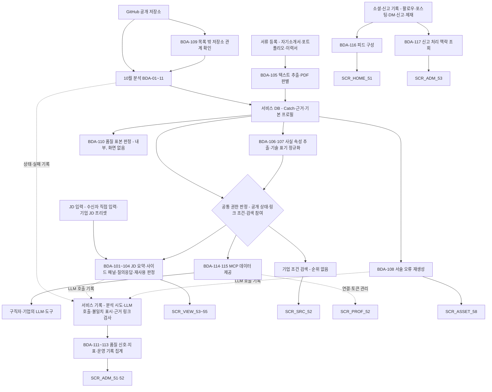
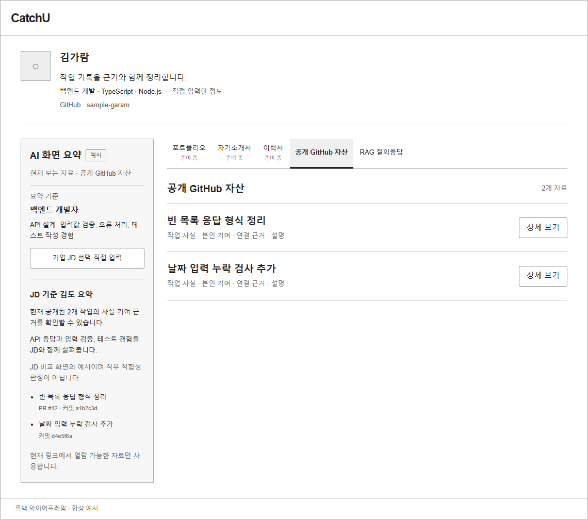
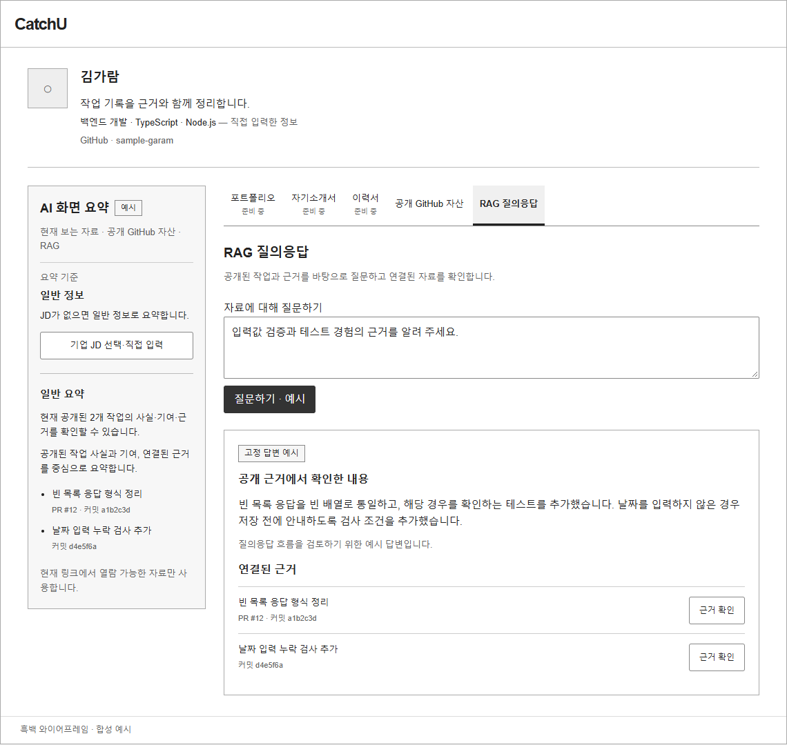
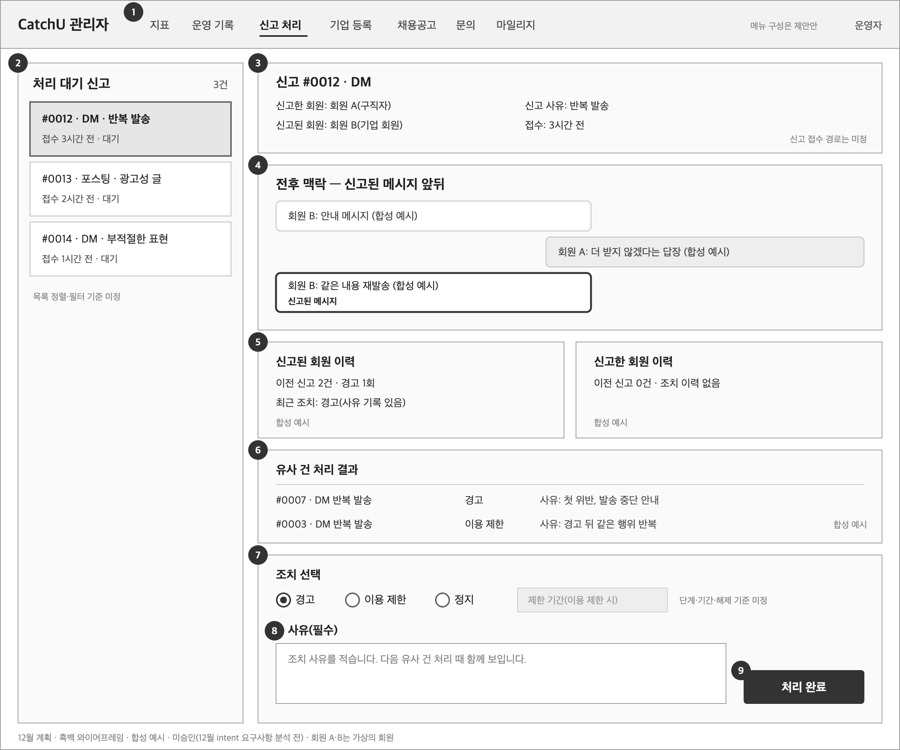

# 빅데이터 분석 정의서 — 12월 계획

| 항목 | 내용 |
|---|---|
| 팀명 | Jaemin_AI |
| 과제명 | 이력서-채용공고 텍스트 매칭 시스템 |
| 서비스명 | CatchU(캐치유) |
| 문서 버전 | v1.0 |
| 작성일 | 2026-09-28 |
| 기준 | origin/dev 9093d2e |
| 문서 지위 | **미승인 계획 — 12월 intent 요구사항 분석 전, 팀장 결정 입력 기준.** 중간 평가 제출 산출물. 분석 기능 ID는 공통 ID 대응표(`docs/deliverables/id-registry.md`)의 12월 가칭 ID(BDA-101~117)다. 12월 분석 기능은 아무것도 구현·실험하지 않았으므로 양식의 "분석 결과·예측 결과·평가 결과" 칸은 모두 "없음"이다. 원천에 없는 기법은 "후보"로 적었고 확정이 아니다. 이 문서는 AI-DLC 승인 기록이 아니다 |

## 변경 이력

| 버전 | 일자 | 내용 | 작성 |
|---|---|---|---|
| v1.0 | 2026-09-28 | 최초 작성. 12월 분석 기능 17개(BDA-101~117)의 기능별 명세(데이터 준비·전처리·분석·모델·검증), 파이프라인 개념도, 관리자 지표 정의와 미결, 분석 결과가 반영될 12월 화면, 개인정보·권한 고려, 미정 사항 정리. 같은 날 검토에서 원천 대조 수정과 분석 기능–요구사항–엔티티–화면 대응 표(7.1)를 반영. 문서 간 정합성 점검으로 BDA-109의 관련 요구사항에 FR-ANL-102를 더하고(4.4절·7.1절과 일치), BDA-105의 이력서 PDF 적용을 미정으로 바로잡고, 작성 메모를 9절(N-24~N-28)로 옮김 | 팀장(AI 작성 보조) |

**미승인 계획 — 12월 intent 요구사항 분석 전, 팀장 결정 입력 기준.** 여기서 intent는 팀이 쓰는 AI 개발 절차(AI-DLC)에서 한 묶음의 작업을 가리키며, 요구사항·설계 등 단계마다 팀장 승인을 거친다. 12월 intent는 아직 시작하지 않았다. 12월 범위를 다룰 intent는 요구사항 분석 승인까지만 진행하고 도메인 설계·계약·ERD는 10월 MVP 개발 뒤에 한다(12월 범위 보완 §5). 따라서 이 문서의 데이터 정의·전처리·분석 방법은 계획 수준이며 12월 요구사항 분석과 설계에서 바뀔 수 있다.

## 1. 개요

### 1.1 아이디어 주제

구직자의 GitHub 기록에서 확인한 작업을 근거와 함께 정리한 Catch를 바탕으로, 채용 쪽(HR·HM)이 **자기 JD를 기준으로** 지원 자료를 확인하게 하는 서비스의 12월 확장이다. 10월 MVP는 GitHub 기록을 분석해 Catch(작업 사실·본인 기여·근거·설명 초안)를 만들고, 구직자가 공개를 고른 뒤 링크로 전달하는 데까지다. 12월에는 그 결과 위에 JD 기준 요약·질의응답, 기업 조건 검색, MCP 데이터 제공, 운영 지표를 더한다.

과제명의 "이력서-채용공고 텍스트 매칭"은 12월의 JD 기능과 검색에서 구체화된다. 다만 CatchU는 JD 적합도를 매칭 %로 제공하지 않고(첫 intent FR6 공통 원칙, BR-101), 검색 결과에 유사도·일치 개수 순위를 만들지 않는다(FR7.4, BR-102). 여기서 "매칭"은 JD 항목과 허용된 자료의 관련 대목·근거를 연결해 보여 주는 것이며 점수 판정이 아니다.

### 1.2 개발 목표

| 목표 | 내용 | 근거·지위 |
|---|---|---|
| 채용 쪽의 JD 기준 확인 | 링크 수신자(비로그인 포함)와 기업 회원이 JD를 입력하면, 현재 허용된 자료로 한 장 요약·사이드 패널·질의응답을 제공한다 | 첫 intent FR6.1~FR6.5(승인, 12월 계획), 12월 범위 보완 §2 「JD 기능의 수신자 입력」 [8월] |
| 기업의 조건 검색 | 검색 참여에 동의한 구직자를 프로필 자가 입력값과 Catch 사실 속성으로 찾는다. 기술 표기는 표준 표기로 정규화한다 | FR7.1~FR7.4(승인, 12월 계획) |
| 자기 도구에서의 데이터 이용 | 구직자·기업이 자기 LLM·도구에서 MCP로 CatchU 데이터를 쓴다 | 12월 범위 보완 §2 「MCP 구직자·기업」 [9/15]·[9/24](팀장 결정) |
| 운영자가 볼 숫자 | 분석 처리·LLM 비용·결과 품질 지표와 운영 기록을 관리자 화면에 모은다. 보고 나서 할 행동이 있는 숫자만 둔다 | 12월 범위 보완 §2 「운영 기능」 [9/24]·지표 화면 [9/25](팀장 결정, 후순위) |
| 12월 품질 목표 | 동의한 검증 표본에서 근거 링크 유효율 100%, 타인 기여 오귀속 0건 | NFR3(승인, 12월 목표) |

### 1.3 개발 내용 — 12월 분석 기능 목록

"방식"은 원천이 정한 처리 방식이다. "LLM"은 외부 LLM API로 문장을 생성하는 기능, "규칙"은 정해진 규칙으로 판정·추출하는 기능, "집계"는 서비스 기록을 세는 기능, "권한 투영"은 권한 판정을 거친 데이터를 그대로 내보내는 기능이다. 원천이 방식을 정하지 않은 것은 "미정"으로 적었다.

| ID | 분석 기능 | 관련 요구사항 | 방식 | 지위 | 우선순위 |
|---|---|---|---|---|---|
| BDA-101 | JD 기준 한 장 요약 | FR-JDF-101 | LLM(FR6.4의 "새 LLM 호출") | 승인(12월 계획) | 중(미정) |
| BDA-102 | 사이드 패널 JD 관련 대목 추출 | FR-JDF-102 | 미정(LLM 사용 여부 미정) | 승인(12월 계획) | 중(미정) |
| BDA-103 | JD 질의응답(근거 검색 후 응답) | FR-JDF-101 | LLM. 근거 검색 방식은 후보(RAG 구상) | 승인(12월 계획), RAG는 검토초안 구상 | 중(미정) |
| BDA-104 | JD 요약 재사용·무효화 판정 | FR-JDF-103, FR-JDF-105 | 규칙 | 승인(12월 계획) | 중(미정) |
| BDA-105 | 서류 텍스트 추출·텍스트/이미지 PDF 판별 | FR-DOC-105 | 규칙(판별 기준은 FR5.5) | 승인(12월 계획) | 중(미정) |
| BDA-106 | 검색용 Catch 사실 속성 추출 | FR-SRC-102 | 규칙(FR7.2 "규칙으로 추출한 사실 속성") | 승인(12월 계획) | 중(미정) |
| BDA-107 | 기술 표기 정규화 | FR-SRC-103 | 미정(Catch 생성 시 정규화만 확정) | 승인(12월 계획) | 중(미정) |
| BDA-108 | 서술 오류 Catch 재생성 | FR-CAT-101 | LLM(호출 한도 있음) | 승인(12월 계획) | 중(미정) |
| BDA-109 | 목록 밖 저장소의 소유·커밋 관계 확인 | FR-ANL-101, FR-ANL-102 | 규칙 | 승인(12월 계획) | 중(미정) |
| BDA-110 | 전체 품질 표본 판정 | NFR-QUA-101 | 표본 판정(판정 상세 OQ12) | 승인(12월 목표) | 해당 없음(NFR) |
| BDA-111 | 품질 신호 집계 | FR-OPS-101 | 집계 | 팀장 결정(후순위) | 하 |
| BDA-112 | 관리자 지표 집계 | FR-OPS-104 | 집계 | 팀장 결정(후순위) | 하 |
| BDA-113 | 운영 기록 수집 | FR-OPS-102 | 집계 | 팀장 결정(후순위) | 하 |
| BDA-114 | 구직자 MCP 데이터 제공 | FR-MCP-101 | 권한 투영 | 팀장 결정 | 중(미정) |
| BDA-115 | 기업 MCP 링크 자료·검색 제공 | FR-MCP-102 | 권한 투영 | 팀장 결정 | 중(미정) |
| BDA-116 | 피드 구성 | FR-SOC-103 | 규칙 | 팀장 결정 | 중(미정) |
| BDA-117 | 신고 처리 맥락 조회 | FR-ADM-101 | 조회. 유사 건 선택 방법 미정 | 팀장 결정 | 중(미정) |

우선순위는 공통 ID 대응표 12절 규칙을 따른다. 12월 범위 보완이 순서를 밝힌 것은 대표 구성(1순위)과 운영 기능(후순위, 가능하면 포함) 두 가지뿐이며, 순서를 밝히지 않은 항목을 후순위로 해석하지 않는다(§2 「우선순위」). 10월 담당 파트는 각 명세 표에 적었지만 이는 10월 작업 구분이며 12월 담당을 뜻하지 않는다(§6).

### 1.4 지위 표기

| 표기 | 이 문서에서의 뜻 |
|---|---|
| 승인(12월 계획) | 첫 intent 요구사항(2026-09-11)이 12월로 승인한 항목. 12월 intent에서 다시 확인한다 |
| 승인(12월 목표) | 첫 intent NFR3처럼 12월 목표로 승인된 품질 기준 |
| 팀장 결정 | 12월 범위 보완 등 입력 문서의 팀장 결정. 이 문서에서는 미승인 계획과 같은 지위다 |
| 검토초안 | 공통 아키텍처 검토초안, 9/23 v2.2 와이어프레임, KPI v4.1(초안), P4 설계 노트의 초안 항목 등 채택 확정이 아닌 자료 |
| 후보 | 원천에 없거나 원천이 구상으로만 둔 기법. 이 문서가 확정하지 않는다 |
| 제안안 | 이 문서에서 새로 제안한 것(계산식 초안, 행동 연결 등) |
| 미정 | 아직 정하지 않음. 정할 곳(OQ·이슈·12월 요구사항 분석)을 함께 적는다 |

### 1.5 기준 원천

| 약칭 | 원천 | 지위 |
|---|---|---|
| 12월 보완 | `docs/ai-dlc-input-december/CatchU_12월_범위_보완.md`(2026-09-15 기록, 9/24·25 보완). 절 번호와 출처 표기([8월]·[9/15]·[9/24]·[9/25])를 그대로 인용한다 | 팀장 결정 입력 |
| 첫 intent | `aidlc/spaces/default/intents/260909-catchu-definition-review/inception/requirements-analysis/requirements.md`의 FR1.2·FR1.3·FR3.6·FR5.5·FR6·FR7·FR10, NFR1~NFR3·NFR5, OQ1·OQ3·OQ5·OQ6·OQ8·OQ11~OQ14 | 승인(2026-09-11) |
| 10월 요구사항 | `aidlc/spaces/default/intents/260914-catchu-october-mvp/inception/requirements-analysis/requirements.md` | 승인(2026-09-22) |
| ERD v1 | `aidlc/spaces/default/intents/260914-catchu-october-mvp/construction/u2-api/functional-design/entities.md`, worker 논리 모델 `construction/u3-worker/functional-design/entities.md` | 승인(9/23) + 9/24 팀장 결정 반영 |
| 대응표 | `docs/deliverables/id-registry.md` | 산출물 공통 ID(제안안 체계) |

### 1.6 평가 항목과 이 문서의 절

| 평가 항목 | 이 문서의 절 |
|---|---|
| 분석 목적 | 1.2, 각 명세 표의 "3. 분석 목표" |
| 데이터 출처·확보(수집 방법) | 2.1, 각 명세 표의 "1. 데이터 준비" |
| 분석 방법·기법 | 2.2, 각 명세 표의 "2. 전처리", "3. 분석 시나리오", "4. 모델" |
| 분석 결과가 반영될 화면·기능 | 7 |
| 기획–데이터–화면–분석 정합성 | 1.3(요구사항 대응), 2.4(10월 데이터와의 연결), 7(화면 대응), 7.1(분석–요구사항–유스케이스–엔티티–화면 대응), 10(대응표 밖 항목) |
| 검증 | 각 명세 표의 "5. 검증", 4.5(BDA-110) |

## 2. 분석 공통 기준

### 2.1 데이터 출처 총괄

12월 분석에 쓰는 데이터는 모두 **서비스 안에서 생기는 데이터**다. 공공데이터포털·AI Hub 같은 외부 공개 데이터셋이나 웹 크롤링을 쓰는 계획은 원천에 없다. 외부 URL 본문 자동 수집은 채택하지 않았다(EXC-08). 데이터 양은 초기 이용량·분석량이 정해지지 않아 모두 미정이다(OQ14).

| 데이터 | 출처와 획득 방법 | 쓰는 분석 기능 | 10월 MVP에 있나 | 근거·지위 |
|---|---|---|---|---|
| Catch·근거 | 10월 분석(BDA-01~11)이 동의한 공개 저장소에서 만들어 서비스 DB에 등록. 등록 근거는 출처 URL·리비전·표현 사실·기여 범위·누락/잘림 한계를 가진 사본 | BDA-101~104, 106~108, 110, 111, 114, 115 | 있음(`CatchAsset`, `CatchEvidence`) | ERD v1(승인) |
| 기본 프로필 | 구직자 자가 입력(표시 이름·한 줄 소개·직무·기술 스택). 출처는 `SELF_REPORTED` | BDA-101, 106, 114, 115 | 있음(`MemberProfile`) | FR11.3(승인), BR-23 |
| GitHub 연동·저장소 정보 | GitHub 연동 계정 권한으로 GitHub API 조회. 구체 방식은 OQ1·C07 | BDA-109 | 연동 상태만 있음(`GitHubConnection`) | FR1.2(승인, 12월 계획) |
| 서류 | 구직자가 내 자산의 서류별 탭에서 등록. 자기소개서는 텍스트 입력, 포트폴리오는 PDF 또는 외부 URL, 이력서는 PDF. 각각 여러 벌 | BDA-101~103, 105 | 없음(10월은 준비 중 탭) | FR5.1(승인), 12월 보완 §2 「서류와 프리셋」·「이력서」 |
| JD 텍스트 | 링크 수신자의 직접 입력 또는 로그인 기업 회원의 기업 JD 프리셋. 채용공고와의 연결은 미정 | BDA-101~104 | 없음 | FR6.1·FR6.6(승인), 12월 보완 §2, §3-2 |
| 질문 텍스트 | 링크 수신자·기업 회원의 질의응답 입력 | BDA-103 | 없음 | FR6.1(승인) |
| 분석 상태·실행 기록 | 10월 분석 요청·시도의 상태와 실패 정보(`processing`, `application`, `failures`) | BDA-112 | 있음(`AnalysisRequest`, `AnalysisAttempt`). 시도 단위 시각 칼럼은 없음 | ERD v1(승인) |
| LLM 호출 기록 | 서비스 LLM 호출마다 기능·토큰·추정 비용·한도 도달 기록 | BDA-112, 113 | 없음. 12월에 수집을 더해야 함 | 12월 보완 §2 지표 ②, DB 12월판의 LlmUsageRecord(가칭) |
| 품질 신호 | 구직자의 불일치 표시, 근거 링크 자동 검사 결과 | BDA-111, 112 | 불일치 표시 여부만 있음(`mismatch` boolean, 유형 없음) | FR10.1(승인 당시 10월, 10월 미제공으로 변경), 12월 보완 지표 ③ |
| 운영 기록 | 오류·권한 위반 징후 | BDA-113 | 없음(G 운영 기능 10월 제외) | FR10.3, 12월 보완 §2 |
| 소셜·신고 기록 | 팔로우·포스팅(글마다 읽기 권한)·DM·신고·제재 | BDA-116, 117 | 없음 | 12월 보완 §2 「팔로우·포스팅·피드」·「관리자 처리 기능」 |
| 검증 표본 | 동의받은 품질 표본. 사전 선정 목록은 내부 품질 검증 표본으로 유지 | BDA-110 | 표본 규모·구성 미정 | NFR3, FR1.3(승인), OQ12 |

### 2.2 파이프라인 개념도

12월 분석은 10월 분석이 만든 Catch·근거 위에 쌓인다. 모든 제공 경로(화면·링크·MCP)는 같은 권한 판정을 거친다(12월 보완 §4, NFR-SEC-101). 아래 그림은 데이터 흐름의 개념이며 서버 배치·저장 구조는 12월 설계에서 정한다.

그림 1. 12월 분석 파이프라인 개념도(미승인 계획, 서버 배치·저장 구조 미정)

### 2.3 공통 원칙

| 원칙 | 적용 | 근거·지위 |
|---|---|---|
| 매칭 % 미제공 | JD 요약·사이드 패널·질의응답 어디에서도 JD 적합도를 매칭 %로 보이지 않는다. 매칭 %를 묻는 질문에도 제공하지 않는다. 사이드 패널은 대응 개수·비율·색으로 세지 않는다 | FR6 공통 원칙·FR6.2(승인), BR-101, EXC-05 |
| 순위 없음 | 검색은 유사도 점수·일치 개수로 순위를 만들지 않는다. 무결과를 역량 부재 판정이나 대체 추천으로 넓히지 않는다 | FR7.4(승인), BR-102, EXC-05 |
| 허용 자료만 | 분석 재료는 요청 시점에 현재 허용된 자료뿐이다. 미공개·원본 보호 Catch, 링크에 담지 않은 서류, 이미지 전용 PDF 내용은 쓰지 않는다 | FR6.1·FR5.5·FR1.5(승인), NFR1 |
| 근거 연결 | 생성 문장은 근거에 연결한다. 관측하지 않은 사실은 확인할 수 없다고 적는다 | FR2.2(승인), 10월 worker 규칙(BR-16·BR-17) |
| 외부 LLM 조건 | 서비스 LLM은 미선정이다(후보 Claude·OpenAI 계열·업스테이지 Solar, 후보별 API·모델·등급 미정). 학습·제품 개선 미사용이 약관으로 보장된 유료 API 등급만 쓴다. 구직자 자료·가명 공동 기여자 기록·기업 JD에 적용한다. 자체 모델 학습·미세조정 계획은 원천에 없다 | NFR2(승인, 10월판 ID NFR-PRV-01), MVP 입력 OQ11, C06 |
| 비용 통제 | JD는 링크 단위 한도, 요약 재사용, 재생성 한도를 둔다. 한도 소진·운영 중단 뒤 새 호출은 막고 허용된 기존 열람은 유지한다. 월 약 160만 원은 계획 기준이며 자동 차단액이 아니다 | NFR5(승인), NFR-COS-101, FR10.4 |
| 입력은 데이터 | JD·서류·질문·커밋 메시지는 지시가 아니라 데이터로 다룬다. 인젝션·시스템 이상은 자동 처리하고 사람이 여는 대응 화면을 두지 않는다 | 12월 보완 §2 「운영 기능」(P4 팀 결정), 증거카드 이상형 문서 §3의 인젝션 고려(PoC 이전 기록) |
| 결과가 없음을 밝힘 | 12월 분석은 수행하지 않았다. 과거 실험(C01/C02) 원문·발췌·생성 응답은 쓰지 않고, 이 문서의 데이터 예시는 모두 새로 만든 **합성 예시**다 | 10월 feasibility 승인(9/22) 「과거 실험 자료」 조건 |

### 2.4 10월 분석 결과와의 연결

12월 분석은 10월에 등록된 Catch의 필드를 입력으로 쓴다. 다만 10월 분석의 원자료(diff·경로 등)는 worker의 임시 결과이며 서비스 DB에 저장하지 않는다(보존 위치·수명 OQ-F1). 12월 기능이 원자료를 다시 필요로 하면 재분석할지, 등록된 필드만 쓸지를 12월 설계에서 정해야 한다.

| 10월 산출(BDA) | 서비스 DB에 남는 것 | 12월에서 쓰는 곳 |
|---|---|---|
| BDA-02 근거 정규화 | `CatchEvidence`의 `sourceUrl`·`sourceRevision`·`representedFacts`·`contributionScope`·`coverageLimits` | BDA-101·103 근거 연결, BDA-106 속성 추출, BDA-110·111 링크 검사 |
| BDA-03·04 작업 묶기·본인 기여 | `CatchAsset.workFacts`, `subjectContribution` | BDA-101~103 재료, BDA-106 저자 구성·규모 |
| BDA-07 Catch 제목 | `CatchAsset.title` | BDA-106 보조 문자열 일치, BDA-101 요약 표기 |
| BDA-08 설명 초안 | `CatchAsset.draftStatus`·`draftContent` | BDA-101~103 재료, BDA-108 재생성 대상 |
| BDA-06 결과 분류 | `AnalysisAttempt.processing`·`failures` | BDA-112 지표 ① |
| BDA-10 원본 상태 확인 | `RepositoryProtection` | BDA-104 무효화, BDA-111 링크 검사 실패와의 구분 |

`CatchAsset`에는 `repositoryId` 칼럼이 없고 원 분석 요청에서 유도한다(9/24 팀장 결정, PR #89). 저장소 단위 속성·집계는 이 유도 경로를 쓴다. 최소 생각해볼 질문(`reflectionQuestions`)은 본인만 보는 자료이므로 수신자·기업용 분석 재료에서 뺀다(ERD v1 제약).

## 3. 기능별 빅데이터 분석 명세 — JD 기능·서류

양식 항목 순서(1. 데이터 준비 → 2. 전처리 → 3. 데이터 분석 → 4. 모델 생성 및 학습 → 5. 검증)로 적는다. 모든 예시는 합성 예시다.

### 3.1 BDA-101 JD 기준 한 장 요약

| 항목 | 내용 |
|---|---|
| 기능명 | JD 기준 한 장 요약(FR-JDF-101, 원본 FR6.1). 유스케이스 UC-108 |
| 관련 화면·엔티티·규칙 | 화면 SCR_VIEW_53(입력 SCR_VIEW_52). 엔티티 JdSummary(가칭), CatchAsset, CatchEvidence, MemberProfile, Document(가칭), LinkDocumentRelease(가칭). 규칙 BR-101, NFR-COS-101 |
| 지위·우선순위 | 승인(12월 계획) + 수신자 JD 입력 재확인(12월 보완 §2, [8월]). 중(미정). 10월 관련 파트 C·F |
| 1. 데이터 정의 | ① JD 텍스트: 링크 수신자가 직접 입력한 JD 또는 로그인 기업 회원이 고른 기업 JD 프리셋 ② 재료: 그 링크에서 현재 허용된 기본 프로필 공개 항목, 공개 Catch의 `title`·`workFacts`·`subjectContribution`·`draftContent`와 근거 필드, 링크에 담긴 서류 발행본의 추출 텍스트(BDA-105) ③ 제외: 미공개·원본 보호 Catch, 링크에 담지 않은 서류, 이미지 전용 PDF 내용, 최소 생각해볼 질문, 확인·불일치 표시 |
| 1. 데이터 획득 방법 | JD는 화면 입력(SCR_VIEW_52)으로만 받는다. 채용공고에서 JD를 가져오는 연결은 미정(§3-2). 재료는 요청 시점에 서비스 DB에서 현재 권한으로 조회한다. 외부 수집 없음. 데이터 양(링크당 요약 수 등)은 OQ6·OQ14 미정 |
| 1. 수집 데이터 예시 | 실제 수집 없음. 합성 예시: JD "신입 백엔드 개발자 — REST API 설계, 입력값 검증과 오류 처리, 테스트 코드 작성" 공개 Catch C1 "주문 API 입력값 검증 추가", 작업 사실 2개, 근거 E1 `https://github.com/example-user/sample-shop/commit/0a1b2c3` |
| 2. 전처리 과정 | 1. 링크 유효·비밀번호 조건 확인 뒤 허용 재료 집합 확정(공통 권한 판정) 2. 재료 목록 지문 계산(BDA-104의 재사용 판정 입력) 3. JD 텍스트를 데이터로 격리하고 지시로 해석하지 않음 4. JD를 요구 항목으로 나눔. JD 항목과 그 순서는 FR6.2가 전제한다. 나누는 방법(줄 단위 규칙 또는 LLM)은 후보 5. 외부 LLM에 보낼 자료를 최소화. 구체 전송 자료는 OQ11 |
| 2. 전처리 데이터 예시 | 합성 예시: JD 항목 J1 "REST API 설계", J2 "입력값 검증과 오류 처리", J3 "테스트 코드 작성" / 재료 C1(근거 E1·E2) |
| 3. 데이터 분석 목표 | JD 항목마다 허용 재료 안의 관련 사실과 근거를 한 장에 모아, HR·HM이 자기 JD 기준으로 여러 자료를 한 번에 확인하게 한다. 적합도 판정·점수·매칭 %는 만들지 않는다 |
| 3. 데이터 분석 시나리오 | 1. JD 항목별 관련 재료 후보 찾기 — 키워드 일치 또는 임베딩 유사도로 추린 뒤 LLM이 관련성 판단(후보. PoC 이전 기록의 "임베딩 후보 추림 → LLM 판정" 구상) 2. 서비스 LLM이 항목별 요약 문장을 쓰고 문장마다 근거 참조를 연결 3. 관련 재료가 없는 항목은 "관련 자료를 찾지 못함"으로 둔다. 역량 부재로 표현하지 않는다(첫 intent 「이용 상황과 경계 확인」) 4. 출력 검사 — 백분율·점수·순위 표현이 없는지, 근거 참조가 모두 허용 재료 안인지 확인 뒤 저장(제안안) 5. JdSummary(가칭) 저장, 링크 한도 사용량 증가, LLM 호출 기록 |
| 3. 데이터 분석 결과 | 없음 — 12월 계획이며 수행하지 않았다 |
| 4. 모델링 목표 | 예측 모델이 아니다. 외부 LLM으로 근거에 연결된 요약 문장을 생성한다 |
| 4. 학습 모델 | 서비스 LLM 미선정(OQ-L, C06). 임베딩 모델 사용 여부 미정 |
| 4. 학습 방법 | 자체 학습·미세조정 없음. 학습 미사용이 약관으로 보장된 유료 API 등급의 추론만 쓴다(NFR2). 프롬프트·출력 형식은 12월 설계 |
| 4. 모델 예측 결과 | 없음 |
| 5. 분석 검증 방안 | 1. 매칭 % 부재 — 화면·응답에 백분율·적합도 점수가 없고, 매칭 %를 요청하는 입력에도 제공하지 않는지(FR6.1 통과 기준) 2. 재료 경계 — 숨김·원본 보호 전환 전후를 비교해 제외 자료가 근거로 쓰이지 않는지 3. 근거 연결 — 요약 문장의 근거 링크 유효성과 근거 일치(NFR3 검사 방식 준용, 후보) 4. 인젝션 — 지시문을 넣은 합성 JD로 지시 불이행 확인(후보) 5. 한도 — 소진 뒤 새 호출이 없고 기존 요약·원자료 열람이 유지되는지(FR6.4) 응답 품질의 상세 판정 기준은 OQ6 |
| 5. 분석 평가 결과 | 없음. 참고로 9/16 최소 실험에서 10월 Catch 초안을 LLM으로 만든 결과는 사실성 미달 사례가 있었다(요약 기능이 아니라 초안 대상, 문서 11 §7.6). JD 요약에도 같은 위험을 전제한다 |

### 3.2 BDA-102 사이드 패널 JD 관련 대목 추출

| 항목 | 내용 |
|---|---|
| 기능명 | 사이드 패널 JD 관련 대목 추출(FR-JDF-102, 원본 FR6.2). 유스케이스 UC-109 |
| 관련 화면·엔티티·규칙 | 화면 SCR_VIEW_54. 엔티티 CatchAsset, Document(가칭), 결과를 저장한다면 JdSummary(가칭). 규칙 BR-101 |
| 지위·우선순위 | 승인(12월 계획). 중(미정). 10월 관련 파트 C·F |
| 1. 데이터 정의 | 현재 열람 중인 자료 하나(공개 GitHub 자산 목록, Catch 상세, 서류 발행본 중 하나)의 텍스트와, 적용 중인 JD 항목 목록 |
| 1. 데이터 획득 방법 | 화면이 알려 주는 현재 자료 식별자로 서비스 DB 조회. 다른 자료는 입력하지 않는다 |
| 1. 수집 데이터 예시 | 합성 예시: 현재 자료 = Catch C1 상세 / JD 항목 J1~J3(3.1과 같음) |
| 2. 전처리 과정 | 1. 현재 자료의 텍스트만 문장 단위로 나눔(후보) 2. 현재 자료 밖 문장은 입력에서 제거 3. JD 항목 순서 유지 |
| 2. 전처리 데이터 예시 | 합성 예시: s1 "수량 필드에 범위 검사를 추가", s2 "검증 실패 시 400 응답을 확인하는 테스트 2건 추가" |
| 3. 데이터 분석 목표 | 지금 보는 자료 안에서 JD 항목과 관련된 대목만 JD 순서대로 보여 준다. 없으면 미발견 안내와 한 장 요약의 해당 JD 항목으로 이동을 제공한다. 여러 자료 종합은 한 장 요약에서 한다 |
| 3. 데이터 분석 시나리오 | 1. JD 항목별로 현재 자료 문장과의 관련 판단 — 규칙(키워드) 또는 LLM(후보) 2. JD 순서대로 관련 대목 나열 3. 대목이 없는 항목은 미발견으로 표시하고 SCR_VIEW_53의 해당 항목으로 연결 4. 대응 개수·비율·색 집계를 만들지 않음 결과를 저장할지 매번 만들지는 미정. 합성 출력 예: J2 → s1·s2, J3 → s2, J1 → 미발견 |
| 3. 데이터 분석 결과 | 없음 |
| 4. 모델링 목표 | 예측 모델 아님. LLM을 쓴다면 관련 대목 선택·정리에 쓴다 |
| 4. 학습 모델 | LLM 사용 여부 미정. 쓴다면 BDA-101과 같은 서비스 LLM(미선정) |
| 4. 학습 방법 | 자체 학습 없음. LLM을 쓰면 링크 한도에 포함된다(FR6.3은 요약·패널·질의응답 모두에 링크 한도를 둔다) |
| 4. 모델 예측 결과 | 없음 |
| 5. 분석 검증 방안 | 1. 현재 자료 밖 문장이 패널에 0건인지(FR6.2 통과 기준) 2. JD 순서 유지, 개수·비율·색·매칭 % 표시 부재 3. 미발견 시 안내와 한 장 요약 이동 동작 |
| 5. 분석 평가 결과 | 없음 |

### 3.3 BDA-103 JD 질의응답

| 항목 | 내용 |
|---|---|
| 기능명 | JD 질의응답 — 근거 검색 후 응답(FR-JDF-101의 질의응답 부분, 원본 FR6.1). 유스케이스 UC-110 |
| 관련 화면·엔티티·규칙 | 화면 SCR_VIEW_55. 엔티티 JdQuestionLog(가칭), CatchEvidence, LinkUsageQuota(가칭). 규칙 BR-101, NFR1 |
| 지위·우선순위 | 승인(12월 계획). RAG 방식은 공통 아키텍처 검토초안 §2의 구상(검토초안). 중(미정). 10월 관련 파트 C·F |
| 1. 데이터 정의 | 질문 텍스트, 적용 중인 JD(있으면), 허용 재료(3.1의 ②와 같음), 질문자 맥락(비로그인 수신자 또는 기업 회원). 비로그인 수신자를 구분하는 방식은 미정이고, 질의 기록의 구직자 공개·보관은 OQ6 |
| 1. 데이터 획득 방법 | 화면 입력. 재료는 서비스 DB에서 현재 권한으로 조회 |
| 1. 수집 데이터 예시 | 합성 예시: 질문 "오류 응답을 어떻게 처리했는지 근거와 함께 알려 주세요" |
| 2. 전처리 과정 | 1. 질문을 데이터로 격리 2. 허용 재료를 검색 단위로 나눔 — Catch 하나를 한 단위(청크)로 쓰는 팀장 구상(검토초안). 청크 분할·검색 방식·임베딩·벡터 저장소는 미결 3. 서류 발행본 텍스트의 분할 단위 미정 |
| 2. 전처리 데이터 예시 | 합성 예시: 검색 단위 K1 = C1(제목·작업 사실·본인 기여·근거 E1·E2), K2 = C2 |
| 3. 데이터 분석 목표 | 허용된 자료에 대해 묻는 질문에, 관련 근거를 찾아 연결한 답을 준다 |
| 3. 데이터 분석 시나리오 | RAG(검색 증강 생성) 후보: 1. 허용 재료 집합 확정(공통 권한 판정) 2. 질문과 관련된 검색 단위 찾기 — 키워드 일치 또는 임베딩 유사도(후보) 3. 찾은 단위만 서비스 LLM 입력으로 넣어 답 생성, 문장마다 근거 연결 4. 근거가 없으면 확인할 수 없다고 답함(후보, FR2.2의 근거 제한과 같은 방향) 5. 매칭 %를 묻는 질문에는 제공하지 않음 6. 질의 기록 저장(다른 수신자에게 공유하지 않음), 링크 한도 사용량 증가 합성 출력 예: "근거 E2에서 검증 실패 시 400 응답을 확인하는 테스트 추가가 확인된다" + E2 링크 여기서의 임베딩 검색은 허용 자료 안의 근거 찾기이며, 기업 조건 검색의 의미 검색(EXC-11)과 다르다 |
| 3. 데이터 분석 결과 | 없음 |
| 4. 모델링 목표 | 예측 모델 아님. 근거에 연결된 답 생성 |
| 4. 학습 모델 | 서비스 LLM 미선정. 임베딩 모델·벡터 저장소 미정(검토초안 §2) |
| 4. 학습 방법 | 자체 학습 없음(NFR2) |
| 4. 모델 예측 결과 | 없음 |
| 5. 분석 검증 방안 | 1. 근거 경계 — 허용 밖 자료 인용 0건 2. 매칭 % 요청 질문에 제공하지 않는지(FR6.1) 3. 다른 수신자의 JD·질의 기록이 보이지 않는지(NFR1) 4. 한도 소진 뒤 새 호출 제한과 안내(FR6.4) 5. 답의 근거 일치 표본 판정(후보, 판정 기준 OQ6) 6. 지시문을 넣은 합성 질문으로 인젝션 확인(후보) |
| 5. 분석 평가 결과 | 없음 |

### 3.4 BDA-104 JD 요약 재사용·무효화 판정

| 항목 | 내용 |
|---|---|
| 기능명 | JD 요약 재사용·무효화 판정(FR-JDF-103·FR-JDF-105, 원본 FR6.3·FR6.5). 유스케이스 UC-108 |
| 관련 화면·엔티티·규칙 | 화면 SCR_VIEW_53. 엔티티 JdSummary(가칭), LinkUsageQuota(가칭). 규칙 NFR-COS-101, NFR1 |
| 지위·우선순위 | 승인(12월 계획). 중(미정). 10월 관련 파트 C·F |
| 1. 데이터 정의 | JD 텍스트 또는 프리셋 식별자, 요약에 쓴 재료 목록(Catch·서류 발행본)과 각 재료의 현재 공개 상태·원본 보호 상태, 링크 식별자, 링크 한도 사용량 |
| 1. 데이터 획득 방법 | 서비스 DB. 공개 상태 변경 사건(구직자의 숨기기, 원본 보호 적용) |
| 1. 수집 데이터 예시 | 합성 예시: 요약 S1 = (링크 L1, JD 지문 h1, 재료 {C1, C2}). 이후 구직자가 C2를 숨김 |
| 2. 전처리 과정 | 1. JD 텍스트 정리(공백·줄바꿈 등) 후 지문 계산(후보) 2. 재료 조합 지문 계산(후보) 동일 JD 판정 기준은 OQ6 |
| 2. 전처리 데이터 예시 | 합성 예시: (L1, h1, m1) → C2 숨김 뒤 재료 지문이 m1과 달라짐 |
| 3. 데이터 분석 목표 | 같은 JD 요약을 재사용해 호출을 줄이되, 비공개로 바뀐 재료가 들어간 요약은 계속 제공하지 않는다 |
| 3. 데이터 분석 시나리오 | 규칙 판정: 1. 현재 자료·접근 조건을 만족하는 같은 JD 요약만 재사용 2. 요약에 쓴 Catch·서류의 공개 상태가 바뀌면(숨김, 원본 보호 포함) 그 요약 전체를 재생성 대상으로 둠 3. 원본 서류 수정·삭제만으로는 무효화하지 않음(발행본 기준) 4. 재생성 대상 요약은 제공하지 않고, 재생성 한도가 없으면 현재 허용된 원자료만 제공 5. 자동 즉시 재생성은 확정하지 않음 재사용 범위(예: 같은 링크 안)는 미정. DB 12월판은 (링크, JD 지문, 재료 지문)을 재사용 키로 제안했다 |
| 3. 데이터 분석 결과 | 없음 |
| 4. 모델링 목표·학습 모델·학습 방법 | 해당 없음 — 규칙 판정이며 모델을 쓰지 않는다 |
| 4. 모델 예측 결과 | 해당 없음 |
| 5. 분석 검증 방안 | 첫 intent 「이용 상황과 경계 확인」의 시나리오로 확인한다. 1. 대표 변경 후 연결 Catch 숨김 → 그 Catch를 쓴 기존 요약 재사용 불가 2. 자기소개서 원본 삭제 → 발행본 공개 상태가 그대로면 요약 유지 3. JD 한도 소진 뒤 원본 저장소 비공개 확인 → 관련 요약 제공 중단, 새 호출 제한, 다른 허용 원자료 열람 유지 |
| 5. 분석 평가 결과 | 없음 |

### 3.5 BDA-105 서류 텍스트 추출·텍스트/이미지 PDF 판별

| 항목 | 내용 |
|---|---|
| 기능명 | 서류 텍스트 추출·텍스트/이미지 PDF 판별(FR-DOC-105, 원본 FR5.5). 유스케이스 UC-103, UC-108 |
| 관련 화면·엔티티 | 화면 SCR_ASSET_54·SCR_ASSET_55·SCR_ASSET_56. 엔티티 Document(가칭) |
| 지위·우선순위 | 승인(12월 계획). 이력서 PDF 업로드는 팀장 결정(9/16). 중(미정). 10월 관련 파트 F |
| 1. 데이터 정의 | 자기소개서 텍스트, 포트폴리오 PDF 또는 외부 URL, 이력서 PDF. 각각 여러 벌. 다만 이력서 PDF를 JD 기능 근거로 쓸지는 원천에 없어 미정이다(9/16 회의 결정 §4는 FR5.2~FR5.4만 똑같이 적용, 04 요구사항 정의서 FR-DOC-105). 결정 전에는 이력서 PDF도 판별만 하고 JD 근거 사용은 보류한다(제안안) |
| 1. 데이터 획득 방법 | 구직자가 내 자산의 서류별 탭에서 등록. 외부 URL은 주소만 보존하고 본문을 수집하지 않는다(EXC-08). 파일 용량·형식·수량·보관은 OQ5·#56 미정 |
| 1. 수집 데이터 예시 | 합성 예시: 포트폴리오 `portfolio_backend_v1.pdf`(글자 선택 가능) / 포트폴리오 `portfolio_scan.pdf`(스캔 이미지) |
| 2. 전처리 과정 | 1. 파일 형식 확인 2. PDF 텍스트 층 추출 시도(도구 미선정, 후보) 3. 추출 텍스트 유무로 판별 — 기준은 FR5.5의 "글자를 선택하고 복사할 수 있는 PDF" 4. 추출 실패 안내(상세 OQ5) 5. JD 기능 재료로 외부 LLM에 보낼 범위는 OQ11(이력서 연락처 등 개인정보 포함 가능성) |
| 2. 전처리 데이터 예시 | 합성 예시: {서류: 포트폴리오 v1, 판별: 텍스트 PDF, 추출 텍스트 있음} / {서류: 포트폴리오 스캔본, 판별: 이미지 전용 PDF, 원문 열람만} |
| 3. 데이터 분석 목표 | JD 기능에 쓸 수 있는 서류 텍스트를 가려내고, 이미지 전용 PDF 내용을 분석 근거에서 뺀다 |
| 3. 데이터 분석 시나리오 | 규칙: 1. 자기소개서 텍스트는 그대로 사용 가능 2. 텍스트 PDF는 추출 텍스트를 링크 발행본과 함께 보존해 JD 기능 재료로 사용 3. 이미지 전용 PDF는 원문 열람만 제공 4. 외부 URL은 JD 기능 재료가 아님 |
| 3. 데이터 분석 결과 | 없음 |
| 4. 모델링 목표·학습 모델·학습 방법 | 해당 없음 — 규칙 판별. 이미지 PDF 내용 분석(OCR 등)은 채택하지 않았다(EXC-08) |
| 4. 모델 예측 결과 | 해당 없음 |
| 5. 분석 검증 방안 | 두 PDF 유형을 구분한 시험에서 텍스트 PDF 내용만 JD 기능 근거로 쓰이고 이미지 전용 PDF 내용은 쓰이지 않는지(FR5.5 통과 기준). 이력서 PDF의 다운로드·보관 기준은 C12·#56 |
| 5. 분석 평가 결과 | 없음 |

## 4. 기능별 빅데이터 분석 명세 — 검색·Catch·분석 대상·품질

### 4.1 BDA-106 검색용 Catch 사실 속성 추출

| 항목 | 내용 |
|---|---|
| 기능명 | 검색용 Catch 사실 속성 추출(FR-SRC-102, 원본 FR7.2). 유스케이스 UC-113 |
| 관련 화면·엔티티·규칙 | 화면 SCR_SRC_52. 엔티티 CatchSearchAttribute(가칭), CatchAsset, CatchEvidence, MemberProfile. 규칙 BR-102, BR-103 |
| 지위·우선순위 | 승인(12월 계획). 중(미정). 10월 파트 밖(검색은 10월 파트 밖, 12월 보완 §6) |
| 1. 데이터 정의 | 검색 공개 대상 Catch의 `title`·`workFacts`·`subjectContribution`과 근거 필드. 속성 예시는 FR7.2가 든 사용 기술·코드 위치·저자 구성·근거 등급·규모·궤적 패턴이며 확정 목록은 OQ8. 프로필의 직무·기술 스택은 구직자 자가 입력값으로 따로 쓴다 |
| 1. 데이터 획득 방법 | 후보 두 가지 — ① Catch 생성 때 worker 분석 흐름에서 원자료(diff·경로)로 추출(FR7.3이 정규화를 "카드 생성 시"로 둔 것과 같은 시점) ② 등록된 Catch 필드에서 추출. 10월에 이미 등록된 Catch는 원자료가 서비스 DB에 없으므로(OQ-F1) 재분석할지 저장 필드만 쓸지 미정 |
| 1. 수집 데이터 예시 | 합성 예시: Catch C1의 근거에서 변경 경로 `src/order/validator.ts`·`test/order.spec.ts`, 커밋 2건, 본인 작성 2건, 공동 기여자 없음 |
| 2. 전처리 과정 | 1. 공동 기여자는 수집 시점 가명 식별자만 사용하고 타인 식별자를 속성에 넣지 않음 2. "판단의 흐름"·"기록에 없는 것", 미공개·원본 보호 Catch, 서류는 검색 대상에서 제외(FR7.2) 3. 기술 명칭은 BDA-107로 정규화 4. 추출 규칙 판본을 함께 기록(DB 12월판 제안안) |
| 2. 전처리 데이터 예시 | 합성 예시(속성 이름은 예시): {사용 기술: TypeScript, 코드 위치: src/order, 저자 구성: 본인 단독, 규모: 커밋 2·파일 2} |
| 3. 데이터 분석 목표 | 기업 조건 검색이 쓸 Catch의 사실 속성을 규칙으로 만든다. 프로필 자가 입력값과 출처를 구분한다 |
| 3. 데이터 분석 시나리오 | 규칙 추출(방식은 승인, 개별 규칙은 후보): 1. 확장자·의존성 파일로 사용 기술 후보(PoC 이전 기록의 diff 안 import·의존성 파일 파싱 구상) 2. 경로 접두로 코드 위치 3. 커밋 저자 구성으로 저자 구성 4. 묶음 근거(본인의 묶음 또는 시스템 추정)로 근거 등급(카드생성논리 §3의 PoC 개념, 후보) 5. 커밋·파일 수로 규모 6. 궤적 패턴은 정의 미정 검색은 조건 일치만 하고 순위를 만들지 않는다. 대표 주장 문장·Catch 제목·"무엇을 했나" 문자열 일치는 보조(FR7.2). 10월 Catch의 어느 필드가 "무엇을 했나"에 해당하는지는 OQ8 |
| 3. 데이터 분석 결과 | 없음 |
| 4. 모델링 목표·학습 모델·학습 방법 | 해당 없음 — 규칙 추출. LLM으로 속성을 뽑는 방식은 원천에 없다 |
| 4. 모델 예측 결과 | 해당 없음 |
| 5. 분석 검증 방안 | 1. 합성 Catch로 속성 규칙 단위 시험 2. 미공개·원본 보호 Catch와 서류가 검색에 나오지 않는지 3. 프로필 자가 입력값이 GitHub 검증 사실로 표시되지 않는지(BR-103) 4. 결과 순서가 유사도·일치 개수 순위가 아닌지(FR7.4) 추출 정확도 기준은 미정 |
| 5. 분석 평가 결과 | 없음. 참고로 8/30 회상 실험은 본인 주도 사건 113건을 사실 속성(저장소·디렉터리·확장자)으로 묶어 표본 3개를 보였고, 3개 중 1개만 회상돼 이 제시 방식은 회상 재료로 기각됐다(참여자 본인 1명, 문서 11 §7.3). 속성 추출의 검색용 적합성·정확도는 검증하지 않았다 |

### 4.2 BDA-107 기술 표기 정규화

| 항목 | 내용 |
|---|---|
| 기능명 | 기술 표기 정규화(FR-SRC-103, 원본 FR7.3). 유스케이스 UC-113 |
| 관련 화면·엔티티 | 화면 SCR_SRC_52(필터), SCR_ASSET_01(Catch 표시). 엔티티 TechnologyTerm(가칭), CatchSearchAttribute(가칭) |
| 지위·우선순위 | 승인(12월 계획). 중(미정). 10월 관련 파트 F |
| 1. 데이터 정의 | BDA-106이 뽑은 기술 명칭 원표기, 표준 표기 목록과 변형 표기 |
| 1. 데이터 획득 방법 | 표준 표기 목록의 출처는 미정(OQ8). 후보: 팀이 관리하는 목록을 선정 저장소·등록 Catch에서 관측한 표기로 시작해 보완 |
| 1. 수집 데이터 예시 | 합성 예시: 원표기 "reactjs", "React.js", "REACT", "Postgres", "postgresql" |
| 2. 전처리 과정 | 1. 대소문자·공백·구두점 정리(후보) 2. 변형 표기 대응표 조회 3. 대응 없는 표기는 미등록으로 모아 검토(후보) |
| 2. 전처리 데이터 예시 | 합성 예시: "reactjs"·"React.js"·"REACT" → "React" / "Postgres"·"postgresql" → "PostgreSQL" |
| 3. 데이터 분석 목표 | 같은 기술의 표기 차이를 Catch 생성 때 하나의 표준 표기로 저장·표시하고, HR이 UI 필터로 조건을 직접 고르게 한다 |
| 3. 데이터 분석 시나리오 | 1. 원표기 정리 → 2. 대응표로 표준 표기 결정 → 3. 표준 표기로 저장·표시 → 4. 필터 목록은 표준 표기만 보인다 제외: 자연어 조건 변환, 개념 그룹 동의어 사전, 의미 검색, JD 렌즈 표기(EXC-11). "React.js → React" 같은 표기 변형은 포함하고, "프론트엔드 프레임워크 → React·Vue" 같은 개념 묶음은 제외한다 프로필 기술 스택(자가 입력)에도 정규화를 적용할지는 미정(OQ8) |
| 3. 데이터 분석 결과 | 없음 |
| 4. 모델링 목표·학습 모델·학습 방법 | 해당 없음 — 대응표 기반(후보). 모델을 쓰는 계획은 원천에 없다 |
| 4. 모델 예측 결과 | 해당 없음 |
| 5. 분석 검증 방안 | 정한 표기 변형 입력이 Catch 생성 뒤 같은 표준 표기로 저장·표시되고 HR이 필터로 고를 수 있는지(FR7.3 통과 기준) |
| 5. 분석 평가 결과 | 없음. 8월 PoC에서 "사용 기술" 필드는 사람이 채웠다(카드생성논리 §4). 자동 추출·정규화는 검증하지 않았다 |

### 4.3 BDA-108 서술 오류 Catch 재생성

| 항목 | 내용 |
|---|---|
| 기능명 | 서술 오류 Catch 재생성(FR-CAT-101, 원본 FR3.6). 유스케이스 UC-106 |
| 관련 화면·엔티티·규칙 | 화면 SCR_ASSET_58(SCR_ASSET_04에서 진입). 엔티티 CatchRegenerationRequest(가칭), CatchAsset, CatchEvidence. 규칙 NFR-COS-101, BR-16·BR-17(10월 생성 규칙 준용) |
| 지위·우선순위 | 승인(12월 계획). 중(미정). 10월 관련 파트 B·F |
| 1. 데이터 정의 | 대상 Catch의 등록 근거 사본, `workFacts`, `subjectContribution`, 기존 `draftContent`, 구직자의 불일치 표시(FR3.6은 불일치 표시를 신고로 쓴다), 재생성 요청 횟수 |
| 1. 데이터 획득 방법 | 구직자 요청. 근거는 서비스 DB의 등록 사본을 쓴다(F 임시 자료의 영구 접근에 의존하지 않음). 원자료 재수집 여부 미정 |
| 1. 수집 데이터 예시 | 합성 예시: C1 초안이 "주문 처리 구조를 전면 재설계"로 되어 있으나 근거는 검증 함수 추가 1건 → 서술 오류로 재생성 요청 |
| 2. 전처리 과정 | 1. 오류 종류 구분 — 서술 오류만 재생성. 묶음·귀속 오류는 저장소 재분석 또는 미공개 유지로 안내(FR3.6). 구분 방법 미정 2. 재생성 한도 확인(수치 OQ3) 3. 외부 LLM 전송 자료 최소화(OQ11) |
| 2. 전처리 데이터 예시 | 합성 예시: {대상 C1, 오류 종류: 서술, 남은 재생성 횟수: 미정} |
| 3. 데이터 분석 목표 | 같은 근거로 사실에 맞는 설명 초안을 다시 만든다. 기존 공개 Catch는 자동으로 바꾸지 않는다 |
| 3. 데이터 분석 시나리오 | 1. 한도·오류 종류 확인 2. 10월 초안 생성(BDA-08)과 같은 근거 제한으로 LLM 재생성 — 미관측 사실은 확인할 수 없다고 적음 3. 결과를 재생성 요청 기록에 두고 구직자 확인 뒤 별도 공개 선택 4. 반영 방식은 미정(OQ3). 10월 ERD의 유일 제약(소유자, 작업 동일성) 때문에 재생성 결과를 새 Catch로 만들 수 없다(DB 12월판 8장) |
| 3. 데이터 분석 결과 | 없음 |
| 4. 모델링 목표 | 예측 모델 아님. 근거 제한 초안 재생성 |
| 4. 학습 모델 | 서비스 LLM 미선정 |
| 4. 학습 방법 | 자체 학습 없음. 표현 반복 튜닝은 12월 요구사항 분석 대상(DEF-13) |
| 4. 모델 예측 결과 | 없음 |
| 5. 분석 검증 방안 | 1. 10월 C01 기준 준용(후보) — 검사 범위의 무근거 단정·오귀속·금지 누출 0건 2. NFR3에 따라 검수 전 최초 생성과 재생성을 구분해 기록 3. 기존 공개 Catch가 바뀌지 않는지 4. 묶음·귀속 오류를 문구 재생성으로 해결됐다고 표시하지 않는지 5. 한도 소진 뒤 새 호출이 없는지 |
| 5. 분석 평가 결과 | 없음. 10월 초안 생성의 C01은 기준 미달 유지 상태다(9/22 feasibility 승인) |

### 4.4 BDA-109 목록 밖 저장소의 소유·커밋 관계 확인

| 항목 | 내용 |
|---|---|
| 기능명 | 목록 밖 저장소의 소유·커밋 관계 확인(FR-ANL-101·FR-ANL-102, 원본 FR1.2·FR1.3). 유스케이스 UC-105 |
| 관련 화면·엔티티·규칙 | 화면 SCR_ANL_51(SCR_ASSET_03 확장). 엔티티 GitHubConnection, AnalysisRequest, AnalysisConsent. 규칙 BR-02 |
| 지위·우선순위 | 승인(12월 계획). 중(미정). 10월 관련 파트 D·A·F |
| 1. 데이터 정의 | GitHub 연동 계정, 구직자가 고른 저장소의 공개 여부·소유자·커밋 저자·크기, 개수·크기 한도 |
| 1. 데이터 획득 방법 | GitHub 연동 계정 권한으로 GitHub API 조회. 확인 방식·한도 수치는 OQ1, 귀속 계약은 C07 |
| 1. 수집 데이터 예시 | 합성 예시: 연동 계정 `example-user`, 요청 저장소 `team-x/sample-shop`(공개, 소유자 team-x), `example-user`가 작성한 커밋 있음 |
| 2. 전처리 과정 | 저장소 식별자 정리, 관계 확인에 필요한 최소 정보만 조회. 비밀값·토큰은 기록하지 않음(NFR-OBS-01) |
| 2. 전처리 데이터 예시 | 합성 예시: {공개: 예, 소유: 아니오, 커밋 관계: 예, 한도: 판정 전} |
| 3. 데이터 분석 목표 | 분석 실행 전에 관계 충족·비공개·한도 초과·미지원을 구분해 안내하고, 조건을 충족한 저장소만 새 동의와 함께 요청하게 한다 |
| 3. 데이터 분석 시나리오 | 규칙: 1. 공개 저장소인지 2. 연결 계정이 소유하거나 커밋했는지(둘 중 하나) 3. 개수·크기 한도 이내인지(수치 미정) 4. 미지원 조건이면 실행 전에 사유 안내(실행 중 실패로 표시하지 않음) 5. 통과하면 새 동의로 요청(BR-02). 소유 사실을 공동 기여 전체의 본인 귀속으로 쓰지 않는다 |
| 3. 데이터 분석 결과 | 없음 |
| 4. 모델링 목표·학습 모델·학습 방법 | 해당 없음 — 규칙 판정 |
| 4. 모델 예측 결과 | 해당 없음 |
| 5. 분석 검증 방안 | 관계 미충족·비공개·한도 초과·미지원을 구분한 시나리오 시험(FR1.2·FR1.3 통과 기준). 사전 선정 목록은 품질 검사 표본으로 계속 쓸 수 있는지 |
| 5. 분석 평가 결과 | 없음. 9/14 PoC 1차 분석은 Google 로그인만으로는 커밋 이메일을 알 수 없다고 지적했고, 이에 따라 10월에는 분석 전 GitHub 연동을 필수로 했다(팀장 결정 9/15, 문서 11 §6.1·§7.9). 연동이 소유·커밋 관계 검증을 뜻하지는 않으며 귀속 계약은 C07로 남아 있다 |

### 4.5 BDA-110 전체 품질 표본 판정

| 항목 | 내용 |
|---|---|
| 기능명 | 전체 품질 표본 판정 — 근거 링크 유효율·오귀속(NFR-QUA-101, 원본 NFR3) |
| 관련 화면·엔티티 | 화면 없음(내부). 엔티티 CatchAsset, CatchEvidence. 판정 기록의 저장 구조는 미정(대응표에 엔티티 없음) |
| 지위·우선순위 | 승인(12월 목표). 판정 상세는 OQ12. 정책·검증 실행 담당 후속 배정(C12) |
| 1. 데이터 정의 | 동의받은 검증 표본의 Catch·근거, 자료·결과 버전, 검사 범위, 판정 기록 |
| 1. 데이터 획득 방법 | 동의 표본 구성(규모·구성 OQ12). 사전 선정 목록을 내부 품질 검증 표본으로 유지(FR1.3). 귀속을 판정하려면 공동 기여가 있는 저장소가 표본에 들어가야 한다(이 문서의 고려. KPI v4.1 초안 §6.3도 정답 자료에 "팀 프로젝트 각 커밋의 실제 작성자"를 담는다) |
| 1. 수집 데이터 예시 | 합성 예시: 표본 저장소 R1·R2에서 생성된 Catch와 근거 링크 전체, 결과 버전 v1 |
| 2. 전처리 과정 | 1. 결과 버전 고정 2. 최초 생성·재생성 구분 3. 공동 기여자 가명 유지 |
| 2. 전처리 데이터 예시 | 합성 예시: {결과 버전 v1, 생성 구분: 최초, 검사 대상: 근거 링크·귀속·설명 근거 일치·묶음} |
| 3. 데이터 분석 목표 | 근거 링크 유효율 100%와 타인 기여 오귀속 0건을 각각 필수 조건으로 확인한다. 설명 근거 일치·묶음 오류는 OQ12 기준으로 따로 판정한다 |
| 3. 데이터 분석 시나리오 | 1. 링크 유효성 자동 검사 2. 귀속 판정 — 커밋 실제 작성자와 대조 3. 설명 근거 일치·묶음 오류 판정 계산(제안안): 근거 링크 유효율 = 유효 링크 수 ÷ 검사한 근거 링크 수 × 100(KPI 초안 §5.2와 같은 식), 오귀속은 비율이 아니라 건수 판정 방식 후보(KPI v4.1 초안, 회의 확정 전): 생성 결과를 보기 전에 정답 작성, 2인 독립 판정과 판정자 간 일치율 기록, 규칙 기반 baseline과 비교 |
| 3. 데이터 분석 결과 | 없음 |
| 4. 모델링 목표·학습 모델·학습 방법 | 해당 없음 — 사람 판정과 자동 링크 검사 |
| 4. 모델 예측 결과 | 해당 없음 |
| 5. 분석 검증 방안 | 이 기능 자체가 12월 생성 결과의 검증이다. 두 지표만으로 전체 통과나 실사용 무오류를 주장하지 않는다(NFR3). 10월 실제 결과 검수(BDA-11, C11)와 구분한다. KPI 초안의 사실 일치율·귀속 정확도처럼 표본을 판정하는 숫자는 관리자 지표 화면의 숫자와 구분한다(12월 보완 §3-2) |
| 5. 분석 평가 결과 | 없음. 12월 공식 품질 판정은 수행하지 않았다(문서 11 §7.10) |

## 5. 기능별 빅데이터 분석 명세 — 운영

운영 기능은 12월 포함이지만 **후순위, 가능하면 넣는다**(12월 보완 §2 [9/24]). 지표는 10월에 남기기로 한 분석 상태·실행 기록을 모아 보여 주며, 별도 수집 플랫폼을 조건으로 삼지 않는다(같은 절 [9/25]).

### 5.1 BDA-111 품질 신호 집계

| 항목 | 내용 |
|---|---|
| 기능명 | 품질 신호 집계 — 불일치 유형·건수, 근거 링크 자동 검사 실패 수(FR-OPS-101, 원본 FR10.1). 유스케이스 UC-133 |
| 관련 화면·엔티티 | 화면 SCR_ADM_51. 엔티티 QualitySignal(가칭), CatchAsset, CatchEvidence |
| 지위·우선순위 | 팀장 결정(후순위). 하. 10월 담당 없음(G) |
| 1. 데이터 정의 | 구직자의 불일치 표시와 그 유형, 근거 링크 자동 검사 결과(대상 근거, 실패 여부, 시각) |
| 1. 데이터 획득 방법 | 불일치 표시는 서비스 안 사건으로 기록. 10월 `CatchAsset.mismatch`는 boolean이라 유형이 없으므로 유형 수집을 12월에 더해야 한다. 근거 링크 검사는 주기 실행(주기 미정) |
| 1. 수집 데이터 예시 | 합성 예시: {종류: 불일치, 유형: 기여 범위 과장, Catch C7} / {종류: 근거 링크 검사 실패, 근거 E12, 응답 없음} |
| 2. 전처리 과정 | 1. 신호에 Catch 설명·근거 본문을 넣지 않음(FR10.1) 2. 불일치 유형 분류 — 유형 목록 미정. 후보: KPI 초안 §5.4의 오답 유형(환각·근거 부족·과장·오귀속·누락) 3. 같은 Catch의 반복 표시 처리 기준 미정 |
| 2. 전처리 데이터 예시 | 합성 예시: 기간 P1의 불일치 {과장 1, 근거 부족 1}, 링크 검사 실패 1 |
| 3. 데이터 분석 목표 | 관리자 지표 ③ 결과 품질의 숫자를 만들고, 불일치 신호를 생성 개선에 쓴다(FR10.1) |
| 3. 데이터 분석 시나리오 | 1. 불일치 건수·유형별 집계 2. 근거 링크 검사 — `sourceUrl` 접근 결과로 실패 집계(후보) 3. 링크 검사 실패를 원본 비공개 확정으로 처리하지 않음. 일시적 접근 실패만으로 비공개 전환하지 않는 규칙(FR1.5, BR-10)을 지키고, 필요하면 원본 상태 확인(BDA-10)으로 넘김 4. 결과를 SCR_ADM_51에 표시 |
| 3. 데이터 분석 결과 | 없음 |
| 4. 모델링 목표·학습 모델·학습 방법 | 해당 없음 — 집계 |
| 4. 모델 예측 결과 | 해당 없음 |
| 5. 분석 검증 방안 | 신호만으로 Catch 설명·근거 전체를 열람할 수 없는지(FR10.1 통과 기준), 합성 신호로 집계값 대조 |
| 5. 분석 평가 결과 | 없음 |

### 5.2 BDA-112 관리자 지표 집계

| 항목 | 내용 |
|---|---|
| 기능명 | 관리자 지표 집계 — 분석 처리·LLM 비용·결과 품질, 사용 흐름은 선택(FR-OPS-104). 유스케이스 UC-133 |
| 관련 화면·엔티티 | 화면 SCR_ADM_51. 엔티티 AnalysisRequest, AnalysisAttempt, OperationLog(가칭), LlmUsageRecord(가칭), QualitySignal(가칭) |
| 지위·우선순위 | 팀장 결정(후순위, 지표 화면 [9/25]). 하. 10월 담당 없음(G) |
| 1. 데이터 정의 | 5.4의 지표 정의 표 참조. 원칙은 "보고 나서 할 행동이 있는 숫자만" |
| 1. 데이터 획득 방법 | 10월 분석 요청·시도 기록, 12월에 더할 LLM 호출 기록·품질 신호. 별도 수집 플랫폼 없음 |
| 1. 수집 데이터 예시 | 합성 예시: 시도 {processing: FAILED, failures: [stage COLLECTION, code 예시값]}, LLM 호출 {기능: JD 요약, 입력·출력 토큰, 추정 비용} |
| 2. 전처리 과정 | 1. 원문·토큰·비밀값을 쓰지 않고 상태·식별자·수치만 사용 2. MOCK 연결 결과를 실제 분석 수치에 섞지 않음(10월 `sourceMode`의 MOCK·LIVE 구분) 3. 집계 기간 단위 미정 |
| 2. 전처리 데이터 예시 | 합성 예시: 기간 P1 요청 10건 중 SUCCEEDED 6·EMPTY 1·PARTIAL_FAILED 1·FAILED 2(수치는 합성) |
| 3. 데이터 분석 목표 | 운영자가 한 화면에서 처리 상태·비용·품질을 보고, 신규 처리 중단·재개 같은 행동을 판단하게 한다 |
| 3. 데이터 분석 시나리오 | 1. 5.4의 계산식(제안안)으로 지표 계산 2. 조회 시 계산할지 주기 집계할지 미정(§3-2) 3. 결과를 SCR_ADM_51 세 묶음으로 표시 |
| 3. 데이터 분석 결과 | 없음 |
| 4. 모델링 목표·학습 모델·학습 방법 | 해당 없음 — 기술 통계 집계. 예측·이상 탐지 모델 계획은 원천에 없다 |
| 4. 모델 예측 결과 | 해당 없음 |
| 5. 분석 검증 방안 | 합성 기록으로 계산값 대조, 원문·토큰 비포함 확인, MOCK 분리 확인 |
| 5. 분석 평가 결과 | 없음 |

### 5.3 BDA-113 운영 기록 수집

| 항목 | 내용 |
|---|---|
| 기능명 | 운영 기록 수집 — 오류·권한 위반 징후·AI 호출량·추정 비용(FR-OPS-102, 원본 FR10.3). 유스케이스 UC-133 |
| 관련 화면·엔티티 | 화면 SCR_ADM_52. 엔티티 OperationLog(가칭), LlmUsageRecord(가칭) |
| 지위·우선순위 | 팀장 결정(후순위). 하. 10월 담당 없음(G) |
| 1. 데이터 정의 | 오류(구성요소, 안전한 코드·메시지), 권한 위반 징후, AI 호출량, 추정 비용. 권한 위반 징후의 정의는 미정(OQ13) |
| 1. 데이터 획득 방법 | web·api·worker 실행 중 기록. 코드·서류·JD·질의 원문 전체의 자동 기록은 요구하지 않는다(FR10.3). 기록 정보·보관·도구는 OQ13 |
| 1. 수집 데이터 예시 | 합성 예시: {구성요소: api, 종류: 권한 위반 징후, 코드: 예시값, 관련 링크 L3} |
| 2. 전처리 과정 | 원문·토큰·비밀값 제거, 관련 식별자만 보존(NFR-OBS-01과 같은 원칙) |
| 2. 전처리 데이터 예시 | 합성 예시: {시각, 구성요소, 종류, 안전 코드, 관련 식별자} |
| 3. 데이터 분석 목표 | 운영자가 오류·권한 위반 징후·호출량·추정 비용을 확인하고, 신규 분석·AI 호출 전체 중단·재개(FR-OPS-103)를 판단하게 한다 |
| 3. 데이터 분석 시나리오 | 1. 기록 수집 → 2. 조회 필터(기간·종류) → 3. 운영자가 스위치로 중단·재개. 자동 중단은 확정하지 않았고, 조건별 경고(FR-OPS-106)는 포함 여부 미결이다 |
| 3. 데이터 분석 결과 | 없음 |
| 4. 모델링 목표·학습 모델·학습 방법 | 해당 없음 |
| 4. 모델 예측 결과 | 해당 없음 |
| 5. 분석 검증 방안 | 오류·권한 위반 징후·호출 발생 사례를 기록에서 확인할 수 있고 호출량·추정 비용을 확인하는지(FR10.3 통과 기준). 원문 자동 기록이 없는지 |
| 5. 분석 평가 결과 | 없음 |

### 5.4 관리자 지표 정의와 미결

12월 보완 §2 「운영 기능」의 지표 묶음 ①②③과 선택 지표를 그대로 옮기고, 계산식과 원천 데이터를 제안안으로 붙였다. "10월 기록" 칸은 ERD v1(승인) 기준 사실이다.

| 묶음 | 지표 | 정의·계산(제안안) | 원천 데이터 | 10월 기록 | 미정 |
|---|---|---|---|---|---|
| ① 분석 처리 | 요청 수 | 기간 안에 접수된 분석 요청 수 | `AnalysisRequest.submittedAt` | 있음 | 기간 단위 |
| ① 분석 처리 | 성공·부분 실패·실패 비율 | 종료된 시도 중 `processing` 값별 비율 | `AnalysisAttempt.processing` | 있음 | 정상 0건(`EMPTY`)을 성공과 따로 보일지, `UNCERTAIN` 처리 |
| ① 분석 처리 | 실패 사유 분포 | 실패 항목의 단계(COLLECTION·ANALYSIS·DRAFT·REFLECTION·APPLICATION·DISPATCH)·코드별 건수 | `AnalysisAttempt.failures` | 있음(코드는 공통 계약상 문자열이라 목록 미고정) | 코드 목록 |
| ① 분석 처리 | 처리 시간 | 시도의 처리 시작부터 종료까지 | 시도 단위 시각 | **부족** — 시도에 시각 칼럼이 없고 요청의 `submittedAt`·`updatedAt`만 있음 | 시각 확보 방법(#86, OQ13) |
| ① 분석 처리 | 대기 작업 수 | 현재 `processing`이 QUEUED인 시도 수(시점 값) | `AnalysisAttempt.processing` | 있음 | 큐 기술(#77, BullMQ 보류) |
| ② LLM 비용 | 호출 수 | 기간 안의 LLM 호출 건수(기능별) | LlmUsageRecord(가칭) | 없음(12월 추가) | 기능 구분 목록 |
| ② LLM 비용 | 토큰 | 입력·출력 토큰 합 | LlmUsageRecord(가칭) | 없음 | — |
| ② LLM 비용 | 추정 비용 대 예산 상한 | 기간 추정 비용 합 ÷ 예산 상한 | LlmUsageRecord(가칭) | 없음 | 단가(서비스 LLM 미선정), 예산 상한 값. 첫 intent C3의 월 약 160만 원은 서버·LLM/API 합산 계획 기준이며 자동 차단액이 아니다 |
| ② LLM 비용 | 한도 도달 건수 | 한도에 걸린 요청 수 | LlmUsageRecord(가칭) | 없음 | 대상 한도 종류(요청별 상한 NFR-COS-01, JD 링크 한도·재생성 한도 NFR-COS-101) |
| ③ 결과 품질 | 불일치 건수·유형 | 불일치 표시된 Catch 수, 유형별 건수 | `CatchAsset.mismatch`, QualitySignal(가칭) | 건수만 가능(boolean), 유형 없음 | 유형 목록 |
| ③ 결과 품질 | 근거 링크 자동 검사 실패 수 | 검사에서 실패한 근거 수 | QualitySignal(가칭) | 없음(검사는 12월) | 검사 주기·방법 |
| 선택 | 사용 흐름 | 가입 → 연동 → 분석 → 공개 → 링크 발행 → 열람 단계별 인원 | `MemberAccount`, `GitHubConnection`, `AnalysisRequest`, `CatchAsset.visibility`, `ShareLink` | 열람 단계 외에는 있음. 열람 사건 기록은 없음 | 열람 단계 집계와 링크 열람 기록(DEF-01, 보류)의 관계, 기간별 집계에 필요한 시각 |

"보고 나서 할 행동이 있는 숫자만 둔다"는 원칙을 확인하기 위해, 지표별로 이어질 행동을 제안한다.

| 지표 | 이어질 행동(제안안) | 연결 기능 |
|---|---|---|
| 실패 비율·실패 사유 급증 | 실패 단계 확인, 필요하면 신규 분석 중단 | FR-OPS-103 |
| 대기 작업 수 증가 | 신규 분석 중단 검토 | FR-OPS-103 |
| 추정 비용이 예산 상한에 근접 | 신규 AI 호출 중단 검토 | FR-OPS-103, NFR-COS-101 |
| 한도 도달 건수 증가 | 한도 수치 재검토 | OQ6(JD 한도), NFR-COS-01 |
| 특정 불일치 유형 집중 | 생성 개선 과제로 넘김 | FR10.1("생성 개선에 사용") |
| 근거 링크 검사 실패 | 원본 상태 확인 | BDA-10 |

12월 보완 §3-2가 남긴 지표 미결은 다음과 같다. 결정이 아니며 12월 요구사항 분석에서 질문으로 다룬다.

- **지표별 집계 주기·보관 기간** — 미정. 운영 기록 정보·보관은 OQ13과 함께 정한다. 참고로 10월 MVP 입력의 OQ13 제안은 LLM 호출 건수·입출력 토큰·추정 비용을 일 단위로 집계하는 안이었으나, 운영 기능(G)이 10월에서 빠지면서 채택되지 않았다. 12월 주기를 정할 때 출발안으로만 쓸 수 있다.
- **품질 지표를 실시간으로 보일지** — 미정.
- **운영 기능의 나머지** — 내부 선택 공유(FR-OPS-105)와 조건별 경고(FR-OPS-106)의 포함 여부 미결.
- **표본 판정 숫자와의 구분** — KPI 문서(v4.1, 초안)의 사실 일치율·귀속 정확도는 표본을 판정하는 방식이라 지표 화면의 숫자와 구분한다. 이 문서는 그 판정을 BDA-110에 두고 SCR_ADM_51 지표에 넣지 않았다.

## 6. 기능별 빅데이터 분석 명세 — MCP·소셜·관리자 처리

### 6.1 BDA-114 구직자 MCP 데이터 제공

| 항목 | 내용 |
|---|---|
| 기능명 | 구직자 MCP 데이터 제공(FR-MCP-101). 유스케이스 UC-122 |
| 관련 화면·엔티티·규칙 | 화면 SCR_PROF_52. 엔티티 McpToken(가칭), CatchAsset, MemberProfile. 규칙 NFR-SEC-101 |
| 지위·우선순위 | 팀장 결정(12월 보완 §2 [9/15], 목적 [9/24]). 중(미정) |
| 1. 데이터 정의 | 구직자 본인의 CatchU 데이터(기본 프로필, Catch·근거). 미공개 Catch 포함 여부 등 읽을 수 있는 항목은 미정(§3-2) |
| 1. 데이터 획득 방법 | 서비스 DB. **구직자 LLM의 정보를 가져오지 않는다**(12월 보완 §2) |
| 1. 수집 데이터 예시 | 합성 예시: 구직자가 자기 LLM에서 "내 Catch 목록" 요청 → C1·C2의 제목·작업 사실·근거 링크 반환 |
| 2. 전처리 과정 | 1. 토큰 검증(발급 방식 미정) 2. 공통 권한 판정(본인 소유) 3. 비밀값·토큰 제외, 응답 형식으로 투영 |
| 2. 전처리 데이터 예시 | 합성 예시: {catchId: C1, title: "주문 API 입력값 검증 추가", 근거 링크 2개} |
| 3. 데이터 분석 목표 | 구직자가 자기 LLM이 이미 아는 맥락으로 어떤 Catch가 필요하고 어떤 주장을 할지 고민하도록 데이터를 준다. CatchU가 자기소개서 문장을 만들지 않는다(EXC-07, 검토초안 §2) |
| 3. 데이터 분석 시나리오 | 1. MCP 요청 수신 → 2. 권한 판정 → 3. 허용 항목 반환. 호출 한도는 v10 기록에 있었으나 미정(§3-2). 쓰기 허용 범위 미정 |
| 3. 데이터 분석 결과 | 없음 |
| 4. 모델링 목표·학습 모델·학습 방법 | 해당 없음 — CatchU 쪽 추론이 없다. 구직자가 MCP로 받은 본인 데이터를 외부에서 활용하는 것은 별개다(검토초안 §2) |
| 4. 모델 예측 결과 | 해당 없음 |
| 5. 분석 검증 방안 | 같은 요청에 화면과 같은 권한 결과가 나오는지 대조(NFR-SEC-101). 기능 검사 통로로 CatchU MCP 서버를 쓰는 방식은 제품 기능이 아니라 개발·검증 방식이다(12월 보완 §2 [9/24]) |
| 5. 분석 평가 결과 | 없음 |

### 6.2 BDA-115 기업 MCP 링크 자료·검색 제공

| 항목 | 내용 |
|---|---|
| 기능명 | 기업 MCP 링크 자료·검색 제공(FR-MCP-102). 유스케이스 UC-123 |
| 관련 화면·엔티티·규칙 | 화면 SCR_PROF_52. 엔티티 McpToken(가칭), SearchParticipation(가칭), ShareLink. 규칙 NFR-SEC-101, BR-102 |
| 지위·우선순위 | 팀장 결정(12월 보완 §2 [9/24]). 중(미정) |
| 1. 데이터 정의 | 기업 회원이 받은 링크 범위의 자료, 검색 노출에 동의한 구직자의 검색 대상(프로필 자가 입력값, BDA-106·107 속성) |
| 1. 데이터 획득 방법 | 서비스 DB. v10은 기업 MCP를 받은 링크 범위의 읽기 전용으로 두었으나 검색 포함으로 바꿨다(12월 보완 §2) |
| 1. 수집 데이터 예시 | 합성 예시: 기업 회원이 "TypeScript 사용 Catch가 있는 검색 참여 구직자" 조건으로 검색 |
| 2. 전처리 과정 | 1. 토큰 검증(발급 주체·방식 미정) 2. 링크 비밀번호·만료·중단, 검색 노출 해제의 반영(방식 미정) 3. 로그인 기업만 검색 |
| 2. 전처리 데이터 예시 | 합성 예시: {검색 참여 구직자 3명 중 조건 일치 1명, 순서는 순위 아님} |
| 3. 데이터 분석 목표 | 기업이 받은 링크 자료와, 검색 노출에 동의한 구직자 탐색(헤드헌팅)을 자기 도구에서 하게 한다. 기존 ATS가 MCP 제공으로 바뀌는 흐름에 맞춘다 |
| 3. 데이터 분석 시나리오 | 1. 링크 범위 조회 — 현재 공개 Catch만 2. 검색 — 화면 검색과 같은 조건(검색 참여 동의·로그인 기업·순위 없음, FR7) 3. 탐색 중 정보 열람의 마일리지 차감(FR-MIL-101) 적용 방식 미정 |
| 3. 데이터 분석 결과 | 없음 |
| 4. 모델링 목표·학습 모델·학습 방법 | 해당 없음 — 권한 판정과 조건 일치 |
| 4. 모델 예측 결과 | 해당 없음 |
| 5. 분석 검증 방안 | 화면·링크와 같은 권한 결과 대조, 순위 부재, 서류가 검색 프로필에 나오지 않는지(FR5.2) |
| 5. 분석 평가 결과 | 없음 |

### 6.3 BDA-116 피드 구성

| 항목 | 내용 |
|---|---|
| 기능명 | 피드 구성(FR-SOC-103). 유스케이스 UC-119 |
| 관련 화면·엔티티·규칙 | 화면 SCR_HOME_51. 엔티티 Follow(가칭), Post(가칭). 규칙 BR-104 |
| 지위·우선순위 | 팀장 결정(12월 보완 §2 [9/15]). 중(미정). 10월 관련 파트 D |
| 1. 데이터 정의 | 팔로우 관계, 포스팅과 글마다의 읽기 권한(전체·맞팔), 팔로워 수 |
| 1. 데이터 획득 방법 | 서비스 안 소셜 기록 |
| 1. 수집 데이터 예시 | 합성 예시: 구직자 M1이 M2·M3을 팔로우, M2의 글 P1(전체 공개), M3의 글 P2(맞팔만, M1과 맞팔 아님) |
| 2. 전처리 과정 | 읽기 권한 판정 — 맞팔 제한 글은 맞팔 관계에서만 후보 |
| 2. 전처리 데이터 예시 | 합성 예시: M1의 후보 글 {P1} (P2는 제외) |
| 3. 데이터 분석 목표 | 로그인 구직자의 홈에 팔로우한 사람의 글을 보여 주고, 팔로우한 사람이 없으면 팔로우가 많은 사람의 공개 포스팅을 보여 준다 |
| 3. 데이터 분석 시나리오 | 규칙: 1. 팔로우한 사람의 글 중 읽기 권한을 충족하는 글 2. 팔로우한 사람이 없으면 팔로워 수가 많은 회원의 공개 포스팅 3. 정렬·기간·인원 기준 미정(정렬은 최신순이 후보) 기업 소속 회원 글의 포함 여부는 미결(§3-2) |
| 3. 데이터 분석 결과 | 없음 |
| 4. 모델링 목표·학습 모델·학습 방법 | 해당 없음. 개인화 추천 모델은 원천에 없으며 이 계획에 넣지 않는다 |
| 4. 모델 예측 결과 | 해당 없음 |
| 5. 분석 검증 방안 | 맞팔 제한 글이 맞팔 아닌 회원의 피드에 나오지 않는지, 팔로우 없는 경우 대체 규칙 동작. 구직자 간 공개 범위가 기업·직접 링크 열람에 적용되지 않는지(BR-104) |
| 5. 분석 평가 결과 | 없음 |

### 6.4 BDA-117 신고 처리 맥락 조회

| 항목 | 내용 |
|---|---|
| 기능명 | 신고 처리 맥락 조회 — 전후 맥락·양측 이력·유사 건 처리 결과(FR-ADM-101). 유스케이스 UC-130 |
| 관련 화면·엔티티 | 화면 SCR_ADM_53. 엔티티 Report(가칭), Sanction(가칭), DirectMessage(가칭), Post(가칭) |
| 지위·우선순위 | 팀장 결정(12월 보완 §2 「관리자 처리 기능」 [9/25]). P4 페르소나의 주 시나리오가 출발 입력. 중(미정) |
| 1. 데이터 정의 | 신고 내용, 신고 대상의 전후 맥락(DM 앞뒤 메시지 또는 포스팅), 신고한 회원·신고된 회원의 이전 신고·제재 이력, 유사 건의 조치와 사유 |
| 1. 데이터 획득 방법 | 서비스 DB. 회원 쪽 신고 접수 경로는 미정 |
| 1. 수집 데이터 예시 | 합성 예시: 신고 #0012(DM, 사유 "반복 발송"), 신고된 회원의 이전 경고 1회 |
| 2. 전처리 과정 | 1. 전후 맥락 범위(앞뒤 몇 개 메시지) 결정 — 미정 2. 양측 이력 모으기 3. 운영자 열람 범위는 관리자 권한 결정에 따름(미정) |
| 2. 전처리 데이터 예시 | 합성 예시: {신고 #0012, 맥락 메시지 3개, 신고된 회원 이력: 신고 2·경고 1, 신고한 회원 이력: 없음} |
| 3. 데이터 분석 목표 | 운영자가 신고 한 건을 한 화면에서 판단하고 조치와 사유를 남기게 한다. 운영자는 개발을 겸하는 1명이고 한 건에 몇 분만 쓴다는 전제다 |
| 3. 데이터 분석 시나리오 | 1. 신고 건 선택 2. 전후 맥락·양측 이력 조회 3. 유사 건 선택 — 방법 미정. 후보: 같은 신고 사유·같은 대상 종류(DM·포스팅) 일치 규칙 4. 조치 선택과 사유 기록(사유 필수는 P4 설계 노트 제약 5, 초안). 제재 단계·해제는 미정 P4 페르소나에 나오는 DM·포스팅 자동 필터, AI 1차 판정, 고객센터 AI 1차 응답은 12월 보완이 포함으로 정하지 않았으므로 이 계획에 넣지 않았다 |
| 3. 데이터 분석 결과 | 없음 |
| 4. 모델링 목표·학습 모델·학습 방법 | 해당 없음 — 조회. 유사 건 추천 모델은 원천에 없다 |
| 4. 모델 예측 결과 | 해당 없음 |
| 5. 분석 검증 방안 | 판단에 필요한 정보가 한 화면에 모이는지(P4 설계 노트 제약 2·3·4, 초안). 처리 시간 측정 후보: KPI 초안 §8의 예외 건 평균 처리시간(신고 접수 → 처리 완료). 실사용 신고가 0건이면 분모가 0이므로 합성 시나리오 리허설 여부는 미결(KPI 초안) |
| 5. 분석 평가 결과 | 없음 |

## 7. 분석 결과가 반영될 12월 화면

화면 ID는 공통 ID 대응표 8.3절의 12월 가칭 화면 ID다(SCR_ASSET_01은 10월 화면의 12월 확장). 화면 단위·배치는 12월 설계에서 정한다.

| 12월 화면(가칭 ID) | 화면 이름 | 반영되는 분석 결과 | 표시 내용 | 보는 사람·권한 조건 |
|---|---|---|---|---|
| SCR_VIEW_53 | JD 한 장 요약 | BDA-101, BDA-104 | 적용 중인 JD, JD 항목별 관련 자료와 근거 링크, 재생성 대상·한도 안내. 매칭 % 없음 | 링크 수신자(비로그인 포함)·기업 회원. 유효 링크 조건 |
| SCR_VIEW_54 | 사이드 패널(현재 자료 AI 요약) | BDA-102 | 현재 자료의 JD 관련 대목(JD 순서), 미발견 안내와 한 장 요약 이동 | 같음. 다른 자료 문장·개수·비율·색 집계 없음 |
| SCR_VIEW_55 | 질의응답 탭 | BDA-103 | 질문, 답변, 연결된 근거 | 같음. 다른 수신자의 기록은 보이지 않음 |
| SCR_ASSET_54·SCR_ASSET_55·SCR_ASSET_56 | 내 자산 자기소개서·포트폴리오·이력서 탭 | BDA-105 | 서류별 JD 기능 사용 가능 여부(텍스트 PDF·이미지 전용 PDF). 표시 방식 미정 | 본인 |
| SCR_SRC_52 | 기업 조건 검색 | BDA-106, BDA-107 | 표준 기술 표기 필터, 사실 속성 조건, 무결과 안내. 순위 없음 | 로그인 기업 회원. 검색 참여 구직자만 대상 |
| SCR_ASSET_01 | 내 자산 — Catch 탭(10월 화면의 12월 확장) | BDA-107 | Catch의 기술 명칭을 표준 표기로 표시 | 본인 |
| SCR_ASSET_58 | Catch 재생성 요청 | BDA-108 | 재생성 결과(확인 전), 남은 횟수, 묶음·귀속 오류 안내 | 본인. 확인 뒤 별도 공개 |
| SCR_ANL_51 | 목록 밖 저장소 선택 | BDA-109 | 관계 미충족·비공개·한도 초과·미지원 사전 안내 | 본인(GitHub 연동) |
| SCR_ADM_51 | 관리자 지표 | BDA-111, BDA-112 | 지표 ① 분석 처리, ② LLM 비용, ③ 결과 품질, 사용 흐름(선택) | 운영자 |
| SCR_ADM_52 | 운영 기록·신규 처리 중단·재개 | BDA-113 | 운영 기록 목록, 신규 분석·AI 호출 스위치 상태 | 운영자 |
| SCR_PROF_52 | MCP 연결 관리 | BDA-114, BDA-115 | MCP 연결·토큰 관리. 데이터 자체는 사용자의 LLM·도구로 전달 | 구직자·기업 회원. 토큰 발급·권한 방식 미정 |
| SCR_HOME_51 | 로그인 홈 — 피드 | BDA-116 | 팔로우한 사람의 글 또는 대체 공개 포스팅 | 로그인 구직자 |
| SCR_ADM_53 | 신고 처리·제재 | BDA-117 | 처리 대기 목록, 신고 내용, 전후 맥락, 양측 이력, 유사 건 처리 결과, 조치·사유 | 운영자 |

BDA-110(전체 품질 표본 판정)은 내부 판정이라 반영 화면이 없다.

### 7.1 분석 기능–요구사항–유스케이스–엔티티–화면 대응

기획(요구사항)·데이터(엔티티)·화면·분석이 같은 대상을 가리키는지 한 표로 확인한다. ID는 모두 공통 ID 대응표의 12월 가칭 ID이고 "(가칭)" 엔티티는 12월 설계 전 이름 자리다. 10월 ERD v1에 이미 있는 엔티티는 이름 그대로 적었다.

| BDA | 요구사항(가칭 ID ← 원본) | 유스케이스 | 입력 엔티티 | 결과 엔티티 | 반영 화면 |
|---|---|---|---|---|---|
| BDA-101 | FR-JDF-101 ← FR6.1 | UC-108 | CatchAsset, CatchEvidence, MemberProfile, LinkDocumentRelease(가칭) | JdSummary(가칭), LinkUsageQuota(가칭) | SCR_VIEW_53 |
| BDA-102 | FR-JDF-102 ← FR6.2 | UC-109 | CatchAsset, LinkDocumentRelease(가칭) | 저장 여부 미정(저장하면 JdSummary(가칭)) | SCR_VIEW_54 |
| BDA-103 | FR-JDF-101 ← FR6.1 | UC-110 | CatchAsset, CatchEvidence, LinkDocumentRelease(가칭) | JdQuestionLog(가칭), LinkUsageQuota(가칭) | SCR_VIEW_55 |
| BDA-104 | FR-JDF-103·105 ← FR6.3·6.5 | UC-108 | JdSummary(가칭), CatchAsset.visibility, RepositoryProtection | JdSummary(가칭) 상태 | SCR_VIEW_53 |
| BDA-105 | FR-DOC-105 ← FR5.5 | UC-103, UC-108 | Document(가칭) | Document(가칭)·LinkDocumentRelease(가칭)의 추출 텍스트 | SCR_ASSET_54~56 |
| BDA-106 | FR-SRC-102 ← FR7.2 | UC-113 | CatchAsset, CatchEvidence | CatchSearchAttribute(가칭) | SCR_SRC_52 |
| BDA-107 | FR-SRC-103 ← FR7.3 | UC-113 | CatchSearchAttribute(가칭) | TechnologyTerm(가칭) | SCR_SRC_52, SCR_ASSET_01 |
| BDA-108 | FR-CAT-101 ← FR3.6 | UC-106 | CatchAsset, CatchEvidence | CatchRegenerationRequest(가칭) | SCR_ASSET_58 |
| BDA-109 | FR-ANL-101·102 ← FR1.2·1.3 | UC-105 | GitHubConnection | 사전 판정 결과(저장 여부 미정). 통과하면 AnalysisRequest·AnalysisConsent 생성 | SCR_ANL_51 |
| BDA-110 | NFR-QUA-101 ← NFR3 | 없음(내부) | CatchAsset, CatchEvidence | 저장 구조 미정 | 없음 |
| BDA-111 | FR-OPS-101 ← FR10.1 | UC-133 | CatchAsset.mismatch, CatchEvidence.sourceUrl | QualitySignal(가칭) | SCR_ADM_51 |
| BDA-112 | FR-OPS-104 ← 원본 없음 | UC-133 | AnalysisRequest, AnalysisAttempt, LlmUsageRecord(가칭), QualitySignal(가칭) | 집계값(저장 여부 미정) | SCR_ADM_51 |
| BDA-113 | FR-OPS-102 ← FR10.3 | UC-133 | 실행 중 사건 | OperationLog(가칭), LlmUsageRecord(가칭) | SCR_ADM_52 |
| BDA-114 | FR-MCP-101 ← 원본 없음 | UC-122 | CatchAsset, CatchEvidence, MemberProfile | 없음(응답만) | SCR_PROF_52 |
| BDA-115 | FR-MCP-102 ← 원본 없음 | UC-123 | ShareLink, SearchParticipation(가칭), CatchSearchAttribute(가칭) | 없음(응답만) | SCR_PROF_52 |
| BDA-116 | FR-SOC-103 ← 원본 없음 | UC-119 | Follow(가칭), Post(가칭) | 없음(조회) | SCR_HOME_51 |
| BDA-117 | FR-ADM-101 ← 원본 없음 | UC-130 | Report(가칭), Sanction(가칭), DirectMessage(가칭), Post(가칭) | 없음(조회). 운영자의 조치·사유는 Sanction(가칭)에 기록 | SCR_ADM_53 |

MCP 인증 자격인 McpToken(가칭)은 BDA-114·115의 접근 판정에 쓰이며 분석 재료가 아니다.

### 7.2 참고 그림

아래 두 그림은 **9/23 검토안 참고 그림**이다. 9/23 v2.2 흑백 와이어프레임(#85, 최수영 작성, 검토초안. #85는 사용자 검토 완료 없이 종료됨)의 README가 추가 기획 검토안이며 10월 확정 범위를 넓히는 승인 기록이 아니라고 밝힌 화면이다. 그림 속 이름·저장소·커밋·요약·답변은 원본의 합성 예시이고 실제 AI 호출 결과가 아니다. "AI 화면 요약", "RAG 질의응답"은 검토안의 표현이며, 여러 자료를 종합하는 한 장 요약(SCR_VIEW_53)과 링크 사용 한도 안내는 그려지지 않았다.

아래 그림은 화면 설계서 12월판이 그린 **제안안 와이어프레임(합성 예시)**이다. ⑤ 양측 이력과 ⑥ 유사 건 처리 결과 영역이 BDA-117의 결과가 놓일 자리다. 유사 건을 고르는 방법은 미정이다.

## 8. 개인정보·권한 고려

### 8.1 공통 권한 판정

- 화면·링크·MCP는 같은 권한 판정을 따른다(NFR-SEC-101, 12월 보완 §4). 판정의 물리적 위치(API 한 곳 등)는 미리 강제하지 않는다.
- 분석 재료는 요청 시점의 현재 권한으로 정한다. 숨김·원본 보호·링크 중단·만료가 생기면 다음 요청부터 재료에서 빠지고, 그 재료를 쓴 JD 요약은 재생성 대상이 된다(FR6.5, FR1.5).
- 대표 문구·서류 발행본 보존도 현재 권한 규칙을 우회하지 않는다(NFR1).

### 8.2 기업 열람 범위

| 경계 | 내용 | 근거·지위 |
|---|---|---|
| 공개 기준 | 기업 열람과 직접 링크 열람은 Catch의 전역 공개·숨김을 따른다. 구직자 간 전체·맞팔 공개 범위는 구직자끼리 볼 때만 적용하며 기업 축에는 걸리지 않는다 | 12월 보완 §2 「공개 범위 전체·맞팔 2단」, BR-104 |
| 검색 대상 | 검색 참여는 링크 발행과 별도 선택이며 기본 미노출이다. 로그인한 기업 계정만 검색한다. 서류는 검색 프로필에 노출하지 않는다 | FR7.1·FR5.2(승인, 12월 계획) |
| 접근 확대 금지 | 기업 구독·제안 수락만으로 자료 접근이 넓어지지 않는다. 회사 안 공유로 지원자 자료의 열람 권한이 자동으로 넓어지지 않는다 | NFR1, 첫 intent FR6.6 통과 기준 |
| 기업 JD 프리셋 공유 | JD 프리셋은 기업 자산이며 같은 기업 소속 회원이 직책 권한에 따라 함께 쓴다. BDA-101~104의 JD 입력으로 쓰이지만, 프리셋 공유가 지원자 자료의 열람 권한을 넓히지 않는다 | 12월 보완 §2 「기업 JD 프리셋」 [9/24](팀장 결정), 12월 보완 §3-2가 인용한 첫 intent 원칙 |
| 기업 안 공유 | 후보자 메모·질의 기록을 같은 기업 회원에게 공유할지 미정 | 12월 보완 §3-2 |
| 탐색 중 무료 열람 | 탐색 중 정보 열람에서 무엇을 무료로 둘지는 미정. 직접 링크 열람은 마일리지 차감 대상이 아니다 | 12월 보완 §2 마일리지 조건, BR-105 |
| 다른 수신자 기록 | 다른 수신자의 JD·질의 기록을 요약 재사용만으로 공유하지 않는다 | NFR1 |

### 8.3 MCP 인증·권한 — 미결

12월 보완 §3-2의 미결을 그대로 적는다. 결정이 아니다.

- **인증·권한:** 토큰을 누가 어떻게 발급하는지, 링크 비밀번호·만료·중단과 검색 노출 해제가 MCP 접근에 어떻게 반영되는지. 8/26 기록은 실제 비용이 인증·권한 모델에 있다고 봤다.
- **쓰기 범위:** v10은 MCP를 읽기 전용으로 두었다. 제안 발송·구직자 주장 저장 같은 쓰기를 MCP로 허용할지 미결. 공통 아키텍처 검토초안은 "본인 권한 안에서 데이터 조회와 서비스 조작"을 방향으로 적었으나 확정이 아니다.
- **호출 한도·열람 기록:** v10은 MCP 접근을 열람 기록에 남기고 호출 한도를 두었다. 링크 열람 기록은 보류이며 기업 MCP 열람 기록도 함께 보류다(DEF-01).
- **검사용 MCP:** 기능 검사 통로로 쓸 MCP가 사용자용과 같은 서버·권한인지, 개발 환경 전용 도구를 따로 두는지.
- 구직자 MCP는 구직자 LLM의 정보를 가져오지 않는다. 토큰 원문은 저장하지 않는 방향이 DB 12월판의 제안안이다.

### 8.4 외부 LLM과 자료 최소화

- 서비스 LLM에는 학습·제품 개선 미사용이 약관으로 보장된 유료 API 등급만 쓴다. 구직자 자료, 가명 공동 기여자 기록, 기업 JD에 적용한다(NFR2). 실제 제공자·등급·적용 조건은 채택 전에 근거로 확인한다(C06).
- 외부로 보낼 구체 자료, 보관 최소화, 처리 위치, 파기는 OQ11 미정이다. 이력서·자기소개서에는 연락처 등 개인정보가 들어 있을 수 있어(이 문서의 고려), JD 기능 재료로 보낼 범위를 OQ11에서 함께 정해야 한다. 10월 분석에 대한 MVP 입력 OQ11 제안은 외부 전송 자료를 가명화·마스킹된 커밋 메시지·diff 발췌·경로·묶음 요약으로 한정하고 프로필·연락처는 보내지 않는 안이다(제안, 미확정).
- 공동 기여자는 수집 시점에 가명 처리한다는 PoC 규칙이 있다(카드생성논리 §1). 검색 속성(저자 구성 등)에 타인 식별자를 넣지 않는다.

### 8.5 운영 데이터

- 품질 신호에는 Catch 설명·근거 본문을 넣지 않으며, 신호만으로 본문을 열람하지 못한다(FR10.1). 선택 공유한 Catch의 내부 품질 검토(FR-OPS-105)는 포함 여부 미결이다.
- 운영 기록·LLM 호출 기록에는 원문과 토큰을 넣지 않는다(FR10.3, NFR-OBS-01).
- 신고 처리에서 운영자가 DM·포스팅 맥락을 보는 범위, 관리자 권한 분리, 관리자 행위 기록 범위·보관 기간은 미정이다(P4 설계 노트 §7·§11, 초안). 개인정보 처리의 법적 근거는 P4 설계 노트 미결 1번이며 "담당·일정 미배정"으로 적혀 있다(§11).
- 사용자 조사와 내부 품질 확인은 분리한다. 포함 여부는 12월 요구사항 분석에서 정한다(FR-OPS-107, 보류).

## 9. 미정 사항

| 번호 | 미정 항목 | 영향 BDA | 정할 곳 |
|---|---|---|---|
| N-01 | 서비스 LLM 제공자·모델·등급·약관 충족, 단가 | BDA-101~103, 108, 112 | OQ-L, C06, OQ11, #119 |
| N-02 | 임베딩 사용 여부, 청크 분할·검색 방식·벡터 저장소 | BDA-101, 103 | 12월 설계(검토초안 §2의 미결) |
| N-03 | JD 한도 수치·집계 단위·초기화, 동일 JD 판정, 재사용 범위, 질의 기록의 구직자 공개·보관, 응답 품질 판정 기준 | BDA-101~104 | OQ6 |
| N-04 | 채용공고와 JD 프리셋의 연결 | BDA-101 | 12월 보완 §3-2 |
| N-05 | 서류 용량·형식·수량·보관, 추출 실패 안내, PDF 처리 도구 | BDA-105 | OQ5, #56 |
| N-06 | Catch 사실 속성 확정 목록·추출 규칙, 표준 기술 표기 목록의 출처, 필터 조합·일치 규칙·정렬, 프로필 기술 스택 정규화 여부 | BDA-106, 107 | OQ8 |
| N-07 | 10월 등록 Catch의 속성 추출 방식(재분석 또는 저장 필드만) | BDA-106 | 12월 설계, OQ-F1 |
| N-08 | 재생성 방식·호출 한도, 서술 오류와 묶음·귀속 오류의 구분 방법, 반영 방식 | BDA-108 | OQ3 |
| N-09 | 목록 밖 저장소의 관계 확인 방식·한도 수치 | BDA-109 | OQ1, C07 |
| N-10 | 품질 표본 규모·구성, 판정 상세, 판정 기록 저장 구조, 담당 | BDA-110 | OQ12, C12 |
| N-11 | 지표별 집계 주기·보관 기간, 품질 지표 실시간 여부 | BDA-111~113 | 12월 보완 §3-2, OQ13 |
| N-12 | 시도 단위 처리 시작·종료 시각 확보 | BDA-112 | #86, OQ13 |
| N-13 | 불일치 유형 목록, 근거 링크 검사 주기·방법 | BDA-111 | 12월 설계 |
| N-14 | 예산 상한 값, 한도 도달의 대상 한도 종류 | BDA-112 | 12월 요구사항 분석, NFR5 후속 |
| N-15 | 사용 흐름의 열람 단계 집계와 링크 열람 기록(보류)의 관계 | BDA-112 | DEF-01, 12월 요구사항 분석 |
| N-16 | 권한 위반 징후 정의, 운영 기록 정보·보관·도구 | BDA-113 | OQ13 |
| N-17 | 내부 선택 공유·조건별 경고 포함 여부 | BDA-111, 113 | 12월 보완 §3-2(FR-OPS-105·106) |
| N-18 | MCP 토큰 발급·권한, 링크 조건·검색 해제 반영, 쓰기 범위, 호출 한도, 검사용 MCP 분리 | BDA-114, 115 | 12월 보완 §3-2 |
| N-19 | 탐색 중 무료 열람 범위와 마일리지 차감 | BDA-115 | 12월 요구사항 분석(마일리지 조건) |
| N-20 | 피드 정렬·기간·인원 기준, 기업 소속 회원의 소셜 이용 | BDA-116 | 12월 요구사항 분석, 12월 보완 §3-2 |
| N-21 | 신고 접수 경로, 전후 맥락 범위, 유사 건 선택 방법, 제재 단계·관리자 권한 | BDA-117 | 12월 보완 §3-2(P4 설계 노트 6·7장이 출발 입력) |
| N-22 | 초기 이용량·데이터 양, 성능 수치 | 전체 | OQ14, DEF-15 |
| N-23 | 12월 분석 기능의 순서와 담당 | 전체 | 12월 요구사항 분석 |
| N-24 | 이력서 PDF를 JD 기능 근거로 쓸지(BDA-105의 적용 범위) | BDA-101~103, BDA-105 | 12월 요구사항 분석(04 FR-DOC-105) |
| N-25 | 근거 링크 자동 검사를 별도 분석 기능으로 둘지. 이 문서는 BDA-111의 시나리오와 BDA-110의 판정 안에 둠 | BDA-110, BDA-111 | 12월 설계(#126) |
| N-26 | 본인 Catch 검색(FR-CAT-102)을 분석 기능으로 둘지. 대응표 BDA 목록에 없어 다루지 않음. 공통 아키텍처 검토초안 §5의 키워드·유사어 목록과 `pg_trgm` 구상은 본인 검색·기업 검색 중 무엇인지 밝히지 않음 | 해당 없음(ID 없음) | 12월 요구사항 분석 |
| N-27 | 인젝션·시스템 이상 자동 처리를 기능으로 둘지. 이 문서는 공통 원칙(2.3절)으로만 적고 BDA를 주지 않음 | 전체 | 12월 요구사항 분석 |
| N-28 | 지표별 행동 연결("보고 나서 할 행동이 있는 숫자만")의 확인. 이 문서는 5.4절에 제안안 표로 둠 | BDA-111, BDA-112 | 12월 요구사항 분석 |

JD 항목 분해는 BDA-101의 전처리에, MCP를 검증 통로로 쓰는 방식은 제품 기능이 아니므로 BDA-114 검증 칸에 언급만 한다. P4 페르소나·설계 노트의 DM·포스팅 자동 필터, AI 1차 판정, 고객센터 AI 1차 응답은 12월 범위 보완이 포함으로 정하지 않아 넣지 않았다(08 화면 설계서와 같은 처리).

## 원본과 근거

| 경로(레포 기준) | 사용한 내용 | 지위 |
|---|---|---|
| `docs/ai-dlc-input-december/CatchU_12월_범위_보완.md` | §2 포함 기능(JD 수신자 입력, 서류·이력서, 검색 관련, MCP 목적·기업 검색, 팔로우·피드, 운영 기능과 지표 ①②③·사용 흐름, 관리자 처리 기능, 마일리지 조건), §3-1 보류, §3-2 미결, §4 설계 제약, §5 절차, §6 파트별 대조 | 팀장 결정 입력(미승인 계획) |
| `aidlc/spaces/default/intents/260909-catchu-definition-review/inception/requirements-analysis/requirements.md` | FR1.2·FR1.3·FR2.2·FR3.6·FR5·FR6·FR7·FR10, NFR1~NFR3·NFR5·NFR7·NFR8, 이용 상황 표, 범위 밖·금지된 파생 행동, C3, OQ1·OQ3·OQ5·OQ6·OQ8·OQ11~OQ14 | 승인(2026-09-11) |
| `aidlc/spaces/default/intents/260914-catchu-october-mvp/inception/requirements-analysis/requirements.md` | FR10·NFR5의 10월 제외, OQ13 처리 | 승인(2026-09-22) |
| `aidlc/spaces/default/intents/260914-catchu-october-mvp/construction/u2-api/functional-design/entities.md` | CatchAsset·CatchEvidence·AnalysisRequest·AnalysisAttempt·MemberProfile 필드와 제약, repositoryId 유도 | 승인(9/23) + 9/24 팀장 결정 반영 |
| `aidlc/spaces/default/intents/260914-catchu-october-mvp/construction/u3-worker/functional-design/entities.md` | 서비스 DB 밖 결과, 보존 OQ-F1 | 승인(9/23) |
| `aidlc/spaces/default/intents/260914-catchu-october-mvp/inception/contract-design/common.yaml` | Failure의 stage 값 목록, code는 문자열 | 승인 |
| `aidlc/spaces/default/intents/260914-catchu-october-mvp/ideation/feasibility/constraint-register.md` | C01·C06·C07·C11·C12 | 승인(2026-09-22) |
| `aidlc/spaces/default/intents/260914-catchu-october-mvp/ideation/feasibility/feasibility-assessment.md` | 「과거 실험 자료·결과 사용」 조건(원문·발췌·응답 사용 불허), 조건부 검토 지속 판정 | 승인(2026-09-22) |
| GitHub 이슈 #56·#77·#85·#86·#119·#126 | 이력서 처리 미결, 큐 기술 검증(BullMQ 보류), v2.2 와이어프레임 작성자·종료 경위, DB 물리 스키마, 서비스 LLM 선정, 대응표 보완 | 이슈 기록(조회만) |
| `docs/ai-dlc-input-mvp/CatchU_mvp_input.md` | 서비스 LLM 후보(Claude·OpenAI 계열·업스테이지 Solar) 미선정, OQ11 외부 전송 자료 제안, OQ13 운영 기록 일 단위 집계 제안(10월 미채택) | 팀장 결정 입력(OQ 제안은 제안) |
| `docs/ai-dlc-input-mvp/CatchU_공통_아키텍처_검토초안.md` | §2 RAG·Catch 청크·MCP 구상과 미결, 자기소개서 생성 미추가, §5 향후 검색 구상(`pg_trgm`) | 검토초안(2026-09-18) |
| `docs/CatchU_작업관리.md` §7 | PostgreSQL 확정, BullMQ·서비스 LLM 보류 | 팀장 결정 |
| `docs/카드생성논리_상세설명.md` | 수집 시점 가명화, 묶음 근거 표시(A·B), 사용 기술 필드 수동 | 검토초안(8/12, PoC 기록) |
| `docs/증거카드_이상형과_추출방법.md` | 사용 기술 추출 구상, 공고 연결의 임베딩·LLM 판정 구상, 인젝션 고려 | PoC 이전 기록(갱신하지 않는 문서) |
| `docs/CatchU_KPI_성공기준_v4_1.md` | §5.2 근거 링크 유효율 식, §5.4 오답 유형, §6.3 GT 작성 규칙, §8 운영 KPI | 초안(회의 확정 전). 문서 첫머리가 확정 전 인용을 막고 있어, 과제 지시에 따라 인용한 곳마다 "초안"으로 표시했다 |
| `docs/페르소나_P4_운영자_v2_0.md`, `docs/P4_설계노트_v2_0.md` | 신고 처리 주 시나리오, 자동 처리 원칙, 설계 제약, 권한 모델(초안), 미결 | 페르소나(9/1 팀 논의 반영), 권한 모델은 초안·미확정 |
| `docs/deliverables/id-registry.md` | BDA-101~117, FR·NFR·BR·UC·화면·엔티티·DEF·EXC ID, 우선순위 규칙 | 산출물 공통 ID(체계는 제안안) |
| `docs/deliverables/06_DB요구사항분석서_12월계획.md` | LlmUsageRecord·QualitySignal·JdSummary·CatchSearchAttribute·TechnologyTerm 속성 초안, 8장 10월 ERD 제약 | 제안안(12월 계획) |
| `docs/deliverables/08_화면설계서_12월계획.md` | 12월 화면 개요, 참고 그림 처리 방식 | 미승인 계획 |
| `docs/deliverables/11_시스템구성_기술검토.md` §5.2·§7 | 서비스 LLM 선정 기준, PoC·검증 결론과 수치 | 산출물(원천 보고서의 결론만 인용) |
| `docs/deliverables/images/screens12/SCR_VIEW_54__v22ref_V02-jdPreset.png`, `SCR_VIEW_55__v22ref_V02-ragAnswer.png` | 그림 2·3. 원본은 `docs/deliverables/원본/2026-09-23_와이어프레임/CatchU-october-mvp-wireframes-v2.2.zip` 안의 V02 화면 | 검토초안(9/23 검토안, 합성 예시) |
| `docs/deliverables/images/screens12/SCR_ADM_53__plan.png` | 그림 4 | 제안안(화면 설계서 12월판이 새로 그림, 합성 예시) |
