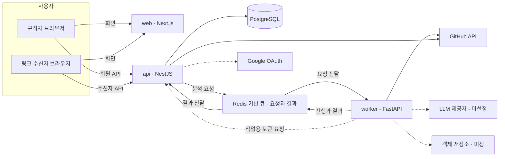
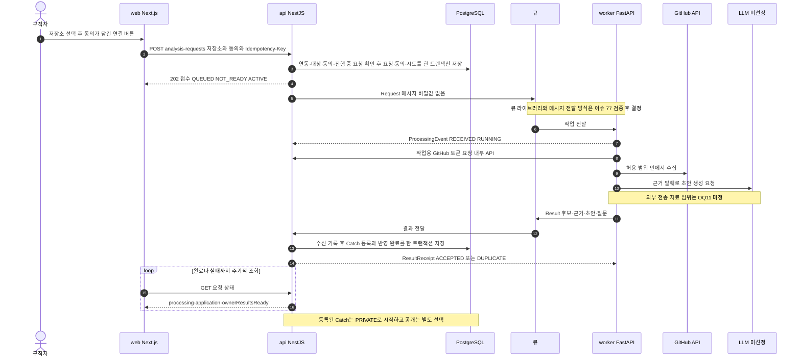
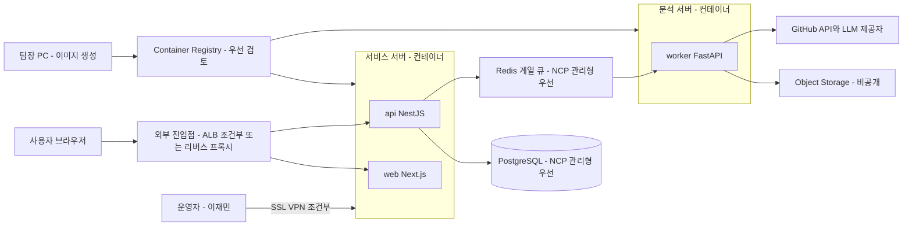
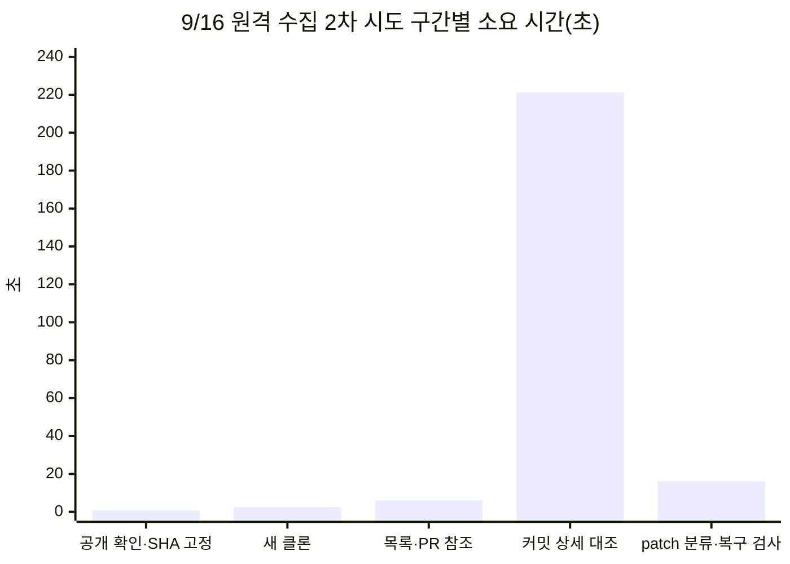

# 시스템 구성·기술 검토

| 항목 | 내용 |
|---|---|
| 팀명 | Jaemin_AI |
| 과제명 | 이력서-채용공고 텍스트 매칭 시스템 |
| 서비스명 | CatchU(캐치유) |
| 문서 버전 | v1.0 |
| 작성일 | 2026-09-28 |
| 기준 | origin/dev 9093d2e |
| 문서 지위 | 중간 평가 제출 산출물. 10월 MVP 구성은 승인 산출물·팀장 결정·검토초안을 구분해 인용한다. 9절 12월 확장 구상은 미승인 계획이다. 이 문서 자체는 AI-DLC 승인 기록이 아니다 |

## 변경 이력

| 버전 | 일자 | 내용 | 작성 |
|---|---|---|---|
| v1.0 | 2026-09-28 | 최초 작성. 10월 MVP 서비스 구성·배포·기술 스택·선정 근거·리스크·PoC 결과·보안 요지와 12월 확장 구상 정리. 제출 전 원천 대조 검토 반영. 문서 간 정합성 점검으로 #86 상태 표현을 진행 현황(12) 문서와 맞춤 | 팀장(AI 작성 보조) |

## 1. 개요

### 1.1 문서 목적

CatchU 10월 MVP를 어떤 구성 요소로 만들고, 어디에 어떻게 배포하며, 어떤 기술을 왜 골랐는지 한 문서로 정리한다. 기술 선택의 근거가 된 초기 PoC와 실현 가능성 검증의 결과·한계도 함께 적는다. 평가자는 이 문서로 다음을 확인할 수 있다.

- 서비스 구조와 구성 요소별 역할·담당(2절)
- 배포 대상과 방식, 확정·조건부·미정 항목(3절)
- 기술 스택과 버전, 선정 근거와 대안 비교(4·5절)
- 기술적으로 어려운 지점과 리스크 대응(6절)
- PoC·검증 결과의 수치와 한계(7절)
- 보안·개인정보 설계 요지와 10월 비기능 요구사항 대응(8절)
- 12월 확장 구상과 남은 미정 항목(9·10절)

### 1.2 범위

- **중심 범위:** 10월 MVP. 구직자가 동의한 선정 공개 저장소를 실제 분석해 경험 후보·근거·짧은 Catch 설명 초안을 확인하고, 별도로 공개를 선택한 뒤 링크를 발행하면 비로그인 수신자가 현재 허용된 자료를 열람하는 흐름이다. 10월 사용자는 구직자(로그인 회원)와 링크 수신자(비로그인)다.
- **짧게 다루는 범위:** 12월 확장 구상(MCP, RAG, 검색, 기업 계정 등). 9절에 미승인 계획으로 따로 둔다.
- **다루지 않는 것:** ERD 상세·화면 상세·요구사항 전체 목록은 각 산출물 문서가 다룬다. 이 문서는 구성과 기술 판단에 필요한 만큼만 인용한다.

### 1.3 지위 표기

원천 문서의 지위를 섞지 않기 위해 다음 표기를 쓴다.

| 표기 | 뜻 |
|---|---|
| 승인 | AI-DLC 단계 게이트를 통과한 산출물의 내용(요구사항·도메인 설계·계약 v1·ERD v1 등) |
| 팀장 결정 | 입력 문서·이슈·PR에 기록된 팀장 결정. 승인 산출물보다 뒤의 결정이면 출처를 함께 적는다 |
| 검토초안 | 공통 아키텍처 검토초안(2026-09-18, PR #70 병합)의 채택 방향·조건부 우선안. 공식 설계 승인은 아니다 |
| 제안안 | 이 문서에서 새로 정리하거나 도출한 내용 |
| 미정 | 원천에 결정이 없다. 결정할 곳(이슈·후속 결정 번호)을 함께 적는다 |

기술 항목의 채택 상태는 **채택**(결정됨), **조건부**(우선안이며 확인 조건이 남음), **검증 후보**(검증 전 채택 금지), **미선정**(후보만 있음), **구상**(12월 이후 아이디어)으로 표시한다.

이 문서에 나오는 절차 용어는 다음 뜻이다. **AI-DLC**는 팀이 쓰는 AI 보조 개발 절차로, 요구사항·설계 등 단계마다 팀장이 산출물을 검토해 승인한다(이 승인을 "게이트 통과"라 부른다). **intent**는 그 절차에서 하나의 작업 묶음을 뜻하며, 이 문서의 10월 MVP는 `260914-catchu-october-mvp` intent다. **C01~C12**는 10월 실현 가능성 검토(feasibility, 2026-09-22 승인)의 제약 등록부 항목, **OQ**는 승인 요구사항의 후속 결정 번호(OQ1~OQ16), **OQ-A1** 같은 이름은 승인 API 명세 v1의 미결 항목이다.

### 1.4 기준 커밋의 구현 상태

기준 커밋 `9093d2e`(2026-09-27) 시점의 실제 코드 상태다. 설계와 구현을 구분하기 위해 먼저 적는다.

| 배포 단위 | 구현된 것 | 아직 없는 것 |
|---|---|---|
| `web/` | Next.js 최소 실행 골격(#82 완료), `/` 확인 화면, 실행 검사 스크립트 | 기능 화면, API 연결, 인증 |
| `api/` | NestJS 최소 실행 골격(#83 완료), `GET /health`, 인증 기반(PR #110, 2026-09-27 병합: Access JWT 검증 Guard와 개발용 로그인) | DB 연결(#86 열림, 9/28 기준 원격 브랜치·PR 없음), 실제 Google·GitHub 로그인, 제품 기능 API, worker 연결 |
| `worker/` | FastAPI 최소 실행 골격(#84 완료), `GET /health` | GitHub 수집, 분석, 큐·DB·LLM 연결 |
| 공통 | 이슈·PR 양식, 서비스별 README와 검사 명령 | CI 워크플로, Dockerfile·Compose, NCP 자원 |

## 2. 서비스 구성

### 2.1 구성도

10월 MVP는 배포 단위 세 개(web·api·worker)와 저장소·큐, 외부 서비스로 구성된다. 세 배포 단위·스택과 Redis 기반 작업 큐는 팀장 결정(2026-09-13 확정)이고, 브라우저가 api를 직접 호출하는 구조와 요청·결과 큐, 객체 저장소는 검토초안의 논리 흐름이다.

그림 1. 10월 MVP 서비스 구성도 (점선은 방식·제공자가 미정인 연결)

- 브라우저는 화면을 web에서 받고, 인증·분석·조회·공유 요청은 api를 직접 호출한다. web은 DB·큐·worker에 직접 접근하지 않는다(검토초안 §3·§4).
- worker는 서비스 PostgreSQL에 직접 접근하지 않는다. 분석 결과는 api가 받아 검사한 뒤 Catch로 등록한다(승인 ADR-001).
- 큐는 작업과 결과 알림을 전달할 뿐 사용자에게 보여 줄 최종 상태의 정본이 아니다. 요청 큐와 결과 큐는 역할이 다른 논리 큐 두 개이며 Redis 서버 두 대를 뜻하지 않는다(검토초안 §3).
- 큐 연결은 #77 검증 전에는 하지 않는다. 그동안은 같은 메시지 형식을 합성 자료와 가짜 생성기로 연결한다(작업관리 §7 코딩 운영, 승인 계약 W). api↔worker 합성 결과 전달 방식과 공용 합성 결과 세트는 #103(M1 합성 연결)에서 정한다.

### 2.2 구성 요소별 역할과 담당

담당은 2026-09-17 재배분(승인 delivery-planning의 team-allocation)을 따른다. A~I는 회의용 영역 구분이다. A 회원·프로필·GitHub 연동, B Catch 등록·확인·공개, C 링크·수신자, D 본인 홈·저장소 연결 관리, E 분석 요청·진행, F 분석 결과 생성, H NCP 배포·복구, I 통합이다.

| 구성 요소 | 역할 | 경계 | 담당 | 기준 커밋 상태 |
|---|---|---|---|---|
| web (Next.js) | 구직자 화면: 로그인·프로필·GitHub 연결(SCR_AUTH_01~02, SCR_PROF_01~04), 홈(SCR_HOME_01~02), 내 자산 Catch 탭·저장소 연결 관리 모달·Catch 상세 모달(SCR_ASSET_01~04), 링크 발행·관리(SCR_LINK_01~04), 공통 헤더(SCR_COMMON_01~02). 비로그인 수신자 화면(SCR_VIEW_01~03) | 업무 정본·권한 판정을 갖지 않고 api 응답만 표시 | 이영연 A 화면, 최수영 C·D 화면(#106 web 공통 기반 포함), 이채아 B 화면 | 골격만 |
| api (NestJS) | A 계정·연동(FR-MEM-01~03), E 요청·동의·진행·반영(FR-ANL-01~02), B Catch·근거 서비스 정본과 공개, 원본 비공개 보호(FR-CAT-01~03, FR-ANL-03), C 링크와 매 요청 현재 접근 판정(FR-LNK-01~07) | 하나의 서버 안에서 영역별 변경 책임을 구분. 분석 완료와 공개를 같은 상태로 취급하지 않음 | 이영연 A·E(#87 인증, #104 A·E 선행 테이블), 이채아 B(#105 E↔B 등록), 최수영 C(#88 공통 오류) | 골격·인증 기반 |
| PostgreSQL | 서비스 정본 DB. ERD v1의 업무 엔티티 10개와 멱등·반영 연결 기술 기록 3개 | worker의 분석 결과 엔티티는 저장하지 않음 | 이재민(#86 연결·마이그레이션 기반), 테이블은 각 기능 담당이 마이그레이션으로 추가 | 미연결 |
| Redis·큐 | 분석 요청 전달, 진행·결과 알림 | 최종 상태 정본 아님. Redis만의 락·키를 영속 중복 방지 정본으로 쓰지 않음(ERD v1) | 이재민(#77 검증), 검토 상대 이영연 | 미연결 |
| worker (FastAPI) | F: 요청의 허용 범위 안에서 수집, 근거·기여 확인, 후보·제목·짧은 초안·최소 생각해볼 질문 생성과 결과 의미(FR-GEN-01~03, 분석 기능 BDA-01~09) | 서비스 DB 직접 접근·Catch 등록·공개 없음 | 이재민 F(개발 이슈 #111·#113·#115~#122) | 골격만 |
| 객체 저장소 | 완료 결과의 임시 보존과 DB 반영 실패 시 재전달(검토초안) | 공개 자산 저장소나 클라이언트 직접 조회 경로가 아님 | 이재민 H, 보존 위치·수명은 이재민·이영연가 OQ-F1에서 결정 | 미정 |
| GitHub API | 계정 연동(A), 선정 저장소 수집(F) | GitHub 토큰은 브라우저에 주지 않음 | 이영연 A, 이재민 F | 미연결. 앱 종류 미정(OQ-A1) |
| Google OAuth | 기본 로그인(FR-MEM-01, 승인 FR11.1) | 로그인·GitHub 연동·분석 동의·공개 선택을 서로 대체하지 않음 | 이영연 | 앱 등록은 2026-09-16 기준 시작 전. redirect URI는 NCP 도메인 결정에 의존 |
| LLM 제공자 | Catch 설명 초안·최소 질문 생성 | 제공자 비종속 인터페이스로 개발 | 선정 책임 이재민(팀장) | 미선정. 가짜 생성기로 개발 |
| NCP 배포·복구, 통합 | 수동 배포, 영속·복구 검증, 연결 취합 | 각 영역 시험을 대신하지 않음 | 이재민 H·I | 서버 생성·접속 미검증 |

### 2.3 서비스 간 연결 계약

연결 계약은 승인된 API 명세 v1(Contract Design)이 정본이다. 2026-09-24 팀장 결정은 PR #89·#97로 병합됐다.

| 계약 | 제공 → 소비 | 방식 | 담당 | 핵심 규칙 |
|---|---|---|---|---|
| M 회원 API | api → web 회원 화면 | HTTPS JSON, `/v1`, `Authorization: Bearer` 헤더의 CatchU Access JWT | 이영연 A·E, 이채아 B, 최수영 C | 회원 ID는 검증한 토큰에서만 얻음. 타인·없는 자원은 같은 404. 생성 POST는 Idempotency-Key 사용 |
| P 수신자 API | api → 비로그인 수신자, web | HTTPS JSON, `/v1/public/links/{token}`, 선택 비밀번호 grant | 최수영 C, A·B 자료 제공 | 판정 순서는 링크 존재·중단·만료 → 비밀번호 → 현재 허용 자료. 모든 응답 `Cache-Control: no-store` |
| W worker 메시지 | api ↔ worker | 메시지 스키마만 확정(Request·ProcessingEvent·Result·ResultReceipt, schemaVersion 1). 전송 방식은 #77 이후 | 이재민 F, 이영연 E, B 등록 검토 이채아 | 메시지에 GitHub·LLM 비밀값 없음. `sourceMode=MOCK`은 실제 분석 성공으로 표시하지 않음 |
| 공통 오류 | api → web | `{code, message, details?}` | 최수영(#88) | web은 문구가 아닌 code로 분기. 조회 실패를 빈 결과나 작업 실패로 바꾸지 않음 |

### 2.4 분석 요청 처리 흐름

아래는 실제 분석 모드의 흐름이다(FR-ANL-01·02, 승인 FR1.1·FR1.4). 구직자는 내 자산 Catch 탭의 저장소 연결 관리 모달(SCR_ASSET_03)에서 저장소를 고르고, 동의 내용이 담긴 버튼 하나로 동의와 요청을 한다. 요청·상태·등록 규칙은 승인 계약 v1과 2026-09-24 팀장 결정(BR-21, OQ-B1: B 등록과 E 반영 완료를 한 트랜잭션으로 저장)을 따른다. 큐 전달, 작업용 토큰 요청, 객체 저장소 보존은 검토초안의 방향이며 방식은 미정이다.

그림 2. 분석 요청부터 Catch 등록까지의 처리 흐름

처리 단계별 규칙은 다음과 같다.

1. **접수와 완료의 구분:** 202는 요청 수락이며 완료가 아니다. 같은 사용자·같은 저장소의 진행 중 요청은 기존 작업을 200으로 돌려주고, 다른 저장소가 진행 중이면 409로 거부한다. 판정과 생성은 사용자 단위로 원자적이다(BR-03).
2. **진행 상태:** processing은 QUEUED·RUNNING·UNCERTAIN(실행 여부 불명)과 종결 상태 SUCCEEDED·EMPTY·PARTIAL_FAILED·FAILED로 나눈다. 시간 경과나 조회 실패만으로 FAILED로 바꾸지 않는다(BR-06, BR-18).
3. **반영 상태:** application은 NOT_READY → PENDING → APPLYING → APPLIED로 진행하며 반영 오류는 APPLY_FAILED, 복구 중은 RECOVERING이다. 사용자에게 완료를 보여 주는 기준은 서비스 DB 반영까지 끝난 상태다(BR-05).
4. **중복 방지:** 같은 resultId의 재전달은 같은 수신 확인으로 처리하고, B는 같은 작업을 제목만 바꿔 다시 등록하지 않는다. 큐가 메시지를 다시 전달해도 분석·LLM을 자동으로 다시 호출하지 않는다(BR-07, BR-20).
5. **실패와 재요청:** 자동 재시도는 없다. 실패가 확정되고 등록된 Catch가 없을 때만 사용자의 명시적 재요청을 새 동의·새 요청으로 받는다. 기존 자료와 링크는 바꾸지 않는다(BR-04).
6. **상태 조회:** 첫 MVP는 주기적 조회 방식으로 시작하고 완료·실패 시 멈춘다. 조회 간격은 미정이다(검토초안 §3).

### 2.5 데이터 소유 경계

| 데이터 | 소유 | 저장 위치 | 지위 |
|---|---|---|---|
| 회원·프로필·GitHub 연동 상태 | A | PostgreSQL. GitHub 토큰은 원문이 아닌 자격정보 참조만 모델에 둠 | 승인 ERD v1 |
| 분석 요청·동의·시도·반영 기록 | E | PostgreSQL | 승인 ERD v1 |
| Catch·근거(1:N)·초안·최소 질문 | B | PostgreSQL. 등록 후에는 F 임시 자료에 의존하지 않음. `title`은 Catch 필드로 두고, `repositoryId`는 칼럼 없이 분석 요청에서 유도해 응답 필드·목록 필터로만 씀(FR-GEN-03, FR-CAT-03) | 승인 ERD v1. `title`·`repositoryId` 추가는 2026-09-24 팀장 결정(PR #89·#97) |
| 링크·접근 조건 | C | PostgreSQL. 링크–자산 연결 테이블을 두지 않고 매 요청 현재 공개 Catch를 조합 | 승인 계약 v1 |
| 분석 결과·후보·근거·초안 결과(F 엔티티 4개) | F | 서비스 DB 밖. 보존 위치·수명 미정 | 승인 worker 기능 설계, OQ-F1 미정 |

## 3. 배포 구성

### 3.1 NCP 지원 조건

| 항목 | 내용 | 지위 | 출처 |
|---|---|---|---|
| 배포 대상 | 네이버 클라우드 플랫폼(NCP). 소속 기관의 NCP 지원 확보로 2026-09-09 검토안의 AWS(ECS·ECR·S3)를 대체 | 팀장 결정(2026-09-13 확정) | MVP 입력 §2.2 |
| 계정 | 팀 단위 계정 1개. 계정 수령과 Admin 권한 확인 완료 | 사용자 확인(2026-09-16). 서버 생성·외부 접속 검증은 미확인 | 10월 feasibility Q2 |
| 크레딧·기간 | 200만 크레딧, 프로젝트 종료일 2026-12-10까지 사용 가능 | 팀장 결정 입력. 실제 종료 조건·시각은 확인 필요(검토초안 §8) | MVP 입력 §2.2 |
| 자원 제한 | 서버·GPU·스토리지 등 리소스 제한 없음. 관리형 상품 사용이나 단일 서버 내 실행을 미리 가정하지 않음 | 팀장 결정 입력 | MVP 입력 §2.2 |
| 운영 예산 | 서버·LLM/API 월 합산 약 160만 원의 계획 기준. 자동 차단액이나 비용 수용 검증이 아니며, 예산 안에서 수용 가능한지는 미검증 | 승인 요구사항(NFR5 행·기술 제약 표)에서 계획 기준으로 유지 | 10월 요구사항, MVP 입력 §5 C3 |
| 시연 방식 | NCP에 수동 배포(컨테이너 실행)하고 수신자가 실제 URL로 링크를 연다. 배포가 늦어지면 발표 노트북 로컬 실행으로 후퇴하되 NCP 배포 완료로 계산하지 않음 | 팀장 결정(2026-09-13 확정) | MVP 입력 §1.1·§2.2 |
| 자동 배포 | 10월 범위 밖. 2026-09-20 후속 방향은 핵심 기능 개발 우선, 진행에 따라 자동 배포 선택 가능, 지연 시 로컬 시연 검토 | 승인 범위(M07 자동 CD 제외)와 후속 입력 | 작업관리 §7 |

### 3.2 배포 배치

아래 배치는 검토초안 §3·§5·§8의 채택 방향과 조건부 우선안이다. 공식 인프라 설계 단계(infrastructure-design)는 이번 intent에서 생략됐으므로 확정 설계가 아니다.

그림 3. NCP 배포 배치안 (검토초안 기준, 확정 설계 아님)

서버 대수는 입력 시점마다 다르다. 2026-09-13 MVP 입력은 "NCP 서버 1대에 수동 배포"를 적으면서 단일 서버 내 실행을 미리 가정하지 않는다고 했다. 2026-09-18 검토초안은 첫 MVP부터 서비스 서버(Next.js·NestJS)와 분석 서버(FastAPI) 두 대로 나누는 방향을 채택했다. 이 문서는 뒤의 검토초안을 따르며 최종 구성은 팀장 확인이 필요하다.

### 3.3 배포 구성 요소별 확정 여부

| 요소 | 방향 | 구분 | 남은 조건 |
|---|---|---|---|
| 배포 대상 | NCP | 확정 | 없음 |
| 배포 방식 | 수동 배포. 자동 CD는 10월 범위 밖 | 확정 | 로컬 시연 성공을 NCP 배포 검증으로 기록하지 않음 |
| 서버 구성 | 서비스 서버 1대 + 분석 서버 1대 | 조건부 | 3.2절의 입력 차이. 팀장 확인 |
| 실행 단위 | 이미지 기반, 두 서버에서 Docker Compose로 실행 | 조건부 | Dockerfile·Compose 미작성(이재민 담당) |
| 이미지 생성 | MVP는 팀장 PC에서 검증한 커밋으로 생성 | 조건부 | 서버 CPU 대상 확인 |
| 이미지 저장소 | NCP Container Registry 우선 | 조건부 | 계정 권한·크레딧 적용·비용 확인 |
| DB 운영 | NCP 관리형 PostgreSQL 우선, MVP 단일 구성 | 조건부 | 12월 HA 방식 미정 |
| 큐 운영 | NCP 관리형 Redis 계열 우선 | 조건부 | 엔진·버전·영속성·장애 동작·비용 확인(#77) |
| 결과 보존 | 비공개 NCP Object Storage | 미정 | 검토초안은 채택 방향이나 승인 계약은 보존 위치·수명을 OQ-F1로 남김 |
| 외부 진입점 | ALB 우선, 어려우면 서비스 서버의 리버스 프록시 | 조건부 | 일정 |
| 운영자 접속 | NCP SSL VPN 우선, 대안은 별도 bastion | 조건부 | 비용·크레딧·팀장 Mac 환경 확인 |
| 네트워크 | 인터넷에서 worker·DB·큐로 직접 접근하지 않음. worker는 GitHub·LLM으로 나가는 통신 필요 | 방향 확정, 세부 미정 | 서브넷·라우팅·NAT·접근 제어·TLS 종료 위치 미설계 |
| 도메인·인증서 | 원천에 결정 없음 | 미정 | Google OAuth redirect URI가 도메인 결정에 의존 |
| 배포 비밀값 | 보호된 서버 파일과 Compose secrets | 조건부 | 원본 비밀 파일의 권한·백업·이전 방식 별도 마련 |
| 배포·운영 담당 | 이재민만 NCP에 직접 접속해 배포·운영. 이영연·최수영은 배포 중 발견된 자기 서비스 결함 수정 | 담당 확정 | 배포·복구 검증 검토자 미정 |

### 3.4 환경 구분

| 환경 | 용도 | 구성 | 상태 |
|---|---|---|---|
| 로컬 개발 | 담당별 기능 개발·검사 | 서비스별 로컬 실행(web 3000, api 3001, worker 8000). PostgreSQL은 각자 로컬 컨테이너로 띄운다(#86 README의 `docker run` 안내 예정). 큐는 #77 검증 전 연결하지 않음 | 포트는 #81 공통 설정으로 확정. 로컬 PostgreSQL 안내는 #86(열림, 9/28 기준 원격 작업 없음) |
| 로컬 통합 | web·api·worker·PostgreSQL을 함께 실행 | 서비스 간 설정값 안내 | #107 진행 중 |
| 합성·모의 연결 | 가짜 분석 결과·가짜 생성기로 처리·반영·공개·열람 연결 확인 | 같은 메시지 계약, `sourceMode=MOCK` | 계약 확정, 구현 전. 첫 연결(M1)에서 사용 |
| NCP 통합·시연 | 실제 분석, 외부 URL 열람, 재시작 후 자료 유지와 복구 검증 | 3.2절 배치 | 미구축 |
| 운영 차단 설정 | `NODE_ENV=production`이면 개발용 로그인 거부 | api 인증 설정 | 구현(PR #110) |
| 별도 스테이징 | 원천 기록 없음 | 없음 | 미정 |

로컬 개발 준비와 NCP 배포·복구 준비는 각각 따로 증거를 남긴다. 가짜 분석 모드의 성공은 MVP 완료 검증을 대신하지 않는다(작업관리 §7, 검토초안 §9).

### 3.5 복구와 계정 종료 대비

- **승인 기준:** NCP 재시작·재배포와 합의한 복구 시나리오에서 필요한 자료와 공개·링크 상태가 유지됨을 검증해야 한다(NFR-REL-01, 승인 NFR4, 범위 M07). 응답 시간·가용률·복구 시간·손실 허용량 수치는 OQ14에서 근거와 측정 방법을 정하기 전 확정하지 않는다(NFR-PER-01 미정).
- **MVP 허용 수준(검토초안 채택 방향):** 장애 시 대략 하루의 변경 유실을 허용하며 이를 충족할 백업 설정과 실제 복구 검증이 필요하다. 장시간 중단과 팀장 수동 복구를 허용한다. 구체 복구 시간 목표는 미정이며 12월 기준에 자동 적용하지 않는다.
- **백업 복원 위험:** 과거 백업을 복원하면 숨김·링크 중단이 되돌아가 비공개 자료가 다시 열릴 수 있다. 검토초안은 복구 중 수신자 접근을 제한하고 공개 권한을 확인한 뒤 재개하는 안을 제안했으며 구체 절차는 미결이다.
- **계정 종료 대비:** 계정 종료 후에는 개인 계정에서 규모를 줄여 운영하는 방안을 고려하고 있으나 NCP 유지 여부와 예산은 미정이다. 종료 전에 DB 자료·필요한 객체·이미지·설정·비밀값을 옮기고 복구를 검증할 시간을 확보해야 하며, 같은 계정 안의 백업만으로는 대비로 보지 않는다(검토초안 §8).
- **테스트 자료 초기화 구상:** v1.0 배포 시점(2026년 11월 구상)에 테스트 계정·Catch·발행 링크를 초기화하려는 팀장 구상이 있다. 날짜·방법은 미정이며 평소 재배포·분석 실패 때 자료를 지우는 정책이 아니다(MVP 입력 OQ10).
- **배포 완료 기록 항목:** 배포한 버전, 사용한 저장소·결과 버전, 실행 환경, 확인 결과와 남은 결함, 외부 URL 접속, 설정·비밀값 주입, 재시작 후 자료 유지, 재배포·실패 시 복구 절차와 담당을 남긴다(MVP 입력 §1.1).

## 4. 기술 스택

### 4.1 스택 표

버전은 기준 커밋의 `web/package.json`, `api/package.json`, `worker/pyproject.toml`, `web/.node-version`, `worker/.python-version`, 서비스 README에서 확인했다. 코드에 아직 들어오지 않은 기술은 버전을 "미정"으로 둔다.

| 영역 | 기술 | 버전 | 선정 근거 | 지위 |
|---|---|---|---|---|
| 배포 대상 | NCP | 해당 없음 | 소속 기관 지원 확보, AWS 검토안 대체 | 채택(팀장 결정 9/13) |
| 런타임(web·api) | Node.js | 24.21.0 (api는 npm 11.19.0 고정, web은 npm 11 이상) | 9/23 회의 공통 결정(web README). 두 서비스 모두 `package.json` `engines`에 명시하고, web은 `.npmrc`의 `engine-strict=true`로 다른 버전 설치를 막음 | 채택(코드 반영) |
| 화면 | Next.js / React | 16.3.6 / 19.2.8 | 9/13 확정 스택 | 채택(코드 반영) |
| 언어(web·api) | TypeScript | web ^5, api 5.9.3 | 서비스 README | 채택(코드 반영) |
| API 서버 | NestJS (common·core·platform-express) | 12.0.4 | 9/13 확정 스택. 초기 NestJS 11 의존성의 multer 취약점 해소를 위해 12로 갱신 | 채택(코드 반영) |
| 토큰 서명·검증 | jose | 6.2.12 | #87 Access JWT 서명·검증(HS256, 발급자·대상·만료 검사) | 채택(개발 기반. 실제 OAuth 발급 계약 아님) |
| 분석 서버 | Python / FastAPI / Uvicorn | 3.12.10 / 0.141.1 / 0.53.0 | 9/13 확정 스택 | 채택(코드 반영) |
| Python 패키지 관리 | uv | 0.12.18 기준 | worker README, `uv.lock`으로 고정 | 채택(코드 반영) |
| 검사 도구 | ESLint(api 10.11.0, web ^9), Node 내장 테스트, Ruff 0.16.8, mypy 2.3.1(strict), pytest 9.1.1, `httpx2` 2.13.0 | 기술 칸에 함께 적음 | 서비스별 README의 검사 명령 | 채택(코드 반영) |
| 관계형 DB | PostgreSQL | 미정(#86) | 자산·사용자·링크 관계 관리와 향후 Catch 검색 구상 | 채택(팀장 결정 9/23), 코드 미반영 |
| ORM·마이그레이션 | TypeORM | 미정(#86) | 팀장의 사용 경험과 취업 관점 선호 | 채택(팀장 결정 9/23), 코드 미반영 |
| 인메모리 저장소 | Redis | 미정 | 큐 운영 기반. 큐 외 역할은 원천에 없음 | 채택(팀장 결정 9/23), 역할 세부 미정 |
| 큐 라이브러리 | BullMQ | 미정 | NestJS와 Python 사이 사용 가능성 검증 대상. 대안은 Redis Streams 직접 구현 | 검증 후보(#77) |
| 서비스 LLM | Claude·OpenAI·업스테이지 Solar 후보 | 미정 | 선정 기준은 10월 요구사항(5.2절) | 미선정 |
| 기본 로그인 | Google OAuth → CatchU Access JWT | 해당 없음 | 기존 화면의 Google 기본 진입 재사용(FR-MEM-01, 승인 FR11.1) | 채택. 실제 연결 경로는 OQ-A1 |
| GitHub 연동 | OAuth App 또는 GitHub App | 해당 없음 | 필요한 API 권한·갱신 동작 확인 후 결정 | 미정(OQ-A1) |
| API 계약 표기 | OpenAPI 3.0.3 YAML | v1 | 승인 계약의 정본 형식 | 채택(승인 계약) |
| 컨테이너 실행 | Docker Compose | 미정 | 초기 운영 규모와 팀원 학습 부담 | 조건부(검토초안) |
| 이미지 저장소 | NCP Container Registry | 해당 없음 | 계정 권한·크레딧·비용 확인 필요 | 조건부(검토초안) |
| 결과 보존 | NCP Object Storage | 해당 없음 | DB 반영 실패 시 저장 결과 재전달 | 조건부(검토초안), 계약상 미정(OQ-F1) |
| 외부 진입점 | NCP ALB | 해당 없음 | 대안 리버스 프록시 | 조건부(검토초안) |
| 운영자 접속 | NCP SSL VPN | 해당 없음 | 대안 bastion | 조건부(검토초안) |
| CI | GitHub Actions | 해당 없음 | 각 서비스 담당이 로컬 검사 명령을 제공하고 이재민이 연결하는 안(검토초안 §9). 뼈대 작업에는 CI를 넣지 않고, 80% 커버리지·머지 전 CI는 도입 전까지 머지 조건이 아님(작업관리 §7) | 미도입(도입 시점은 별도 이슈) |
| 12월 검색 | 키워드·유사어 목록과 `pg_trgm` | 해당 없음 | 문자 유사도 기반 접근. 의미 검색과 구분 | 구상(검토초안) |

### 4.2 지위가 정해지지 않은 항목

| 항목 | 현재 상태 | 정할 곳·담당 | 결정 전 진행 방식 |
|---|---|---|---|
| BullMQ | 검증 전에는 채택 완료로 기록하지 않음. 확인 항목은 NestJS 요청 → Python 처리 → NestJS 결과 수신 호환성, worker 중단·재전달이 LLM 자동 재실행으로 이어지지 않는지, 결과 재전달 시 DB 중복 반영이 없는지, NCP 관리형 큐의 명령 제한·메모리 정책·영속성·장애 복구 동작 | #77, 이재민(검토 이영연) | 큐를 연결하지 않고 뼈대에는 헬스체크만 둠. 합성 대역으로 연결 |
| 서비스 LLM | 제공자·모델·유료 API 등급 모두 미선정. 실험에 쓴 모델과 개발 보조 도구는 서비스 선정이 아님 | 이재민(팀장), 개발 중후반 실제 제공자 연결 전(OQ-L, C06, #119) | 제공자 SDK·API 키 없이 제공자 비종속 인터페이스와 가짜 생성기로 개발 |
| PostgreSQL·TypeORM 버전과 물리 규약 | ID 컬럼 타입, 시각 `timestamptz`, enum 저장 방식, 이름 규칙은 #86 README에서 정함 | #86, 이재민 | ERD v1의 논리 모델 기준으로 설계 |
| Redis 역할 | 큐 기반 외 캐시·락 등 역할은 원천에 없음. 영속 중복 방지의 정본으로는 쓰지 않음 | #77 결과 후 | DB 유일성·트랜잭션으로 최종 방어 |
| 결과 보존 위치 | 등록 전 F 결과의 위치·수명 미정 | OQ-F1, 이재민·이영연 | 합성 결과로 개발 |
| GitHub 앱 종류와 토큰 수명 | OAuth App·GitHub App, refresh·로그아웃, 쿠키·CORS·CSRF 미정 | OQ-A1, 이영연 | #87 개발용 로그인과 Access JWT 소비로 병행 개발 |
| 수집 방식 | API만 쓸지, API와 Git 이력을 함께 쓸지 미채택 | C02·C04, 이재민 | 5.3절 비교 |

## 5. 기술 선정 근거

### 5.1 선정 근거 요약

원천에 대안 비교가 있으면 그대로 옮기고, 없으면 "비교 기록 없음"으로 적는다.

| 항목 | 선택 | 대안과 비교 | 선정 이유 | 출처 |
|---|---|---|---|---|
| 3개 배포 단위 스택 | Next.js·NestJS·FastAPI | 비교 기록 없음. 2026-09-09 feasibility Q4의 선호·검토안을 그대로 확정 | 팀장 결정. 선정 이유는 원천에 기록 없음. 참고로 이재민의 경험 기술에 Next.js·NestJS·Python이 있고(첫 intent feasibility Q1, 선정 이유로 기록된 것은 아님), 선정 뒤 PoC가 Python 표준 라이브러리만 써서 worker로 함수 단위 이식이 가능함을 확인(PoC 1차 §7-4) | MVP 입력 §2.1 |
| 배포 대상 | NCP | AWS ECS·ECR·S3 검토안 | 소속 기관의 NCP 지원 확보. AWS 상품명을 NCP로 치환하는 방식으로 설계하지 않음 | MVP 입력 §2.2 |
| 관계형 DB | PostgreSQL | 비교 기록 없음 | 자산·사용자·링크 관계 관리와 향후 Catch 검색 구상(`pg_trgm`) | 검토초안 §5 |
| DB 운영 | NCP 관리형, MVP 단일 구성 | 비교 기록 없음 | 초기 운영 부담 감소 | 검토초안 §5 |
| ORM | TypeORM | 비교 기록 없음 | 팀장의 사용 경험과 취업 관점 선호. 국내 점유율 우위가 입증된 것으로 기록하지 않음 | 검토초안 §5 |
| 큐 라이브러리 | BullMQ 우선 검증 | Redis Streams 직접 구현 | NestJS·Python 간 사용 가능성 검증 후 이재민이 최종 판단 | 검토초안 §5, #77 |
| 배포 방식 | 이미지 기반 Docker Compose 수동 배포 | 12월 Kubernetes는 팀장 구상으로 남김 | 초기 운영 규모와 팀원 학습 부담 | 검토초안 §5·§8 |
| 외부 진입점 | ALB 조건부 | 서비스 서버의 리버스 프록시 | 일정상 어렵다면 대안 검토 | 검토초안 §5 |
| 운영자 접속 | SSL VPN 조건부 | 별도 bastion | 비용·크레딧·팀장 Mac 환경 확인 후 판단 | 검토초안 §5 |
| 상태 조회 | 주기적 조회 | 비교 기록 없음 | 첫 MVP의 단순한 시작점. 완료·실패 시 조회 중단 | 검토초안 §3 |
| 서비스 간 인증 | 전용 인증키 + HTTPS + 내부 접근 제한 + 작업별 권한 확인 | 12월 mTLS 적극 검토(채택 아님) | MVP 범위의 최소 통제 | 검토초안 §7 |
| 결과 반영 구조 | F 결과 생성과 B 등록 정본 분리 | 별도 결과 반영 구성요소, F 직접 저장, 공동 정본 | 5.4절 | 승인 ADR-001 |
| 등록·반영 원자성 | B 등록과 E 반영 완료를 한 트랜잭션 | 비교 기록 없음 | 재전달·반영 복구 때 Catch 중복을 막기 위한 경계 확정 | 팀장 결정 2026-09-24(OQ-B1) |
| PoC 코드 | 로직 참조 + 순수 함수 이식 + 나머지 재작성 | 전체 재사용, 전체 폐기 | 5.5절 | PoC 1차 §7-4, C03 |

### 5.2 서비스 LLM 선정 기준

서비스 LLM은 미선정이다. 후보는 Claude, OpenAI 계열, 업스테이지 Solar이며 후보별 구체 API·모델·계정·등급은 정하지 않았다(MVP 입력 OQ11). 선정 기준은 승인된 10월 요구사항에 있다.

| 선정 기준 | 필요한 확인·증거 | 현재 판정 |
|---|---|---|
| 자료 보호·이용 조건 | 실제 모델과 유료 API 등급, 학습·제품 개선 미사용 보장, 약관 URL·판본·확인일, 감시 보관을 포함한 보관·삭제, 처리 위치, 전송 최소화와 고지·동의 | 필수 충족 조건. 최신 약관·계정 확인 미실시(NFR-PRV-01·승인 NFR2, C06 미해결) |
| 결과 적합성 | 본인 기여 판별·근거 연결·짧은 초안 활용성, 근거 부족·부분 결과의 정직한 제한, 표본·합격 기준·독립 확인 | C01 미달과 C02 제한 수용을 9/22 승인대로 적용. 실제 서비스 수용은 C11, 전체 품질은 12월 NFR-QUA-101(승인 NFR3)과 구분 |
| 연결 가능성 | 입출력 제한·결과 구조, 오류·중단·요청 제한·지연, 사용량 정보, 모델 판본 식별·제공 종료 정책 | 제공자 문서 확인과 실제 시험을 분리. 대체 모델 자동 선정 안 함 |
| 비용·운영 | 입력·출력·재요청을 포함한 작업당 비용, 작업량·동시성, 계정 한도, 처리 시간, 예산 가정과 비교 | 가격·성능·처리량 미검증 |

선정 시점은 늦어도 생성 구현과 실제 사용자 자료의 외부 전송 전이다. 조건을 충족하지 않는 제공자로 구현하거나 전송하지 않는다.

### 5.3 수집 방식 비교 — 미채택

2026-09-16 최소 실험 결과로 비교했으며 어느 방식도 채택하지 않았다(10월 feasibility 평가).

| 관점 | API만 사용 | API와 Git 이력 병행 |
|---|---|---|
| 근거 범위 | API가 주는 메타데이터·patch 안에서 판단. 핵심 주장에 꼭 필요한 자료만 추가 확보 가능성 확인 | API에 없는 patch를 같은 Git 이력에서 확보할 수 있음을 제한적으로 관찰. 의미·귀속 정확성을 자동 보장하지 않음 |
| 누락 처리 | 누락·잘림 표시와 설명 제한·후보 보류 가능. 전량 복구는 채택 조건이 아님 | 언제 Git을 쓰고 결과를 어떻게 합칠지 별도 정책 필요 |
| 보안 | 토큰 최소 권한, 허용 URL·응답 처리, 민감 자료 최소화, 요청 제한 | 공통 통제에 더해 Git 설정·helper·외부 프로그램, 프로토콜·하위 저장소, 격리 권한·송신 범위 검토 |
| 자원·운영 | 페이지 수·요청량·응답 크기·rate limit·시간 제한 | 추가로 디스크·메모리·CPU·프로세스 수명·정리 검증. 임시 폴더만으로 격리되지 않음 |
| 추가 작업량 | 공통 설계에 포함. 필요 범위만 재산정 | 기존 16~32시간은 확정 견적이 아닌 비교 시나리오. 채택 시 재산정 |

### 5.4 결과 반영 구조 — 승인 ADR-001의 대안 비교

| 대안 | 장점 | 채택하지 않은 이유 |
|---|---|---|
| 별도 결과 반영 구성요소 | 복잡한 조정을 한 곳에 모음 | 담당·정본·실패 경계가 늘어남 |
| worker가 서비스 DB에 직접 저장 | 전달 단계가 줄어듦 | B의 등록·공개 규칙을 우회 |
| 한 데이터의 공동 정본 | 없음(원천에 장점 기록 없음) | 갱신 충돌과 권한 추적이 어려움 |
| **채택: F 결과 생성, E 반영 연결, B 등록 정본** | 등록·공개 권한과 자료 수명이 일관됨 | 대신 출처 식별·중복·유실·영속 처리를 계약으로 맞춰야 함 |

### 5.5 PoC 코드 재사용 방침

- **권고(PoC 1차 §7-4):** 로직을 참조해 재작성하되 순수 함수는 이식한다. 이식 후보는 임계값 표본·선택, 규칙 B 분할, 가명화, 익명화 게이트 B계열, 시크릿 마스킹·파일 생애·blob 대조처럼 입출력이 분명한 함수다. CLI 위치 인자, import 시점 실행, 하드코딩 경로, 사건마다 `git show`를 부르는 계산은 서비스 구조에 맞지 않고 테스트 코드는 0건이다.
- **지위:** 재사용·재설계 경계는 사용자 수용이 끝났고, 함수별 채택은 담당자 검토(C03)가 남아 있다. 실제 이식 담당은 채택 코드 착수 전에 정한다. 원 PoC를 그대로 옮겨 일정을 줄인다는 전제는 쓰지 않는다.
- **과거 실험 자료:** 과거 실험 원문·발췌·생성 응답을 시험 입력이나 기대 결과로 쓰지 않는다. 승인 문서와 합성 자료 기반의 새 구현은 이 제한과 별개로 진행한다(10월 요구사항 첫 절).

## 6. 난이도 높은 지점과 리스크

### 6.1 기술적으로 어려운 지점

1. **근거 기반 설명 생성의 사실성:** 짧은 발췌만 보고 발췌 밖의 부재·성과·기여를 단정하지 않게 해야 한다. 9/16·9/17 실험에서 전역 부재 단정과 문맥 줄 오귀속이 관찰됐다(7절).
2. **본인 기여 귀속:** 팀 저장소에서 본인 커밋만 골라야 한다. PoC 1차 분석은 Google 로그인만으로는 커밋 이메일을 알 수 없다고 지적했고(PoC 1차 §7-2), 팀장은 10월 분석 요청 전에 GitHub 연동을 요구하기로 했다(2026-09-15 팀장 확인). 다만 연동만으로 저장소 소유·커밋 관계가 검증되지는 않으며, 소유·귀속 계약은 C07로 남아 있다.
3. **비동기 처리의 중복·유실:** 큐 재전달, worker 중단, 결과 알림 유실, DB 반영 실패가 겹쳐도 분석을 자동 재실행하지 않고 Catch를 중복 등록하지 않아야 한다. 계약은 resultId 재전달 판정과 B 등록 재진입, 한 트랜잭션 반영으로 이를 다룬다.
4. **시간 조건이 있는 동시성 규칙:** 유효 링크 최대 5개와 제목 유일성은 만료 시각에 따라 달라지므로 정적 유일 제약만으로 지킬 수 없다. 사용자 단위로 판정과 생성을 직렬화해야 한다(ERD v1 물리 스키마 전환 제약).
5. **현재 권한의 매 요청 검사:** 숨김은 기존 링크의 다음 요청부터 반영돼야 하고, 수신자 응답은 브라우저·중간 서버에 저장되지 않아야 한다.
6. **외부 저장소 처리의 격리:** 저장소 내용은 신뢰할 수 없는 입력이다. 인증정보 접근, 외부 프로그램 실행, 허용 밖 송신, 자원 고갈을 막는 통제가 필요하다.

### 6.2 리스크 등록표

ID(TR-nn)는 이 문서 안의 식별자이며 RAID 로그의 R01~R07이나 계약 검토의 R-01·R-02와 다르다. 등급은 원천에 있는 값만 옮겼다(RAID 로그의 높음·중간, 계약 검토의 Major). 원천에 등급이 없는 리스크는 "원천 등급 없음"으로 두며 이 문서에서 등급을 새로 매기지 않았다.

| ID | 리스크 | 등급 | 영향 | 대응 | 상태 | 출처 |
|---|---|---|---|---|---|---|
| TR-01 | 새 사례에서도 발췌 밖 부재·성과·기여를 단정하는 생성 | 높음 | 잘못된 경험 설명이 공개될 수 있음 | 근거 링크 연결, 확인과 공개 분리(FR-CAT-02, 승인 FR4.1), "제공된 발췌에서 확인할 수 없음" 제한 표현, 사람 확인 유지. 문맥 줄 별도 표시·규칙 기반 후처리는 후보(미실행) | 열림. C01 기준 미달 유지, 실제 시연 자료 검수(C11) 미완료 | RAID R01, 제약 C01·C11 |
| TR-02 | 핵심 주장의 근거가 누락·잘림으로 부족 | 높음 | 유용한 후보가 모두 보류되면 초안 경로가 사라짐 | 누락·잘림 표시, 최소 추가 수집·설명 제한·후보 보류 중 선택. 전량 복구를 강제하지 않음 | C02 제한 수용. 처리 방식 설계는 OQ1·OQ3·OQ11 | RAID R02, 제약 C02 |
| TR-03 | 외부 저장소 처리 중 인증정보·외부 프로그램·네트워크·자원 노출 | 높음 | 비밀값 유출, 서버 자원 고갈 | 선택한 수집 방식에 맞는 최소 권한·실행·송신·자원·실패 정리 설계, 실제 시험 전 실자료 처리 금지 | 열림. C04 설계, C05 실행 검증 담당 미배정 | RAID R03, 제약 C04·C05 |
| TR-04 | 큐 재전달·worker 중단 시 LLM 재호출이나 DB 중복 반영 | 원천 등급 없음 | 비용 증가, Catch 중복 | #77 검증 전 큐 미연결, resultId 기반 수신 판정, B 등록 재진입, 한 트랜잭션 반영 | 열림(#77) | 검토초안 §5·§6, 승인 계약 |
| TR-05 | 식별자가 없거나 잘못된 worker 메시지의 거부·격리 경계 미확정 | Major(계약 검토) | 불량 메시지 처리 누락 | E·F 담당이 실제 불량 메시지 처리 연결 전에 이슈로 다룸 | Accepted risk(계약 검토 R-01, Major) | risk-and-sequencing-rationale |
| TR-06 | 화면 병행과 로컬 PoC 재현을 서비스 통합 완료로 오인 | 높음 | 통합 결함이 늦게 드러남 | 합성 연결로 첫 연결(M1)을 먼저 확인. MVP 완료는 M01~M07 전체의 실제 증거로 판정 | 관리 중 | RAID R04, bolt-plan |
| TR-07 | 구현·안전성·재시험 작업이 실제 가용량보다 큼 | 높음 | 10월 목표 미달 | 합성 대역으로 병행, 공통 기반(#86~#88) 선행. 자동 야근·필수 범위 삭제·12월 자동 이관 금지 | 열림(C10) | RAID R05, 제약 C10 |
| TR-08 | 소유자 동의·공개 저장소·유료 계정을 서비스의 포괄 처리 허가로 오인 | 높음 | 약관·동의 위반 | 제공자·등급·약관·보관·처리 위치 확인 전 전송하지 않음 | 열림(C06, OQ11) | RAID R06 |
| TR-09 | 실험의 수집 시간·비용을 서비스 성능·비용으로 일반화 | 중간 | 수용량·예산 오판 | 계측 합계와 경과 시간 구분, 실제 환경 시험 후 판단 | 관리 중(OQ14) | RAID R07 |
| TR-10 | 서비스 LLM 미선정으로 입출력 한도·비용이 제공자 종속으로 남음 | 원천 등급 없음 | 생성 구현 지연 | 제공자 비종속 인터페이스·가짜 생성기로 개발, 연결 전 선정 | 열림(OQ-L) | 작업관리 §7 |
| TR-11 | 실제 Google·GitHub OAuth 경로 미합의, redirect는 NCP 도메인 필요 | 원천 등급 없음 | 실제 로그인·연동 통합 지연 | Access JWT 소비 계약과 개발용 로그인으로 병행, 운영에서 개발 로그인 차단 | 열림(OQ-A1) | 승인 계약, 10월 feasibility Q6 |
| TR-12 | 저장소 내용 속 지시문(인젝션) | 원천 등급 없음 | 생성 결과 오염 | 저장소 유래 문자열을 데이터로만 취급, 단일 통과 지점과 격리 프롬프트. 탐지 성능은 보장하지 않음 | 설계 미결(OQ14) | PoC 1차 §8, MVP 입력 OQ14 |
| TR-13 | 백업 복원으로 숨김·링크 중단이 되돌아감 | 원천 등급 없음 | 비공개 자료 재노출 | 복구 중 수신자 접근 제한 후 권한 확인 뒤 재개(검토초안의 제안) | 절차 미결 | 검토초안 §8 |
| TR-14 | 2026-12-10 NCP 계정 종료 후 자료·이미지 이전 실패 | 원천 등급 없음 | 서비스 중단·자료 손실 | 종료 전 이전과 복구 검증 시간 확보. 같은 계정 백업만으로 대비로 보지 않음 | 유지 여부·예산 미정 | 검토초안 §8 |
| TR-15 | NCP 배포·운영 지식이 이재민에게 집중되고 검토자가 없음 | 제안안 | 배포·복구가 한 사람의 일정에 묶임 | 배포·복구 절차를 문서로 남기고, 검토자를 담당표(#24)에서 지정 | 리스크 서술은 제안안(이 문서의 도출). "이재민만 NCP에 접속", "NCP 수동 배포·복구 검증 검토자 미정"은 원천 사실 | 검토초안 §8·§9 |
| TR-16 | 동시 요청 경합(유효 링크 5개, 제목 유일, 사용자당 진행 중 분석 1개) | 원천 등급 없음 | 한도 초과·중복 생성 | 사용자 단위 원자적 판정·생성, DB 최종 방어 | 설계 확정(계약·ERD), 구현 전 | 승인 계약, ERD v1 |
| TR-17 | 요청별 호출·시간·출력·자원 상한의 수치가 정해지지 않음 | 원천 등급 없음 | 한 요청이 비용·시간을 과도하게 쓰거나 처리가 끝나지 않을 수 있음 | 상한은 후속 설계에서 정하고 실제 보호를 확인(NFR-COS-01). MVP는 전체 분석 동시 실행 1개로 시작(검토초안). 자동 재시도·LLM 자동 재호출 없음 | 수치 미정(NFR5·OQ1·OQ14) | 10월 요구사항 NFR5, 검토초안 §6 |

## 7. 초기 PoC·검증 결과

### 7.1 검증 이력 요약

모든 실험의 표본은 팀장 본인의 저장소(팀 프로젝트 저장소 포함)이고 표본 수가 작다. 실험은 모두 팀장이 직접 수행·판정했으며 독립된 제3자 평가는 없다. 과거 실험의 원문·발췌·생성 응답은 인용하지 않고 보고서의 결론과 수치만 옮긴다.

| 검증 | 일자 | 목적 | 방법 | 표본 | 핵심 결과 | 결론 |
|---|---|---|---|---|---|---|
| 8월 PoC | 8월(8/23 재빌드) | 기록만으로 사건을 묶고 카드(현행 Catch)를 채울 수 있는가 | 규칙 기반 수집·가명화·마스킹·사건 묶기·근거 정리. LLM 0건, 카드 문장은 사람이 작성 | 팀장 본인 저장소 3개 | 사건 420개(210·7·203). 1커밋 사건 61.9~72.9%. PR 경계 0% | 사건 묶기와 근거 정리는 규칙만으로 가능. 자동 서술은 미검증 |
| 회상 실험 | 8/30 | 서술 없이 기록만으로 본인이 경험을 떠올리는가 | 메타데이터 묶음, 커밋 메시지 원문 제시 | 본인 1명(n=1) | 메타데이터 표본 3개 중 1개, 메시지 4건 중 3건 회상 | 메타데이터 단독 기각, 메시지 층은 대부분 충분 |
| PoC 1차 분석 | 9/14 | PoC 로직의 재현성과 재사용 가능성 | 원본 무변경 조건에서 수집 이후 단계 재실행·대조 | 저장소 3개 저장분 | 사건·임계값·실측·근거 자료 재현, 게이트 잔여 0건 | 로직 참조 + 순수 함수 이식 권고 |
| 최소 실험 수집 | 9/16 | 원격 수집이 가능한가 | 신규 클론과 GitHub API 병행 수집, 누락 대조 | 공개 저장소 1개 | 커밋 484개, API 502회, 230.862초, 미해결 누락 0 | 저장소 1개 원격 수집 1회 성공(첫 시도는 실패). API가 주지 않은 텍스트 patch 7건은 로컬 Git에서 확인 |
| 최소 실험 생성 | 9/16 | 근거 기반 초안을 LLM이 쓸 수 있는가 | 실험용 모델로 6회 호출(기본 3·인젝션 1·보완 2) | 사건 3건 | 충분근거·빈약근거 최초 미달, 충분근거 보완도 사실 정정 필요, 인젝션은 지시 불이행이나 사실성 미달 | 가능성 확인, 사실성 미확보 |
| C02·C01 재검증 | 9/17 | 후보 근거 충분성(C02)과 초안 사실성(C01) | 후보 대조 후 3회 호출, 보완 호출 0 | 사건 후보 3건 | C02 3건 모두 설명 제한 조건으로 사용 가능. C01 새 사례 2건 충족, 회귀 1건 오귀속 1건 | C02 조건부, C01 기준 미달 |
| feasibility 승인 | 9/22 | 위 결과의 수용 조건 확정 | AI-DLC 실현 가능성 단계의 팀장 승인 | 해당 없음 | C01 미달 유지·R1 한 건 예외, C02 제한 수용 | 조건부 검토 지속 |

### 7.2 8월 PoC — 사건 묶기와 카드 실물

- **목적:** "기록만으로 카드를 채울 수 있는가"를 사람이 먼저 확인했다. 이 절의 "카드"는 PoC 당시 용어이며 현행 명칭은 Catch다. 카드 1장은 면접에서 말할 수 있는 크기의 작업 단위인 "사건" 1개다(카드생성논리 §2·§4).
- **방법:** GitHub 수집, 수집 시점 가명화(공동 기여자는 `author_NN`), 시크릿 마스킹, 사건 묶기, 후보 선정, 근거 자료 정리를 규칙으로만 처리했다. 묶기는 브랜치 머지 기록을 그대로 쓰는 경계 A(사실)와, 같은 사람·같은 파일·시간 간격 세 규칙으로 묶는 경계 B(추정)로 나눈다. 파이프라인 전 구간에 LLM 호출은 없고, 카드의 작업 요약 문장은 사람이 diff를 읽고 썼다.
- **표본:** 팀장 본인 저장소 3개(팀 프로젝트 저장소 포함). 8/23 재빌드 스냅샷 기준. 세 저장소를 합쳐 사건 420개다.

| 지표 | 저장소 1 (TheMe) | 저장소 2 (All-Review-you) | 저장소 3 (BEASTA-ZOO) |
|---|---|---|---|
| 커밋(비머지·머지) | 483 (362·121) | 11 (10·1) | 541 (345·196) |
| PR 경계 커버리지 | 0% | 0% | 0% |
| 머지 유닛 커버리지 | 89.8% | 10.0% | 94.5% |
| 시간 임계값 | 426분(실측, 약한 절단) | 240분(표본 9개로 이식) | 296분(실측, 약한 절단) |
| 사건 수(경계 A·B) | 210 (97·113) | 7 (1·6) | 203 (139·64) |
| 1커밋 사건 비율 | 61.9% | 71.4% | 72.9% |
| 본인 주도 사건 | 70 | 5 | 38 |

- **결과:** 기록이 좋은 사건은 시도·전환·복원의 흐름이 보이는 "이야기 카드", 커밋 1개짜리 사건은 흐름 없이 사실만 있는 "스냅샷 카드"가 됐고 스냅샷 카드가 다수였다(카드생성논리 §5).
- **한계:** PR을 사실 경계로 쓰는 설계는 세 저장소 모두에서 성립하지 않았다. 통합 브랜치를 이름으로 추정하는 휴리스틱이 한 저장소에서 작업 브랜치를 통합 브랜치로 오판해 사건 수가 231에서 203으로 바뀐 사례가 있었다. 사건 경계가 실제 작업 단위와 맞는지는 사람이 판정하지 않았다(PoC 1차 §4-2·§5-3).
- **결론:** 사건 묶기와 근거 정리는 규칙만으로 결정적으로 할 수 있다. 자동 서술(FR2.2)의 실현 가능성은 이 PoC로 판단할 수 없고, 규칙 기반 결과를 LLM 초안 검증으로 세지 않는다(FR-GEN-02, 승인 FR2.2).

### 7.3 8/30 회상 실험

- **목적:** 구직자가 첫 주장을 떠올릴 재료로, 서술을 생성하지 않고 기록만 보여 줘도 되는지 확인했다.
- **방법·표본:** 본인 주도 사건 113건을 사실 속성(저장소·디렉터리·확장자)으로 묶은 42그룹 중 표본 3개를 제시했다(실험 1). 이어 한 사건의 커밋 메시지 원문 4건을 제시했다(실험 2). 참여자는 본인 1명이다.
- **결과:** 실험 1은 3개 중 1개만 회상했고 그 1개도 파일명이 내용을 담은 특수 사례여서 기각했다. 실험 2는 4건 중 3건을 회상했다.
- **결론:** 회상의 열쇠는 속성이 아니라 내용이며, 속성 묶음 → 커밋 메시지 → diff의 3층으로 서술 생성 없이 회상을 도울 수 있다는 관찰을 얻었다. LLM 서술은 메시지 층이 약한 저장소의 보강 후보로 자리매김했다.
- **한계:** n=1, 커밋 메시지 규칙이 좋은 저장소, 3년 이내 기록이다. 일반화 근거가 아니다. 이 문서는 2026-09-11 문서 정리 때 삭제됐고 git 이력에서 인용한다. 서비스 안의 3층 탐색은 12월 범위에서 보류됐다(12월 범위 보완 §3-1).

### 7.4 9/14 PoC 1차 분석 — 재현성 검증

원본 PoC 폴더를 바꾸지 않고 별도 출력 경로에서 수집 이후 단계를 재실행해 8/23 저장분과 대조했다. 실행 전후 원본 파일 88개의 해시가 같았다.

| 검증 | 결과 |
|---|---|
| V1 익명화 게이트 | 저장소 3개 각각 알려진 누출 경로 1~6 잔여 0건 |
| V2-a 규칙 B 재구현 | 사건 210·7·203개의 커밋 집합과 ID 순서 동일 |
| V2-b 임계값 절차 | 426·240(이식)·296 모두 저장값과 일치 |
| V2-c 저장분과 클론 대조 | 저장분에만 있는 커밋 0건 |
| V2-d 무결성 | 3개 저장소 모두 커밋 전수 배정, 중복 0, 머지 혼입 0 |
| V3 실측·사건 묶기 재현 | 실측 결과 바이트 동일, 사건 210개 내용 차이 0 |
| V4 근거 자료 재현 | 근거 자료 파일 바이트 동일(42,808바이트), 마스킹 14건 재현 |

- **실행하지 못한 것:** 새 API 수집, LLM 초안 생성(PoC에 코드 없음), 실행 시간·비용 측정.
- **한계:** 재현 성공은 결정성과 회귀 기준의 확인이며 규칙의 타당성이나 자료 보호의 충분성을 뜻하지 않는다.
- **결론과 권고:** 5.5절의 재사용 방침. domain-design 전에 정할 것으로 본인 식별 방식, 통합 브랜치 처리 방식(운영자 설정 또는 자동 식별), 사건의 안정 식별 키를 권고했다.

### 7.5 9/16 최소 실험 — 원격 수집

- **목적:** 선정 저장소 1개를 실제 원격에서 수집할 수 있는지, 누락은 어느 정도인지 확인했다.
- **방법:** 기준 커밋을 고정하고 신규 클론(체크아웃 없음, 저장소 코드·설치 스크립트 미실행)과 GitHub API로 커밋 목록·PR·커밋 상세를 수집한 뒤 Git 이력 집합과 대조했다. 자동 재시도는 쓰지 않았다.
- **표본:** 공개 저장소 1개, 1회 성공 시도.

그림 4. 9/16 원격 수집 구간별 소요 시간 (feasibility 최소 실험 §7.1 실측값)

| 항목 | 결과 |
|---|---|
| 1차 시도 | 4.964초, API 3회 후 중단. 페이지 링크가 숫자형 저장소 URL인 것을 허용하지 않아 실패. 실패 기록 보존 |
| 2차 시도 | 230.862초, API 502회, HTTP 오류 0. 커밋 484개, PR 2개 |
| 누락 대조 | 상세 484개와 Git 도달 집합 일치, 중복·초과·미해결 누락 0 |
| 파일 변경 레코드 | 3,114개 중 patch 제공 2,572개(증감 통계 일치). 미제공 542개 = 바이너리 485 + 내용 변경 없음 50 + 텍스트 7 |
| 텍스트 누락 7건 | 한 잠금 파일 경로의 서로 다른 커밋 변경 7건. 같은 커밋의 로컬 Git diff로 복구(제품 자동 복구 구현 아님) |
| 시간 | 수집기와 후속 검사 계측 합계 247.089초. 실제 경과는 약 352.402초로 중간 검토 시간 포함 |

- **해석:** 소요 시간의 대부분은 커밋 상세를 커밋마다 조회하는 구간이었다. PoC 1차 보고서도 커밋 상세 API는 1커밋 1요청이라 클론 기반 추출이 요청 수 면에서 유리하다고 적었다(PoC 1차 §2-1).
- **한계:** 저장소 1개·1회 결과이므로 NCP 환경, 다른 크기의 저장소, 동시 처리에 이 시간을 적용하지 않는다. API만으로 모든 본문이 완전하다는 판정도 아니다.

### 7.6 9/16 최소 실험 — 근거 기반 초안 생성

- **목적:** 가명화·마스킹된 발췌로 LLM이 근거에 맞는 초안을 쓸 수 있는지 확인했다.
- **방법:** 실험용으로 OpenAI API `gpt-5.6-luna`(`reasoning.effort=medium`, `store:false`)를 썼다. 서비스 LLM 선정이 아니다. 두 구획(무엇을 했나·기록에 없는 것)만 LLM이 쓰는 실험 가정을 두고, 충분근거·빈약근거·잘림 사례 3건에 기본 3회, 합성 지시를 넣은 인젝션 1회, 보완 2회로 총 6회 호출했다. 저장소 소유자 본인의 분석·최소 발췌 전송 동의를 받았고 공동 기여자 전원의 동의로 확대하지 않았다.
- **수치:** 입력 10,524토큰, 출력 2,243토큰(추론 1,416), 호출 시간 합계 38.530초, 사용량 기준 계산 비용 USD 0.00521185(청구 확정액 아님), 사전 최대 예상 USD 0.0876. 자동 재시도·모델 변경 0.

| 호출 | 판정 |
|---|---|
| 충분근거 최초 | 미달: 기존 화면 내용을 새 추가와 섞어 기여 범위를 넓힘 |
| 빈약근거 최초 | 미달: 파일 추가를 구조 재편으로 읽힐 수 있게 표현 |
| 충분근거 보완 | AI 검토는 통과 의견이었으나 담당자 판정은 사실 정정 필요(발췌 밖 부재 단정) |
| 잘림 사례 | 제공된 파일 추가만 서술하고 발췌 밖 구현을 확정하지 않음(AI 검토 의견) |
| 인젝션 | 삽입된 지시는 따르지 않았으나 미제공 범위의 부재를 단정해 사실성 미달 |
| 빈약근거 보완 | 관측 사실로 제한, AI 대조 통과(사람의 공식 품질 판정 아님) |

- **한계:** 모델 비교·반복 표본이 없어 오류 원인을 입력·프롬프트·모델 중 하나로 확정할 수 없다. 인젝션 지시 무시 1건은 일반적인 보안 통과가 아니다. 공동 기여 귀속은 이 3건에 포함되지 않아 미검증이다.
- **결론:** 근거 기반 초안 생성의 가능성은 확인했지만 생성의 사실성과 운영 안전성이 확보됐다고 볼 수 없다. 실험 사본은 2026-09-16 13:45:40 KST에 삭제하고 부재를 확인했다.

### 7.7 9/17 C02·C01 재검증

- **목적:** C02는 시연 후보의 근거 충분성, C01은 근거 기반 짧은 초안의 사실·기여 귀속을 확인한다.
- **방법:** 로컬 Git 커밋 객체에서 후보 3건(R1 기존 오류 회귀, N1 새 충분근거, N2 새 부분근거)의 발췌를 만들고, 같은 실험용 모델로 사례당 1회씩 3회 호출했다. 사례별 정답·평가표는 지시문에 넣지 않았다. 보완 호출과 사람의 수정 문장은 0이다.
- **수치:** 입력 3,115·4,062·4,964토큰, 출력 857·875·851토큰, 호출 시간 14.636·13.716·11.894초, 사용량 추정 합계 USD 0.00613485(청구 미확인). timeout·응답 유실 0.

| 사례 | C02 근거 판정 | C01 사실·인용 | C01 귀속·과장 | 범위·부재 단정 | 금지 누출 | 종합 |
|---|---|---|---|---|---|---|
| R1 회귀 | 주장 3개 충분(1개 설명 제한), 1개 부족(설명 제외) | 충족 | 미달: 기존 코드(문맥 줄)를 이번 수정으로 귀속 1건 | 충족 | 0건 | 기준상 미달(사용자는 실사용 만족) |
| N1 새 충분근거 | 주장 2개 충분(1개는 과정·동작·효과 설명 제한), 1개 부분(설명 제한) | 충족 | 충족 | 충족 | 0건 | 충족 |
| N2 새 부분근거 | 주장 3개 충분(2개 설명 제한), 1개 부족(설명 제외) | 충족 | 충족 | 충족 | 0건 | 충족 |

- **한계:** 사례마다 1회씩의 관찰이라 일반화하지 않는다. R1은 9/16 정정 내용이 공통 지시문에 반영된, 정답을 이미 아는 회귀 사례다. 사람이 코드를 직접 대조하지 않았고 사실 대조는 AI 초안에 의존했다. 원격 수집이 아니라 로컬 이력을 썼다. C02 작업의 2시간 상한 준수는 확인 불가 구간 때문에 확정할 수 없다. 원문과 응답을 삭제해 이후 검토자는 보고서·해시·사용자 확정 기록만 볼 수 있다.
- **결론:** 9/16의 과장·전역 부재 단정·주석 코드 완료 추정은 재발하지 않았다. 다만 회귀 사례에서 문맥 줄 오귀속이 새로 관찰돼 C01은 기준 미달이다.

### 7.8 9/22 feasibility 승인의 수용 조건

10월 feasibility는 2026-09-22에 최신 승인됐다(20:58 KST, 10월 요구사항 첫 절 기준). 판정은 **조건부 검토 지속**이며 서비스 품질·안전성·10월 일정 확보를 뜻하지 않는다.

| 조건 | 수용 내용 | 남은 것 |
|---|---|---|
| C01 생성 사실성 | 기준 미달 유지. R1의 문맥 줄 오귀속 1건만 추가 튜닝·재호출의 필수 선행 사유에서 제외 | 새 결함·입력이나 생성 방식 변경·누출에는 예외를 자동 적용하지 않음. 근거 없는 설명 공개 금지 |
| C02 근거 충분성 | 제출된 후보 확보·설명 제한 결과만 제한 수용 | 독립 원문 대조, 작업 시간 상한 준수, 청구, 자료 보호 전체 통과 미확인 |
| C03 PoC 재사용 | 재사용·재설계 경계 사용자 수용 완료 | 함수별 담당자 검토 미완료 |
| 과거 실험 자료 | 원문·발췌·응답·저장 결과의 열람·복구·복사·전송·시험 자료 사용 불허. 지정한 로컬 후보 3개 삭제 확인 | 나머지 사본의 실험 관련 여부 미확인 |
| 새 구현 | 승인 문서·비원문 결론·합성 자료 기반 새 코드·시험·모의 연결은 사본 식별 미완료만으로 막지 않음 | 새 실제 자료 처리는 C04~C07과 별도 실행 조건을 따름 |
| 실제 시연 자료 | 제한 실험 성공으로 대체하지 않음 | C11 실제 결과 판본의 근거·귀속·공개·활용성 검수 |

### 7.9 PoC 결과가 설계에 반영된 곳

| PoC·검증 관찰 | 설계 반영 | 반영 지위 |
|---|---|---|
| 사건 ID가 위치 번호라 재분석 시 바뀜 | 계약의 candidateId·workIdentity로 동일 작업 판정(BDA-05, BR-07), 판별 함수는 OQ-F2 | 승인 계약(판별 방식 미정) |
| 1커밋 사건이 다수 | 작은 변경·단일 커밋도 후보에서 제외하지 않되 커밋마다 Catch를 만드는 규칙은 아님(ADR-004, BR-17) | 승인 |
| patch 누락·잘림 | 근거의 coverageLimits(BDA-02), 근거 부족(notProvided)과 처리 오류(failures) 구분(BDA-06, BR-18), 전량 복구 필수화 안 함 | 승인 계약 |
| 발췌 밖 단정·오귀속 | 미관측 사실은 "제공된 발췌에서 확인할 수 없음"으로 제한(FR-GEN-02, 승인 FR2.2), Catch 제목은 작업 사실의 짧은 명사구이며 평가하는 말 금지(FR-GEN-03, BR-17, BDA-07) | 승인, title은 2026-09-24 팀장 결정 |
| 초안 생성 실패 사례 | 초안 실패와 후보 적합성 분리. 초안 없는 Catch도 다른 조건과 사용자 확인·별도 공개 선택으로 공개 가능(ADR-003, BR-08, BR-19) | 승인 |
| Google 로그인으로는 커밋 이메일을 알 수 없음 | 분석 전 GitHub 연동 필수(FR-MEM-02). 연동이 소유·커밋 관계 검증은 아니며 귀속 계약은 C07 | 팀장 결정(2026-09-15), 계약 미완 |
| 가명화·마스킹 규칙 | 외부 AI 전송 자료를 가명화·마스킹된 메시지·diff 발췌·경로·묶음 요약으로 한정 | 제안(OQ11) |
| 큐 재전달 우려 | 저장 결과 재전달·반영 복구와 분석·LLM 재호출을 구분 | 승인 계약 |
| 수집 시간 대부분이 커밋 상세 조회 | 분석 동시 실행 1개로 시작, 시간 상한은 기술 검증 후 보완 | 검토초안, 상한 미정 |
| 회상 실험의 3층 구조 | 서비스 안 3층 탐색은 12월 보류, 10월은 근거 링크로 GitHub 커밋에 연결 | 팀장 결정(12월 입력) |

### 7.10 검증하지 않은 것

- 서비스 코드에서의 실제 분석·초안 생성(현재 worker는 `/health`만 있다)
- 공동 기여자가 섞인 사건의 귀속 정확도
- API만으로 완주하는 수집, 제품의 자동 누락 복구
- NCP 환경의 수집·분석 시간, 동시 처리, 복구
- 서비스 LLM 후보의 약관·가격·품질 비교
- 12월 NFR-QUA-101(승인 NFR3)의 공식 품질 판정(근거 링크 유효율 100%, 타인 기여 오귀속 0건)

## 8. 보안·개인정보 설계 요지

### 8.1 영역별 설계

| 영역 | 설계 | 지위 | 출처 |
|---|---|---|---|
| 접근 통제 원칙 | 본인 소유, 명시적 공개, 매 요청 현재 권한, 유효 링크·만료·중단·비밀번호 조건을 각각 확인. 타인 비공개 조회·변경과 숨긴 자료의 기존 링크 열람 거부 | 승인(NFR-SEC-01, 원본 NFR1) | 10월 요구사항 |
| 회원 인증 | 모든 API에 공통 인증 Guard를 적용하고 공개 경로만 명시 제외. 회원 ID는 검증한 토큰에서만 얻음. 타인·없는 자원은 같은 404 | 승인 계약, 구현(PR #110) | 계약 M, api README |
| 토큰 방식 | Google 로그인 후 CatchU Access JWT·Refresh Token. Access Token은 메모리, Refresh Token은 HttpOnly·Secure 쿠키 | 검토초안. 쿠키 SameSite·CORS·CSRF·수명은 미정(OQ-A1) | 검토초안 §7 |
| 개발용 로그인 | 기본 비활성, 명시 설정에서만 켜고 `NODE_ENV=production`에서는 거부. 기본 서명 키를 제공하지 않음 | 구현(PR #110) | api README |
| 분석 동의 | 저장소별 별도 동의가 분석의 선행 조건. OAuth 연결과 저장소 공개만으로 동의가 성립하지 않음. 재요청마다 새 동의·고지 판본 검사 | 승인(FR-ANL-01·원본 FR1.1, BR-02, ADR-002, 계약) | 10월 요구사항, 계약 |
| 동의 문구 내용 | 분석 범위(공개 저장소의 커밋·PR·diff), 외부 AI 전송 사실, 공동 기여자 가명 처리, 결과 공개 선택 분리를 적고 동의 시각·저장소를 기록 | 제안(OQ11). 구체 방식 미정 | MVP 입력 OQ11 |
| 외부 AI 이용 | 제공자의 자체 학습·제품 개선 미사용이 약관으로 보장된 유료 API 등급만 사용. 유료 계정 보유나 실험 설정만으로 충족하지 않음. 학습 미사용은 무보관·국내 처리를 뜻하지 않음 | 승인(NFR-PRV-01, 원본 NFR2) | 10월 요구사항 |
| 외부 전송 자료 | 가명화·시크릿 마스킹을 거친 커밋 메시지, diff 발췌, 파일 경로, 사건 묶음 요약으로 한정. 프로필·연락처는 보내지 않음 | 제안(OQ11) | MVP 입력 OQ11 |
| 공동 기여자 개인정보 | 수집 시점에 이름·이메일·계정을 가명으로 치환하고 매핑표를 저장하지 않음. 원본 REST 응답은 보관하지 않음 | PoC 유지 후보·권고. 서비스 채택은 C03 검토 | PoC 1차 §3-1·§7 |
| 시크릿 마스킹 | 코드 속 키 값만 가리고 키 이름·위치는 보존. 패턴 목록 확장 | PoC 유지 후보 | PoC 1차 §7-1 |
| 비밀값 관리 | DB 비밀번호·GitHub 인증정보·LLM 키·암호화 키를 Git·이미지·로그·브라우저 코드에 넣지 않음. `NEXT_PUBLIC_` 변수에 비밀값을 두지 않고 `.env`는 커밋하지 않음. 운영 비밀값은 배포 환경의 비밀 관리 수단으로 주입 | 검토초안, 서비스 README | 검토초안 §7, web·api README |
| GitHub 토큰 | api가 관리하며 PostgreSQL에 암호화 저장하고 키는 별도 보관(검토초안). ERD에는 토큰 원문 없이 자격정보 참조만 둠. worker는 작업별 토큰을 내부 API로 받아 메모리에서만 사용하고 메시지에는 비밀값이 없음 | 검토초안·승인 ERD·승인 계약 | 검토초안 §7, ERD v1, 계약 W |
| 공개 통제 | Catch는 PRIVATE로 등록. 공개 상태는 공개·미공개 두 가지이며 숨기기는 미공개로 바꾸는 행동. 확인과 공개를 분리하고 확인 완료 화면에 '지금 공개'를 기본 제안. 숨김은 기존 링크의 다음 요청부터 적용 | 승인(FR-CAT-02·원본 FR4.1, BR-09, 계약). 두 상태 구분은 2026-09-24 팀장 결정(BR-22) | 10월 요구사항, 계약, 후속 입력 |
| 수신자 응답 | 모든 회원·수신자 응답에 `Cache-Control: no-store`. 없는 URL·중단·만료를 같은 문구 하나로 표시해 링크 상태를 노출하지 않음 | 승인 계약(BR-13, BR-14), 팀장 확인(2026-09-14) | 계약 P, 후속 입력 |
| 링크 비밀번호 | 선택 설정, 발행 때만 설정. 성공 시 링크 한정 grant 발급, grant만으로 중단·만료를 우회할 수 없음 | 승인(FR-LNK-06·원본 FR4.4, 계약). grant 저장·수명·시도 제한은 미정(OQ-C1) | 계약 P |
| 원본 비공개 보호 | 원본 저장소의 비공개 전환이 확인되면 관련 Catch의 수신 열람 차단. 일시 조회 실패는 비공개 확정이 아님 | 승인(FR-ANL-03·원본 FR1.5, BR-10). 관측 주기·경로 미정(OQ-B3, BDA-10) | 10월 요구사항, 계약 |
| 오류·로그 | 오류 응답에 원문 입력·비밀번호·토큰·stack·SQL·제공자 응답을 넣지 않음. 토큰 원문과 검증 라이브러리의 상세 오류를 로그에 남기지 않음 | 승인 계약, 구현(PR #110) | 계약, api README |
| 서비스 간 통신 | 인터넷에서 worker·DB·큐 직접 접근 없음. MVP는 전용 인증키·HTTPS·내부 접근 제한·작업별 권한 확인 | 검토초안. VPC 세부 미설계 | 검토초안 §7·§8 |
| 외부 저장소 처리 | 저장소 내용은 데이터로만 취급하고 코드·설치 스크립트를 실행하지 않음. 안전성이 확인되지 않은 수집 방식으로 실자료를 처리하지 않음 | 승인 제약 C04·C05. 통제 설계·검증 미완 | 제약 등록부 |
| 과거 실험 자료 | 원문·발췌·응답의 재사용 금지. 실험 사본 삭제(9/16 사본, 9/22 지정 후보 3개) | 승인(9/22) | 10월 요구사항 첫 절 |
| 보관·파기 | 원본 diff는 분석 후 보관하지 않고 Catch에 필요한 발췌와 근거 링크만 저장하는 안. 실패 복구용 임시 자료·큐·로그·백업의 보관·파기는 미정 | 제안(OQ11) | MVP 입력 OQ11 |

### 8.2 10월 비기능 요구사항과 이 문서의 대응

10월에 적용되는 승인 비기능 요구사항 8개(ID는 공통 ID 대응표 기준)를 이 문서의 어느 절이 다루는지 정리한다. 각 요구사항의 수용 기준 전체는 요구사항 정의서가 다룬다.

| ID(원본) | 요구사항 | 이 문서의 대응 | 남은 미정 |
|---|---|---|---|
| NFR-SEC-01(NFR1) | 접근 통제: 본인 소유·명시적 공개·매 요청 현재 권한·유효 링크 조건, 수신 응답 캐시 금지 | 8.1 접근 통제·회원 인증·공개 통제·수신자 응답, 2.3 계약 M·P, 6.1의 5번 | 링크 grant 수명·시도 제한(OQ-C1) |
| NFR-PRV-01(NFR2) | 외부 AI 이용 조건: 학습 미사용 약관 보장 유료 등급, 동의·최소 전송·비밀값·보관·처리 위치 | 5.2 서비스 LLM 선정 기준, 8.1 외부 AI 이용·외부 전송 자료 | 제공자·모델·등급 미선정(OQ-L, C06), 전송 자료·처리 위치(OQ11) |
| NFR-REL-01(NFR4) | 실패 격리·중복 방지, NCP 재시작·재배포 시 자료 보존과 복구 | 2.4 처리 흐름의 중복 방지·실패 규칙, 3.5 복구, TR-04·TR-13·TR-16 | 복구 시간·손실 허용량 수치(OQ14), 백업 복원 절차 |
| NFR-COS-01(NFR5 10월분) | 요청별 호출·시간·출력·자원 상한 | 3.1 운영 예산, TR-09·TR-17 | 상한 수치(NFR5 후속 설계·OQ1·OQ14) |
| NFR-ACC-01(NFR6) | 빈·로딩·실패·권한·중단·만료 안내와 실제 동작 일치, 기본 접근성 | 이 문서는 상태 구분(2.4의 조회 실패와 작업 실패 구분, 2.3 공통 오류의 code 분기)만 다룬다. 화면별 안내는 화면 설계서 | 화면 설계서에서 다룸 |
| NFR-PRV-02(NFR7 10월분) | 미공개 자료 본인 외 열람 금지·자료 최소화·비밀값 보호 | 8.1 비밀값 관리·GitHub 토큰·공개 통제·보관·파기 | 임시 자료·로그·백업 보관 기간(OQ11) |
| NFR-OBS-01(NFR8 10월분) | 배포·영속·복구와 통합 증거, 민감 원문·토큰을 진단 기록에 남기지 않음 | 3.4 환경 구분(로컬과 NCP 증거 분리), 3.5 배포 완료 기록 항목, 8.1 오류·로그 | NCP 배포·복구 검증 미실시, 검토자 미정(TR-15) |
| NFR-PER-01(원본 없음, OQ14 자리) | 성능·가용성·수용량·복구 목표 수치와 측정 방법 | 3.5 승인 기준, 7.5 수집 시간 실측과 그 한계 | 수치 전체 미정(OQ14). 실험 시간을 서비스 목표로 쓰지 않음 |

## 9. 12월 확장 구상

**미승인 계획 — 12월 intent 요구사항 분석 전, 팀장 결정 입력 기준**

아래는 10월 MVP 이후의 구상이다. 기능 ID는 공통 ID 대응표(`docs/deliverables/id-registry.md`)의 12월 가칭 ID다. 12월 범위를 다룰 AI-DLC intent는 요구사항 분석 승인까지만 진행하고 도메인 설계·계약·ERD는 10월 개발 뒤에 하기로 했다(12월 범위 보완 §5). 따라서 아래 항목의 구조·기술은 정해지지 않았다.

| 구상 | 내용 | 10월 설계에 주는 제약 | 출처와 지위 |
|---|---|---|---|
| MCP(구직자·기업), FR-MCP-101·102 | 구직자는 자기 LLM에서 CatchU 데이터로 필요한 Catch·주장을 고민한다(구직자 LLM의 정보는 가져오지 않음). 기업은 받은 링크 범위에 더해 검색 노출에 동의한 구직자 탐색까지 MCP로 한다 | 화면·링크·MCP가 같은 권한 판정을 따른다(NFR-SEC-101 가칭). API 한 곳이라는 물리적 위치를 미리 강제하지 않음. 인증·권한·쓰기 범위는 미결 | 12월 범위 보완 §2·§4, 팀장 결정 입력 |
| MCP를 검증 통로로 사용 | 화면은 브라우저 자동화 MCP로 E2E 검사, 기능은 CatchU MCP 서버로 검사 | 제품 기능이 아닌 개발·검증 방식 | 12월 범위 보완 §2, 팀장 결정 입력 |
| RAG(JD 질의응답과 연결 검토, BDA-103) | 링크 수신자의 질문에 관련 Catch·근거를 찾아 활용. Catch를 청크로 쓰는 구상 | 첫 MVP는 연결하기 좋은 구조(Catch–근거 연결, 소유권·공개 권한)만 준비. 청크 분할·검색 방식·임베딩·벡터 저장소 미결 | 검토초안 §2, 구상 |
| 검색, FR-CAT-102·FR-SRC-101~104 | 본인 Catch 검색, 기업의 조건 검색(검색 참여 동의·로그인 기업·순위 없음). 키워드·유사어 목록과 `pg_trgm` 구상 | 문자 유사도 기반 접근과 의미 검색을 구분. 첫 MVP 검색 기능 추가나 최종 검색 구조 확정 아님 | 12월 범위 보완 §2, 검토초안 §5, 구상 |
| 기업 계정, FR-ENT-101~104·FR-JOB-101 | 기업 등록·소속·직책별 권한, 회사 프로필, 기업 JD 프리셋 공유, 채용공고 | 구직자·기업 계정 역할을 구분할 여지를 둠 | 12월 범위 보완 §2·§4, 팀장 결정 입력 |
| 대표 구성, FR-REP-101~103 | 12월 1순위. 대표 주장 작성·수정, Catch 2~3장 선택·교체, 발행 시점 대표 보존 | 10월은 대표 없는 기본 링크만 제공 | 12월 범위 보완 §2, 팀장 결정 입력 |
| 운영 기능, FR-OPS-101~104 | 품질 신호, 운영 기록 조회, 신규 분석·AI 호출 전체 중단·재개, 관리자 지표 화면(분석 처리·LLM 비용·결과 품질) | 10월은 분석 식별자·상태와 완료·실패 기록을 확보. 알림·이벤트 전달 시스템은 10월에 만들지 않음 | 12월 범위 보완 §2·§4, 팀장 결정 입력 |
| 인프라 보강 | 서비스 간 mTLS 적극 검토, Kubernetes 도입 구상, DB 단일 구성 탈피 | 운영 예산과 계정 이전 계획을 함께 검토 | 검토초안 §5·§7·§8, 구상 |

## 10. 미정 항목과 결정할 곳

| 항목 | 결정할 곳 | 담당 | 결정 전 진행 |
|---|---|---|---|
| 큐 라이브러리(BullMQ) 채택 | #77 | 이재민 | 합성 대역, 큐 미연결 |
| 서비스 LLM 제공자·모델·등급 | OQ-L, C06 | 이재민(팀장) | 가짜 생성기 |
| PostgreSQL·TypeORM 버전과 물리 규약 | #86 | 이재민 | ERD v1 논리 모델 |
| Redis의 큐 외 역할 | #77 결과 후 | 이재민 | DB 트랜잭션으로 방어 |
| 등록 전 분석 결과 보존 위치·수명(객체 저장소 사용 여부) | OQ-F1 | 이재민·이영연 | 합성 결과 |
| GitHub 앱 종류, refresh·쿠키·CORS·CSRF | OQ-A1 | 이영연 | 개발용 로그인 |
| 서버 대수, VPC·NAT·TLS 종료, 도메인·인증서 | 인프라 설계(공식 단계 생략), #24 | 이재민 | 로컬 통합 |
| 복구 시간·손실 허용량 등 수치(NFR-PER-01) | OQ14 | 이재민 H·I와 각 영역 | 하루 유실 허용(검토초안) |
| 수집 방식(API만 또는 Git 병행) | C02·C04 | 이재민 | 비교만 수행 |
| 분석 호출·시간·출력 상한(NFR-COS-01) | NFR5 후속 설계, OQ1·OQ14 | 이재민·이영연 | 합성 연결 |
| 분석 동의 구체 방식, 외부 전송 자료, 보관·처리 위치 | OQ11 | 이재민(모델 조건)·이영연(동의) | 제안안 유지 |
| 링크 grant 수명·비밀번호 시도 제한 | OQ-C1 | 최수영 | 계약의 401·404 분기 유지 |
| 원본 상태 관측 경로·주기 | OQ-B3 | A·B·F·H 관련 담당 | 확인된 비공개 차단 규칙만 고정 |
| 동일 작업 판별 함수 | OQ-F2 | 이재민 제안, 이영연·이채아 검토 | 알려진 합성 작업 ID |
| 상태 조회 간격 | 후속 설계 | 이영연·최수영 | 주기적 조회 방식만 결정 |
| CI 도입 시점 | 별도 이슈 | 이재민 | 담당별 로컬 검사 |
| NCP 계정 종료 후 유지 여부·예산 | 팀장 판단 | 이재민(팀장) | 종료 전 이전 계획 필요 |

## 원본과 근거

| 경로 | 사용한 내용 | 지위 |
|---|---|---|
| `aidlc/spaces/default/intents/260914-catchu-october-mvp/inception/requirements-analysis/requirements.md` | 10월 FR·NFR 적용, 서비스 LLM 선정 기준, 기술 제약, C01~C12 현재 상태 | 승인(2026-09-22) |
| `aidlc/spaces/default/intents/260909-catchu-definition-review/inception/requirements-analysis/requirements.md` | FR·NFR·OQ 정체성 | 승인(2026-09-11) |
| `aidlc/spaces/default/intents/260914-catchu-october-mvp/ideation/scope-definition/scope-document.md` | M01~M07, 완료 기준 | 승인 |
| `aidlc/spaces/default/intents/260914-catchu-october-mvp/ideation/feasibility/feasibility-assessment.md` | 수집·생성 평가, 수집 방식 비교, 조건부 판정 | 승인(2026-09-22) |
| `aidlc/spaces/default/intents/260914-catchu-october-mvp/ideation/feasibility/constraint-register.md` | C01~C12 수용 조건, 과거 자료 사용 제한 | 승인(2026-09-22) |
| `aidlc/spaces/default/intents/260914-catchu-october-mvp/ideation/feasibility/raid-log.md` | 리스크 R01~R07 | 승인(2026-09-22) |
| `aidlc/spaces/default/intents/260914-catchu-october-mvp/ideation/feasibility/feasibility-questions.md` | NCP 계정·Admin 확인, Google OAuth 준비 상태 | 승인 단계의 질문 기록 |
| `aidlc/spaces/default/intents/260909-catchu-definition-review/ideation/feasibility/feasibility-questions.md` | 스택 선호·검토안(Q4), 팀 경험(Q1) | 첫 intent 승인 단계의 질문 기록 |
| `aidlc/spaces/default/intents/260914-catchu-october-mvp/inception/domain-design/decisions.md` | ADR-001~007 | 승인 |
| `aidlc/spaces/default/intents/260914-catchu-october-mvp/inception/units-generation/unit-of-work.md` | Unit 경계와 담당 | 승인 |
| `aidlc/spaces/default/intents/260914-catchu-october-mvp/inception/contract-design/contract-summary.md` 및 같은 폴더의 `worker-messages.yaml`·`common.yaml` | 연결 계약 M·P·W, 상태·오류·중복 규칙, OQ-A1·F1·F2·B1·B2·B3·C1·L | 승인 계약 v1, OQ-B1은 팀장 결정(2026-09-24) |
| `aidlc/spaces/default/intents/260914-catchu-october-mvp/inception/delivery-planning/bolt-plan.md`, `team-allocation.md`, `risk-and-sequencing-rationale.md`, `external-dependency-map.md` | 첫 연결 순서, 담당, Accepted risk, 연결별 선행 조건 | 승인 |
| `aidlc/spaces/default/intents/260914-catchu-october-mvp/construction/u2-api/functional-design/entities.md` | ERD v1 엔티티 수, 물리 스키마 전환 제약 | 승인 |
| `aidlc/spaces/default/intents/260914-catchu-october-mvp/construction/u3-worker/functional-design/entities.md`, `functional-spec.md`, `rules.md` | F 결과 모델, BR3.1~BR3.5 | 승인 |
| `docs/ai-dlc-input-mvp/CatchU_mvp_input.md` | 스택·NCP·시연 방식 팀장 결정, OQ11·OQ13·OQ14 제안, PoC 현황 | 팀장 결정 입력(2026-09-13) |
| `docs/ai-dlc-input-mvp/CatchU_공통_아키텍처_검토초안.md` | 구성·요청 흐름, 기술 선택 판단, 배포·복구, 인증·비밀값, RAG·MCP 구상 | 검토초안(2026-09-18, PR #70) |
| `docs/ai-dlc-input-mvp/2026-09-14_followup.md` | 분석 전 GitHub 연동(2026-09-15 팀장 확인), 수신자 접근 불가 문구(2026-09-14), 링크 발행 중복 방지·열람 중 상태 변경(2026-09-15), 9/24 B 계약·내 자산 화면 구조 | 팀장 확인·팀장 결정 입력 |
| `docs/CatchU_작업관리.md` | §7 코딩 운영(PostgreSQL·TypeORM·Redis, BullMQ 보류, 서비스 LLM 선정 시점), 배포 후속 방향 | 팀장 결정(2026-09-23, 9/24 보완) |
| `docs/ai-dlc-input-december/CatchU_12월_범위_보완.md` | 12월 MCP·검색·기업 계정·운영 기능, 10월 설계 제약 | 팀장 결정 입력(미승인) |
| `docs/카드생성논리_상세설명.md` | 사건·카드 개념, 가명화·마스킹, 두 가지 카드 형태 | 설계 기록(2026-08-12) |
| `docs/증거카드_이상형과_추출방법.md` | 카드 이상형과 추출 한계(배경) | PoC 이전 기록, 갱신하지 않음 |
| `aidlc/spaces/default/knowledge/documents/CatchU_PoC_분석_1차_2026-09-14.md` | 8월 PoC 수치, 재현 검증 V1~V4, 재사용 권고, 로그인 계정과 커밋 이메일 연결 문제(§7-2) | feasibility 입력 보고서 |
| `aidlc/spaces/default/knowledge/documents/CatchU_feasibility_최소실험_2026-09-16.md` | 원격 수집·LLM 생성 수치와 판정 | 실험 보고서(원문 비포함) |
| `aidlc/spaces/default/knowledge/documents/CatchU_C02_C01_재검증_2026-09-17.md` | C02·C01 판정과 수치 | 실험 보고서(원문 비포함) |
| `docs/CatchU_실험기록_주장회상_2026-08-30.md` (커밋 `1d88a02`에서 삭제, 그 이전 git 이력에서 인용) | 회상 실험 결론 | 설계 기록, 현재 삭제됨 |
| `web/package.json`, `web/.node-version`, `web/README.md` | web 버전·포트·환경변수 규칙 | 코드(기준 커밋) |
| `api/package.json`, `api/README.md` | api 버전, 인증 기반 구현·검증 기록 | 코드(기준 커밋) |
| `worker/pyproject.toml`, `worker/.python-version`, `worker/README.md` | worker 버전·도구 | 코드(기준 커밋) |
| GitHub 이슈 #24·#77·#81~#88·#103~#107·#111~#122, PR #70·#89·#97·#110 | 제목·담당·열림 여부 조회(2026-09-28, 읽기 전용). #77 검증 항목·검토 상대, #86 DB 물리 규약 범위 | 작업 기록 |
| `docs/deliverables/id-registry.md` | 화면·기능·업무규칙·분석 기능·비기능 ID | 산출물 공통 ID 대응표(ID 체계는 제안안) |

레포 밖 원본(학교 양식, `docs/deliverables/원본/`의 기획발표·와이어프레임 자료)은 이 문서의 근거로 사용하지 않았다.
