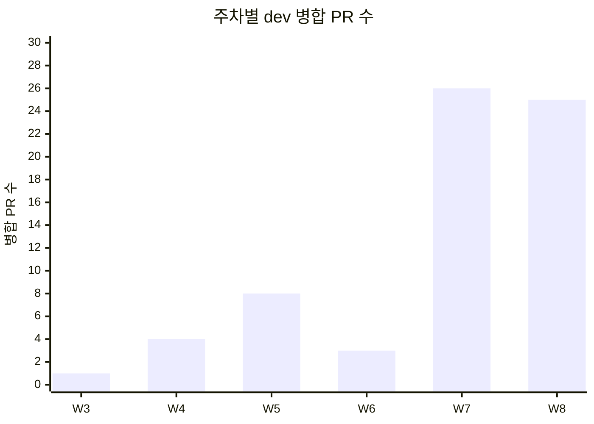
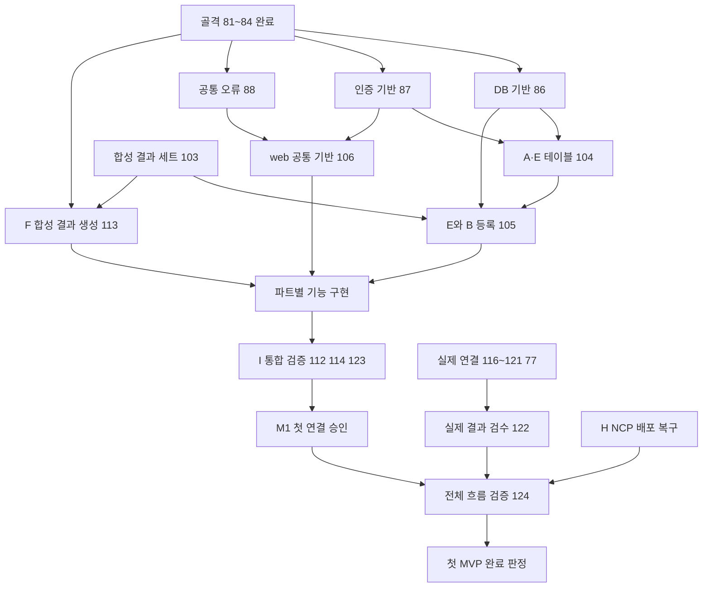

# 진행 현황

| 항목 | 내용 |
|---|---|
| 팀명 | Jaemin_AI |
| 과제명 | 이력서-채용공고 텍스트 매칭 시스템 |
| 서비스명 | CatchU(캐치유) |
| 문서 버전 | v1.0 |
| 작성일 | 2026-09-28 |
| 기준 | origin/dev 9093d2e, GitHub 이슈·PR·Project 조회 2026-09-28 11:47(KST) |
| 문서 지위 | 중간 평가 제출 산출물(진행 기록). AI-DLC 승인 기록이 아니다. 내용마다 승인·팀장 결정·검토초안·제안안·미정을 구분해 적는다 |

## 변경 이력

| 버전 | 일자 | 내용 | 작성 |
|---|---|---|---|
| v1.0 | 2026-09-28 | 최초 작성. WBS 계획과 실제, 마일스톤, 이슈·PR 진척 통계, 역할 분담, 이슈 기록 12건, M01~M07 진행 상황, 남은 기간 계획, 협업 운영 정리. 최종 발표일 확정(12/10)·남은 마일스톤 기한 제안안(8.0절) 반영. 문서 간 정합성 점검으로 7.1절 중간 발표와의 관계에 9/17 목표 변경을 반영 | 팀장(AI 작성 보조) |

## 1. 개요

### 1.1 목적과 기준 시점

이 문서는 CatchU(인공지능사관학교 파이널 프로젝트, 팀 Jaemin_AI)가 2026년 8월 3일 시작부터 **2026년 9월 28일**까지 무엇을 계획했고 실제로 어떻게 진행했는지, 남은 기간에 누가 무엇을 하는지를 정리한다. 9월 28일은 파트별 기능 개발을 시작한 날이며(후속 입력 「팀장 확인 (2026-09-24)」의 "9/28 개발 시작"), 이 문서의 모든 상태는 이날 오전(11:47 KST) 조회한 값이다.

- 시각은 한국 시간(KST)으로 적는다. AI-DLC 감사 기록의 UTC 시각은 9시간을 더해 옮겼다.
- 팀원은 실명으로 적는다. GitHub 이슈·팀 문서의 번호 표기와는 이재민(팀장) = 팀원 1, 이영연 = 팀원 2, 최수영 = 팀원 3, 이채아 = 팀원 4로 대응한다.
- 이슈·PR 번호는 GitHub 저장소 `JminAILab/CatchU`의 번호다. 이슈와 PR은 한 번호 체계를 나눠 쓴다.
- 화면·기능·유스케이스 ID는 공통 ID 대응표(`docs/deliverables/id-registry.md`)를 따른다.
- **AI-DLC 용어:** AI-DLC는 요구사항 → 설계를 정해진 단계로 진행하고, 단계마다 팀장이 승인한 기록(이하 '승인', 도구 용어로 게이트)을 `aidlc/`에 남기는 AI 개발 절차다. intent는 이 절차를 한 번 돌리는 작업 묶음으로, 첫 intent(9/9, 서비스 정의·요구사항)와 두 번째 intent(9/14, 10월 MVP 설계)가 있다. Feasibility(실현 가능성), Scope(범위), Rough Mockups(화면 초안), Approval & Handoff(인계 승인), Practices Discovery(팀 관행 확인)는 두 번째 intent의 단계 이름이다.

### 1.2 자료 출처

| 자료 | 무엇을 확인했나 |
|---|---|
| GitHub 이슈 59건·PR 69건, 마일스톤 「10월 중간 발표 MVP」, Project 「CatchU · 10월 MVP」 | 상태·생성/종료/병합 일시·담당·기능 영역·우선순위, 이슈 본문과 댓글 |
| git 이력(origin/dev 9093d2e) | 커밋 날짜, 코드 파일 구성 |
| AI-DLC 두 intent의 `aidlc-state.md`와 `audit/` | 단계 실행·생략 여부, 게이트 승인 시각 |
| 10월 intent `inception/delivery-planning/` | 첫 연결 순서(bolt-plan), 담당(team-allocation), 위험·선행 조건 |
| `docs/CatchU_그라운드룰_2026-08-04.md`, `docs/CatchU_작업관리.md` | 회의·기록 규칙, 이슈·PR·Projects 흐름, 코딩 운영 결정 |
| 원본 `docs/deliverables/원본/2026-09-04_기획발표/CatchU_기획서_v0_3.docx`, `CatchU_발표슬라이드_재료_v2_4섹션.md` | 9/4 기획발표 때의 원래 WBS와 역할 분담, 발표용 일정표 |

### 1.3 평가 항목과 이 문서의 절

| 평가 항목 | 이 문서의 절 |
|---|---|
| WBS 계획·진척 기록(상주 5) | 2. 전체 일정과 단계, 4. 진척 기록 |
| 역할 분담·이슈 기록(상주 5) | 5. 역할 분담, 6. 이슈 기록 |
| MVP 진행 상황(상주 5, 외부 5) | 7. MVP 진행 상황 |
| 잔여 마일스톤 — 담당·기한(외부 5) | 3. 마일스톤, 8. 남은 기간 계획(8.0 기한 제안안) |

### 1.4 한눈에 보는 현재 상태

- **설계:** 10월 MVP의 AI-DLC 실행 단계 15개(자동 초기화 3단계 포함)가 모두 완료됐고, 그중 승인 대상 12단계가 모두 팀장 승인을 받았다. 마지막 승인은 기능 설계(9/23 17:42)이며, API 명세 v1·ERD v1은 9/24 dev에 반영됐다(PR #89).
- **구현:** web·api·worker 실행 골격(9/23)과 API 인증 기반(9/27, PR #110)이 dev에 있다. 9/28 파트별 기능 개발을 시작했고 분석(F)·통합(I) 이슈 14건(#111~#124)을 등록했다. 회원·분석 요청(A/E), Catch 등록·공개(B), 링크·홈(C/D)의 기능 이슈는 조회 시점에 아직 없다.
- **수치(계산 근거는 4.3절):** 마일스톤 이슈 30건 중 12건 완료(40.0%), 구현 관련 이슈 27건 중 4건 완료(14.8%), M01~M07 구현 완료 0/7.
- **남은 확정 일정:** 중간 발표 10/1~2, 최종 발표 12/10(W19, 9/28 팀장 확정). 최종 발표일은 프로젝트 종료일·NCP 지원 기한과 같은 날이다. 그 사이 마일스톤의 기한은 원천에 없어 8.0절에 제안안(9/28 작성, 팀 합의 전)을 두었다.
- **주요 위험:** 공통 기반(#86 DB, #88 오류 형식)이 병합 전이라 기능 구현 대부분이 대기 중이다. NCP 배포(H)는 착수 전이고 서비스 LLM은 미선정, 큐 기술은 미검증이다. 중간 발표에서 보일 시연 범위는 정해지지 않았다.

## 2. 전체 일정과 단계(WBS)

### 2.1 주차 기준

9/4 기획서 v0.3의 주차 번호를 그대로 쓴다(W1 = 8/3 월요일 시작 주). 프로젝트는 W19 목요일인 12/10(최종 발표·프로젝트 종료일)에 끝난다. W20(12/14 주)은 기획서 v0.3의 원래 최종 발표 주차라 계획 비교용으로만 남긴다.

| 주차 | 기간 | 주차 | 기간 |
|---|---|---|---|
| W1 | 8/3~8/9 | W11 | 10/12~10/18 |
| W2 | 8/10~8/16 | W12 | 10/19~10/25 |
| W3 | 8/17~8/23 | W13 | 10/26~11/1 |
| W4 | 8/24~8/30 | W14 | 11/2~11/8 |
| W5 | 8/31~9/6 | W15 | 11/9~11/15 |
| W6 | 9/7~9/13 | W16 | 11/16~11/22 |
| W7 | 9/14~9/20 | W17 | 11/23~11/29 |
| W8 | 9/21~9/27 | W18 | 11/30~12/6 |
| W9 | 9/28~10/4 | W19 | 12/7~12/10(12/10 종료) |
| W10 | 10/5~10/11 | W20 | 12/14~12/20(v0.3 계획만) |

### 2.2 단계별 계획과 실제

| 단계 | 계획(기획서 v0.3, 9/3 작성) | 실제 | 상태(9/28) |
|---|---|---|---|
| 기획·개편 | 기획·페르소나·그라운드룰 W1~W4, 방향 개편·화면목록·KPI W4~W5 | 그라운드룰 8/4 확정. 8월 마지막 주 방향 전환 합의. 페르소나 신규본·KPI v4.1 초안 9/1~9/3. 개편 전 문서 13개 9/11 삭제 | 완료 |
| PoC | 카드 추출 PoC W2~W4 | 8월 PoC(본인 저장소 3개, 규칙 기반, n=1). 9/14 PoC 1차 분석, 9/16 최소 실험, 9/17 C02·C01 재검증 | 수행 완료. C01 기준 미달 유지(1건 한정 예외), C02 제한 수용(9/22). 상세는 11_시스템구성_기술검토 7절 |
| 기획 발표 | 9/4(W5) | 9/4 발표 | 완료 |
| AI-DLC 요구사항 | 계획에 없음 | 첫 intent 9/9 시작, 9/11 11:23 요구사항 승인 | 완료(승인) |
| 10월 MVP 설계 | 와이어프레임 W5~W7, ERD·API 명세 W6~W7 | 두 번째 intent 9/14 시작, 9/23 17:42 기능 설계까지 승인 대상 12단계 모두 승인. 9/24 API 명세 v1·ERD v1 병합 | 완료(승인) |
| 구현 | 구현 1차 W7~W10, 분석 워커 이식 W7~W10, 구현 2차 W10~W15 | 9/23 골격, 9/27 인증 기반, 9/28 파트별 개발 시작 | 진행 중(착수 단계) |
| 배포 | ECS 배포·CI/CD W10~W11 | 9/13 NCP 수동 배포로 변경. 자동 배포 제외. H 이슈 미등록 | 미착수 |
| 중간 발표 | 기획서 WBS 표에는 없음. 발표자료 일정표는 9/30(W9) | 10/1~2 목표(첫 intent 요구사항 C2, 9/11) | 남음 |
| 측정·사용자 세션 | Ground Truth·baseline W8~W11, 1차 측정 W11~W12, P1 세션 W15~W16 | 10월 intent 밖(사용자 조사 실행·12월 품질 검증 제외). 담당·일정 미배정 | 미정 |
| 12월 확장 | 구현 2차 W10~W15, 통합·QA W17~W18 | 12월 범위 입력 정리(팀장 결정, 미승인 계획). 12월 intent는 요구사항 분석까지 먼저 진행 예정 | 미착수(시점 미정, 제안안은 8.0절) |
| 최종 | 코드 프리즈 W19, 최종 발표 12/18(W20) | 요구사항 C2: 최종 목표 12월 중순. MVP 입력: 12/10 프로젝트 종료일. 검토초안: 최종 완성 목표 12/10 전. 현행 확정: 최종 발표 12/10(W19, 9/28 팀장 확정). 제안: 코드 프리즈 12/4(W18) | 남음(최종 발표 12/10 확정) |

### 2.3 실제 경과 주차표

■ 실제 수행, ▶ 9/28 기준 진행 중, ◆ 날짜가 확정된 발표·승인, ◇ 확정됐지만 아직 오지 않은 날짜. 빈칸은 수행하지 않았거나 시점이 정해지지 않은 칸이다.

| 단계 | W1~W4 8월 | W5 | W6 | W7 | W8 | W9 | 10월 W10~ | 11월 | 12월 | 비고 |
|---|---|---|---|---|---|---|---|---|---|---|
| 기획·페르소나·그라운드룰 | ■ | ■ |  |  |  |  |  |  |  | 그라운드룰 8/4, 페르소나 9/1~9/3 |
| 카드 추출 PoC | ■ |  |  |  |  |  |  |  |  | 본인 저장소 3개, 규칙 기반 |
| 방향 개편·문서 정리 | ■ | ■ | ■ |  |  |  |  |  |  | 9/11 개편 전 문서 삭제(PR #17) |
| 기획 발표 |  | ◆ |  |  |  |  |  |  |  | 9/4 |
| 요구사항(첫 intent) |  |  | ■◆ |  |  |  |  |  |  | 9/9~9/11 승인 |
| 10월 MVP 의도·실현 가능성·범위 |  |  |  | ■◆ | ■◆ |  |  |  |  | 9/14~9/17 승인, 9/22 재승인 |
| PoC 분석·재검증 |  |  |  | ■ | ■ |  |  |  |  | 9/14·9/16·9/17 수행, 9/22 수용 |
| 화면 흐름 초안·와이어프레임 |  |  |  | ■ | ■ | ■ |  |  |  | 9/14 첫 판, 9/23 흑백 통합, 9/28 #55 종료 |
| 요구사항·도메인·계약·기능 설계(10월) |  |  |  |  | ■◆ |  |  |  |  | 9/22 요구사항, 9/23 계약·기능 설계 승인 |
| 9/30 web 모의 시연 계획 |  |  |  | ■ | ■ |  |  |  |  | 9/20 착수, 9/22 목표 종료, 9/24 중단 |
| 코드 골격·공통 기반 |  |  |  |  | ■ | ▶ |  |  |  | 9/23 골격, 9/27 인증, #86·#88 진행 |
| 10월 MVP 기능 구현·통합 |  |  |  |  |  | ▶ |  |  |  | 9/28 시작, 완료 시점 미정(제안: 첫 MVP 완료 11/25, 8.0절) |
| 중간 평가 산출물 |  |  |  |  |  | ▶ |  |  |  | #125~#128 |
| 중간 발표 |  |  |  |  |  | ◇ |  |  |  | 10/1~2 |
| NCP 수동 배포·복구(H) |  |  |  |  |  |  |  |  |  | 이슈 미등록, 시점 미정(제안 11/20, 8.0절) |
| 12월 intent·12월 기능 |  |  |  |  |  |  |  |  |  | 시점 미정(제안: 요구사항 승인 11/6, 기능 개발 11/16~12/4, 8.0절) |
| 프로젝트 종료·NCP 지원 기한 |  |  |  |  |  |  |  |  | ◇ | 12/10 |
| 최종 발표 |  |  |  |  |  |  |  |  | ◇ | 12/10(W19, 9/28 팀장 확정) |

### 2.4 기획서 v0.3의 원래 WBS와 실제 비교

기획서 v0.3의 담당 칸은 9/3 당시 담당을 실명으로 적었다. 영역 이름은 이후의 A~I 영역 코드와 다르다.

| v0.3 항목 | v0.3 담당 | v0.3 계획 | 실제 경과(9/28 기준) | 차이·사유 |
|---|---|---|---|---|
| 기획·페르소나·그라운드룰 | 전원 | W1~W4 | 그라운드룰 8/4 확정. 페르소나 P1~P4 신규본·KPI v4.1 초안 9/1~9/3(PR #9) | 방향 전환에 맞춰 페르소나를 새로 쓰며 W5까지 이어짐 |
| 카드 추출 PoC | 이재민 | W2~W4 | 8월 PoC 수행(본인 저장소 3개, 사건 113건·카드 2장, n=1). 서비스 적용 분석은 9/14(PR #39) | 계획대로. 9/14~9/17 재사용 경계 분석과 재검증이 추가됨 |
| 서비스 방향 개편·화면목록·KPI | 전원 | W4~W5 | 8월 마지막 주 전환 합의. 화면목록 v0.5·KPI v4.1 초안 9/3. 화면목록·설계원칙은 9/11 삭제(PR #17) | 화면·범위 기준을 AI-DLC 승인 요구사항·범위 문서로 대체 |
| 와이어프레임 | 이영연·최수영 | W5~W7 | 흐름 초안 6종 첫 판 9/14~9/15(이영연·최수영·이채아). Rough Mockups 승인 9/21~22. 흑백 통합 v2.2 9/23(최수영). 초안 이슈 종료 9/24~9/28 | 약 1주 늦게 끝남. 9/17 재배분으로 홈·분석 초안이 이채아에서 최수영으로 인계됨 |
| 목업·디자인 시스템 | 이채아 | W5~W7 | 별도 산출물 없음. 10월 intent에서 Refined Mockups 단계를 생략하고 흑백 와이어프레임으로 진행 | 첫 제출에 완성 시각 디자인을 요구하지 않고, 공통 시각 디자인을 이채아 혼자 책임지게 배정하지 않는 안(MVP 입력 §2.5, 9/14 제안) |
| ERD 초안·배포 아키텍처 | 이재민 | W6~W7 | ERD v1 9/23 승인·9/24 병합(PR #89). 공통 아키텍처 검토초안 9/18(PR #70) | ERD는 계획 끝(9/20)보다 3일 늦음. 배포 대상이 AWS에서 NCP로 바뀜(9/13), 인프라 설계 단계는 생략 |
| API 명세·워커 인터페이스 | 이재민 주도, 전원 | W6~W7 | API 명세 v1(worker 메시지 스키마 포함) 9/23 승인, 9/24 병합. 담당별 검토(PR #80·#89) | AI-DLC 도메인·유닛·계약 단계를 거쳐 9/23 완료 |
| 구현 1차 — web·api 기본 동선 | 전원 | W7~W10 | 골격 9/23(PR #90·#94·#95), 인증 기반 9/27(PR #110), 파트별 개발 9/28 시작 | 계획 시작(9/14)보다 골격 기준 9일, 기능 개발 기준 2주 늦음. 9/23 코딩 운영 결정 전까지 설계 승인 진행 |
| 분석 워커 이식(PoC → 서비스) | 이재민 | W7~W10 | 그대로 이식하지 않고 함수별 재사용·재설계 경계를 검토(C03). F 구현 이슈 9/28 등록(#113, #115~#122) | PoC 실행은 서비스 구현으로 세지 않음(첫 intent 요구사항 C5). 과거 실험 자료는 사용 금지 |
| Ground Truth·baseline 스크립트 | 이재민·이채아 | W8~W11 | 착수 안 함 | GT 담당·일정 미배정(KPI v4.1 초안). 12월 품질 검증(NFR3)은 10월 intent 밖 |
| ECS 배포·CI/CD | 이재민 | W10~W11 | NCP 수동 배포로 변경, 자동 배포 제외(M07). CI 도입 시점은 별도 이슈에서 결정. H 이슈 미등록 | 기관 NCP 지원 확보(9/13). 9/28 H는 나중에 진행하기로 함(#24) |
| 1차 측정 → KPI 목표값 확정 | 전원 | W11~W12 | 미정 | KPI v4.1은 초안. 공식 성과지표는 팀장 결정 대기(#125) |
| 구현 2차 — 프리셋·링크 발행·기업 측·렌즈 | 전원 | W10~W15 | 링크 발행은 10월 MVP(M04)로 앞당김. 대표 구성은 첫 MVP 이후(12월 1순위), 기업 계정은 12월 | 10월 범위 문서와 12월 범위 입력으로 재편 |
| P1 세션(수료생 5명) | 최수영·이채아 | W15~W16 | 미정 | 사용자 조사 실행은 10월 intent 밖(MVP 입력 §1) |
| 통합·QA·인젝션 대응·2차 측정 | 전원 | W17~W18 | 10월 MVP 통합 검증 이슈 9/28 등록(#112·#114·#123·#124, 이재민). 12월 통합은 미정 | 통합 검증을 10월 MVP 안으로 앞당김 |
| 코드 프리즈·문서화·발표 준비 | 전원 | W19 | 미정. 제안: 코드 프리즈 12/4(W18), 발표 준비·리허설 12/7~12/9(W19)(8.0절, 팀 합의 전) | 최종 발표가 W19(12/10)로 확정돼 코드 프리즈를 W18로 당겨 제안 |
| 최종 발표 | 이재민 | W20(12/18) | 요구사항 C2: 12월 중순. MVP 입력: 12/10 프로젝트 종료일. 검토초안: 최종 완성 목표 12/10 전. 현행 확정: 12/10(W19, 9/28 팀장 확정) | v0.3 계획보다 8일(W20 → W19) 앞당겨짐. 프로젝트 종료일·NCP 지원 기한과 같은 날로 확정 |
| 중간 발표 | — | 기획서 WBS 표에는 없음. 같은 발표의 슬라이드 일정표에는 9/30(W9) | 10/1~2 목표(9/11 승인 요구사항 C2) | 기획발표 뒤 요구사항에서 10/1~2로 정해짐 |
| (v0.3에 없던 항목) AI-DLC 요구사항·설계 승인 | — | — | 9/9~9/23 | 2.5절 참조 |

### 2.5 계획이 바뀐 이유

원천에 적힌 사유만 옮긴다.

1. **8월 말 방향 전환:** 8월 마지막 주 팀 회의에서 프로젝트를 전환했다(12월 범위 입력 §1, 회의록 없음·9/24 팀장 확인). 개편 전 포지션(채용플랫폼·JD 적합도) 자료와 화면목록이 현행 기획과 섞여 오독이 생겨 9/11에 삭제했다(`docs/README.md` 정리 기록).
2. **AI-DLC 도입(9/9):** 첫 intent의 목적은 "방향과 초기 개발 범위를 정리하고 요구사항을 구체화"하는 것이었다(`docs/ai-dlc/START_AI_DLC.md`). v0.3 WBS에 없던 요구사항·도메인·계약 승인 단계가 9/9~9/23에 들어가 설계 완료가 9/23으로 정해졌다.
3. **배포 대상 변경(9/13):** 소속 기관의 NCP 지원이 확보돼 AWS(ECS·ECR·S3) 검토안을 NCP로 대체했다(MVP 입력 §2.2). 10월은 NCP 서버 수동 배포, 늦어지면 발표 노트북 로컬 실행으로 후퇴한다.
4. **입력 조건 변경으로 승인 단계 재진행(9/22):** C01·C02 재검증 결과 수용과 과거 실험 자료 사본 조건이 단계 진행 중에 바뀌어, 이미 승인한 6단계를 같은 날 두 번 다시 승인했다(6절 I-04).
5. **9/30 모의 시연 중단:** 9/22 팀장 결정으로 별도 web 모의 시연 목표를 종료하고 실제 MVP의 설계·구현·테스트 산출물에 집중했다(PR #76). 9/24 해당 intent를 더 진행하지 않기로 했다(PR #100).
6. **코딩 운영 전환(9/23):** "AI-DLC 절차가 복잡해 진행이 늦어져" 코딩은 이슈 → dev PR 흐름으로 하고 AI-DLC는 계약·마일스톤 기록에 쓰기로 했다(작업관리 §8 결정 이력).
7. **10월 범위 조정:** 대표 구성은 첫 MVP 이후로, 기업 계정·서류·JD 기능은 12월로 두고 사용자 조사 실행·12월 품질 검증은 10월 intent 밖으로 뒀다(10월 범위 문서, MVP 입력 §1).

## 3. 마일스톤

각 행의 담당은 실명, 날짜는 KST다. 10월 intent의 계획 문서는 "승인 소요 시간·실제 완료 날짜는 미정이며 새 기한을 만들지 않는다"고 적었다(external-dependency-map). 원천에 기한이 없는 항목은 8.0절의 기한 제안안(9/28 작성, 팀 합의 전)을 "제안 10/6" 형식으로 적고, 제안안에도 대응 항목이 없으면 "기한 미정"으로 적는다. 제안 기한은 그 계획 문서 밖에서 만든 것이며 승인 기록이 아니다. 남은 마일스톤 전체의 순서와 제안 기한은 8.0절 표에 있다.

### 3.1 완료

| 마일스톤 | 담당 | 완료일 | 근거 | 지위 |
|---|---|---|---|---|
| 그라운드룰 확정 | 전원 | 8/4 | 그라운드룰 문서 | 팀 합의 |
| 카드 추출 PoC(본인 저장소 3개) | 이재민 | 8월(일자 기록 없음) | 기획서 v0.3 §4 | 과거 실험 |
| 기획 발표 | 전원 | 9/4 | 원본 폴더(기획서 v0.3, 발표자료 18장) | 발표 완료 |
| 요구사항 승인(첫 intent, FR45·NFR8·후속 결정 16) | 이재민 진행, 팀 검토 | 9/11 11:23 | 첫 intent 감사 기록, PR #16 | 승인 |
| 스택·배포 대상·분담 원칙 결정 | 이재민 | 9/13 | MVP 입력 §2(PR #18) | 팀장 결정 |
| 10월 MVP 의도 승인 | 이재민 | 9/14 16:18 | 10월 intent 감사 기록, PR #27·#36 | 승인 |
| 화면 흐름 초안 6종 첫 판 | 이영연·최수영·이채아 | 9/14~9/15 | PR #28·#29·#31·#33·#42·#52 | 검토초안 |
| Feasibility 승인 | 이재민 | 9/16 16:28(최종 9/22 20:58) | 감사 기록, PR #58 | 승인 |
| 범위(M01~M07) 승인·담당 재배분 | 이재민, 담당 전원 | 9/17 15:51(최종 9/22 21:25) | 감사 기록, PR #58 | 승인 |
| C02·C01 재검증 제출과 판정 반영 | 이재민 | 9/17 제출, 9/22 반영 | 재검증 문서, 제약 등록부 | 승인. C01은 기준 미달 유지(1건 한정 예외), C02는 제한 수용 |
| Rough Mockups·인계 승인 | 이재민(담당 초안 재사용) | 9/21 23:45·9/22 00:05(최종 21:49·22:04) | 감사 기록 | 승인 |
| 10월 요구사항 최종 승인 | 이재민 | 9/22 23:20 | 감사 기록, PR #68 | 승인 |
| 계약 마일스톤: 도메인·유닛·계약·전달 계획·기능 설계 승인 | 이재민, 담당별 검토 | 9/23 13:40~17:42 | 감사 기록, PR #80 | 승인 |
| web·api·worker 실행 골격 | 최수영·이영연·이재민 | 9/23 | PR #94·#95·#90(이슈 #82·#83·#84) | 병합 |
| API 명세 v1·ERD v1 dev 반영 | 이재민(B 확인은 팀장 결정) | 9/24 20:08 | PR #89·#97 | 승인본 병합 |
| 내 자산 화면 구조·B 계약 결정 | 이재민 | 9/24 | #64, PR #97 | 팀장 결정 |
| 공통 선행 이슈 등록 | 이재민 | 9/24 | #103~#107 | 등록 |
| 화면 초안 이슈 종료 | 이영연·최수영 | 9/24~9/28 | #41·#50(9/24), #22(9/25), #20(9/26), #55(9/28) | 완료(초안) |
| API 인증 기반·개발용 로그인 | 이영연 | 9/27 22:11 | PR #110 | 병합(#87 잔여 있음) |
| 분석(F)·통합(I) 하위 이슈 등록 | 이재민 | 9/28 | #111~#124 | 등록 |

### 3.2 진행 중

| 마일스톤 | 담당 | 현재 상태 | 기한 | 근거 |
|---|---|---|---|---|
| API 오류 응답 공통 형식(#88) | 최수영(검토 예정 이채아) | 브랜치 `api/error-response` 4커밋, api 부분 완료(9/28). 명세 밖 예외 4건 팀장 결정(9/28). PR 전 | 제안 10/6 | #88 댓글 |
| API 인증 기반 잔여(#87) | 이영연 | PR #110 병합. #88 병합 뒤 `AUTH_REQUIRED`·`AUTH_INVALID` 코드 연결 남음 | 제안 10/6 | #87 댓글 |
| DB 연결·마이그레이션 기반(#86) | 이재민 | 범위 확정·선행 해제(9/24). 원격 브랜치·PR 없음, Project 상태 '백로그'(로컬 작업 여부 팀장 확인 필요) | 제안 10/6 | #86 |
| 중간 평가 산출물(#125~#128) | 이재민 | 작성 중 | 9/28(팀장 목표, 이슈 본문에는 기한 없음) | #125 |
| 연결 기준·담당·제약 추적(#23·#24·#37) | 이재민 | #23 검토 요청, #24·#37 진행 중 | 기한 미정 | Project |
| 흑백 와이어프레임 통합(#85) | 최수영(작성자, GitHub 배정 없음) | v2.2 작성(9/23). 마지막 완료 기준 미확인, 결과물은 원격에 게시하지 않음 | 기한 미정 | #85 |

### 3.3 남음

| 마일스톤 | 담당 | 기한 | 선행 |
|---|---|---|---|
| 파트별 기능 개발 이슈 등록(A/E·B·C/D) | 이영연·이채아·최수영 | 제안 9/30. #20·#22 종료 댓글에 "9/28 파트 분할 때 등록"으로 기록 | 분할 기준(PR #108) |
| 공통 선행 구현(#103·#104·#105·#106·#107) | 이재민·이영연·이채아·최수영·이재민 | 제안 10/8(#103·#104), 10/14(#105·#106·#107) | #86·#87·#88 |
| 중간 발표 | 전원 | 10/1~2 | 시연 범위 결정(8.1절) |
| M1 첫 연결 결과 승인 | 이재민 승인, 각 담당 근거 제출 | 제안 10/30. 승인된 계획은 새 기한을 만들지 않음 | 첫 연결 1~3단계(7.4절) |
| 서비스 LLM 선정(#119) | 이재민 | 제안 11/13(실제 연결 묶음 기한). 실제 제공자 연결 전 | — |
| 큐 기술 검증(#77) | 이재민 | 제안 11/13(실제 연결 묶음 기한) | — |
| F 실제 분석 구현·검수(#115~#122) | 이재민 | 제안 11/13(구현), 11/18(검수 #122) | #116, #119 등 이슈별 |
| H NCP 수동 배포·복구 | 이재민 | 제안 11/20. 이슈 미등록 | 배포 대상 서비스 준비 |
| I 통합 검증(#112·#114·#123·#124) | 이재민 | 제안 10/28(#112·#114·#123), 11/25(#124) | 각 기능 이슈 |
| 첫 MVP 완료 판정(M01~M07 전체 증거) | 전원 | 제안 11/25 | #124, H |
| 12월 intent 요구사항 분석 | 이재민 | 제안 11/6 | 12월 범위 입력 |
| v1.0 배포와 테스트 자료 초기화 | 미정(제안안은 전원) | 2026년 11월 구상(확정 아님, MVP 입력 OQ10). 제안 11/25(첫 MVP 완료 판정과 함께) | v1.0 완료 기준 미정 |
| NCP 자료 이전·복구 검증 | 이재민(H) | 12/10 전 | 이전 방안 미정 |
| 프로젝트 종료일 | 전원 | 12/10(MVP 입력 §2.2) | — |
| 최종 발표 | 전원 | 12/10(W19, 9/28 팀장 확정). 승인 요구사항 C2는 '12월 중순'으로 적음 | — |

## 4. 진척 기록

### 4.1 이슈·PR 통계

| 구분 | 전체 | 상태 |
|---|---|---|
| 이슈 | 59건 | 열림 33, 닫힘 26(완료 22, 계획하지 않음 4: #48·#61·#75·#78) |
| PR | 69건 | 병합 67, 병합 없이 닫음 2(#10, #76) |
| 병합 PR 성격 | 67건 | 문서 63, 코드 4(#90 worker 골격, #94 web 골격, #95 api 골격, #110 인증 기반) |
| 마일스톤 「10월 중간 발표 MVP」 | 31건(이슈 30 + PR #39) | 닫힘 13(이슈 12 + PR 1), 열림 18. 마감일 칸은 비어 있음("정확한 마감일·담당은 별도 합의") |
| 9/28 하루 등록 이슈 | 18건 | F·I 하위 #111~#124, 산출물 #125~#128 |

Project 「CatchU · 10월 MVP」에 들어 있는 이슈 55건의 기능 영역별 상태(Project 필드 기준)는 아래와 같다. 구현 이슈는 대부분 '공통·운영·배포'에 있고, 회원·링크·홈 영역에는 아직 초안 이슈만 있다.

| 기능 영역 | 완료 | 검토 요청 | 진행 중 | 준비됨 | 백로그 | 계 |
|---|---|---|---|---|---|---|
| 분석 | 1 | 0 | 0 | 3 | 7 | 11 |
| 회원·자산·대표 | 1 | 0 | 0 | 0 | 0 | 1 |
| 링크·수신자 | 1 | 0 | 0 | 0 | 0 | 1 |
| 홈 | 4 | 0 | 0 | 0 | 0 | 4 |
| 공통·운영·배포 | 12 | 1 | 5 | 2 | 13 | 33 |
| 영역 미지정 | 3 | 0 | 0 | 0 | 2 | 5 |
| 계 | 22 | 1 | 5 | 5 | 22 | 55 |

Project 밖 이슈 4건(#43·#48·#61·#75)은 모두 닫혀 있다. Project '완료' 22건에는 '계획하지 않음'으로 닫은 #78이 포함된다. #88·#87처럼 작업이 진행 중인데 Project 상태가 '백로그'로 남은 이슈가 있어, 실제 진행은 3.2절과 이슈 댓글 기준으로 적었다.

담당자·작성자별 수치는 아래와 같다. 문서 PR은 크기 차이가 커서 PR 수가 작업량을 뜻하지 않는다. 이재민의 PR에는 AI-DLC 기록·규칙 문서가 많다.

| 팀원 | 배정 이슈(열림·닫힘) | 작성·병합 PR |
|---|---|---|
| 이재민 | 37(27·10) | 41 |
| 이영연 | 5(2·3) | 9 |
| 최수영 | 9(2·7) | 11 |
| 이채아 | 2(1·1) | 6 |
| 담당 없음 | 7(1·6) | — |

이슈 #55는 이영연·최수영 공동 배정이라 배정 합계가 이슈 수보다 1 많다.

### 4.2 기간별 병합 수

| 주차 | 기간 | 병합 PR | 작성자별 |
|---|---|---|---|
| W3 | 8/17~8/23 | 1 | 이재민: 1 |
| W4 | 8/24~8/30 | 4 | 이재민: 4 |
| W5 | 8/31~9/6 | 8 | 이재민: 3, 이영연: 1, 최수영: 3, 이채아: 1 |
| W6 | 9/7~9/13 | 3 | 이재민: 3 |
| W7 | 9/14~9/20 | 26 | 이재민: 13, 이영연: 4, 최수영: 4, 이채아: 5 |
| W8 | 9/21~9/27 | 25 | 이재민: 17, 이영연: 4, 최수영: 4 |
| 계 |  | 67 |  |

저장소는 8/18에 만들었고(첫 커밋), W1~W2에는 PR이 없다. W9(9/28~)는 조회 시점까지 병합 0건이다. 코드 PR 4건은 모두 W8에 병합됐다.

그림 1. 주차별 dev 병합 PR 수(KST 기준, W3 8/17 주 ~ W8 9/21 주)

### 4.3 진척률 계산

진척률은 하나로 합치지 않고 기준마다 따로 적는다. 분모에 들어가지 않은 작업이 있으므로 숫자만 떼어 읽지 않는다.

| 기준 | 계산 | 값 | 읽는 법 |
|---|---|---|---|
| 10월 intent 설계 단계 승인 | 승인 12 ÷ 승인 대상 12(실행 단계 15 중 자동 초기화 3 제외, `aidlc-state.md`·감사 기록) | 100% | 생략한 18단계(코드 생성·빌드·CI·배포 등)는 분모에 없음 |
| 마일스톤 이슈 완료 | 닫힌 이슈 12 ÷ 마일스톤 이슈 30 | 40.0% | 아래 두 줄로 나눠 읽는다 |
| 마일스톤 중 설계·초안 이슈 | 12 ÷ 16(#19~#64, #77) | 75.0% | 열린 것: #23·#24·#37·#77 |
| 마일스톤 중 구현·통합 이슈 | 0 ÷ 14(#111~#124, 9/28 등록) | 0% | 등록 당일 |
| 구현 관련 이슈 완료 | 닫힌 4 ÷ 27 | 14.8% | 골격 #81~#84(4, 완료), 공통 기반 #86~#88·#103~#107(8), F #111·#113·#115~#122(10), I #112·#114·#123·#124(4), 큐 #77(1). A/E·B·C/D 기능 이슈는 미등록이라 분모에 없으므로 실제 남은 양은 더 크다. #87은 PR이 병합됐지만 잔여 항목이 있어 열림으로 셈 |
| M01~M07 구현 완료 | 완료 0 ÷ 7 | 0% | 7.2절 |

### 4.4 주요 산출물 타임라인

| 날짜 | 산출물·사건 | 담당 | 근거 | 지위 |
|---|---|---|---|---|
| 8/4 | 그라운드룰 확정 | 전원 | 그라운드룰 문서 | 팀 합의 |
| 8월 | 카드 추출 PoC(본인 저장소 3개, 사건 113건, 카드 2장) | 이재민 | 기획서 v0.3 §4 | 과거 실험(레포 밖) |
| 8/18~8/21 | 저장소 뼈대·팀 공유 문서 초기 배치 | 이재민 | 첫 커밋 8/18, PR #1 | — |
| 8/25 | 취준생 기능명세·기능목록 v0.2 | 이재민 | PR #5 | 개편 전(9/11 삭제) |
| 9/1 | 채용·경쟁사·JD 적합도 조사 보고서 | 최수영·이채아·이영연 | PR #6·#7·#8 | 개편 전 조사(9/11 삭제) |
| 9/3~9/4 | 페르소나 P1~P4 신규본, KPI v4.1 초안과 표기 정리 | 최수영 | PR #9(9/3)·#14(9/4) | 초안 |
| 9/3 | 화면목록 v0.5 | 이재민 | PR #12 | 9/11 삭제 |
| 9/4 | 기획 발표(기획서 v0.3, 발표자료 18장) | 전원 | 원본 폴더 | 발표 |
| 9/11 | 첫 intent 요구사항 승인, 개편 전 문서 13개 삭제 | 이재민 | PR #16·#17 | 승인 |
| 9/13~9/14 | 스택·NCP·분담 원칙 결정, 10월 MVP 입력 | 이재민 | PR #18 | 팀장 결정 |
| 9/14 | 10월 MVP intent 시작·진행 계획, 의도 승인(16:18) | 이재민 | PR #27, 이슈 #26 | 승인 |
| 9/14~9/15 | 화면 흐름 초안 6종: 홈(#28), 회원·자산(#29), 저장소 선택·동의(#31), 공유 링크(#33), 분석 진행(#42), 분석 실패·재요청(#52) | 이채아·이영연·이채아·최수영·이채아·이채아 | 이슈 #20·#21·#22·#30·#41·#50 | 검토초안 |
| 9/14 | PoC 1차 분석 보고서 | 이재민 | PR #39(#19) | 입력 자료 |
| 9/15 | 12월 목표 누락 기능 팀장 결정 | 이재민 | PR #53 | 팀장 결정 |
| 9/16 | Feasibility 승인(최소 실험 9/16) | 이재민 | 감사 기록 | 승인 |
| 9/17 | 범위 M01~M07 승인, 담당 재배분, C02·C01 재검증 제출 | 이재민 | PR #58, #37 | 승인 |
| 9/18 | 공통 아키텍처 검토초안 | 이재민 | PR #70(9/22 병합) | 검토초안 |
| 9/21~9/22 | 화면 초안·인계·팀 관행 확인·10월 요구사항 승인(9/22 재승인 포함) | 이재민 | 감사 기록, PR #68 | 승인 |
| 9/23 | 도메인~기능 설계 승인(API 명세 v1·ERD v1) | 이재민, 담당별 검토 | 감사 기록, PR #80 | 승인 |
| 9/23 | web·api·worker 골격 | 최수영·이영연·이재민 | PR #94·#95·#90 | 병합 |
| 9/23 | 흑백 와이어프레임 v2.2(19개 화면 유형·183개 상태) | 최수영 | #85, 원본 zip | 검토초안 |
| 9/24 | API 명세 v1·ERD v1 병합, B 계약·내 자산 화면 구조 결정 | 이재민 | PR #89·#97, #64 | 승인·팀장 결정 |
| 9/24 | 공통 선행 이슈 등록, 코딩 AI-DLC 사용 담당자 선택, 모의 시연 중단 표시 | 이재민 | #103~#107, PR #99·#100 | 팀장 결정 |
| 9/24~9/25 | 12월 범위 입력 보완, AI 하위 이슈 분할 기준 | 이재민 | PR #98·#101·#109, PR #108 | 팀장 결정 |
| 9/27 | API 인증 기반·개발용 로그인(테스트 17건 통과) | 이영연 | PR #110(#87) | 병합 |
| 9/28 | F·I 하위 이슈 14건 등록, 중간 평가 산출물 착수 | 이재민 | #111~#128 | 등록 |
| 9/28 | 공통 오류 형식 api 부분 커밋 | 최수영 | #88 | 진행 중 |

## 5. 역할 분담

### 5.1 담당의 변화

A~I는 회의에서 나눈 영역이며 AI-DLC Unit(web·api·worker)과 1:1로 대응하지 않는다. A 회원·프로필·GitHub 연동, B Catch 등록·확인·공개, C 공유 링크·수신자 열람, D 본인 홈·저장소 연결 관리, E 분석 요청·동의·진행·반영, F 분석 결과 생성(worker), G 내부 품질·운영(10월 제외), H NCP 환경·수동 배포·복구, I 계약 취합·통합 검증이다.

| 시점 | 이재민(팀장) | 이영연 | 최수영 | 이채아 | 근거 |
|---|---|---|---|---|---|
| 9/3 기획서 v0.3 | 백엔드(NestJS·FastAPI)·인프라·기획 총괄. ERD·배포·API 명세·카드 추출 파이프라인·Ground Truth | 프론트엔드 주. 와이어프레임, 구직자 화면. 부: 구직자 도메인 API | 프론트엔드 주. 와이어프레임, 기업·운영 화면, P1 세션. 부: 기업 도메인 API | 프론트엔드 주. 목업·디자인 시스템, 프리셋·링크 발행 화면, GT 판정 1인, P1 세션. 부: 프리셋·링크 API, baseline | 원본 기획서 v0.3 §7 |
| 9/14 제안 | AI-DLC 공통 조율, PoC 분석, 분석 서버 처리 | 회원·기본 프로필, 내 자산·대표 프리셋 | 공유 링크 발행·관리, 수신자 열람 | 서비스 홈, 분석 화면 프론트엔드 | MVP 입력 §2.5(제안) |
| 9/17 재배분 | F·H·I | A·E | C·D(홈·분석 초안을 이채아에게서 인계) | B 조건부(담당 확정 대기) | 범위 문서, 9/17 첫 작업 안내 |
| 9/21~9/23 확정 | F·H·I, #86 DB | A·E, #87 인증 | C·D, #88 공통 오류 | B 확정 | 인계 결정 D08, team-allocation |
| 9/24 보정 | — | 분석·저장소 API와 상태 의미, GitHub 연동 화면 | D를 '본인 홈·저장소 연결 관리'로 정정. 연결 관리 영역·모달(SCR_ASSET_03) | 내 자산 틀·탭 머리, 저장소 필터·Catch 목록(SCR_ASSET_01), Catch 상세 모달(SCR_ASSET_04) | 후속 입력 9/24 절, delivery-planning 9/24 정정 |

### 5.2 팀원별 담당·산출물·주요 이슈

| 팀원 | 현재 담당 | 주요 산출물(병합 PR) | 진행·남은 이슈 |
|---|---|---|---|
| 이재민(팀장) | F·H·I, #86 DB, AI-DLC 공통 조율 | PoC 1차 보고서(#39). 두 intent 기록·승인 공유(#27·#36·#58·#68·#80·#89). 공통 아키텍처 검토초안(#70). 12월 범위 입력(#53·#98·#101·#109). 작업관리·규칙(#18·#25·#47·#66·#72·#92·#93·#99·#108). worker 골격(#90). 9/24 결정 기록(#97·#100) | #86·#103·#107, F #111·#113·#115~#122, I #112·#114·#123·#124, #23·#24·#37·#77, 산출물 #125~#128 |
| 이영연 | A·E, #87 인증 | 회원·자산 흐름 초안 v0.1~v0.10(#29·#32·#45·#54·#79·#102). api 골격(#95). API 인증 기반·개발용 로그인(#110). JD 적합도 벤치마킹(#8, 개편 전) | #87 잔여, #104, A·E 기능 이슈(미등록) |
| 최수영 | C·D, #88 공통 오류 | 공유 링크 흐름·관리 초안(#33·#38·#57), 링크 정보·판단 조건(#67), 9/16 회의 결정(#62), PR 규칙(#63), 홈·분석 인계(#71), web 골격(#94), 페르소나 P1~P4·KPI v4.1 초안(#9·#14), 경력직 채용 조사(#6). 흑백 와이어프레임 v2.2(#85, 원격 게시 없음) | #88 진행, #106, C·D 기능 이슈(미등록) |
| 이채아 | B | 서비스 홈 흐름 초안(#28·#44), 저장소 선택·분석 동의 초안(#31), 분석 진행 초안(#42), 분석 실패·재요청 초안(#52), ATS 경쟁사 분석(#7, 개편 전) | #105, B 기능 이슈(미등록) |

각 영역의 설계·구현·테스트와 PR 설명은 해당 담당이 책임진다. D나 I가 모든 화면·업무 시험을 대신하지 않는다(team-allocation). 공통 기반은 이재민(#86)·이영연(#87)·최수영(#88)이 나눠 맡았다.

### 5.3 공통·미배정 책임

- **운영 담당:** 오류·AI 호출량·비용 확인과 신규 분석·AI 호출 중단·재개의 운영 담당은 미정이다(MVP 입력 §2.4). 해당 운영 화면(G)은 10월에서 제외했다.
- **원본 상태 관측(OQ-B3):** A·B·F·H 사이의 실행 책임·주기·오류 처리는 #23에서 조율하며 F·I가 자동으로 전담하지 않는다(#24).
- **H 후속 작업:** NCP 배포·복구의 하위 이슈는 등록하지 않았다(9/28, #24).
- **지원·가용량:** 추가 인력·가용량·완료 날짜·지원 분담은 확정하지 않았다(team-allocation).

## 6. 이슈 기록

팀 수준에서 일정·범위·담당에 영향을 준 문제 12건이다. 상태는 9/28 기준이다.

| ID | 시기 | 이슈 | 상태 | 관련 |
|---|---|---|---|---|
| I-01 | 8월 말~9/11 | 방향 전환과 개편 전 문서 혼재 | 해결 | PR #9·#15·#17·#98 |
| I-02 | 9/15 | 첫 intent 요구사항에서 12월 목표 기능 누락 | 12월 입력 정리 완료, 요구사항 분석 남음 | PR #53·#98·#101·#109 |
| I-03 | 9/17~9/24 | B 담당 공백과 확정, B 검토 이연 | 해결(구현 남음) | PR #80·#89·#97, #105 |
| I-04 | 9/22 | 입력 조건 변경으로 승인 단계 재진행 | 해결 | 감사 기록, PR #68·#80, #37 |
| I-05 | 9/17~9/22 | 근거 기반 초안 재검증 기준 미달(C01)·제한 수용(C02) | 조건 유지 | #37, #119, #122 |
| I-06 | 9/20~9/24 | 9/30 web 모의 시연 계획과 중단 | 해결(중단 확정) | PR #74·#76·#100, #75·#78 |
| I-07 | 9/23 | AI-DLC 절차 부담과 코딩 착수 지연 | 해결 | PR #72·#92·#99 |
| I-08 | 9/16~9/24 | 분석 화면 단위·내 자산 구조 미합의 | 해결 | #64, PR #97 |
| I-09 | 9/24 | 공통 선행 작업의 이슈 누락 | 등록 완료, 구현 남음 | #103~#107, #86·#88 |
| I-10 | 9/18~ | 큐 기술(BullMQ) 미검증 | 미해결(보류) | #77, #103 |
| I-11 | 9/15~9/28 | PR·이슈 본문 가독성 | 규칙 반영, #91 종료(9/28) | #43·#65·#91, PR #47·#66·#93 |
| I-12 | 9/13~ | NCP 배포(H) 착수 지연과 계정 기간 | 미해결(위험) | #24, #107 |

#### I-01 방향 전환과 개편 전 문서 혼재

- **문제:** 8월 마지막 주 팀 회의에서 서비스 방향을 전환했지만, 개편 전 포지션(채용플랫폼·JD 적합도) 조사 자료와 화면목록·설계원칙·기능명세가 저장소에 남아 현행 기획과 섞였다.
- **원인:** 전환 합의의 회의록이 없었고(12월 범위 입력 §1), 개편 전후 문서가 같은 폴더에 있어 사람과 AI 에이전트가 오독했다(`docs/README.md` 정리 기록).
- **대응:** 9/2~9/3 개편 전 문서를 보관 폴더로 옮겼고, 보관 문서 참조를 정리한 뒤(PR #15) 9/11 개편 전 문서 13개를 삭제하고 현행 기준을 승인 요구사항으로 지정했다(PR #17). 8월 합의 내용은 9/24 팀장 인터뷰로 확인해 12월 범위 입력에 '[8월]' 출처로 남겼다(PR #98).
- **결과:** 해결. 판본은 git 이력에 남아 있다.

#### I-02 첫 intent 요구사항에서 12월 목표 기능 누락

- **문제:** 9/15, 첫 intent의 참고 원문(v10 기획 문서)에서 '포함'이던 팔로우·포스팅·피드·구직자 간 DM, 알림·MCP·채용공고 등이 승인 요구사항의 12월 항목에 없음을 확인했다.
- **원인:** AI-DLC 시작 설명의 "링크드인이라는 비유만으로 소셜 기능 전체를 추가하지 않는다"는 기준이 의도 정리·범위 정의를 거쳐 "제품 범위 밖·자동 확대 금지"로 굳었고, 네 기능을 12월 항목으로 따로 묻는 질문이 없었다. 알림·MCP·공고는 입력 문서가 "우선순위 검토"로 넘겼으나 첫 intent에서 다루지 않았다(12월 범위 입력 §1).
- **대응:** 승인 기록을 소급 수정하지 않고, 팀장 결정을 12월 범위 입력으로 기록했다(9/15 PR #53, 9/24~25 PR #98·#101·#109). 10월 설계에는 그 문서의 §4 제약만 적용한다.
- **결과:** 12월 계획 입력 정리 완료(미승인). 키워드 대조로 찾았으므로 다른 표현으로 들어간 항목은 빠졌을 수 있다고 문서 스스로 밝혔다. 12월 intent 요구사항 분석은 시작 전이다.

#### I-03 B 담당 공백과 확정, B 검토 이연

- **문제:** 9/17 범위 문서에서 B(Catch 등록·확인·공개)는 "담당 확정 대기, 수행 불가 시 대안 있음"이었다. 대안은 이재민이 B를 맡는 것이어서 F·H·I와 겹치는 집중 위험이 있었다.
- **원인:** 9/17 재배분에서 이영연가 A·E를 맡으면서 기존 회원·자산 초안의 B 부분(W03~W05)이 인계 대상으로 남았고, B를 맡을 이채아의 참여 일정·가용량이 그 시점에 확인되지 않았다(범위 문서 「담당·의존성과 일정 위험」).
- **대응:** Approval & Handoff(9/22 00:05 승인)의 결정 D08에서 이채아의 B를 확정했다. 9/23 도메인 검토(PR #80)에는 이채아가 참여하지 못해 B 검토를 PR #89 병합 전 필수 항목으로 미뤘다. 9/24 팀장이 이 B 확인을 직접 맡아 B 계약(Catch 제목, 공개·미공개 두 상태, 등록과 반영 완료의 한 트랜잭션, `repositoryId`)을 정하고(PR #97, 후속 입력 9/24 절) PR #89를 병합했다.
- **결과:** 담당·계약은 해결. B 기능 이슈 등록과 구현(#105 포함)은 남아 있다.

#### I-04 입력 조건 변경으로 승인 단계 재진행

- **문제:** 9/22 하루에 게이트 승인이 15건 기록됐고, 그중 12건은 이미 승인한 6단계(Feasibility·Scope·Rough Mockups·Approval & Handoff·Practices Discovery·Requirements Analysis)를 두 번 다시 승인한 것이다(14:41~17:45, 20:58~23:20).
- **원인:** 단계 진행 중에 입력 조건이 바뀌었다. 첫 번째는 9/17 C02·C01 재검증 결과의 수용(C01 한 건 한정 예외, C02 제한 수용), 두 번째는 과거 실험 자료 사본의 처리 조건 반영이다.
- **대응:** 변경 전 판본을 `archive/`에 보존하고 단계마다 수정본을 다시 승인했다. 자료 사용은 과거 실험 자료 사용(금지)·과거 자료에 의존하지 않는 새 구현(허용)·새 실제 자료 처리(기존 조건 적용)로 나눴다(10월 요구사항). 12월 intent에서는 요구사항 분석 중 입력 문서를 고치지 않고 새 결정을 질문 답변으로 남기기로 했다(12월 범위 입력 §5).
- **결과:** 해결. 10월 요구사항은 9/22 23:20에 최종 승인됐고 다음 날 계약 마일스톤으로 이어졌다.

#### I-05 근거 기반 초안 재검증 기준 미달·제한 수용

- **문제:** 9/17 재검증에서 C01(근거 기반 짧은 초안)은 문맥 줄 오귀속 1건으로 기준 미달, C02(후보 확보·설명 제한)는 제한 수용으로 판정됐다(제약 등록부).
- **원인:** 재검증 사례 가운데 한 건에서 문맥 줄이 잘못 귀속됐다. 세부 결과는 11_시스템구성_기술검토 7.7절에 있다.
- **대응:** 9/22 Feasibility에서 해당 한 건만 추가 튜닝·재호출의 선행 사유에서 빼는 한정 예외를 승인하고 원래 기준은 유지했다. 추가 실험 호출은 허용하지 않았다. 서비스 LLM은 미선정 상태로 두고 제공자 비종속 인터페이스와 가짜 생성기로 개발한다(코딩 운영). 실제 서비스 결과의 근거·귀속 검수는 #122, 모델 선정은 #119로 등록했다.
- **결과:** 조건 유지(미해결 조건을 해결로 표시하지 않음).

#### I-06 9/30 web 모의 시연 계획과 중단

- **문제:** 9/20~9/21 합성 자료로 9/30 web 모의 시연을 계획하고 착수 안내(PR #74, 9/22 병합)와 시연 구성·골격 이슈(#75·#78)를 만들었다. 실제 MVP와 별도의 준비 작업이 생겼다.
- **원인:** 9/22 팀장 결정으로 방향을 바꿔 실제 MVP의 설계·구현·테스트 산출물에 집중하기로 했다(PR #76 종료 사유).
- **대응:** 9/22 시연 목표를 종료하고 PR #76을 병합하지 않고 닫았으며 #75·#78을 '계획하지 않음'으로 닫았다. 9/24 해당 intent를 더 진행하지 않기로 하고 관련 문서에 중단 지위를 표시했다(PR #100). 문서·커밋·브랜치는 보존하고, 필요한 화면·모의 데이터는 담당자가 검토해 재사용한다.
- **결과:** 해결(중단 확정). 기존 문서가 현행 착수 기준으로 읽히지 않게 됐다.

#### I-07 AI-DLC 절차 부담과 코딩 착수 지연

- **문제:** 기획서 v0.3은 구현 1차를 9/14(W7)에 시작하도록 계획했지만, 9/23까지 설계 승인 절차가 이어져 코드가 없었다.
- **원인:** "AI-DLC 절차가 복잡해 진행이 늦어져"(작업관리 §8 결정 이력, 9/23).
- **대응:** 9/23 팀장 결정으로 코딩은 이슈 → `영역/작업내용` 브랜치 → dev PR → 작성자 외 승인 1건 → merge commit으로 진행하고, AI-DLC는 요구사항·설계·계약의 승인 원본과 마일스톤 기록에만 쓴다(PR #72·#92, 작업관리 §7). 10월 intent는 Minimal 깊이로 NFR·인프라 설계·코드 생성·빌드·CI·배포 단계를 생략했다. 80% 커버리지·머지 전 CI는 CI 도입 전까지 머지 조건이 아니다. 9/24 코딩에 AI-DLC를 쓸지는 담당자가 정하도록 바꿨다(PR #99).
- **결과:** 해결. 같은 날 골격 3종이 병합됐고 9/27 인증 기반이 병합됐다.

#### I-08 분석 화면 단위·내 자산 구조 미합의

- **문제:** 9/16 #64를 열었지만, 분석 화면을 별도 화면으로 둘지 자산 GitHub 탭 안에 둘지 합의되지 않아 D·B·A/E의 화면 경계가 정해지지 않았다.
- **원인:** 9/17 재배분으로 홈·분석 초안의 원작성자와 D 담당이 달라졌고, B 경계가 미확정이었다(9/17 첫 작업 안내 "#64의 탭 안/별도 화면은 D 제안과 B 경계 미결").
- **대응:** 9/24 팀장 결정. 내 자산은 Catch 탭 하나(SCR_ASSET_01)와 저장소 연결 관리 모달(SCR_ASSET_03), Catch 상세 모달(SCR_ASSET_04)로 구성하고 별도 분석 상태·실패 화면(A-02·A-03)과 분석별 결과 목록(W03-R)을 없앴다. 담당과 만나는 곳 세 곳을 정했다(PR #97, web 기능 설계 「내 자산 화면 구조」).
- **결과:** 해결. 기존 초안(#85 통합본, 회원·자산 v0.10, #41·#50)은 입력 자료로 남고, 새 구조 반영은 각 개발 이슈에서 한다.

#### I-09 공통 선행 작업의 이슈 누락

- **문제:** 9/24 파트 분할 전 점검에서, 승인된 계약·첫 연결 계획에 있는 공통 작업이 어느 이슈에도 없음을 발견했다. M1 합성 결과 전달 대역, E↔B 등록 함수·테이블 생성 순서, A·E 선행 테이블과 멱등 처리, web 공통 기반, 로컬 통합 실행, 전역 `/v1` 경로·`no-store`, DB 물리 규약·테스트 DB가 해당한다.
- **원인:** API 명세 v1은 등록 함수를 "E↔B 등록 개발 이슈"에서 정한다고 적었는데 그 이슈가 없었다(#105). 전역 설정도 "병합된 API 명세 v1에 있지만 main.ts와 기존 이슈에는 없었다"(#88 댓글). 계약이 후속 이슈로 넘긴 항목을 이슈로 옮기는 단계가 따로 없었다.
- **대응:** 9/24 #103~#107을 등록하고 #86(DB 물리 규약·테스트 DB)과 #88(`/v1`·`no-store`)의 범위를 넓혔다.
- **결과:** 등록 완료. 다섯 이슈 모두 구현 전이다.

#### I-10 큐 기술(BullMQ) 미검증

- **문제:** api(Node)와 worker(Python) 사이 요청·결과 큐로 BullMQ를 검토했지만 양쪽 호환성, 중복 전달 시 LLM 재호출 방지, worker 중단 시 자동 재실행 방지, NCP 관리형 서비스 제약이 확인되지 않았다.
- **원인:** 공통 아키텍처 검토초안 §5가 최종 선정을 검증 뒤로 뒀고, PR #70 리뷰에서 이영연가 같은 질문을 했다.
- **대응:** 9/22 #77을 등록했다. 검증 전에는 BullMQ를 연결하지 않고 뼈대에 헬스체크만 둔다(코딩 운영). 첫 연결은 api 안 주입 방식의 합성 결과 대역으로 우회한다(#103).
- **결과:** 미해결(백로그, P2). 실제 전송을 포함한 전체 흐름 검증(#124)의 선행이다.

#### I-11 PR·이슈 본문 가독성

- **문제:** 결론과 리뷰 요청을 찾으려면 PR 본문을 끝까지 읽어야 했고(PR #33·#36·#38·#39), 이슈 상단만으로는 무엇을 만드는지 알기 어려웠다. 9/23에도 요약이 문단이 되고 ID가 반복돼 리뷰어가 요약만으로 판단을 시작하지 못했다(#91, PR #74 리뷰).
- **원인:** 분량이 아니라 배치·중복·경과 누적(작업관리 §8, 9/16 기록).
- **대응:** 9/15 회의 가결로 PR 본문을 결론 우선 구조로 바꾸고(#43, PR #47), 9/16 이슈 본문을 결론 우선으로 바꿨다(#65, PR #66). 9/23 요약 기준 문장을 결론 한 문장·리뷰어별 질문·ID 풀어 쓰기로 교체했다(#91, PR #93).
- **결과:** 규칙 반영 완료. 병합 뒤 후속 PR 계량을 위해 열어 두었던 #91은 9/28 닫혔다.

#### I-12 NCP 배포(H) 착수 지연과 계정 기간

- **문제:** 10월 완료 기준은 NCP 실제 환경에서 선정 저장소 분석부터 비로그인 열람까지 완주하는 것인데(마일스톤 설명, MVP 입력 §1), 9/28 기준 H 하위 이슈가 없고 착수 전이다.
- **원인:** 9/28 "H 환경·NCP 배포/복구는 사용자가 나중에 진행하기로 한 범위"로 정했다(#24). 9/20 사용자 방향은 핵심 기능 개발 우선이다(작업관리 §7).
- **대응:** 배포 준비가 늦어지면 발표 노트북 로컬 실행으로 후퇴하되 로컬 시연 성공을 NCP 배포 완료로 계산하지 않는다(MVP 입력 §1·§2.2). 로컬 통합 실행 안내(#107)를 등록했다. NCP 계정은 12/10까지이므로 종료 전에 자료 이전·복구 검증 시간을 확보해야 한다(공통 아키텍처 검토초안 §8).
- **결과:** 미해결. 8.4절 위험으로 추적한다.

## 7. MVP 진행 상황

### 7.1 10월 MVP의 범위와 완료 기준

- **범위:** 승인된 10월 범위 M01~M07(10월 범위 문서, 9/22 최종 승인). 공통 ID 기준 10월 기능 요구사항은 19개(승인 17 + 9/24 팀장 결정 2), 10월 화면은 21개다(id-registry 3절·8절).
- **완료 기준:** 첫 MVP 완료는 M01~M07 전체의 실제 흐름·거부/실패·보호·배포/복구 증거를 요구한다. 기능 일부 성공·PR 승인·보드 완료 중 어느 하나도 전체 완료를 뜻하지 않는다(범위 문서 「완료 판정」).
- **중간 발표와의 관계:** GitHub 마일스톤 설명과 MVP 입력(9/13, §1)은 10/1~2 중간 발표에서 NCP 실제 환경 완주를 목표로 적었다. 그 뒤 9/17 목표 변경(10월 intent 범위 정의 질문 기록 「목표 변경 확정」)으로 발표 준비와 10/1~2 기존 기능 전체 완성은 일정의 필수 조건에서 빠졌고, 10월 초 MVP 목표와 핵심 흐름 우선만 남았다. 따라서 중간 발표는 MVP 완료 시점이 아니며, 첫 MVP 완료 판정 기한은 8.0절 제안안(11/25, 팀 합의 전)에 두었다. 발표 노트북 로컬 실행은 발표를 위한 대안이며, 충족하지 못한 조건은 미완료로 기록한다(MVP 입력 §1).

### 7.2 M01~M07별 진행

범위 칸 아래 줄은 공통 ID 대응표의 관련 요구사항 ID다. 10월 기능 요구사항 19개, 비기능 요구사항 8개(미정 자리 NFR-PER-01 포함), 화면 21개가 모두 한 번 이상 들어가도록 적었다. 설계 칸의 '승인'은 10월 요구사항(9/22)·계약과 기능 설계(9/23)의 승인이다. 구현 이슈의 '미등록'은 9/28 조회 시점에 해당 기능 이슈가 없다는 뜻이다.

| ID | 범위 요약 | 담당 | 설계 | 화면(공통 ID) | 구현 이슈·코드 | 상태(9/28) |
|---|---|---|---|---|---|---|
| M01 | 로그인·프로필·GitHub 연동, 저장소 선택·별도 동의 FR-MEM-01~03, FR-ANL-01 | A·E 이영연, D 최수영 | 승인 | SCR_COMMON_01·02, SCR_AUTH_01·02, SCR_PROF_01~04, SCR_HOME_01·02, SCR_ASSET_01(연결 관리 영역), SCR_ASSET_03 | #87 인증 기반(PR #110 병합: Access JWT Guard·개발용 로그인), #104 회원 행·분석 요청 테이블(백로그), #106 web 개발용 로그인 진입(백로그). 실제 Google 로그인·GitHub 연동은 미등록(OQ-A1 미결) | 공통 기반 일부 구현 |
| M02 | 실제 분석·후보·근거·짧은 초안·최소 질문 FR-ANL-01, FR-GEN-01~03 | F 이재민, E 이영연(저장 B 이채아) | 승인 | SCR_ASSET_03(상태), SCR_ASSET_04(결과) | worker 골격(헬스체크)만 있음. F 하위 #113·#115~#122와 #103 합성 결과 세트 9/28 등록, 서비스 LLM 미선정(#119). E 요청 접수·결과 수신 이슈 미등록 | 미착수(이슈 등록) |
| M03 | 최소 B: 본인 목록·상세·확인·개별 공개/숨김·불일치 표시(9/24 결정으로 상태는 공개·미공개 두 가지) FR-CAT-01~03, FR-GEN-03, FR-LNK-02·03 | B 이채아 | 승인, 9/24 B 계약 결정(팀장 결정) | SCR_ASSET_01, SCR_ASSET_02(준비 중 탭), SCR_ASSET_04 | #105 E↔B 등록(백로그). B 목록·상세·공개 이슈 미등록 | 미착수 |
| M04 | 대표 없는 링크 발행, 비로그인 열람 FR-LNK-01~07, FR-MEM-03, FR-CAT-02 | C 최수영 | 승인 | SCR_LINK_01~04, SCR_VIEW_01~03 | C 기능 이슈 미등록. 화면 통합 검증 #123(백로그) | 미착수 |
| M05 | 진행/실패·명시 재요청·중복 방지·자료 보존, 원본 비공개 대응 FR-ANL-02·03, NFR-REL-01 | E 이영연, D 최수영, F 이재민, B 이채아 | 승인 | SCR_ASSET_03(상태 아이콘·재요청), SCR_VIEW_03(보호 상태) | #104 Idempotency-Key, #103 실패·중복 합성 사례, #111 작업 동일성, #105 중복 등록 방지(모두 열림) | 미착수(설계·일부 이슈) |
| M06 | 권한·동의·최소화·비밀값·상한, 빈/로딩/실패/권한 안내·접근성 NFR-SEC-01, NFR-PRV-01·02, NFR-COS-01, NFR-ACC-01, NFR-PER-01(수치 미정, OQ14) | 각 담당 | 승인 | 전 화면 공통 상태 | #87 Guard(병합), #88 공통 오류 형식(브랜치 진행), #116 수집 통제 설계(준비됨) | 공통 기반 진행 중 |
| M07 | NCP 수동 배포·외부 URL·영속/복구·통합/재시험·PR 빌드/시험 NFR-REL-01, NFR-OBS-01, NFR-ACC-01, NFR-PER-01(수치 미정, OQ14) | H·I 이재민, 각 담당 자체 시험 | 승인 | — | I #112·#114·#123·#124(9/28 등록), #107 로컬 통합 안내(백로그). H 이슈 미등록, CI 미도입 | 미착수 |

### 7.3 코드 현황

| 서비스 | 스택(버전) | dev에 있는 것 | 근거 | 없는 것 |
|---|---|---|---|---|
| web | Next.js 16.3.6, React 19.2.8, Node 24.21.0 | 루트 레이아웃·첫 페이지, 실행 확인 스크립트, lint·typecheck 설정 | PR #94(9/23, 최수영) | 기능 화면, API 호출 공통 기반(#106) |
| api | NestJS 12.0.4, jose 6.2.12 | `/health`, Access JWT Guard·현재 회원 ID 접근자·개발용 로그인(운영 환경 거부), 자동 테스트(헬스·인증·기동). 최수영이 README로 재현, 테스트 17건 통과 | PR #95(9/23, 이영연), PR #110(9/27, 이영연) | DB 연결(#86), 공통 오류 형식(#88 브랜치), 기능 API·테이블 |
| worker | Python 3.12.10, FastAPI 0.141.1 | 헬스 엔드포인트와 테스트 | PR #90(9/23, 이재민) | 수집·후보·생성 모듈(#113·#117~#121) |
| 공통 | — | 서비스별 README·`.env.example` | 작업관리 §7 | CI(도입 시점 별도 이슈), 배포용 Dockerfile·Compose, 큐 연결(#77) |

8월 PoC 코드는 레포 밖에 있으며 서비스 구현으로 세지 않는다(첫 intent 요구사항 C5). 서비스 코드에는 과거 실험 자료를 쓰지 않는다(10월 요구사항).

### 7.4 첫 연결(M1) 순서와 현재 위치

전달 계획은 모든 기능을 끝낸 뒤 연결하지 않고, 합성 자료로 얇은 연결을 먼저 확인하는 순서를 정했다(bolt-plan, 승인 9/23).

| 순서 | 내용 | 담당 | 현재 위치(9/28) |
|---|---|---|---|
| 0 뼈대 | web·api·worker 최소 실행 | #81~#84 지정 담당 | 완료(9/23) |
| 1 공통 기반 | #86 DB·마이그레이션, #87 인증·개발용 로그인, #88 공통 오류 | 이재민·이영연·최수영 | 진행 중. #87 병합(잔여 있음), #88 브랜치, #86 원격 작업 없음 |
| 2 합성 처리·반영 | F 합성 결과 → E 요청·동의·상태 → B 미공개 등록·본인 열람 준비 | 이재민 → 2 → 4 | 이슈 일부 등록(#103·#104·#105·#113). E 수신 이슈 미등록 |
| 3 화면·공개·열람 | 접수 → 상태·결과 진입 → 근거·기여 확인 → 별도 공개 → 수신자 열람 | 최수영·이채아·이영연 | #106·#123 등록. B·C·D 기능 이슈 미등록 |
| M1 첫 연결 결과 | 연결 판본·실제/모의 경계·기대/실제 결과·남은 문제를 모아 팀장이 한 번 승인 | 이재민 승인, 각 담당 근거 | 미도래, 제안 10/30(8.0절) |

M1 성공은 첫 MVP 완료가 아니다. 비밀번호·중단·만료, 실패·재요청, 실제 보호·배포 등 기존 완료 기준은 그대로 남는다(bolt-plan).

### 7.5 진행 상황 요약

- 설계 문서는 요구사항부터 API 명세·ERD·기능 설계까지 승인돼 개발 기준이 있다.
- 코드는 실행 골격과 인증 기반까지다. M01~M07 가운데 구현을 마친 항목은 없다.
- 기능 개발은 9/28 시작했다. 분석(F)·통합(I)은 하위 이슈까지 나눴고, 나머지 파트의 기능 이슈 등록이 다음 단계다.
- 중간 발표(10/1~2) 전까지 남은 작업일은 9/28~9/30 사흘이다. 발표에서 무엇을 실제 동작으로 보이고 무엇을 설계 문서로 설명할지는 정해지지 않았다(8.1절).

## 8. 남은 기간 계획

담당과 선행 관계는 이슈 본문·전달 계획을 옮긴 것이다. 원천에 기한이 없는 항목은 8.0절 제안안(팀 합의 전)의 기한을 "제안 10/6" 형식으로 적었고, 대응 항목이 없으면 "기한 미정"으로 두었다.

### 8.0 남은 마일스톤 기한 제안안

| 순서 | 마일스톤 | 담당 | 제안 기한 | 선행 |
|---|---|---|---|---|
| 1 | 파트별 기능 개발 이슈 등록(A/E·B·C/D) | 이영연·이채아·최수영 | 9/30 (W9) | 분할 기준(PR #108) |
| 2 | 중간 발표 | 전원 | 10/1~2 (W9) | — |
| 3 | 공통 기반 완료(#86 DB·마이그레이션, #87 인증 잔여, #88 공통 오류) | 이재민·이영연·최수영 | 10/6 (W10) | #83 |
| 4 | A·E 선행 테이블·멱등(#104), 공용 합성 결과 세트(#103), F 합성 결과 생성(#113) | 이영연·이재민·이재민 | 10/8 (W10) | #86, #87 |
| 5 | E↔B 등록 한 트랜잭션(#105), web 공통 기반(#106), 로컬 통합 실행 안내(#107) | 이채아·최수영·이재민 | 10/14 (W11) | #103, #104, #87, #88 |
| 6 | 파트별 기능 구현(합성 결과 기준: E 접수·상태, B 목록·상세·공개, C 링크·수신자, D 연결 관리 모달, A 실제 로그인·연동) | 이영연·이채아·최수영·최수영·이영연 | 10/23 (W12) | 5 |
| 7 | I 검증표(#112) → API 통합(#114) → 화면 통합(#123) | 이재민 | 10/28 (W13) | 6 |
| 8 | M1 첫 연결 결과 승인 | 이재민 승인, 각 담당 근거 | 10/30 (W13) | 7 |
| 9 | 실제 연결: 수집 경계·수집(#116·#117), 후보·동일성(#118), 서비스 LLM 선정(#119), 생성(#120), 실행·전달(#121), 큐 검증(#77) | 이재민 | 11/13 (W15) | 8 |
| 10 | 실제 서비스 결과 검수(#122) | 이재민 | 11/18 (W16) | 9 |
| 11 | H NCP 수동 배포·복구 | 이재민 | 11/20 (W16) | 배포 대상 서비스 |
| 12 | 전체 흐름 통합 검증(#124) → 첫 MVP 완료 판정, v1.0 배포 | 전원 | 11/25 (W17) | 10, 11 |
| 13 | 12월 intent 시작과 요구사항 분석 승인 | 이재민 | 11/6 (W14) | 12월 범위 입력 |
| 14 | 12월 기능 개발(대표 구성 1순위, 운영 기능은 가능하면) | 전원 | 11/16~12/4 (W16~W18) | 13 |
| 15 | 코드 프리즈 | 전원 | 12/4 (W18) | 12, 14 |
| 16 | 최종 발표 준비·리허설 | 전원 | 12/7~12/9 (W19) | 15 |
| 17 | 최종 발표 | 전원 | 12/10 (W19) | — |

이 표는 2026-09-28에 작성한 **제안안이며 팀 합의 전**이다. 이 표에서 확정된 날짜는 중간 발표(10/1~2)와 최종 발표(12/10, 9/28 팀장 확정)뿐이고, 나머지는 원천(이슈 본문·전달 계획)에 기한이 없어 최종 발표 12/10에서 거꾸로 잡았다. MVP 입력(`docs/ai-dlc-input-mvp/CatchU_mvp_input.md`)의 "11월 v1.0 배포 시 테스트 자료 초기화" 구상(OQ10)에 맞춰 첫 MVP 완료를 11월 넷째 주(W17)에 두었고, 연결 순서는 7.4절·8.2절의 순서(공통 기반 → 합성 연결 → M1 → 실제 연결 → 배포 → 전체 검증)를 따랐다. 주차는 2.1절 기준이며 휴일(10/3 개천절, 10/9 한글날)은 기한으로 잡지 않았다. 12월 기능 개발(순서 14)은 MVP 후반(순서 10~12)과 겹쳐 진행하는 계획이라 일정 위험이 크다(8.4절).

**승인 목표와의 차이:** 승인 기록(10월 MVP 요구사항·범위 문서)의 목표는 중간 발표(10/1~2)까지 첫 MVP를 완주하는 것이었다. 9/28 현재 공통 기반 단계라 이 목표는 중간 발표까지 달성되지 않는다. 이 제안안은 첫 MVP 완료를 11/25로 다시 잡은 재계획이며, 목표 시점을 바꾸는 것이므로 팀 합의가 필요하다. 합의 전까지 승인 기록의 목표는 바뀌지 않는다.

### 8.1 중간 발표(10/1~2)까지

| 할 일 | 담당 | 기한 | 선행·비고 |
|---|---|---|---|
| 중간 평가 산출물 12종 작성·원본 보관(#125~#128) | 이재민 | 9/28(팀장 목표, 이슈 본문에는 기한 없음) | #126 공통 ID 체계 → 각 문서 |
| #88 공통 오류 형식 PR·병합 | 최수영(검토 이채아 예정) | 제안 10/6(중간 발표 뒤) | 명세 밖 예외 4건 결정 완료(9/28) |
| #87 인증 오류 코드 연결 | 이영연 | 제안 10/6(중간 발표 뒤) | #88 병합 |
| #86 DB·마이그레이션 기반 | 이재민 | 제안 10/6(중간 발표 뒤) | #83 완료. #104·#105·#107의 선행 |
| 파트별 기능 개발 이슈 등록(A/E·B·C/D) | 이영연·이채아·최수영 | 제안 9/30 | 하위 이슈 분할 기준(PR #108) |
| 중간 발표 시연 범위와 방식 결정(NCP 실제 환경·로컬 실행·합성 연결·설계 설명 중 무엇을 보일지) | 이재민 | 중간 발표 전(날짜 미정) | 로컬 실행은 대안이며 미충족 조건은 미완료로 기록(MVP 입력 §1) |
| 중간 발표 | 전원 | 10/1~2 | — |

### 8.2 10월 MVP 완료까지

순서는 전달 계획의 첫 연결 순서와 각 이슈의 선행 관계를 따른다. 합성 자료로 할 수 있는 준비는 실제 연결 조건을 기다리지 않고 병행한다(#115·#24).

| 순서 | 할 일 | 담당 | 기한 | 선행 |
|---|---|---|---|---|
| 1 | 공통 기반 완료(#86·#87·#88) | 이재민·이영연·최수영 | 제안 10/6 | #83 |
| 2 | A·E 선행 테이블과 멱등 처리(#104) | 이영연 | 제안 10/8 | #86, #87 |
| 3 | 공용 합성 결과 세트·전달 방식(#103) | 이재민 | 제안 10/8 | 이슈에 등록된 선행 없음 |
| 3 | F 합성 결과 생성(#113) | 이재민 | 제안 10/8 | #84, #103 |
| 4 | E↔B 등록 한 트랜잭션(#105) | 이채아 | 제안 10/14 | #86, #104, #103 |
| 5 | web 공통 기반(#106) | 최수영 | 제안 10/14 | #87, #88 |
| 6 | 파트별 기능 구현: E 접수·수신·상태, B 목록·상세·공개, C 링크·수신자, D 연결 관리 모달, A 실제 로그인·연동 | 이영연·이채아·최수영·최수영·이영연 | 제안 10/23 | 이슈 등록(8.1) |
| 7 | I 검증표(#112) → API 통합(#114) → 화면 통합(#123) | 이재민 | 제안 10/28 | #103~#106, 6의 기능 |
| 8 | M1 첫 연결 결과 승인 | 이재민 승인, 각 담당 근거 | 제안 10/30 | #123의 최소 공개 흐름 |
| 9 | 실제 연결: 수집 경계(#116) → 수집(#117) → 후보·동일성(#118), 모델 선정(#119) → 생성(#120) → 실행·전달(#121), 큐 검증(#77) | 이재민 | 제안 11/13 | OQ-A1·OQ-F1·OQ-L |
| 10 | 실제 서비스 결과 검수(#122) | 이재민 | 제안 11/18 | #117, #118, #120 |
| 11 | H NCP 수동 배포·복구 | 이재민 | 제안 11/20(이슈 미등록) | 배포 대상 서비스 |
| 12 | 전체 흐름 통합 검증(#124) → 첫 MVP 완료 판정 | 이재민과 각 담당 | 제안 11/25 | #77·#104·#105·#87·#88·#106·#117~#122, H |

그림 2. 10월 MVP 완료까지 남은 작업의 선행 관계(9/28 이슈 기준, 숫자는 이슈 번호)

### 8.3 12월까지

12월 범위는 **미승인 계획 — 12월 intent 요구사항 분석 전, 팀장 결정 입력 기준**이다.

| 할 일 | 담당 | 기한 | 근거 |
|---|---|---|---|
| 12월 intent 시작과 요구사항 분석 승인(여기까지만 먼저 진행) | 이재민 | 제안 11/6 | 12월 범위 입력 §5 |
| 12월 도메인 설계·계약·ERD | 미정 | 10월 MVP 개발 뒤(날짜 미정). 8.0절 제안안의 12월 기능 개발 시작(11/16)과 순서 조정 필요 | 12월 범위 입력 §5 |
| 12월 기능 개발(대표 구성 1순위, 운영 기능 후순위·가능하면 포함, 나머지 순서는 요구사항 분석에서) | 미정(제안안은 전원) | 제안 11/16~12/4 | 12월 범위 입력 §2 |
| v1.0 배포와 테스트 자료 초기화 | 미정 | 2026년 11월 구상(확정 아님). 제안 11/25(첫 MVP 완료 판정과 함께) | MVP 입력 OQ10 |
| NCP 자료·설정 이전과 복구 검증 | 이재민(H) | 12/10 전 | 공통 아키텍처 검토초안 §8 |
| 코드 프리즈 | 전원 | 제안 12/4 | 8.0절 제안안 |
| 최종 발표 준비·리허설 | 전원 | 제안 12/7~12/9 | 8.0절 제안안 |
| 최종 완성 | 전원 | 12/10 전 목표(검토초안) | 공통 아키텍처 검토초안 §8 |
| 프로젝트 종료일 | 전원 | 12/10 | MVP 입력 §2.2(NCP 크레딧 사용 기한과 같음) |
| 최종 발표 | 전원 | 12/10(W19). 요구사항 C2는 '12월 중순', 기획서 v0.3은 12/18로 적었음 | 9/28 팀장 확정(프로젝트 종료일·NCP 지원 기한과 같은 날) |

### 8.4 위험과 대응

| 위험 | 영향 | 현재 대응 | 근거 |
|---|---|---|---|
| A/E·B·C/D 기능 이슈 미등록 | 통합 검증(#114·#123)의 선행이 채워지지 않음 | 각 담당이 등록하면 검증 이슈에 blocked by 관계를 추가 | #24, #114 |
| 이재민 업무 집중 | 열린 이슈 33건 중 27건이 이재민 배정(F·H·I·#86·산출물) | 각 영역 구현·자체 시험·결함 수정은 해당 담당 책임, I에 자동 배정하지 않음 | 4.1절, team-allocation |
| NCP 배포(H) 미착수, 계정 12/10 종료 | 10월 완료 기준의 실제 환경 검증 불가, 종료 전 이전 필요. 최종 발표일(12/10)이 계정 종료일과 같음 | 로컬 실행 대안(미완료로 기록), #107 로컬 통합 안내 | I-12 |
| 서비스 LLM 미선정, C01 기준 미달 유지 | 실제 초안 생성 연결 지연 | 가짜 생성기로 개발, #119 선정, #122 실제 결과 검수 | I-05 |
| 큐 기술 미검증 | 실제 api↔worker 전송 방식 미정 | 합성 대역(api 안 주입)으로 첫 연결 | I-10 |
| 중간 발표 시연 범위 미정 | 발표 준비 방향 불명확 | 팀장 결정 필요 | 8.1절 |
| 12월 기능 개발이 MVP 실제 연결·검수와 겹침 | 제안안에서 12월 기능 개발(11/16~)이 실제 결과 검수·NCP 배포·전체 흐름 검증(11/18~11/25)과 같은 기간이라 두 일정이 함께 밀릴 수 있음 | 대표 구성 1순위만 먼저 진행하고, 나머지는 12월 요구사항 분석에서 순서 결정(제안) | 8.0절, 12월 범위 입력 §2 |

## 9. 협업 운영

- **회의:** 데일리 스크럼 매일 09:30(20분 이내), 주간 회의 월요일, 주간 회고 금요일(그라운드룰). 스크럼에서는 검토 대기·막힘·미배정부터 확인한다(작업관리 §3). 30분 이상 풀리지 않는 버그는 GitHub Issue를 쓰고 Slack으로 도움을 요청하며, 모든 팀원이 주 1회 작업일지를 쓴다. 의견이 2:2로 갈리면 강사 의견을 듣고 다시 논의한다.
- **작업 흐름:** 이슈(양식) → `영역/작업내용` 브랜치 → dev PR → 작성자 외 승인 1건 → merge commit. squash·rebase 머지는 쓰지 않는다. 커밋은 접두사 5종(feat·fix·refactor·docs·chore)과 바꾼 이유 한 줄을 쓴다(AGENTS.md, 레포 컨벤션).
- **Projects:** 공용 Project 하나(「CatchU · 10월 MVP」)에 상태(백로그 / 준비됨 / 진행 중 / 검토 요청 / 완료), 기능 영역(분석 / 회원·자산·대표 / 링크·수신자 / 홈 / 공통·운영·배포), 우선순위(P1 / P2) 필드를 둔다. `mvp-october` 라벨로 자동 편입하고, 마일스톤은 「10월 중간 발표 MVP」 하나다(작업관리 §3).
- **기록 위치:** 요구사항·설계·승인 원본은 `aidlc/`, 실행 상태·담당·막힘은 Issue·Projects, 변경·검증 증거는 PR에 남긴다. 이슈 완료·PR 병합이 AI-DLC 승인을 대신하지 않는다(작업관리 §1).
- **AI 사용:** AI-DLC(저장소에 설치된 Codex 하네스)는 요구사항·설계·계약 승인과 마일스톤 기록에 쓰고, 코딩에 쓸지는 담당자가 정한다(9/24). 각 팀원은 자기 담당 범위에서 Codex 세션을 쓸 수 있다(MVP 입력 §2.4). Codex와 Claude Code는 같은 작업관리 문서를 읽고 이슈·Projects를 함께 갱신한다. 파트를 하위 이슈로 나눌 때는 하위 이슈 하나를 PR 하나로 다른 사람이 확인할 결과 하나로 둔다(PR #108, 작업관리 §4). PR 작성이나 AI의 자기 검토는 다른 팀원의 승인으로 세지 않는다(작업관리 §3).

## 10. 미정 항목

- 중간 발표에서 보일 시연 범위와 방식(8.1절).
- 공통 기반·공통 선행·기능 구현·M1·H·통합 검증·첫 MVP 완료·코드 프리즈의 기한 합의. 8.0절 제안안(9/28 작성)이 있으나 팀 합의 전이다.
- A/E·B·C/D 기능 개발 이슈의 목록(등록 기한은 제안 9/30).
- H(NCP 배포·복구) 하위 이슈와 착수 시점(완료는 제안 11/20).
- 서비스 LLM 제공자·모델(#119, OQ-L), 큐 기술(#77), 실제 OAuth(OQ-A1), F 임시 보존·전송(OQ-F1).
- 운영 담당(오류·호출량·비용 확인, 신규 처리 중단·재개).
- KPI 공식 성과지표, Ground Truth·baseline 담당·일정, 사용자 세션 일정.
- 12월 intent 시작 시점과 12월 기능 개발 일정, v1.0 배포 시점(제안: 요구사항 승인 11/6, 기능 개발 11/16~12/4, v1.0 배포 11/25, 합의 전).

9/28 확정으로 목록에서 뺀 항목: 최종 발표 날짜는 12/10(W19)으로 팀장이 확정했다. 그전에는 요구사항이 '12월 중순', 기획서 v0.3이 12/18로 적었고, MVP 입력은 12/10을 프로젝트 종료일로 적었다.

## 원본과 근거

| 자료 | 경로(레포 기준) | 지위 |
|---|---|---|
| 첫 intent 상태·감사 기록 | `aidlc/spaces/default/intents/260909-catchu-definition-review/aidlc-state.md`, `.../audit/` | 승인 기록 |
| 첫 intent 요구사항 | `aidlc/spaces/default/intents/260909-catchu-definition-review/inception/requirements-analysis/requirements.md` | 승인(9/11) |
| 10월 범위 정의 질문 기록 | `aidlc/spaces/default/intents/260914-catchu-october-mvp/ideation/scope-definition/scope-definition-questions.md` 「목표 변경 확정」(9/17) | 승인 단계의 질문·확인 기록 |
| 10월 intent 상태·감사 기록 | `aidlc/spaces/default/intents/260914-catchu-october-mvp/aidlc-state.md`, `.../audit/` | 승인 기록 |
| 10월 요구사항 | `aidlc/spaces/default/intents/260914-catchu-october-mvp/inception/requirements-analysis/requirements.md` | 승인(9/22) |
| 10월 범위·백로그 | `aidlc/spaces/default/intents/260914-catchu-october-mvp/ideation/scope-definition/scope-document.md`, `intent-backlog.md` | 승인(9/17, 9/22 수정본) |
| 인계·결정 기록 | `aidlc/spaces/default/intents/260914-catchu-october-mvp/ideation/approval-handoff/initiative-brief.md`, `decision-log.md` | 승인 |
| 제약 등록부 | `aidlc/spaces/default/intents/260914-catchu-october-mvp/ideation/feasibility/constraint-register.md` | 승인(9/22) |
| 전달 계획 | `aidlc/spaces/default/intents/260914-catchu-october-mvp/inception/delivery-planning/bolt-plan.md`, `team-allocation.md`, `risk-and-sequencing-rationale.md`, `external-dependency-map.md`, `delivery-planning-questions.md`, `single-2026-09-24-verification.md` | 승인(9/23). 9/24 담당 문구 정정은 단독 실행 기록(공식 단독 완료 미완료) |
| web 기능 설계 | `aidlc/spaces/default/intents/260914-catchu-october-mvp/construction/u1-web/functional-design/functional-spec.md` | 승인(9/23), 9/24 결정 반영 |
| PoC·재검증 보고서 | `aidlc/spaces/default/knowledge/documents/CatchU_PoC_분석_1차_2026-09-14.md`, `CatchU_feasibility_최소실험_2026-09-16.md`, `CatchU_C02_C01_재검증_2026-09-17.md` | 입력 자료(결론만 인용) |
| 10월 MVP 입력 | `docs/ai-dlc-input-mvp/CatchU_mvp_input.md` | 팀장 결정·제안 입력 |
| 회의 후속 입력 | `docs/ai-dlc-input-mvp/2026-09-14_followup.md`(「팀장 확인 (2026-09-24)」 절) | 팀장 결정 입력 |
| 9/17 첫 작업 안내 | `docs/ai-dlc-input-mvp/2026-09-17_Rough-Mockups_팀별_첫작업_안내.md` | 작업 안내 기록 |
| 공통 아키텍처 검토초안 | `docs/ai-dlc-input-mvp/CatchU_공통_아키텍처_검토초안.md` | 검토초안 |
| 12월 범위 입력 | `docs/ai-dlc-input-december/CatchU_12월_범위_보완.md` | 팀장 결정 입력(미승인 계획) |
| 작업관리 | `docs/CatchU_작업관리.md`(§3 Project, §7 코딩 운영, §8 결정 이력) | 적용 준비안, 코딩 운영은 팀장 결정(9/23) |
| 그라운드룰 | `docs/CatchU_그라운드룰_2026-08-04.md` | 팀 합의 |
| 문서 안내 | `docs/README.md`(정리 기록) | 규칙 |
| AI-DLC 시작 요청문 | `docs/ai-dlc/START_AI_DLC.md` | 보관본 |
| KPI | `docs/CatchU_KPI_성공기준_v4_1.md` | 초안 |
| 팀 지침 | `AGENTS.md` | 규칙 |
| 코드 구성 | `web/package.json`, `api/package.json`, `worker/pyproject.toml`, 각 서비스 파일 목록 | origin/dev 9093d2e |
| 공통 ID 대응표 | `docs/deliverables/id-registry.md` | 제안안(산출물 공통 기준) |
| 기술 검토 | `docs/deliverables/11_시스템구성_기술검토.md` | 중간 평가 산출물 |
| GitHub 기록 | 이슈 #19~#128, PR #1~#110, 마일스톤 「10월 중간 발표 MVP」, Project 「CatchU · 10월 MVP」 | 2026-09-28 조회값 |
| git 이력 | origin/dev 9093d2e까지의 커밋·병합 기록 | — |
| 9/4 기획서 v0.3(원래 WBS·역할) | `docs/deliverables/원본/2026-09-04_기획발표/CatchU_기획서_v0_3.docx` | 레포 밖 원본(9/3 작성, 기획발표용) |
| 9/4 발표슬라이드 재료(일정표 부록) | `docs/deliverables/원본/2026-09-04_기획발표/CatchU_발표슬라이드_재료_v2_4섹션.md` | 레포 밖 원본(9/3 작성) |
| 흑백 와이어프레임 v2.2 | `docs/deliverables/원본/2026-09-23_와이어프레임/CatchU-october-mvp-wireframes-v2.2.zip` | 레포 밖 원본(검토초안) |
