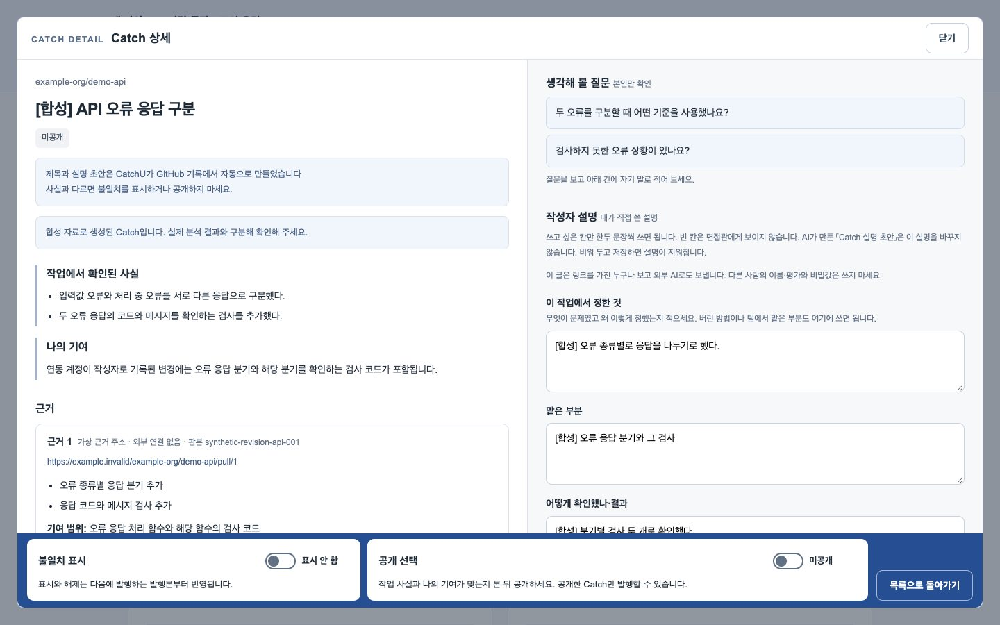
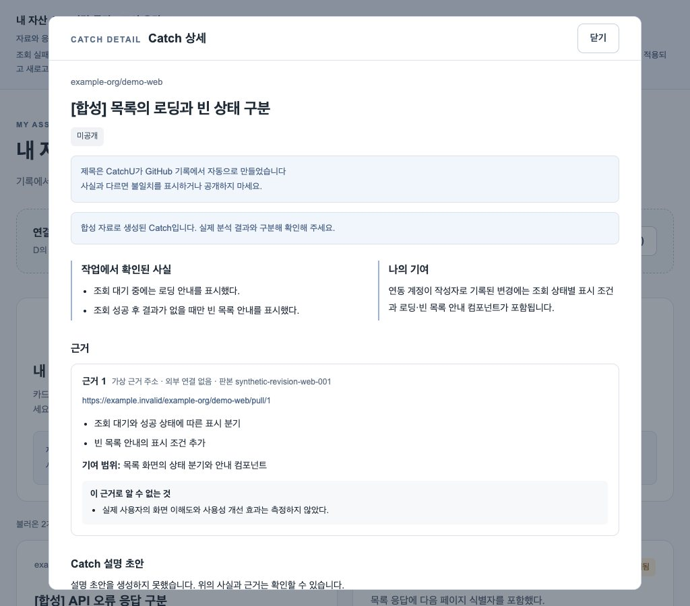
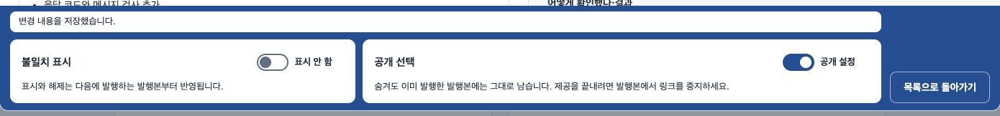

# Catch 상세·불일치·공개 화면 안내

목록에서 Catch를 열어 기록과 설명을 읽고, 작성자 설명을 쓰고, 불일치 표시와 공개 여부를 고르는 화면이다.

> 사진은 **합성 자료 미리보기**다. 실제 분석 결과가 아니며 저장도 개발 화면의 메모리에만 적용된다. 실제 연결 검증 범위는 [#169](https://github.com/JminAILab/CatchU/issues/169)에서 확인한다.

## 1. 넓은 화면: 읽는 칸과 쓰는 칸

화면 가로 1200px 이상이면서 세로 600px 이상이면 창이 화면 거의 전체로 커지고 두 칸으로 나뉜다([#635](https://github.com/JminAILab/CatchU/issues/635)). 근거를 보면서 작성자 설명을 쓸 수 있게 하려는 것이다.

| 자리 | 내용 |
|---|---|
| 머리말 | 「CATCH DETAIL · Catch 상세」와 [닫기]. 재인증 안내가 있으면 둘째 줄에 보인다. |
| 왼쪽 기록 칸 | 저장소 이름·제목·상태 표지·안내 → 작업에서 확인된 사실·나의 기여 → 근거 → 다시 볼 곳 → Catch 설명 초안 |
| 오른쪽 쓰기 칸 | 생각해 볼 질문 → 작성자 설명 → [설명 저장] |
| 바닥 결정 줄 | 불일치 표시 · 공개 선택 · [목록으로 돌아가기] |

- 두 칸은 따로 스크롤한다. 한 칸을 끝까지 내려도 다른 칸과 뒤의 목록은 움직이지 않고, 머리말과 결정 줄은 늘 보인다.
- 창 너비는 `min(1440px, 화면 − 48px)`이고 높이는 화면 − 48px이다(세로 760px 미만이면 − 24px). 좌우 너비는 1.12 : 1이고 오른쪽은 최소 400px이다. 받은 사람 화면([#615](https://github.com/JminAILab/CatchU/issues/615))과 같은 값이다.
- 마크업 순서는 기록 칸 → 쓰기 칸 → 결정 줄이라 Tab과 낭독 순서가 보이는 순서와 같다. 기록 칸은 누를 것이 없어도 키보드로 내릴 수 있게 초점을 받는다.
- 두 칸의 이름(「Catch 기록과 초안」·「질문과 작성자 설명」)은 화면 낭독기에만 읽힌다.

## 2. 좁거나 낮은 화면: 한 줄

그보다 좁거나 낮으면 같은 내용이 한 줄로 흐르고 창 전체가 스크롤한다. 순서는 기록 칸 → 쓰기 칸(옅은 바탕) → 결정 줄(남색 띠)이다. 화면을 200%로 키워 기준보다 작아져도 이 배치가 된다. 배치를 넘나들어도 쓰던 글은 남는다.

## 3. 기록 칸과 쓰기 칸에서 보는 것

- **상태 표지:** 「공개 설정」 또는 「미공개」, 「불일치 표시됨」, 「원본 비공개 · 외부 열람 제한」. 확인 표지는 없다.
- **작업 사실과 나의 기여:** 작업에서 확인된 사실과 연동 계정의 기여 범위다. 제목·설명 초안은 자동으로 만들어지므로 근거와 대조한다.
- **근거:** 머리 줄에 「근거 n」과 판본이 있고, 실제 자료는 [원본 근거 열기 ↗]가 새 탭으로 열린다. 사진의 가상 주소는 글자로만 보인다. 뒷받침하는 사실, 기여 범위, 그 근거로 알 수 없는 내용을 본다.
- **다시 볼 곳:** 사실이 있을 때만 근거 아래에 보인다([기능 README](../README.md)).
- **Catch 설명 초안:** 기록을 바탕으로 만들어진 설명이다. 초안 자체는 고치지 않는다. 설명 초안이 만들어지지 않은(NOT_GENERATED) Catch에는 이 칸이 없다(Catch 개편 CR3 BR7.1).
- **생각해 볼 질문:** 질문마다 상자 하나다. 질문 아래에 「질문을 보고 아래 칸에 자기 말로 적어 보세요.」가 있고 질문별 답 칸은 없다.
- **작성자 설명:** 「이 작업에서 정한 것」·「어떻게 확인했고 무엇을 고쳤나」·「짚어 볼 곳」 세 칸 가운데 쓰고 싶은 칸만 쓰고 [설명 저장] 하나로 저장한다. 앞 두 칸 아래에는 무엇을 쓸지 안내 한 줄이 있다. 예전 칸 제목(예: 「맡은 부분」)으로 저장한 글이 있으면 그 칸도 원래 자리에 보인다. 빈 칸은 면접관에게 보이지 않는다. 「짚어 볼 곳」 아래 안내대로 근거의 본인 커밋 화면에서 바뀐 줄 주소를 붙이면 면접관 화면에서 이름으로 보인다. 합계는 칸 제목 포함 4,000자까지다. 편집은 제품 상세와, 합성 설명을 쓰는 `/preview/assets-connected`에서 열린다([기능 README](../README.md) 「Catch 작성자 설명 편집」).

## 4. 결정 줄: 불일치 표시와 공개 선택

둘 다 켜고 끄는 전환 단추이고, 옆의 글(「표시 안 함」/「표시됨」, 「미공개」/「공개 설정」)이 지금 상태다. Space나 Enter로 바꾼다.

| 행동 | 화면에서 일어나는 일 |
|---|---|
| 불일치 표시 켜기·끄기 | 사실과 맞지 않는 Catch에 표시한다. 표시와 해제는 다음에 발행하는 발행본부터 반영된다. 설명과 공개 상태는 바뀌지 않는다. |
| 공개 켜기 | 작업 사실과 나의 기여가 맞는지 본 뒤 켠다. 공개한 Catch만 프리셋에 담아 발행할 수 있다. 원본이 보호된 Catch는 켤 수 없다. |
| 공개 끄기(숨기기) | 이미 발행한 발행본에는 그대로 남는다(발행본은 발행할 때 고정한 사본이다, #565). 보낸 링크의 제공을 끝내려면 발행본에서 링크를 중지한다. 원본이 보호된 Catch는 끄면 보호가 풀릴 때까지 다시 켤 수 없고, 끄기 전에 그 문장이 보인다. |
| 닫기·목록으로 돌아가기 | 목록의 필터와 열었던 버튼의 초점을 유지한다. Escape로도 닫을 수 있다. |

내용 확인을 따로 하는 단계는 없다(2026-11-24 결정, #635). 공개를 켜면 화면이 확인을 함께 저장한다. 공개는 Catch마다 직접 켜야 하므로 만들어진 것만으로 공개되지는 않는다.

## 저장이 늦거나 실패할 때

- 전환 단추를 누르면 바로 옮겨 보이고 「저장 중…」이 뜬다. 저장 중에는 두 단추를 다시 눌러도 보내지 않는다. 창을 닫아도 보낸 요청이 취소되지는 않는다.
- 「변경 내용을 저장하고 있습니다.」·「변경 내용을 저장했습니다.」는 결정 줄 맨 앞의 안내 자리에 보인다. 이 자리는 비어 있을 때도 화면에 있어 화면 낭독기가 글이 바뀔 때 읽는다.
- 로그인이 풀리는 등으로 요청을 보내지 않았으면 「저장되지 않았습니다. 다시 눌러 주세요.」가 보이고 단추는 원래 자리에 있다.
- 저장에 실패하면 단추가 원래 자리로 돌아오고 성공으로 표시하지 않는다. 결정 줄의 [현재 상태 다시 불러오기] 후 다음 조작을 한다.
- 설명·질문을 만들지 못한 경우는 각각 별도 안내한다. Catch 자체를 조회하지 못한 경우와 구분한다.

## 사진 기준과 실행

2026-11-24, #635 작업 판본. [web 실행 안내](../../../../README.md)에 따라 개발 서버를 켠 뒤 `/preview/assets-connected?catchId=synthetic-catch-api-errors`를 1440×900으로(두 칸, 결정 줄), `catchId=synthetic-catch-web-loading`을 1024×900으로(한 줄) 촬영했다. 개발용 합성 응답으로 표시·조작을 확인한 것이며 실제 로그인·API·DB 전체 연결을 입증하지 않는다.

[목록 화면으로](list-screen.md) · [실행·API 연결 세부](../README.md)
