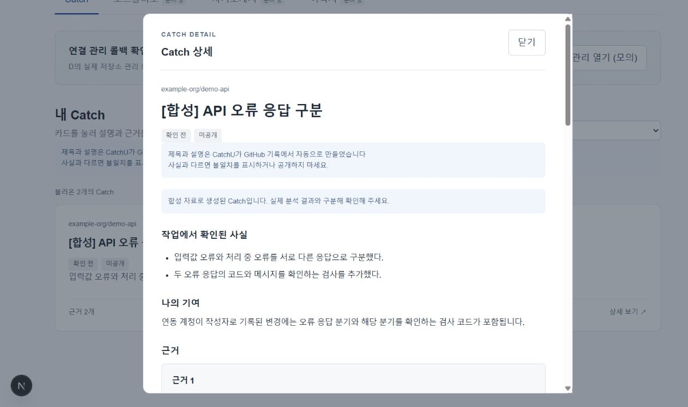
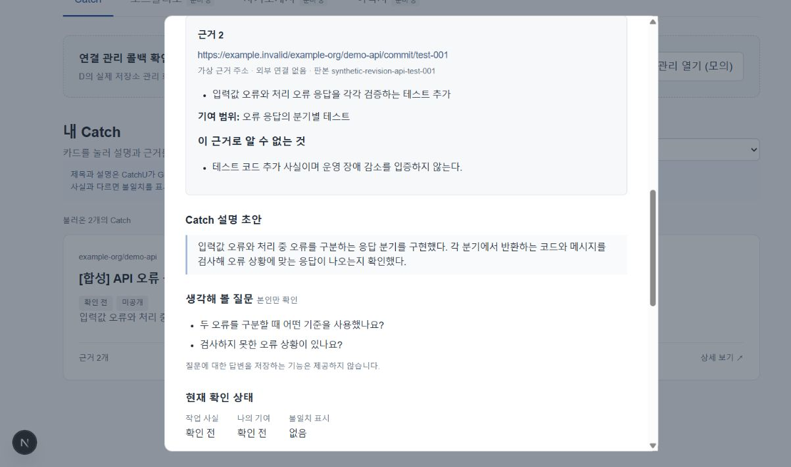
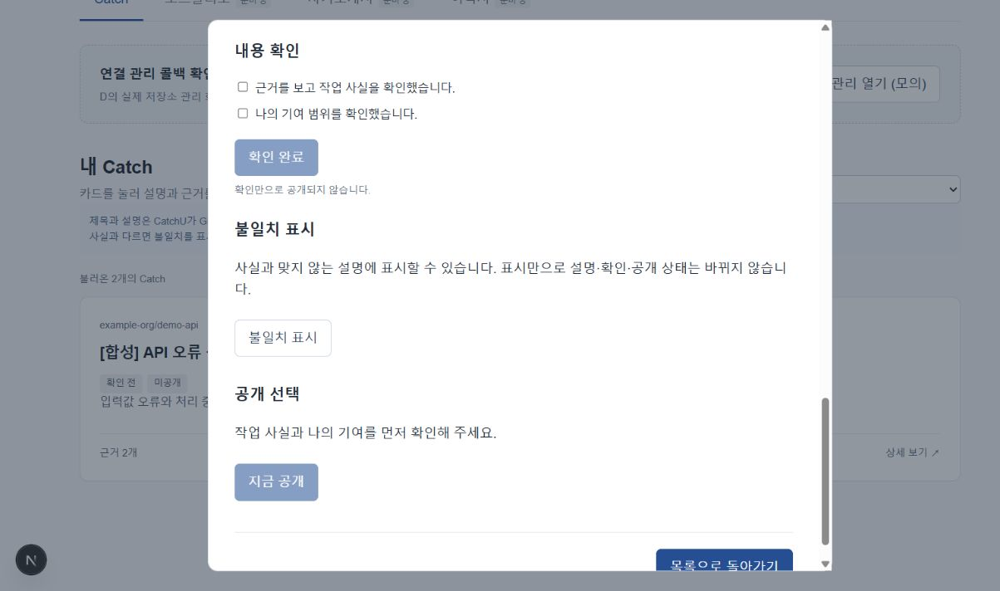

# Catch 상세·확인·공개 화면 안내

목록에서 Catch를 열어 기록과 설명을 읽고, 내용 확인과 공개 여부를 각각 선택하는 화면이다.

> 사진은 같은 Catch를 아래로 스크롤하며 촬영한 **합성 자료 미리보기**다. 실제 분석 결과가 아니며 저장도 개발 화면의 메모리에만 적용된다. 실제 연결 검증 범위는 [#169](https://github.com/JminAILab/CatchU/issues/169)에서 확인한다.

## 1. 작업 사실과 나의 기여 읽기

작업에서 확인된 사실과 연동 계정의 기여 범위를 읽는다. 제목·설명은 자동 생성될 수 있으므로 아래 근거와 대조한다. 팝업을 여는 것만으로 확인 완료나 공개로 바뀌지 않는다.

## 2. 근거·설명·질문 살펴보기

칸 순서는 위에서부터 근거 → Catch 설명 초안 → 생각해 볼 질문 → 작성자 설명 → 현재 확인 상태다(새 Catch BR4.1). 사진은 작성자 설명 칸이 생기기 전 판본이다.

- **근거:** PR·커밋 등 원본과 판본, 뒷받침하는 사실, 기여 범위와 그 근거로 알 수 없는 내용을 본다. 사진의 가상 주소는 외부 링크로 열리지 않는다.
- **Catch 설명 초안:** 기록을 바탕으로 만들어진 설명을 읽는다. 초안 자체는 고치지 않는다. 설명 초안이 만들어지지 않은(NOT_GENERATED) Catch에는 이 칸이 없다(Catch 개편 CR3 BR7.1).
- **생각해 볼 질문:** 본인이 경험을 돌아볼 질문이다. 질문 아래에 「질문을 보고 아래 칸에 자기 말로 적어 보세요.」가 있고 질문별 답 칸은 없다.
- **작성자 설명:** 칸 제목 8개(「이 작업에서 정한 것」~「더 쓰기」) 가운데 쓰고 싶은 칸만 쓰고 [설명 저장] 하나로 저장한다. 빈 칸은 면접관에게 보이지 않는다. 「짚어 볼 곳」 아래 안내를 보고 GitHub 줄 링크를 붙이면, 아래 「발행하면 면접관에게 열릴 링크」에 면접관이 볼 이름으로 미리 보인다. 합계는 칸 제목 포함 4,000자까지다. 실제 편집은 제품 상세에서만 열린다([기능 README](../README.md) 「Catch 작성자 설명 편집」).
- **현재 확인 상태:** 작업 사실·나의 기여의 확인 여부와 불일치 표시를 구분한다.

## 3. 확인·불일치·공개를 각각 선택하기

| 행동 | 화면에서 일어나는 일 |
|---|---|
| 내용 확인 | 작업 사실과 나의 기여를 각각 체크한 뒤 [확인 완료]를 누른다. 체크만으로 저장되지는 않는다. |
| 불일치 표시·해제 | 사실과 맞지 않는 설명에 표시한다. 설명·확인·공개 상태는 자동 변경하지 않는다. |
| 지금 공개 | 두 항목의 확인을 마친 뒤 별도로 누른다. 원본이 보호된 Catch는 공개할 수 없다. |
| 숨기기 | 공개한 Catch를 숨긴다. 저장되면 이후 조회부터 기존 공유 링크에서도 제외된다. |
| 닫기·목록으로 돌아가기 | 목록의 저장소 필터와 기존 버튼 초점을 유지한다. Escape로도 닫을 수 있다. |

**근거 읽기 → 두 항목 체크 → [확인 완료] → 필요할 때 [지금 공개]**

확인 완료만으로 공개되지 않는다. 불일치 표시는 어느 단계에서든 별도로 할 수 있으며, 이미 공개한 내용을 내리려면 [숨기기]를 사용한다. ‘공개 설정’과 원본 보호에 따른 실제 외부 열람 가능 여부도 구분한다.

## 저장이 늦거나 실패할 때

- 저장 중에는 반복 조작을 막는다. 창을 닫아도 보낸 요청이 취소되지는 않는다.
- 저장 오류가 나면 성공으로 표시하지 않고 마지막 확인값을 유지한다. [현재 상태 다시 불러오기] 후 다음 조작을 한다.
- 설명·질문을 만들지 못한 경우는 각각 별도 안내한다. Catch 자체를 조회하지 못한 경우와 구분한다.

## 사진 기준과 실행

2026-10-19, [화면 코드 기준 판본](https://github.com/JminAILab/CatchU/tree/71902bb24f587d037e9dfca815b401854ab6517e/web/src/features/assets). [web 실행 안내](../../../../README.md)에 따라 개발 서버를 켠 뒤 `/preview/assets-connected?catchId=synthetic-catch-api-errors`에서 촬영했다. 개발용 합성 응답으로 표시·조작을 확인한 것이며 실제 로그인·API·DB 전체 연결을 입증하지 않는다.

[목록 화면으로](list-screen.md) · [실행·API 연결 세부](../README.md)
