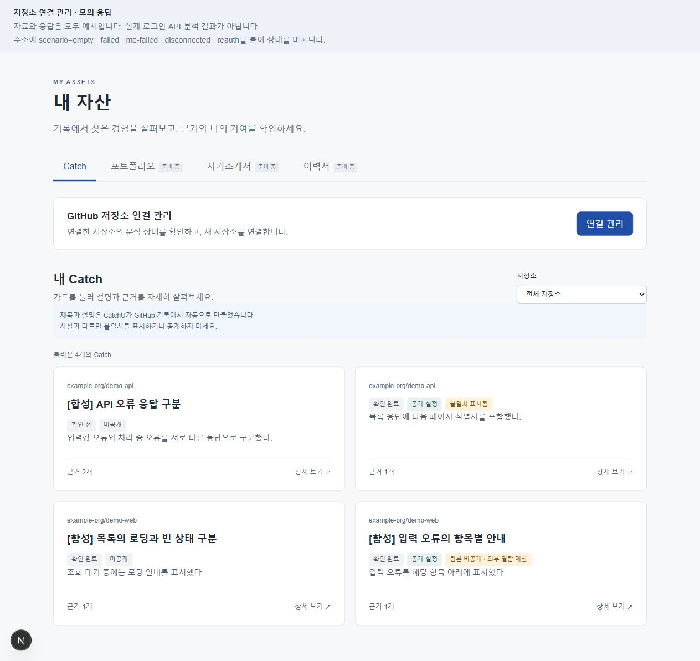

# 내 자산·Catch 목록 화면 안내

분석으로 만들어진 내 Catch를 모아 보고, 저장소별로 찾아 상세를 여는 화면이다. 제품 주소는 `/assets`다.

> 사진은 **합성 자료 미리보기**다. 실제 회원 정보·분석 결과가 아니며 상단의 모의 응답 안내는 개발 도구에만 있다. 구현·연결 검증 범위는 [#168](https://github.com/JminAILab/CatchU/issues/168)에서 확인한다.

## 화면에서 보이는 것

| 위치 | 사용자가 할 수 있는 일 |
|---|---|
| 자산 종류 | Catch를 본다. 포트폴리오·자기소개서·이력서는 준비 중으로 안내한다. |
| GitHub 저장소 연결 관리 | [연결 관리]로 저장소 관리 창을 연다. 분석 상태 확인·요청 흐름은 [저장소 관리 기능](../../repository-management/README.md)에서 다룬다. |
| 저장소 필터 | 전체 또는 특정 저장소의 Catch만 본다. |
| Catch 카드 | 저장소, 작업 사실 요약, 근거 개수와 상태를 본다. 제목을 누르면 상세가 열린다. 제목이 없으면 [상세 보기] 버튼으로 연다. |

카드의 **확인 상태**와 **공개 설정**은 별개다. ‘확인 완료’여도 미공개일 수 있고, ‘공개 설정’이어도 원본 보호로 외부 열람이 제한될 수 있다. 불일치 표시도 따로 보인다.

## 사용하는 순서

1. 저장소 필터를 고른다.
2. Catch 제목 또는 [상세 보기]를 눌러 [상세·확인·공개 화면](detail-screen.md)을 연다.
3. 상세를 닫으면 기존 필터를 유지하고, 열었던 버튼으로 초점이 돌아온다.
4. 추가 자료가 있으면 [더 보기]로 이어서 불러온다. 사진은 네 건을 모두 받은 예시라 이 버튼이 없다.

저장소 관리 창을 닫으면 목록을 갱신한다. 창 안의 [이 저장소 Catch 보기]로 돌아오면 그 저장소 필터를 적용해 다시 불러온다.

## 비어 있거나 오류가 날 때

- **조회 중:** 불러오는 중으로 안내한다.
- **정상 0건:** 현재 목록에 Catch가 없다고 안내한다.
- **조회 실패:** 오류와 다시 불러오기 행동을 제공한다. 실패를 ‘Catch 없음’으로 바꾸지 않는다.
- **추가 목록 조회 실패:** 먼저 받은 목록은 유지한다.

## 사진 기준과 실행

2026-10-19, [화면 코드 기준 판본](https://github.com/JminAILab/CatchU/tree/71902bb24f587d037e9dfca815b401854ab6517e/web/src/features/assets). [web 실행 안내](../../../../README.md)에 따라 개발 서버를 켠 뒤 `/preview/repository-management`에서 촬영했다. 공통 로그인·헤더를 포함한 제품 전체가 아니라 B 목록과 저장소 관리의 조립을 보여주는 개발 화면이다.

API 호출·주소 유지·제품 페이지 연결은 [기능 README](../README.md)를 따른다. 이 안내는 현재 화면 설명이며 새로운 기능·정책을 정하지 않는다.
